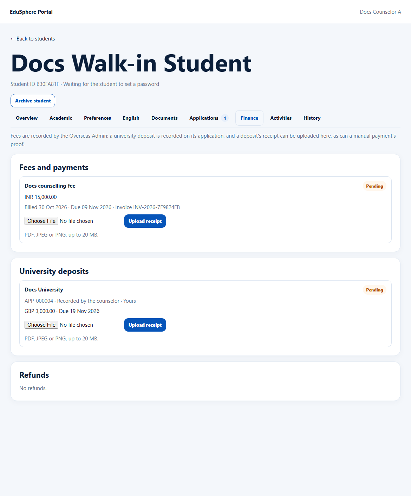

# Finance tab: fees, payments, deposits, refunds
> Doc ID: DOC-CNS-FIN-002 · Verified on 2026-10-30 against `main` @ `045d8c40` · Roles: Counselor, Overseas Admin

## Purpose
See a student's fees and payments, university deposits and refunds in one place.

## Who Can Use This Feature
Counselors (your students) and the Overseas Admin. Only the Overseas Admin records fees.

## Prerequisites
None.

## How to Access
Student 360 → **Finance**.

## Steps
### Step 1 — Fees and payments
Each fee shows its description, amount, status and "Billed {date} · Due {date} · Invoice {number}". Statuses are Pending, Overdue, Paid, Failed, Refunded and Cancelled. If proof was uploaded, it shows "Uploaded proof: {name}" with **Download**.

### Step 2 — University deposits
Each application's deposit shows:
- the university and status;
- "{EduSphere ID} · Recorded by the counselor · Yours" (or "Paid by the agency");
- the amount and due date, and the receipt if uploaded.

### Step 3 — Refunds
Refunded amounts with the date and application, or "No refunds."

## Expected Result
You can answer "has the student paid?" without asking the accounts team.

## Validation Messages
| Message | When |
|---|---|
| No fees or payments recorded for this student. | No fees |
| No university deposit recorded on any application. | No deposits |

## Common Errors
**Problem:** You can't download the invoice or system receipt. **Cause:** Those downloads are for the Overseas Admin only. **Resolution:** Ask the Overseas Admin.

**Problem:** You need to add a fee. **Cause:** Fees are recorded by the Overseas Admin. **Resolution:** Ask them.

## Related Features
- [Upload a deposit receipt or payment proof](fin-003-upload-receipt.md)
- [University deposit record](fin-001-deposit.md)
