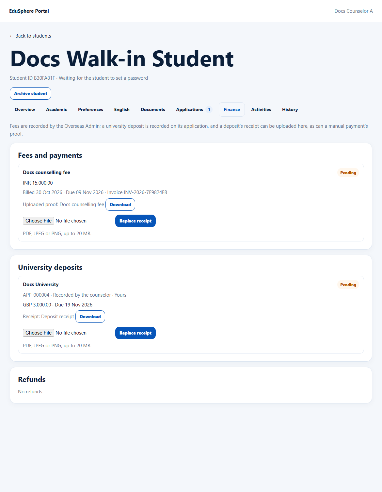

# Upload a deposit receipt or payment proof
> Doc ID: DOC-CNS-FIN-003 · Verified on 2026-10-30 against `main` @ `045d8c40` · Roles: Counselor

## Purpose
Attach proof that a fee or a university deposit was paid, for example a bank transfer slip the student brought in.

## Who Can Use This Feature
Overseas counselors, for students in their caseload (not archived).

## Prerequisites
- **Payment proof:** a manual (not online) fee recorded by the Overseas Admin.
- **Deposit receipt:** a required deposit recorded on your application.

## How to Access
Student 360 → **Finance**.

## Steps
### Step 1 — Choose the file
Under the fee or deposit, choose the file (PDF, JPEG or PNG, up to 20 MB).

### Step 2 — Upload
Select **Upload receipt**. **Receipt uploaded. The student can see it in their Documents.** appears. The fee shows "Uploaded proof: {name}" and the deposit shows "Receipt: Deposit receipt", each with **Download**. The button becomes **Replace receipt**.

## Expected Result
The file is saved as a student document (Payment receipt or Deposit receipt), pending review. Uploading proof never changes the fee's amount or status; the Overseas Admin marks fees paid.

## Validation Messages
| Message | When |
|---|---|
| Receipt uploaded. The student can see it in their Documents. | Success |
| Choose a PDF, JPEG or PNG file first. | No file |
| Record a required deposit on the application first | No deposit |
| An online payment already has its system receipt | Online payment |

## Tips
- Any counselor who has the student in their caseload can upload or replace a payment proof.

## Related Features
- [Finance tab](fin-002-finance-tab.md)
- [University deposit record](fin-001-deposit.md)
