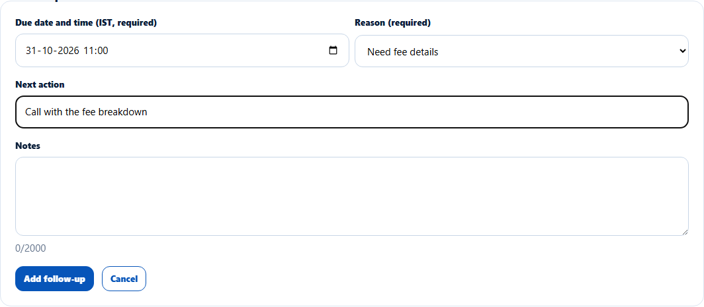
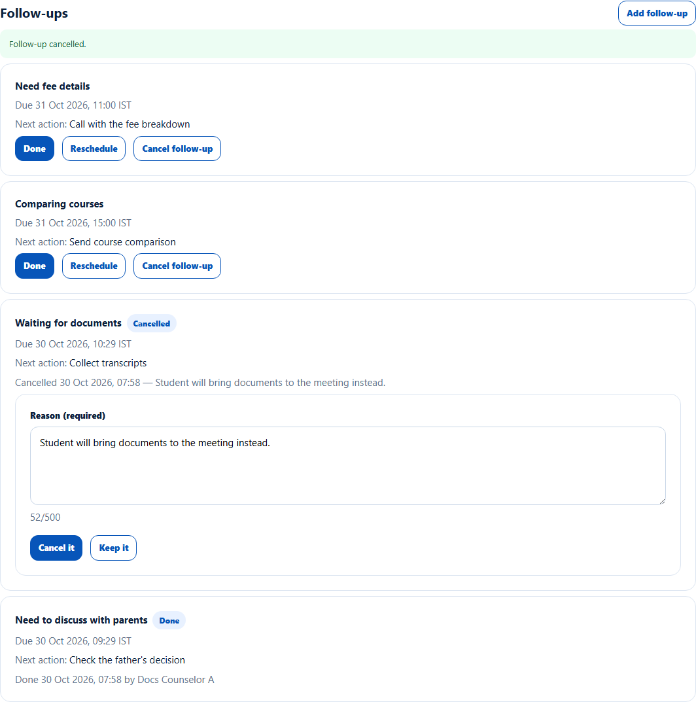

# Follow-ups on a lead
> Doc ID: DOC-CNS-FUP-001 · Verified on 2026-10-30 against `main` @ `045d8c40` · Roles: Counselor

## Purpose
Schedule dated follow-ups on a lead, so nothing is forgotten: when to call back, why, and what to do.

## Who Can Use This Feature
The counselor who owns the lead.

## Prerequisites
The lead is open.

## How to Access
Lead page → **Follow-ups** → **Add follow-up**.

## Steps
### Step 1 — Add a follow-up
Choose the **Due date and time (IST, required)** (in the future, within 12 months) and the **Reason (required)**. Add a **Next action** and **Notes** if useful. Select **Add follow-up**. **Follow-up added.** appears.

### Step 2 — Work the follow-up
Each follow-up shows its reason, due time and next action, with three buttons:
- **Done** marks it complete ("Marked done.") and records who and when.
- **Reschedule** lets you choose a new due time ("Follow-up rescheduled.").
- **Cancel follow-up** asks for a **Reason (required)**; confirm with **Cancel it** ("Follow-up cancelled."), or **Keep it**.

### Step 3 — Overdue follow-ups
When the due time passes, the follow-up shows **Overdue**, and it appears on your **Tasks** page and dashboard. See [Overdue follow-ups](fup-002-overdue-follow-ups.md).

## Fields
| Field | Description | Required | Example |
|---|---|---|---|
| Due date and time (IST) | Future, within 12 months | Yes | 31 Oct 2026, 11:00 |
| Reason | Need to discuss with parents, Need course details, Need fee details, Waiting for salary, Waiting for documents, Comparing courses, Interested next month, Interested next intake, Waiting for university information, Requested counselor call | Yes | Need fee details |
| Next action | Up to 200 characters | No | Call with the fee breakdown |
| Notes | Up to 2000 characters | No | — |

## Expected Result
Open follow-ups stay on the lead until done or cancelled. Closing or returning the lead cancels them.

## Validation Messages
| Message | When |
|---|---|
| Follow-up added. / Marked done. / Follow-up rescheduled. / Follow-up cancelled. | Success |
| Choose a due date and time / Choose a reason | Missing field |
| Choose a due time in the future | Past time |
| Choose a due time within the next 12 months | Too far ahead |
| This lead is closed. A manager can reopen it before a follow-up is added | Closed lead |

## Common Errors
**Problem:** The cancel form stays open after you cancel a follow-up. **Resolution:** It is already cancelled (it shows **Cancelled** and the reason); select **Keep it** to close the form.

## Tips
- A lead can have up to 20 open follow-ups.
- Use [Log a call](../activity/act-001-log-call.md) with **Call Back Requested** to log a call and schedule the follow-up in one step.

## Related Features
- [Overdue follow-ups](fup-002-overdue-follow-ups.md)
- [Next action](../leads/lead-005-next-action.md)
