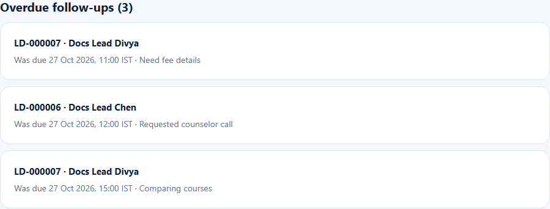
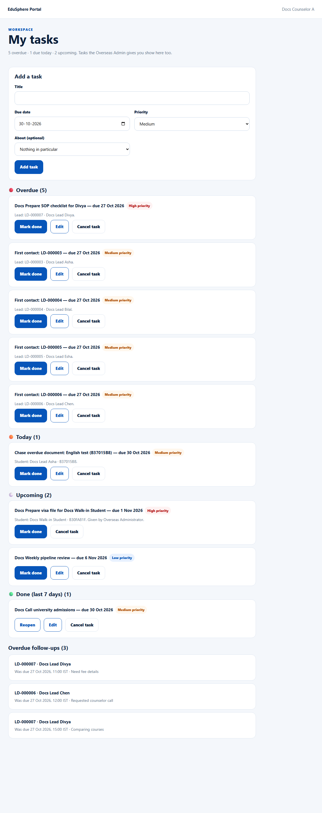

# Overdue follow-ups
> Doc ID: DOC-CNS-FUP-002 · Verified on 2026-10-30 against `main` @ `045d8c40` · Roles: Counselor
> Overdue items in the screenshots were prepared by moving test dates back in the documentation database (owner instruction, 2026-10-30).

## Purpose
See every follow-up on your leads that is past due, in one place.

## Who Can Use This Feature
Overseas counselors.

## Prerequisites
At least one open follow-up past its due time.

## How to Access
Sidebar **Tasks** (page **My tasks**) → **Overdue follow-ups** at the bottom. They also appear in **Follow-ups due** on the [dashboard](../dashboard/dash-001-dashboard.md).

## Steps
### Step 1 — Open the list
Each overdue follow-up shows "{Lead ID} · {name}" and "Was due {date and time} · {reason}".

### Step 2 — Act on it
Select the lead to open it, then mark the follow-up **Done**, **Reschedule** it or cancel it (see [Follow-ups on a lead](fup-001-follow-ups.md)).

## Expected Result
The list empties as you deal with each follow-up.

## Validation Messages
| Message | When |
|---|---|
| No follow-ups on your leads are overdue. | Nothing overdue |
| Your follow-ups can't be loaded right now. Try again in a moment. | Loading failed (your tasks still show) |

## Tips
- Work more than 2 days overdue (default) is reported to the Overseas Admin (see [Overdue escalation](../../admin-manual/escalation/esc-002-overdue-escalation.md)).

## Related Features
- [Follow-ups on a lead](fup-001-follow-ups.md)
- [My tasks](../tasks/task-001-my-tasks.md)
