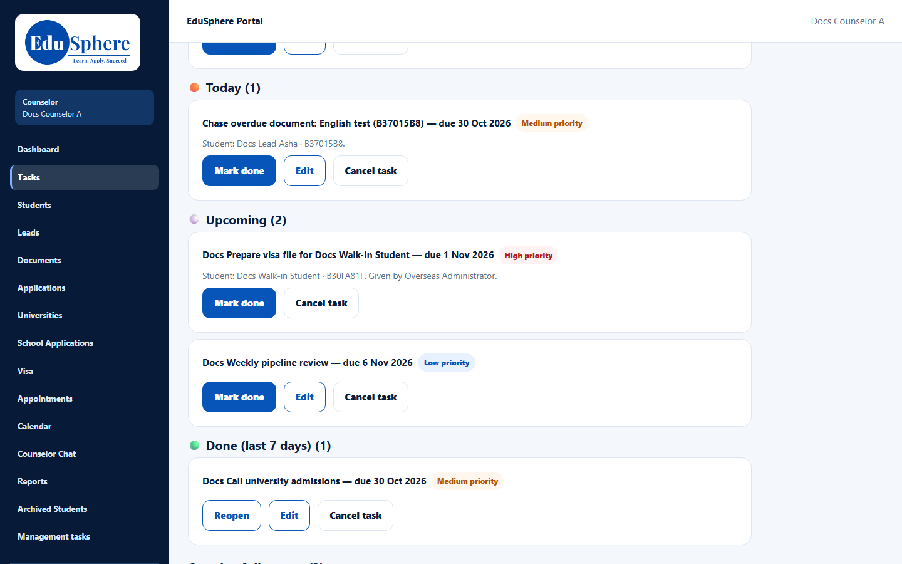

# Automatic reminders
> Doc ID: DOC-CNS-FUP-003 · Verified on 2026-10-30 against `main` @ `045d8c40` · Roles: Counselor

## Purpose
Know which reminders EduSphere creates for you automatically and where they show.

## Who Can Use This Feature
Overseas counselors. The Overseas Admin sets the rules ([Reminder rules](../../admin-manual/config/cfg-002-reminder-rules.md)).

## Prerequisites
None. The rules run every day at 08:15 IST.

## How to Access
Sidebar **Tasks**, and the **Tasks due** section of the dashboard.

## Steps
### Step 1 — Reminder tasks on My tasks
These rules create a **task** for you:
- **New lead assigned:** for example "First contact: LD-000003".
- **No response after contact.**
- **Document request overdue:** for example "Chase overdue document: English test (B37015B8)".
- **University decision overdue.**
- **On-hold review date.**

Reminder tasks show on [My tasks](../tasks/task-001-my-tasks.md) and on the dashboard like any other task, linked to their lead or student.

### Step 2 — Notice-only reminders
These rules only create an in-app **notice**:
- Application deadline approaching.
- Offer deadline approaching.
- Deposit due.
- Offer condition due.
- Visa appointment approaching.

The counselor portal has **no notifications page**, so these notices aren't visible to you. Check deadlines on the dashboard sections **Offer deadlines and conditions** and **Visa appointments and decisions**.

## Expected Result
Each reminder is created once, even if the rules run again.

## Common Errors
**Problem:** "First contact" tasks remain for a lead you closed or returned. **Resolution:** Mark them done.

## Related Features
- [My tasks](../tasks/task-001-my-tasks.md)
- [Counselor dashboard](../dashboard/dash-001-dashboard.md)
- [Reminder rules (admin)](../../admin-manual/config/cfg-002-reminder-rules.md)
