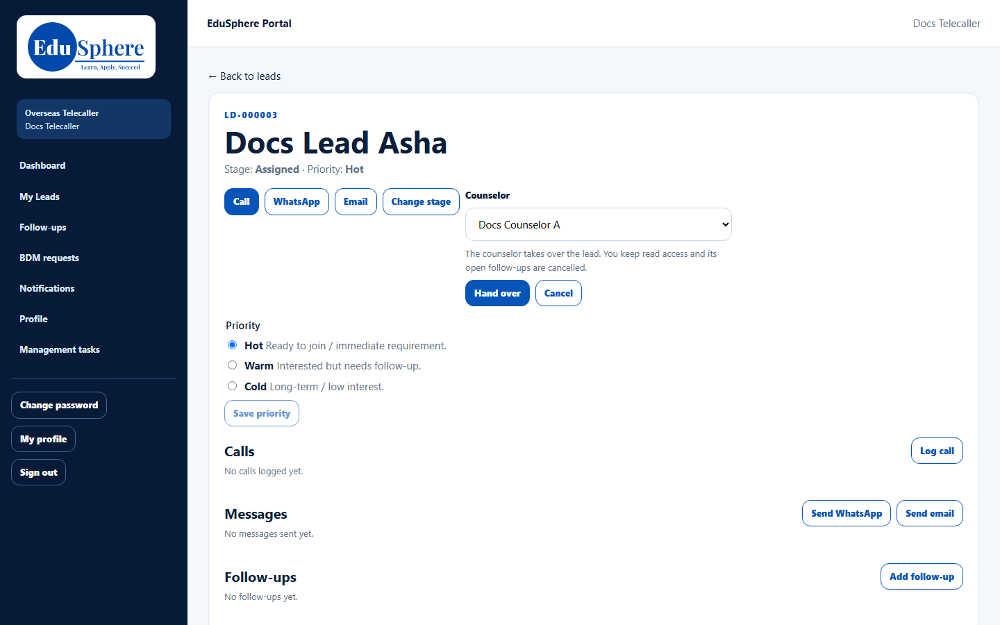
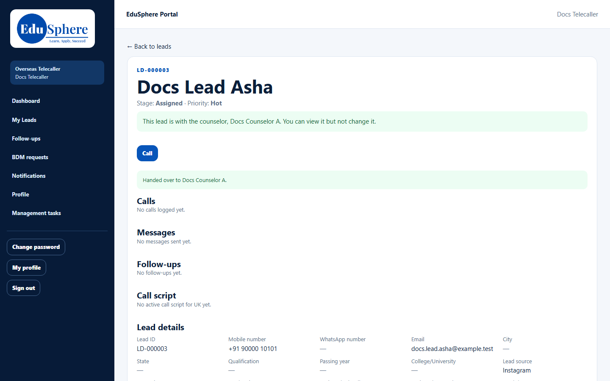
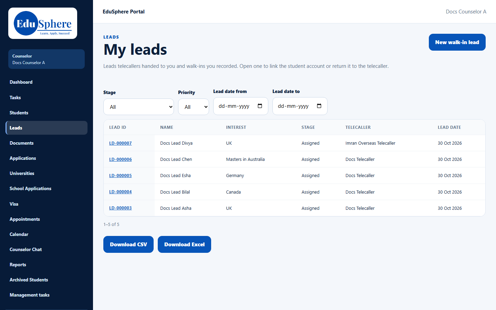

# A telecaller hands a lead to you
> Doc ID: DOC-CNS-HO-001 · Verified on 2026-10-30 against `main` @ `045d8c40` · Roles: Telecaller, Counselor

## Purpose
Understand how a lead reaches you from the telecalling team and what changes when it does.

## Who Can Use This Feature
- **Telecaller**: hands over their own lead (their manager and the Super Admin can too).
- **Counselor**: receives the lead in **Leads**.

### What each role sees
| | Telecaller | Counselor |
|---|---|---|
| Before handover | Full lead page with **Assign to counselor** | Nothing |
| After handover | "This lead is with the counselor, {name}. You can view it but not change it." | The lead in **My leads**, ready to work |

## Prerequisites
- The lead is open (not closed) and has not already moved past the counselor handover.
- You are an active Overseas counselor.

## How to Access
- Telecaller: **My Leads** → open the lead → **Assign to counselor**.
- Counselor: sidebar **Leads** (page **My leads**).

## Steps
### Step 1 — The telecaller chooses you
On the lead, the telecaller selects **Assign to counselor**, picks you in **Counselor** and selects **Hand over**. The form explains: "The counselor takes over the lead. You keep read access and its open follow-ups are cancelled."

### Step 2 — The handover is confirmed
The telecaller sees **Handed over to {counselor}.** and their lead page becomes read-only.

### Step 3 — The lead appears in My leads
Open **Leads**. The lead is listed with its telecaller's name and keeps its stage (for example **Assigned**). Open it to start work. See [Lead detail page](../leads/lead-003-lead-detail.md).

## Expected Result
You own the lead. The telecaller can still view it, and any follow-ups they had open on it are cancelled.

## Validation Messages
| Message | Who sees it | When |
|---|---|---|
| Handed over to {name}. | Telecaller | Success |
| This lead is closed; reopen it before handing it over | Telecaller | The lead is closed |
| This lead is already past the counselor handover | Telecaller | The lead has moved on |
| This lead is already with this counselor | Telecaller | Chosen counselor already owns it |
| No other active counselor in this division. | Telecaller | No counselor to choose |

## Common Errors
**Problem:** You can't find a notice about a new lead in EduSphere. **Cause:** The handover itself sends nothing; the **New lead assigned** reminder rule (on by default) creates a "First contact" task and emails you a notice. The counselor portal has no notifications page. **Resolution:** Check **Leads**, **Tasks** and your email each morning.

## Tips
- Leads keep their telecaller. If the lead isn't ready for counselling, you can [return it](../leads/lead-008-return-to-telecaller.md).

## Related Features
- [A website enquiry becomes your lead](ho-002-website-enquiry.md)
- [My leads list](../leads/lead-001-my-leads.md)
- [Return a lead to the telecaller](../leads/lead-008-return-to-telecaller.md)
