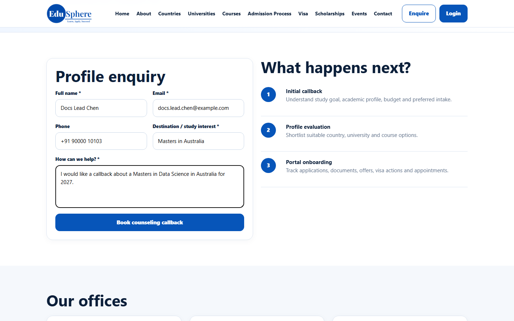
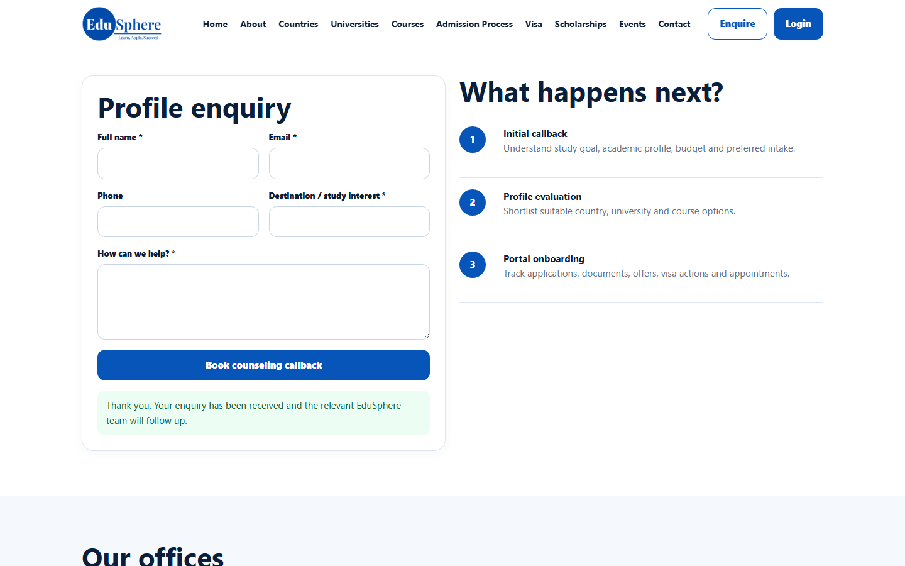
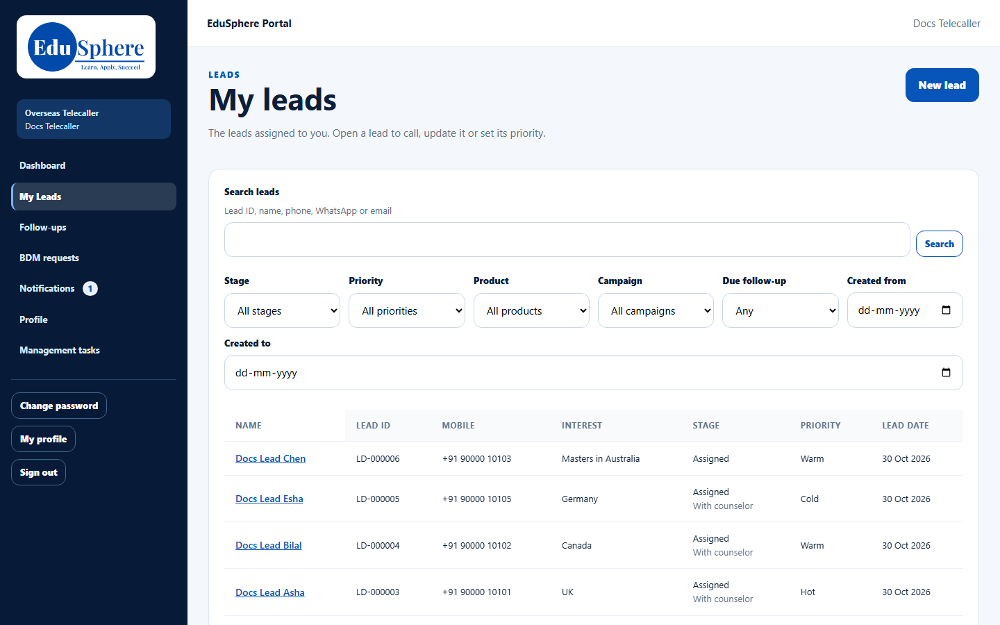

# A website enquiry becomes your lead
> Doc ID: DOC-CNS-HO-002 · Verified on 2026-10-30 against `main` @ `045d8c40` · Roles: Website visitor, Telecaller, Counselor

## Purpose
Know the path a website enquiry takes before it reaches you.

## Who Can Use This Feature
Counselors (for awareness). Visitors submit the form; telecallers take the first call.

## Prerequisites
None.

## How to Access
The public **Contact** page of the Overseas Education site.

## Steps
### Step 1 — A visitor submits the enquiry form
The visitor fills **Full name**, **Email**, **Phone**, **Destination / study interest** and **How can we help?**, then selects **Book counseling callback**. They see **Thank you. Your enquiry has been received and the relevant EduSphere team will follow up.**

### Step 2 — The lead goes to an Overseas telecaller
EduSphere creates a lead with source **Website** and assigns it to an active Overseas telecaller automatically. If nobody can take it, it waits in the telecaller managers' unassigned queue. The enquiry subject becomes the lead's **Interest**.

### Step 3 — The telecaller hands it to you
After the first call, the telecaller hands the lead over. From then on it is in your **My leads**. See [A telecaller hands a lead to you](ho-001-telecaller-handover.md).

## Expected Result
Website leads reach you already called and qualified by the telecaller, never directly.

## Validation Messages
| Message | When |
|---|---|
| Thank you. Your enquiry has been received and the relevant EduSphere team will follow up. | The enquiry was accepted |
| We could not submit your enquiry. Please review the fields and try again. | A field is missing or invalid (for example, an unusual email address) |

## Common Errors
**Problem:** A student says they filled the website form but you can't see them. **Cause:** The lead is still with a telecaller. **Resolution:** Ask the telecalling team to hand it over.

## Tips
- If the same person is already a lead, the enquiry is added to that lead instead of creating a new one.

## Related Features
- [A telecaller hands a lead to you](ho-001-telecaller-handover.md)
- [Record a new walk-in lead](../leads/lead-002-new-walk-in-lead.md)
