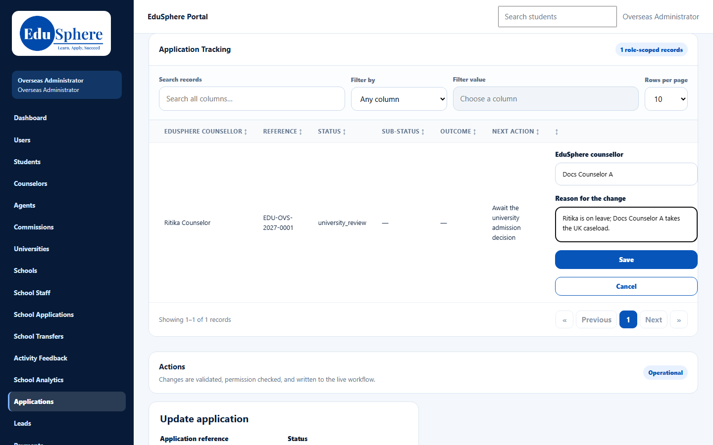
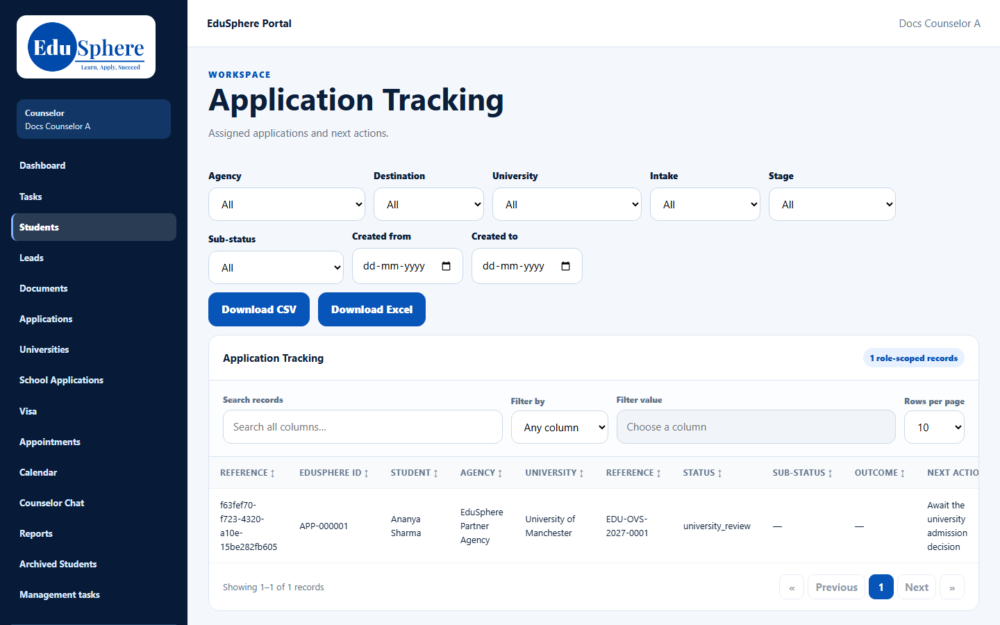
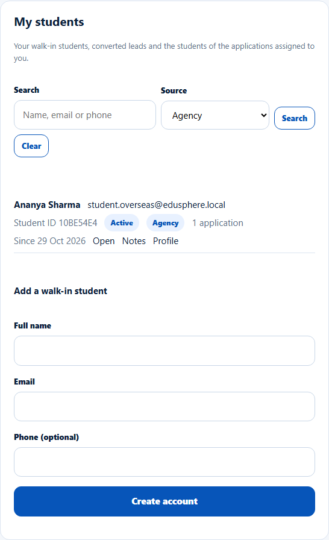

# Agency students and applications
> Doc ID: DOC-CNS-HO-003 · Verified on 2026-10-30 against `main` @ `045d8c40` · Roles: Agent, Overseas Admin, Counselor

## Purpose
Understand how applications submitted by education agents reach you.

## Who Can Use This Feature
Counselors (awareness). Agents create the applications; the Overseas Admin assigns them.

## Prerequisites
None.

## How to Access
Sidebar **Students** (Application Tracking and My students).

## Steps
### Step 1 — The agent applies
An agent's application arrives with no EduSphere counselor.

### Step 2 — The Overseas Admin assigns a counselor
The Overseas Admin selects **Assign counsellor** (or **Change counsellor**) on the application. See [Assign or change an application's counselor](../../admin-manual/accounts/adm-004-application-counselor.md).

### Step 3 — It appears in your lists
The application shows in **Application Tracking** with the agency's name in **Agency**. Its student appears in **My students** with source **Agency**.

## Expected Result
You record offers, visa and enrolment on agency applications too. The agent sees who their counselor is, but not the reason for a change.

## Common Errors
**Problem:** A new agency application has no counselor for days. **Cause:** Nobody is alerted when an agency application arrives unassigned. **Resolution:** Overseas Admins should filter **Counsellor** = **Not assigned** regularly.

## Related Features
- [Self-registered students](ho-004-self-registered.md)
- [Agency vs direct applications](../applications/app-010-agency-vs-direct.md)
