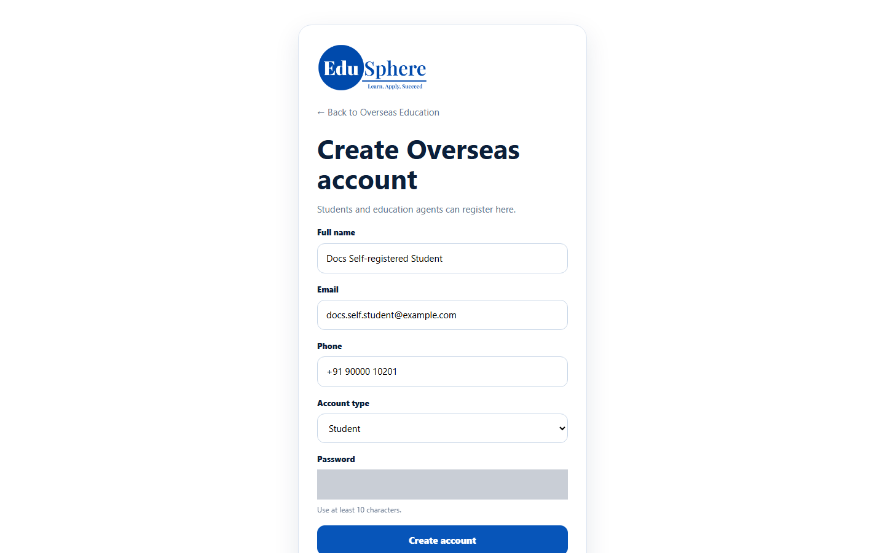
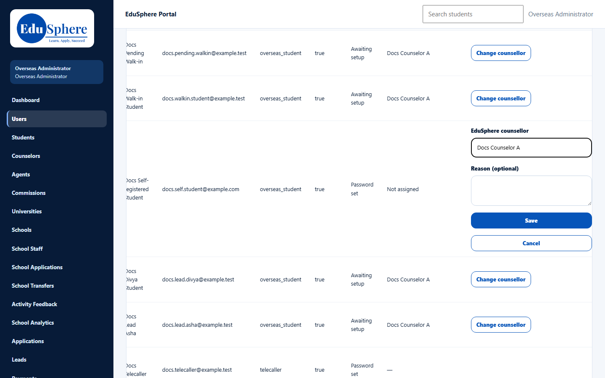
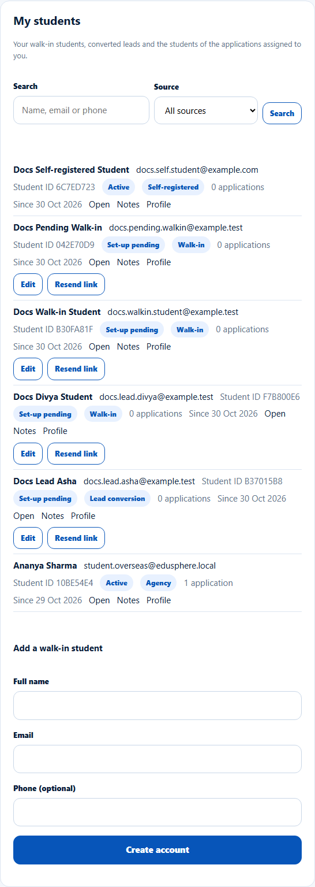

# Self-registered students
> Doc ID: DOC-CNS-HO-004 · Verified on 2026-10-30 against `main` @ `045d8c40` · Roles: Student, Overseas Admin, Counselor

## Purpose
Understand how a student who registers on the website reaches you.

## Who Can Use This Feature
Counselors (awareness). Students register themselves; the Overseas Admin assigns them.

## Prerequisites
None.

## How to Access
Website: **Create Overseas account** (`/overseas/register`). Counselor: **My students**.

## Steps
### Step 1 — The student registers
On **Create Overseas account**, the student enters **Full name**, **Email**, **Phone** and **Password**, keeps **Account type** as student, and selects **Create account**. They land on their dashboard, where they are asked for consent first.

### Step 2 — The Overseas Admin assigns a counselor
The student has no counselor until the Overseas Admin selects **Assign counsellor** for them on **Users**. See [Assign or change a student's counselor](../../admin-manual/accounts/adm-003-student-counselor.md).

### Step 3 — The student appears in My students
They show with source **Self-registered** and status **Active**.

## Expected Result
You work with the student like any other; they already have a password.

## Common Errors
**Problem:** A student says they registered but you can't find them. **Cause:** No counselor has been assigned yet. **Resolution:** Ask the Overseas Admin.

## Related Features
- [Agency students and applications](ho-003-agency-students.md)
- [Add a walk-in student](../students/stu-003-walk-in-student.md)
