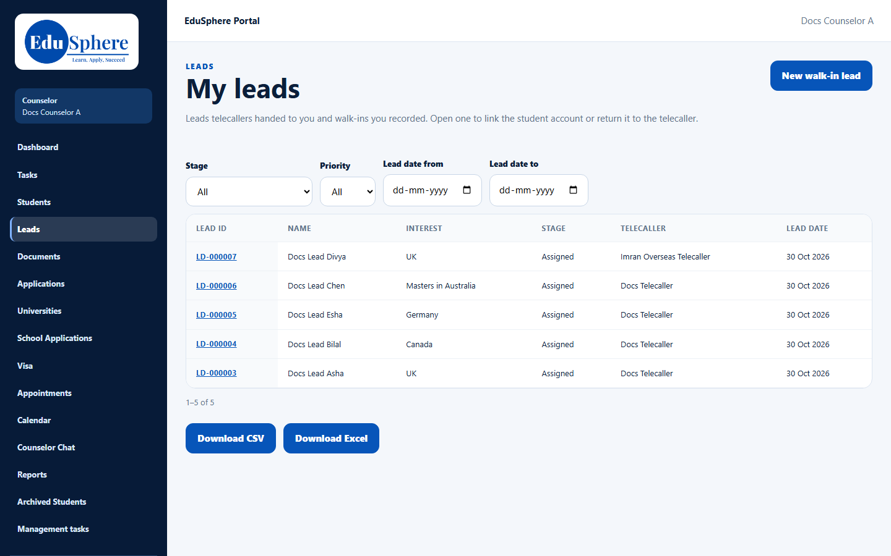
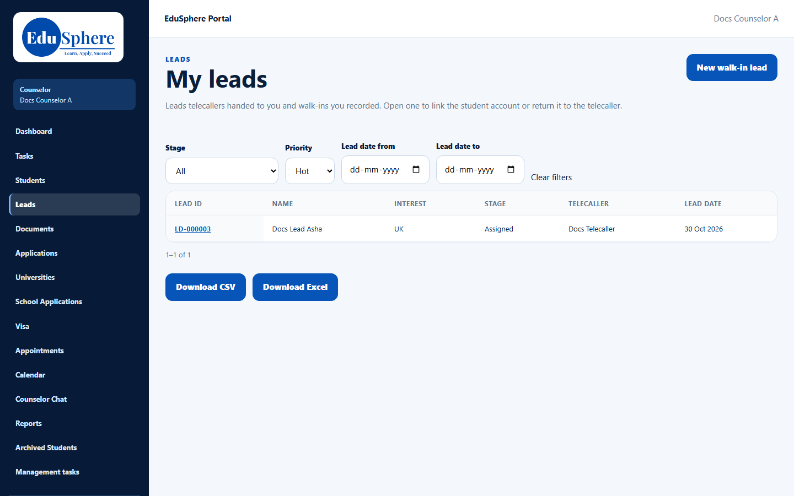
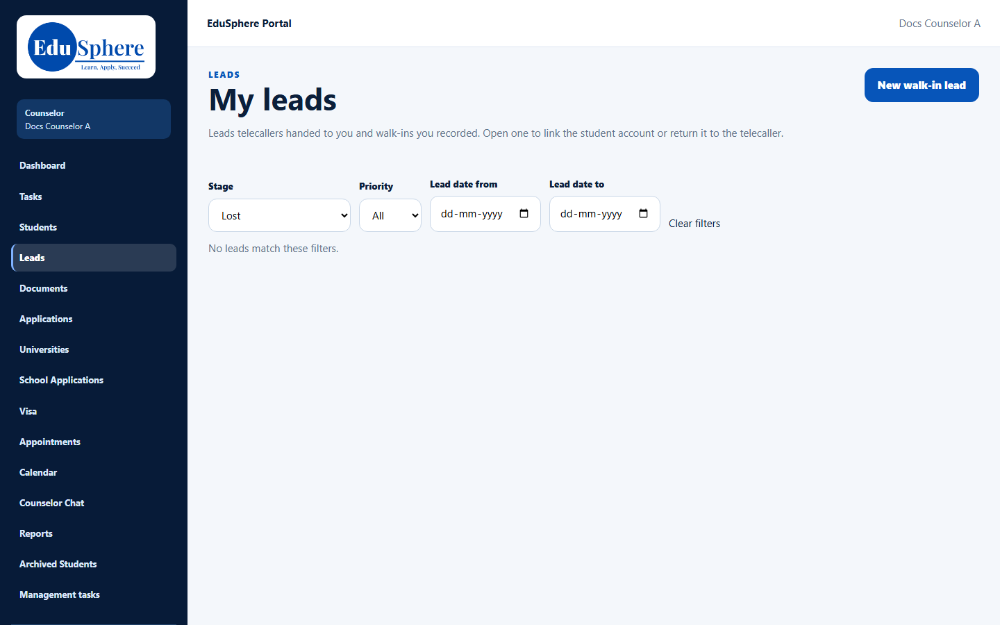
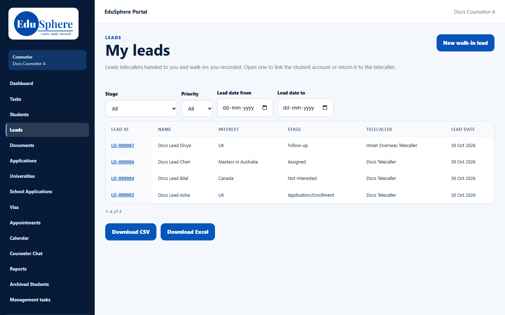

# My leads list
> Doc ID: DOC-CNS-LEAD-001 · Verified on 2026-10-30 against `main` @ `045d8c40` · Roles: Counselor

## Purpose
See every lead you own: leads telecallers handed to you and walk-ins you recorded.

## Who Can Use This Feature
Overseas counselors. You see only your own leads.

## Prerequisites
At least one lead handed to you or recorded by you.

## How to Access
Sidebar **Leads**. The page title is **My leads**.

## Steps
### Step 1 — Open My leads
The table lists **Lead ID**, **Name**, **Interest**, **Stage**, **Telecaller** and **Lead date**, newest first, 20 per page. Select a **Lead ID** to open the lead.

### Step 2 — Filter
Use **Stage**, **Priority**, **Lead date from** and **Lead date to**. The list updates as soon as you change a filter, and the filters stay in the page address so you can bookmark them. Select **Clear filters** to reset.

### Step 3 — Download
Select **Download CSV** or **Download Excel** to export every lead matching the filters. The file has Lead ID, Name, Interest, Stage, Priority, Source, Telecaller and Lead date. It never contains phone numbers or emails.

## Fields
| Column / filter | Description |
|---|---|
| Lead ID | Opens the lead |
| Interest | The enquiry subject (for example the destination or "Masters in Australia") |
| Stage | Where the lead is in the pipeline |
| Telecaller | The telecaller who works the lead with you, or **Unassigned** |
| Priority (filter) | Hot, Warm or Cold; there is no Priority column, but the export includes it |

## Expected Result
You can find any of your leads quickly. As you work, stages change in the list.

## Validation Messages
| Message | When |
|---|---|
| No leads have been handed to you yet. | You own no leads |
| No leads match these filters. | The filters exclude every lead |
| Unable to load your leads. (with **Try again**) | The list could not load |

## Common Errors
**Problem:** A returned lead disappeared. **Cause:** Returning a lead gives it back to the telecaller. **Resolution:** This is expected; see [Return a lead](lead-008-return-to-telecaller.md).

## Tips
- Filter **Stage** = **Follow-up** to plan your calls.

## Related Features
- [Record a new walk-in lead](lead-002-new-walk-in-lead.md)
- [Lead detail page](lead-003-lead-detail.md)
