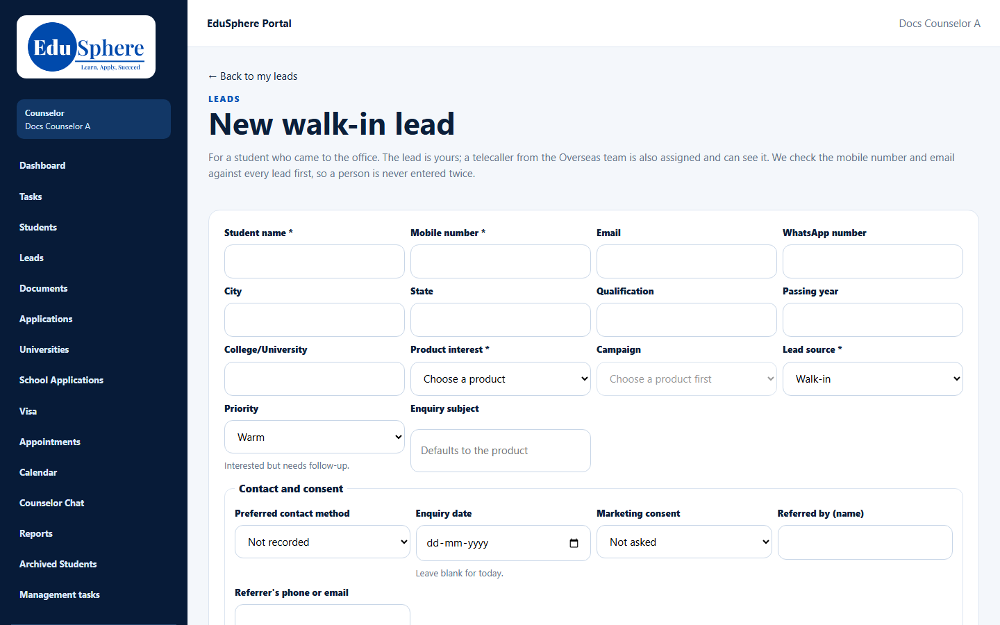
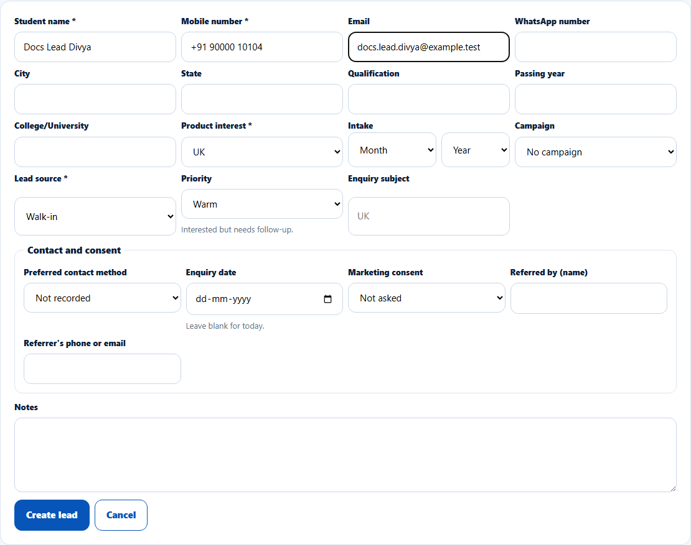
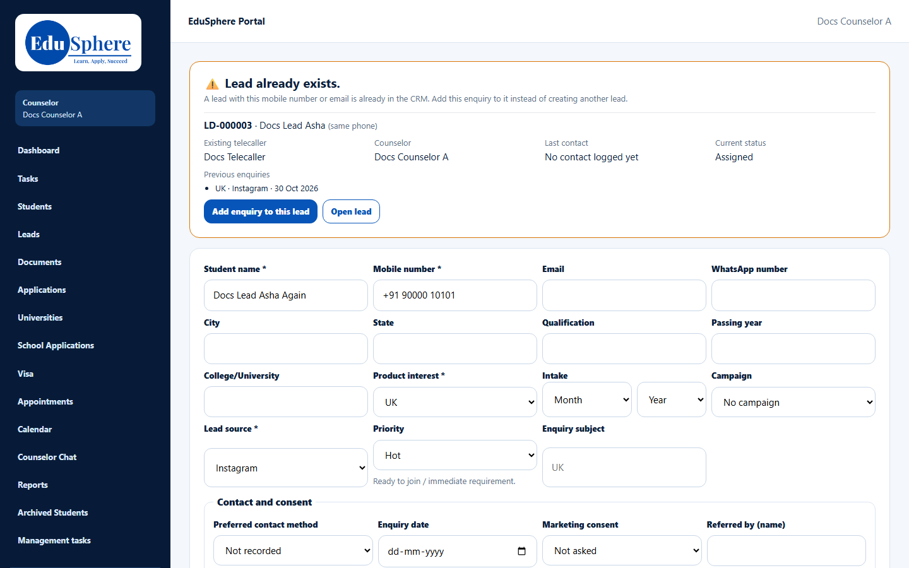

# Record a new walk-in lead
> Doc ID: DOC-CNS-LEAD-002 · Verified on 2026-10-30 against `main` @ `045d8c40` · Roles: Counselor

## Purpose
Enter a student who came to the office as a lead you own, without creating a duplicate of someone already in the CRM.

## Who Can Use This Feature
Overseas counselors.

## Prerequisites
You know at least the student's name, mobile number and what they are interested in.

## How to Access
**Leads** → **New walk-in lead**.

## Steps
### Step 1 — Open the form
The page explains: "For a student who came to the office. The lead is yours; a telecaller from the Overseas team is also assigned and can see it. We check the mobile number and email against every lead first, so a person is never entered twice." **Lead source** is already set to **Walk-in**.

### Step 2 — Fill in the details
Enter **Student name** and **Mobile number**, choose the **Product interest** (the destination) and keep or change **Lead source**. Add anything else you know: email, WhatsApp number, city, qualification, intake, priority, contact and consent details, and notes.

### Step 3 — Create the lead
Select **Create lead**. The new lead opens. It is yours, at stage **Assigned**, and a telecaller from the Overseas team is assigned to it automatically.

### If the person already exists
When the mobile number or email matches an existing lead, the form shows **Lead already exists** with that lead's ID, telecaller, counselor, last contact, current status and previous enquiries. Select **Add enquiry to this lead** to record the visit on the existing lead, or **Open lead** if it is yours.

## Fields
| Field | Description | Required | Example |
|---|---|---|---|
| Student name | Full name | Yes | Docs Lead Divya |
| Mobile number | Used for the duplicate check | Yes | +91 90000 10104 |
| Email | Also used for the duplicate check | No | docs.lead.divya@example.test |
| Product interest | Destination or product | Yes | UK |
| Intake | Month and year (overseas products) | No | September 2027 |
| Lead source | Preset to Walk-in | Yes | Walk-in |
| Priority | Hot / Warm / Cold (default Warm) | No | Warm |
| Enquiry subject | Defaults to the product | No | — |
| Contact and consent | Preferred contact method, enquiry date, marketing consent, referrer | No | — |
| Notes | Up to 5000 characters | No | — |

## Expected Result
The lead appears at the top of **My leads** with source Walk-in.

## Validation Messages
| Message | When |
|---|---|
| Enter the student name / mobile number / product interest / lead source. | A required field is empty |
| Lead already exists. | The mobile number or email belongs to another lead |
| Enquiry added to {Lead ID}. | You added the visit to the existing lead |
| This campaign is for another product / belongs to another lead source | The campaign doesn't fit |

## Common Errors
**Problem:** "Lead already exists" for someone new. **Cause:** Another lead uses the same mobile or email (for example a sibling's number). **Resolution:** Check the match; if it is a different person, enter their own number.

## Tips
- Use **Add enquiry to this lead** rather than creating a second lead; it keeps the history together.

## Related Features
- [My leads list](lead-001-my-leads.md)
- [Lead detail page](lead-003-lead-detail.md)
