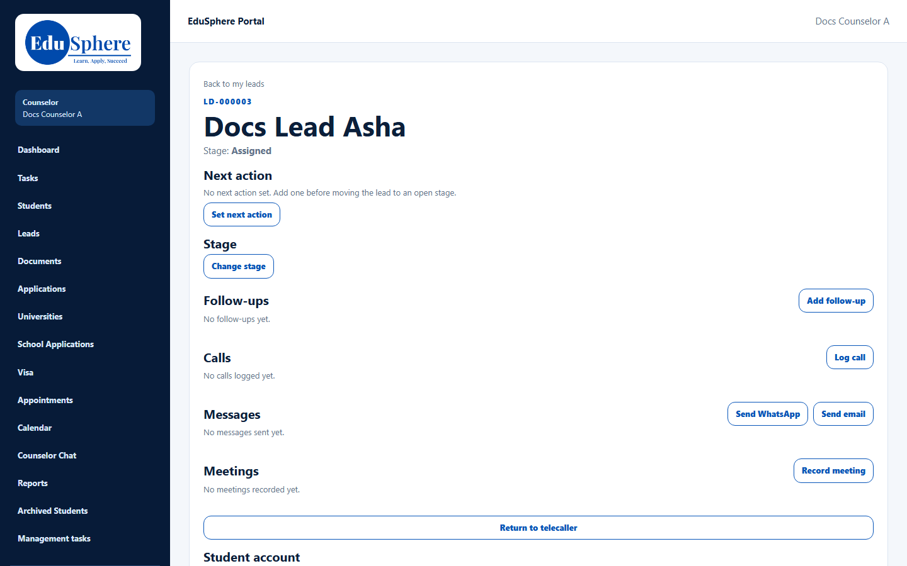
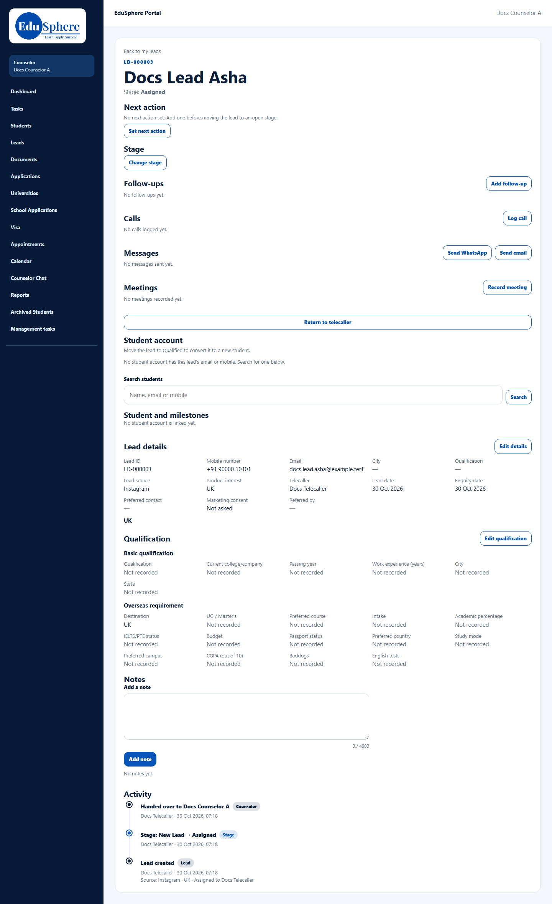

# Lead detail page
> Doc ID: DOC-CNS-LEAD-003 · Verified on 2026-10-30 against `main` @ `045d8c40` · Roles: Counselor

## Purpose
Everything about one lead on one page: what to do next, its stage, your contact history and the link to the student account.

## Who Can Use This Feature
The counselor who owns the lead.

## Prerequisites
The lead is yours.

## How to Access
**Leads** → select the **Lead ID**.

## Steps
### Step 1 — Read the header
The top shows **Back to my leads**, the Lead ID, the name and **Stage**. For a closed lead, a line under the stage shows the lost reason (see [Change stage](lead-006-change-stage.md)).

### Step 2 — Work down the page
The sections, in order:

| Section | What you do there | Guide |
|---|---|---|
| **Next action** | The one next step and its due date | [LEAD-005](lead-005-next-action.md) |
| **Stage** | Move the lead or close it | [LEAD-006](lead-006-change-stage.md) |
| **Follow-ups** | Dated follow-ups | FUP-001 |
| **Calls** | Log calls | ACT-001 |
| **Messages** | WhatsApp and email | ACT-002, ACT-003 |
| **Meetings** | Record meetings | ACT-004 |
| **Return to telecaller** | Give the lead back | [LEAD-008](lead-008-return-to-telecaller.md) |
| **Student account** | Convert or link the student | [CONV-001](../conversion/conv-001-convert-to-student.md), [CONV-002](../conversion/conv-002-link-student.md) |
| **Student and milestones** | Linked student and their progress | [LEAD-009](lead-009-student-and-milestones.md) |
| **Lead details** | Contact and consent details | [LEAD-004](lead-004-lead-details.md) |
| **Qualification** | Academic and study plans | [LEAD-007](lead-007-qualification.md) |
| **Notes** / **Activity** | Notes and the timeline | ACT-005, ACT-006 |

## Expected Result
You can act on the lead without leaving the page. Sections that don't apply disappear. For example, a closed lead has no stage or activity buttons.

## Common Errors
**Problem:** "Lead not found" when you open a link. **Cause:** The lead is not yours (or was returned). **Resolution:** Ask the telecalling team or your Overseas Admin.

## Tips
- There is no lead-appointment section here. Counselling appointments are on the **Appointments** page.

## Related Features
- [My leads list](lead-001-my-leads.md)
- [Next action](lead-005-next-action.md)
