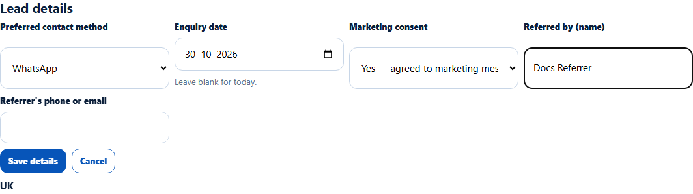
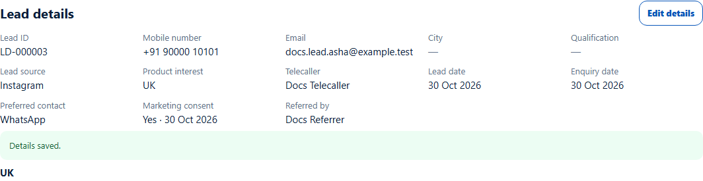

# Lead details: contact, consent and referral
> Doc ID: DOC-CNS-LEAD-004 · Verified on 2026-10-30 against `main` @ `045d8c40` · Roles: Counselor

## Purpose
Record how the student prefers to be contacted, whether they agreed to marketing messages, and who referred them.

## Who Can Use This Feature
The counselor who owns the lead.

## Prerequisites
The lead is yours and has not been returned.

## How to Access
Lead page → **Lead details** → **Edit details**.

## Steps
### Step 1 — Open Edit details
**Lead details** shows the Lead ID, mobile, email, city, qualification, lead source, product interest, telecaller, dates, preferred contact, marketing consent and referrer. Select **Edit details**.

### Step 2 — Change what you need
You can change **Preferred contact method**, **Enquiry date**, **Marketing consent**, **Referred by (name)** and **Referrer's phone or email**. Name, mobile, email and product can't be edited here.

### Step 3 — Save
Select **Save details**. **Details saved.** appears. A marketing consent answer shows the date it was recorded (for example **Yes · 30 Oct 2026**).

## Fields
| Field | Description | Required | Example |
|---|---|---|---|
| Preferred contact method | Not recorded, Phone call, WhatsApp, Email, SMS | No | WhatsApp |
| Enquiry date | Between 1 Jan 2000 and today; blank = today | No | — |
| Marketing consent | Not asked / Yes — agreed to marketing messages / No — no marketing messages | No | Yes |
| Referred by (name) | Who referred the student | No | Docs Referrer |
| Referrer's phone or email | Their contact | No | — |

## Expected Result
The new details show immediately in **Lead details**.

## Validation Messages
| Message | When |
|---|---|
| Details saved. | Success |
| Unable to save the details. | The save failed |

## Common Errors
**Problem:** You need to fix the student's phone or name. **Resolution:** Ask the lead's telecaller or your Overseas Admin; counselors can't edit them here.

## Tips
- Record **Marketing consent** at the first conversation; it decides which messages the student can receive.

## Related Features
- [Lead detail page](lead-003-lead-detail.md)
- [Lead qualification](lead-007-qualification.md)
