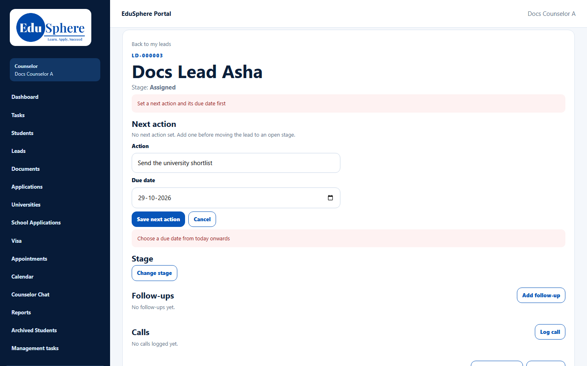
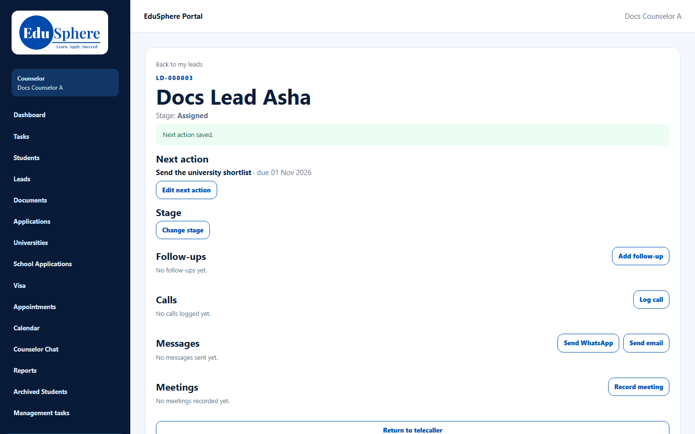

# Next action
> Doc ID: DOC-CNS-LEAD-005 · Verified on 2026-10-30 against `main` @ `045d8c40` · Roles: Counselor

## Purpose
Keep one clear next step, with a due date, on every open lead. EduSphere asks for it before you can move a lead to an open stage.

## Who Can Use This Feature
The counselor who owns the lead.

## Prerequisites
The lead is open (not closed).

## How to Access
Lead page → **Next action** → **Set next action** (or **Edit next action**).

## Steps
### Step 1 — Open the form
With no next action, the section says "No next action set. Add one before moving the lead to an open stage." Select **Set next action**.

### Step 2 — Enter the action and due date
Type the **Action** (for example "Send the university shortlist") and choose a **Due date** from today onwards. A past date is refused with **Choose a due date from today onwards**.

In this screenshot, the message at the top (**Set a next action and its due date first**) is left over from an earlier attempt to change the stage; see [Change stage](lead-006-change-stage.md).

### Step 3 — Save
Select **Save next action**. **Next action saved.** appears and the section shows "{action} · due {date}". When the date passes, a red **Overdue** badge appears.

## Fields
| Field | Description | Required | Example |
|---|---|---|---|
| Action | Up to 200 characters | Yes | Send the university shortlist |
| Due date | Today or later | Yes | 01 Nov 2026 |

## Expected Result
The next action shows at the top of the lead and counts on your dashboard.

## Validation Messages
| Message | When |
|---|---|
| Next action saved. | Success |
| Add the next action and its due date. | A field is empty |
| Choose a due date from today onwards | The date is in the past |
| This lead is closed; it needs no next action | The lead is closed |

## Common Errors
**Problem:** You can't save an overdue next action. **Cause:** A changed date must be today or later. **Resolution:** Pick a new date; you can still edit the text of an overdue action without changing its date.

## Tips
- Returning a lead to the telecaller clears its next action.

## Related Features
- [Change stage, record loss, close a lead](lead-006-change-stage.md)
- [Lead detail page](lead-003-lead-detail.md)
