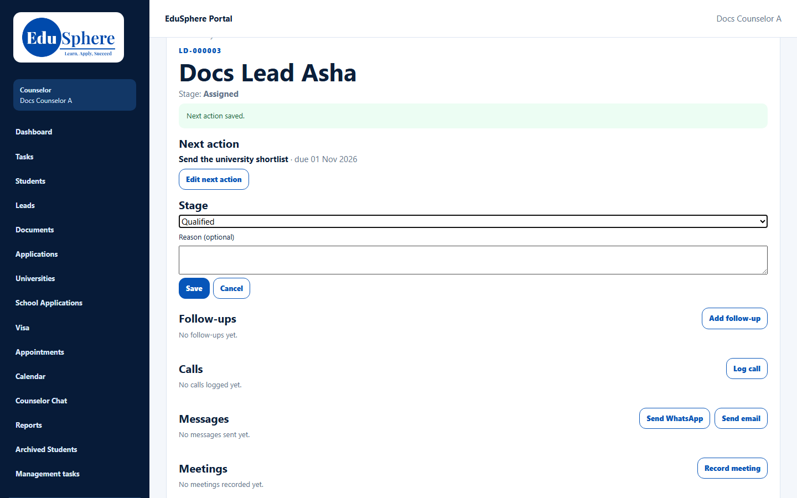
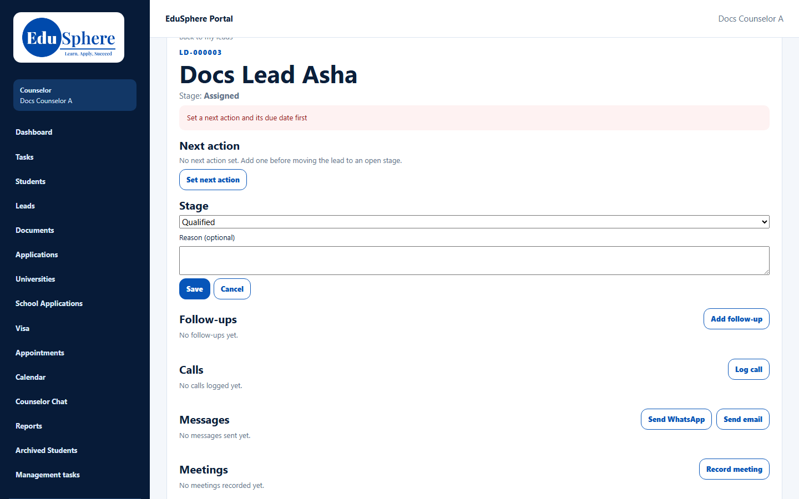
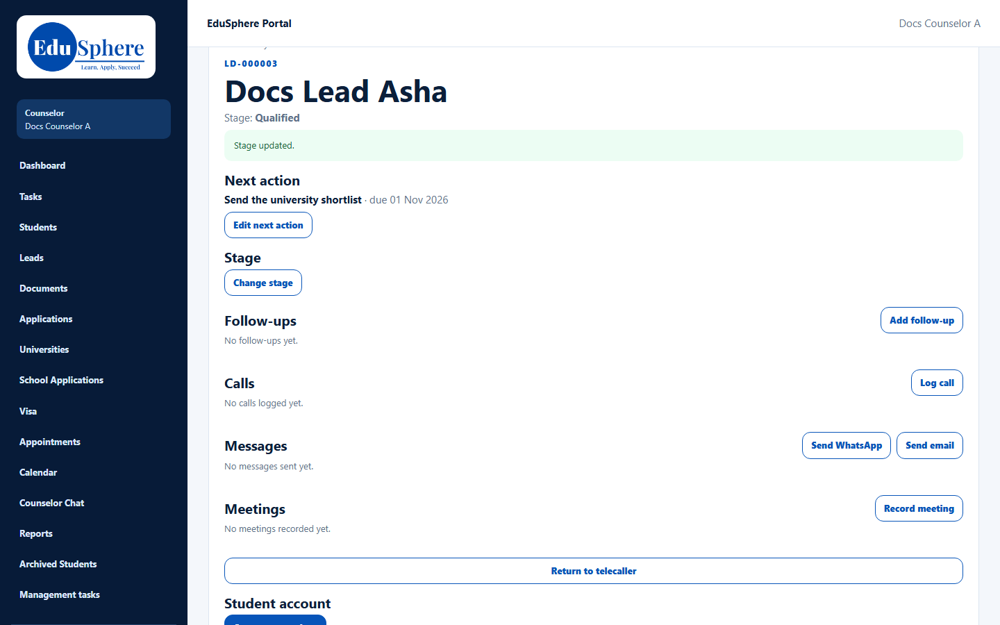
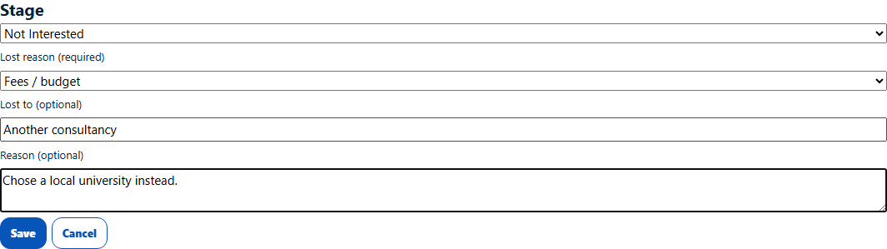
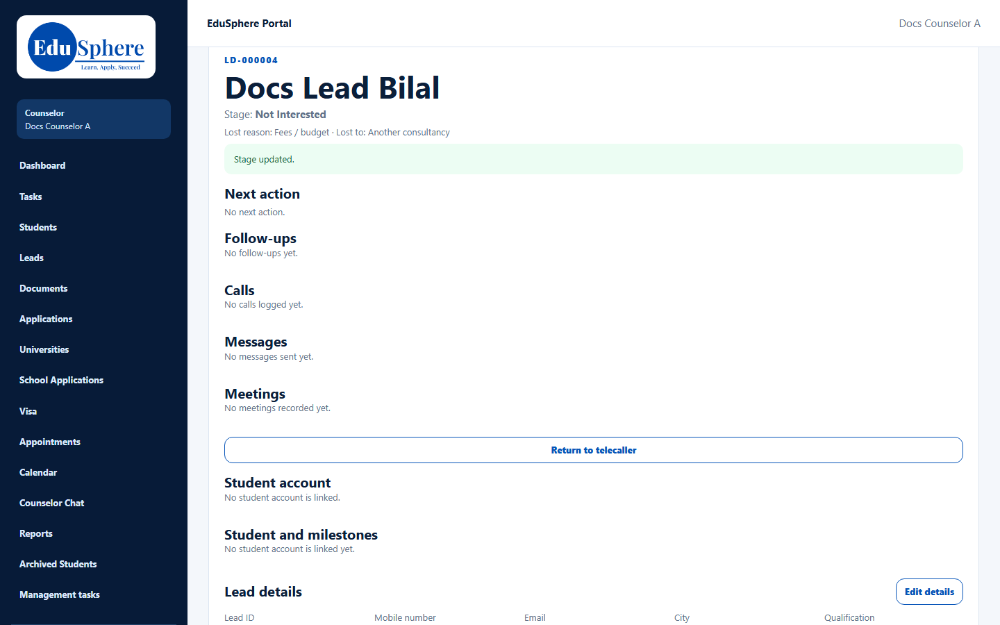

# Change stage, record loss, close a lead
> Doc ID: DOC-CNS-LEAD-006 · Verified on 2026-10-30 against `main` @ `045d8c40` · Roles: Counselor

## Purpose
Move a lead through counselling, or close it with the reason it was lost, so that reports show why students don't proceed.

## Who Can Use This Feature
The counselor who owns the lead.

## Prerequisites
- The lead is open and not converted.
- To move to an open stage, the lead needs a [next action](lead-005-next-action.md).

## How to Access
Lead page → **Stage** → **Change stage**.

## Steps
### Step 1 — Choose a stage
Select **Change stage** and pick from **Choose a stage**. A counselor can choose:
- **Open stages:** **Qualified**, **Follow-up**, **Counselling Scheduled**, **Counselling Completed**.
- **Closing outcomes:** **Not Interested**, **Not Eligible**, **Lost**.

Once a lead reaches **Application/Enrollment**, only the three closing outcomes remain.

### Step 2 — Save
Select **Save**. **Stage updated.** appears and the stage at the top changes. Without a next action, an open stage is refused with **Set a next action and its due date first**.

### Step 3 — Close a lead with a reason
Choose **Not Interested** or **Lost**. Pick a **Lost reason (required)** and, if you know it, **Lost to (optional)**, meaning the competitor or destination they chose. Add a **Reason** (required for **Not Eligible**). Select **Save**.

The lead now shows the closing stage and a line such as **Lost reason: Fees / budget · Lost to: Another consultancy**. Its open follow-ups and appointments are cancelled, and activity buttons disappear.

## Fields
| Field | Description | Required | Example |
|---|---|---|---|
| Stage | See Step 1 | Yes | Qualified |
| Lost reason | Fees / budget, Chose another institution, Chose another country, Not ready this intake, Not eligible for the course, Other | For Not Interested and Lost | Fees / budget |
| Lost to | Competitor or chosen destination | No | Another consultancy |
| Reason | Up to 500 characters | For Not Eligible | Chose a local university instead. |

## Expected Result
The stage shows in **My leads** and on the lead. A closed lead stays in **My leads** with its closing stage.

## Validation Messages
| Message | When |
|---|---|
| Stage updated. | Success |
| Choose a stage. | No stage chosen |
| Set a next action and its due date first | Moving to an open stage without a next action |
| Choose why the lead was lost. | Not Interested or Lost without a lost reason |
| Add a reason for this stage. | Not Eligible without a reason |
| The lead is already at this stage | Same stage chosen |
| The lead is with the counselor; its stage moves with the application | The stage is driven by the student's application |
| No lost reasons are set up yet. Ask a telecaller manager to add one. | The lost-reason list is empty |

## Common Errors
**Problem:** You need to reopen a closed lead. **Cause:** Counselors can't reopen leads. **Resolution:** Ask the telecaller manager or your Overseas Admin.

**Problem:** **Duplicate**, **Invalid Contact**, **No Response** or **Interested** aren't offered. **Cause:** Those stages are set by telecallers or by the system.

## Tips
- Choose the most accurate lost reason; it feeds the loss reports.

## Related Features
- [Next action](lead-005-next-action.md)
- [Return a lead to the telecaller](lead-008-return-to-telecaller.md)
- [Convert a lead to a new student](../conversion/conv-001-convert-to-student.md)
