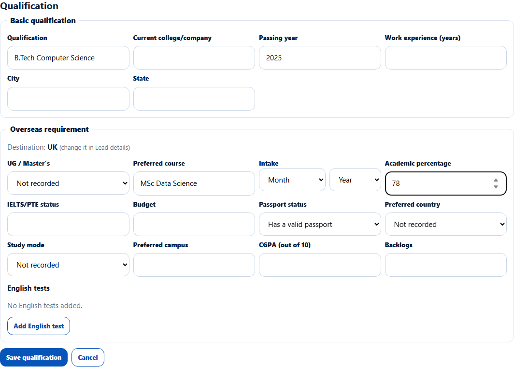
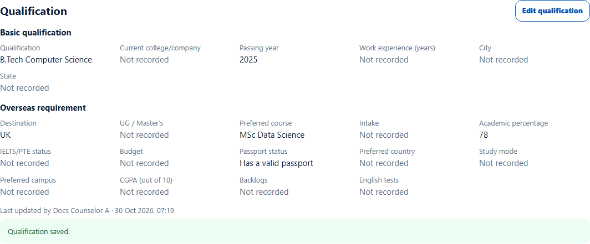

# Lead qualification
> Doc ID: DOC-CNS-LEAD-007 · Verified on 2026-10-30 against `main` @ `045d8c40` · Roles: Counselor

## Purpose
Record the student's academic background and study plans so you can shortlist universities. Saving the qualification never changes the lead's stage.

## Who Can Use This Feature
The counselor who owns the lead.

## Prerequisites
The lead has a **Product interest** (for example a destination). Without one, the section says "Set the lead's product interest in Lead details to see its IT or overseas questions."

## How to Access
Lead page → **Qualification** → **Edit qualification**.

## Steps
### Step 1 — Open the form
Select **Edit qualification**. It has two parts:
- **Basic qualification**: Qualification, Current college/company, Passing year, Work experience (years), City, State.
- **Overseas requirement**: the destination ("change it in Lead details"), UG / Master's, Preferred course, Intake (month and year), Academic percentage, IELTS/PTE status, Budget, Passport status, Preferred country, Study mode, Preferred campus, CGPA (out of 10), Backlogs, and **English tests** (**Add English test**).

### Step 2 — Fill in what you know
All fields are optional. Enter what the student tells you.

### Step 3 — Save
Select **Save qualification**. **Qualification saved.** appears, with "Last updated by {name} · {time}".

## Fields
| Field | Allowed values | Example |
|---|---|---|
| Passing year | 1950–2100 | 2025 |
| Work experience (years) | 0–50 | 0 |
| Academic percentage | 0–100 | 78 |
| Passport status | No passport, Applied, Has a valid passport | Has a valid passport |
| Study mode | Full-time, Part-time, Online | Full-time |
| CGPA (out of 10) | 0–10 | — |
| Backlogs | 0–99 | 0 |

## Expected Result
The answers show in **Qualification**. When you convert the lead, they are copied into the student's profile.

## Validation Messages
| Message | When |
|---|---|
| Qualification saved. | Success |
| Check the highlighted fields. | A value is out of range |
| Enter a year from 1950 to 2100. / Enter whole years from 0 to 50. | Field-level range errors |

## Tips
- Fill the qualification before converting; it saves typing on the student profile.

## Related Features
- [Lead details](lead-004-lead-details.md)
- [Convert a lead to a new student](../conversion/conv-001-convert-to-student.md)
