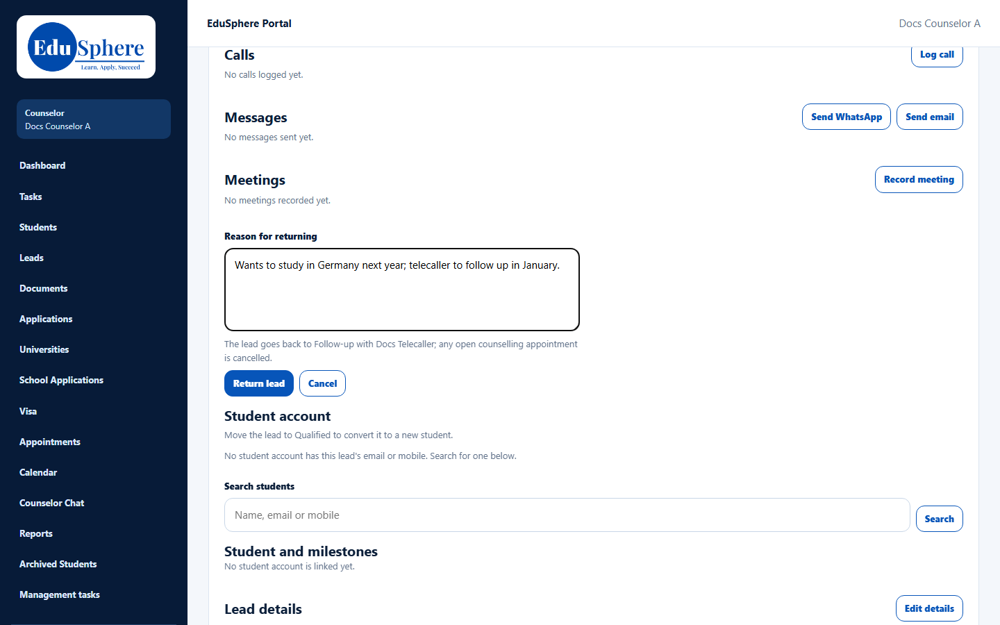
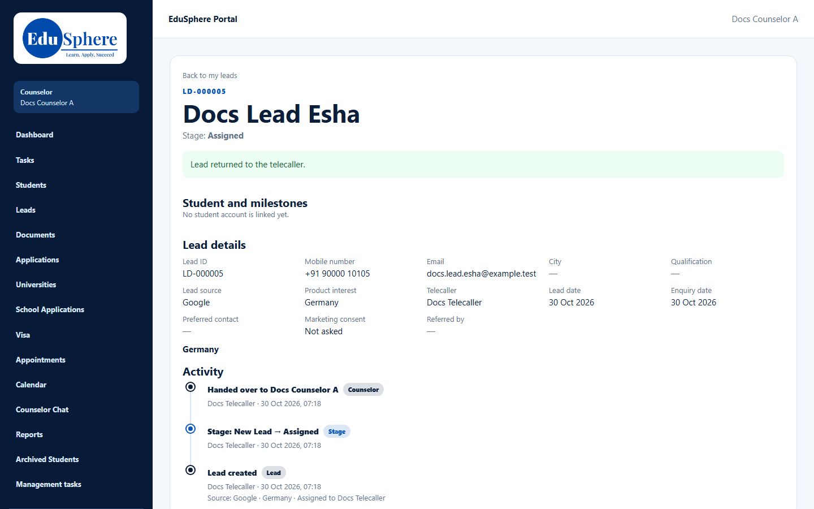
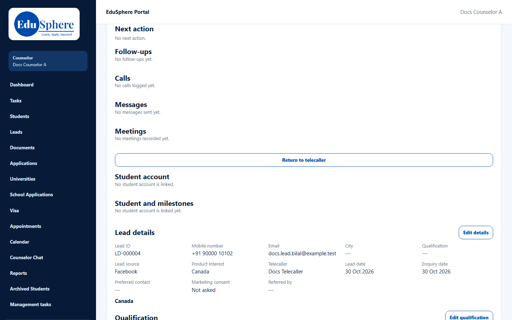

# Return a lead to the telecaller
> Doc ID: DOC-CNS-LEAD-008 · Verified on 2026-10-30 against `main` @ `045d8c40` · Roles: Counselor

## Purpose
Give a lead back to its telecaller when it isn't ready for counselling, for example when the student wants to wait a year.

## Who Can Use This Feature
The counselor who owns the lead.

## Prerequisites
No student account is linked to the lead. Unlink it first if needed (see [Link / unlink](../conversion/conv-002-link-student.md)).

## How to Access
Lead page → **Return to telecaller**.

## Steps
### Step 1 — Give a reason
Select **Return to telecaller** and enter the **Reason for returning**. The form says: "The lead goes back to Follow-up with {telecaller}; any open counselling appointment is cancelled."

### Step 2 — Return it
Select **Return lead**. **Lead returned to the telecaller.** appears and the lead's action sections disappear. The lead leaves your **My leads**.

## Fields
| Field | Description | Required | Example |
|---|---|---|---|
| Reason for returning | Up to 500 characters; the telecaller sees it | Yes | Wants to study in Germany next year; telecaller to follow up in January. |

## Expected Result
The telecaller gets the lead back with an alert. Its next action is cleared, and open follow-ups and appointments are cancelled.

## Validation Messages
| Message | When |
|---|---|
| Lead returned to the telecaller. | Success |
| Add a reason for returning the lead. | No reason entered |
| Unlink the student before returning the lead | A student account is linked |

## Common Errors
**Problem:** **Return to telecaller** is shown on a lead you have closed. **Cause:** The button is offered whenever no student is linked, including on closed leads. Returning a closed lead removes it from your list but leaves it closed, and does not record your reason in its history.

**Resolution:** Don't return closed leads. If it needs to be worked again, ask the telecaller manager to reopen it.

## Tips
- Write the reason for the telecaller: what the student wants and when to call back.

## Related Features
- [Change stage, record loss, close a lead](lead-006-change-stage.md)
- [A telecaller hands a lead to you](../handoffs/ho-001-telecaller-handover.md)
