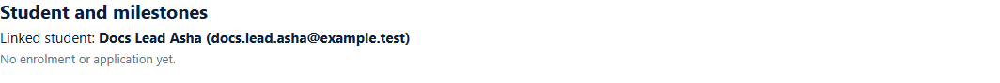

# Student and milestones panel
> Doc ID: DOC-CNS-LEAD-009 · Verified on 2026-10-30 against `main` @ `045d8c40` · Roles: Counselor

## Purpose
See, from the lead, which student account it belongs to and how far that student has got.

## Who Can Use This Feature
The counselor who owns the lead. The panel is read only.

## Prerequisites
None. Before a student is linked it says "No student account is linked yet."

## How to Access
Lead page → **Student and milestones**.

## Steps
### Step 1 — Read the panel
After [conversion](../conversion/conv-001-convert-to-student.md) or [linking](../conversion/conv-002-link-student.md), the panel shows **Linked student: {name} ({email})**. Until the student has an application or enrolment it says **No enrolment or application yet.**

### Step 2 — Follow the milestones
As the student's applications move on, each milestone is listed with its kind, label, status, reference and time. When the student enrols, the panel shows a **Converted** badge and the lead's stage becomes **Converted** automatically.

VERIFICATION REQUIRED: milestone rows and the **Converted** badge are captured once applications exist (S7–S8).

## Expected Result
You can tell from the lead whether the student has applied or enrolled.

## Related Features
- [Convert a lead to a new student](../conversion/conv-001-convert-to-student.md)
- [Link / unlink an existing student](../conversion/conv-002-link-student.md)
