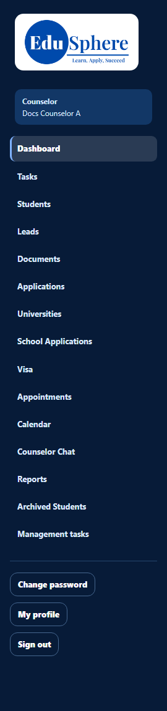
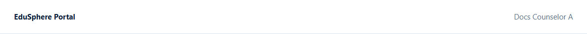
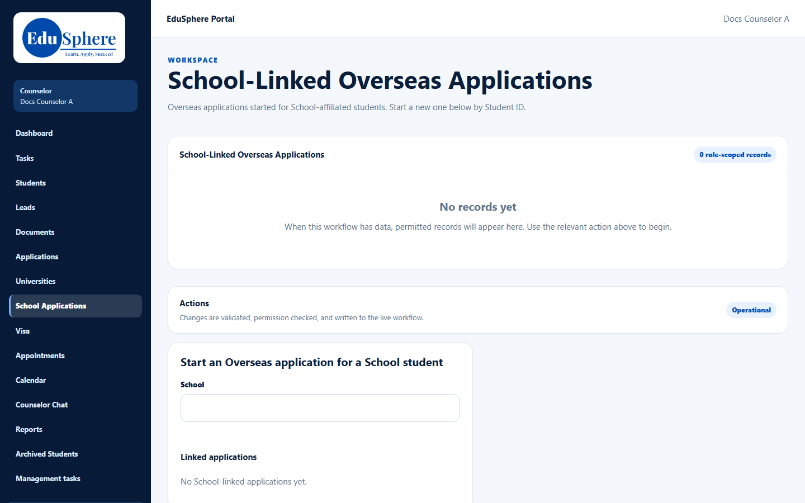
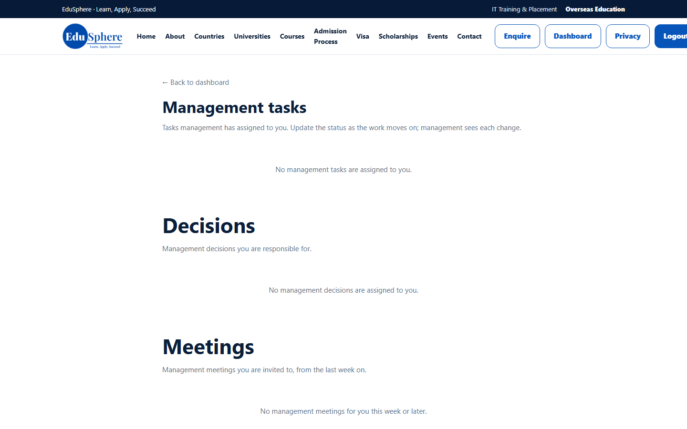
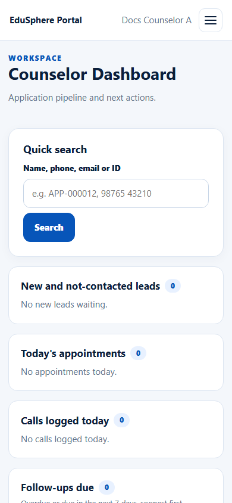
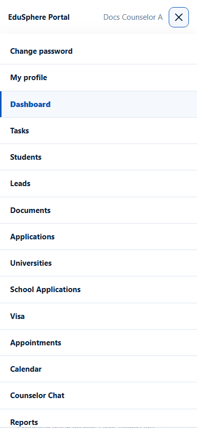
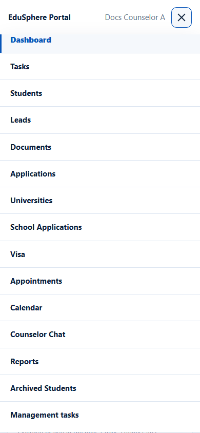

# Portal tour: sidebar, top bar and mobile menu
> Doc ID: DOC-CNS-NAV-001 · Verified on 2026-10-30 against `main` @ `045d8c40` · Roles: Counselor

## Purpose
Know where everything is in the counselor workspace.

## Who Can Use This Feature
Overseas counselors.

## Prerequisites
You are signed in. See [Sign in](../account-access/auth-001-sign-in.md).

## How to Access
Every counselor page shows the sidebar on the left and the top bar above the page.

## Steps
### Step 1 — The sidebar
Below the logo, the dark box shows your role (**Counselor**) and your name. The sidebar items, top to bottom:

| Sidebar item | Page title | What it is for | Guide |
|---|---|---|---|
| **Dashboard** | Counselor Dashboard | Quick search and today's action tiles | DASH-001, SRCH-001 |
| **Tasks** | My tasks | Your tasks and overdue follow-ups | TASK-001, FUP-002 |
| **Students** | Application Tracking | Applications table, **Evaluate Applications** and **My students** | STU-001, STU-002 |
| **Leads** | My leads | Leads handed to you and walk-ins you recorded | LEAD-001 |
| **Documents** | Document Verification | Students' documents and their status | DOC-002 |
| **Applications** | Application Tracking | Applications table and **Evaluate Applications** | APP-004 |
| **Universities** | Partner universities | Partner universities and their courses | UNI-001 |
| **School Applications** | School-Linked Overseas Applications | Overseas applications for School-affiliated students (outside this guide) | — |
| **Visa** | Visa Tracking | Visa cases | VISA-001 |
| **Appointments** | Lead appointments | Counselling appointments with your leads | CAL-001 |
| **Calendar** | Calendar | Your calendar and calendar-feed link | CAL-002 |
| **Counselor Chat** | Counselor Chat | Messages with your students | CHAT-001 |
| **Reports** | My performance | Your own performance figures | REP-001 |
| **Archived Students** | Archived students | Students you archived | STU-008 |
| **Management tasks** | Management tasks | Tasks, decisions and meetings from EduSphere management | — |

The sidebar footer has **Change password**, **My profile** and **Sign out**.

### Step 2 — The top bar
The top bar shows **EduSphere Portal** on the left and your name on the right. Counselors have no notifications bell or student-search box in the top bar.

### Step 3 — Pages outside this guide
- **School Applications** opens **School-Linked Overseas Applications**, where you start an Overseas application for a School student by Student ID.
- **Management tasks** opens a page in the public website layout that lists management tasks, decisions and meetings assigned to you. Use **← Back to dashboard** to return.

### Step 4 — On a phone or small tablet
Below about 980 px wide the sidebar is hidden. Select the menu button (☰, **Open menu**) in the top bar to open a list with **Change password**, **My profile** and every sidebar item. The current page is highlighted. The menu has **no Sign out**; see [Sign out](../account-access/auth-006-sign-out.md).

## Expected Result
You can reach every counselor page from the sidebar (desktop) or the menu (phone).

## Common Errors
**Problem:** A page says **Workspace not found** or shows a "not found" page. **Cause:** The address was typed by hand or is for another role. **Resolution:** Use the sidebar.

**Problem:** Sidebar names differ from page titles (for example **Leads** opens **My leads**, **Reports** opens **My performance**). **Resolution:** This is expected; the table above maps them.

## Tips
- **Students** and **Applications** open the same applications table. **Students** also has the **My students** card.
- **Counselor Chat** is covered in [Counselor Chat with students](../chat/chat-001-counselor-chat.md).

## Related Features
- [Sign in](../account-access/auth-001-sign-in.md)
- [Sign out](../account-access/auth-006-sign-out.md)
