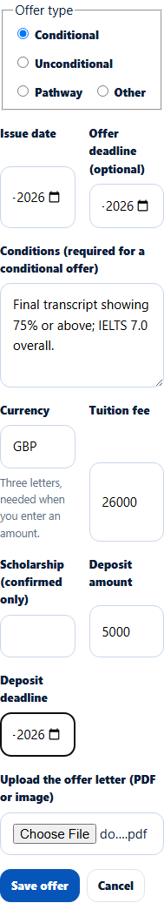
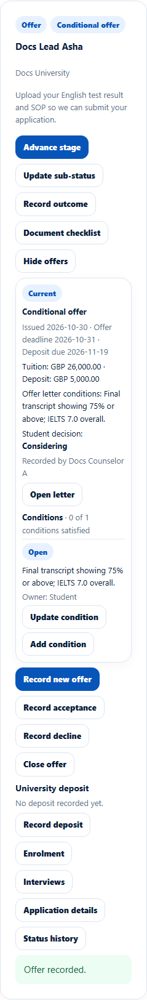
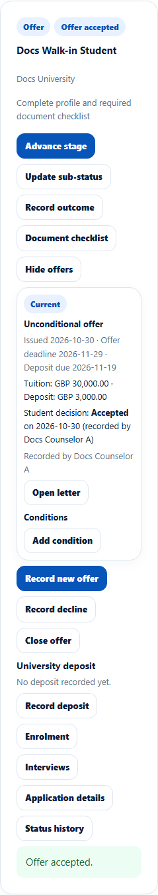

# Record, close or decide an offer
> Doc ID: DOC-CNS-OFR-001 · Verified on 2026-10-30 against `main` @ `045d8c40` · Roles: Counselor

## Purpose
Record the university's offer with its letter, then record the student's acceptance or decline, or close the offer if the university withdraws it or it expires.

## Who Can Use This Feature
The counselor assigned to the application.

## Prerequisites
- The application is open.
- You have the offer letter (PDF or image).

## How to Access
**Evaluate Applications** → the application → **Offers**.

## Steps
### Step 1 — Record the offer
Select **Record offer** and fill in:
- **Offer type**: **Conditional**, **Unconditional**, **Pathway** or **Other**.
- **Issue date** and **Offer deadline (optional)**.
- **Conditions** (required for a conditional offer).
- **Currency**, as three letters such as **GBP**.
- **Tuition fee**, **Scholarship (confirmed only)**, **Deposit amount** and **Deposit deadline**.
- The **offer letter**: upload it, or pick one already uploaded.

Select **Save offer**.

### Step 2 — Check the offer
**Offer recorded.** appears. The offer shows as **Current** with its dates, amounts and conditions, **Student decision: Considering** and **Open letter**. The application moves to **Offer** with the sub-status **Conditional offer** (or **Unconditional offer**).

### Step 3 — Record the student's decision
- **Record acceptance**: choose the acceptance date and **Save acceptance**. **Offer accepted.** appears and the sub-status becomes **Offer accepted**.
- **Record decline**: give the date and reason. "Offer declined. The application is now closed."

### Step 4 — Close an offer
**Close offer** marks it **Withdrawn by university** or **Expired**, with a reason. The offer stays in the history and the application keeps its stage. **Record new offer** adds a replacement; the old one becomes **Superseded**.

VERIFICATION REQUIRED: the automatic **Expired** status, set by the nightly job after the offer deadline, is captured in session S9.

## Fields
| Field | Description | Required | Example |
|---|---|---|---|
| Offer type | Conditional, Unconditional, Pathway, Other | Yes | Conditional |
| Issue date | When the university issued it | Yes | 30 Oct 2026 |
| Offer deadline | Date the student must decide by | No | 31 Oct 2026 |
| Conditions | Required for Conditional | Conditional | Final transcript showing 75%… |
| Currency | Three letters; needed with any amount | With amounts | GBP |
| Tuition fee / Deposit amount | Amounts | No | 26000 / 5000 |
| Deposit deadline | When the deposit is due | No | 19 Nov 2026 |
| Offer letter | PDF or image | Yes | docs-offer-letter.pdf |

## Expected Result
The student is notified ("Offer recorded", "Offer accepted"). Deadlines feed the reminders "Offer deadline approaching" and "Deposit due".

## Validation Messages
| Message | When |
|---|---|
| Offer recorded. | Success |
| Choose the currency of the amounts | An amount without currency |
| Attach the offer letter: pick an uploaded one or upload the file. | No letter |
| Offer accepted. (Note: this student has also accepted an offer on APP-…) | Accepted; warns about another accepted offer |
| Offer declined. The application is now closed. | Declined |
| Only the current offer can be accepted or declined | Older offer |
| The decision date cannot be before the offer was issued | Date error |

## Related Features
- [Offer conditions](ofr-002-offer-conditions.md)
- [Admission interviews](ofr-003-interviews.md)
- [University deposit record](../finance/fin-001-deposit.md)
