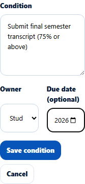
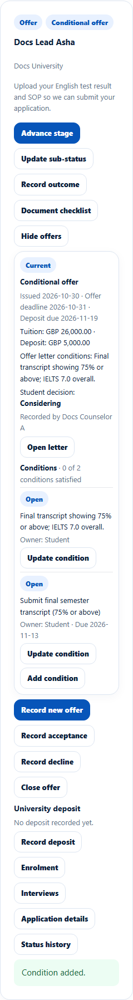
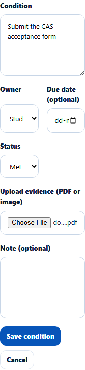
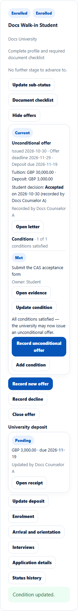

# Offer conditions
> Doc ID: DOC-CNS-OFR-002 · Verified on 2026-10-30 against `main` @ `045d8c40` · Roles: Counselor

## Purpose
Track each condition of a conditional offer (who must meet it, by when, and with what evidence) until the university can issue an unconditional offer.

## Who Can Use This Feature
The counselor assigned to the application.

## Prerequisites
A current offer is recorded.

## How to Access
**Evaluate Applications** → the application → **Offers** → **Conditions** under the current offer.

## Steps
### Step 1 — See the conditions
The conditions you typed when recording a conditional offer are listed with their status (**Open**) and owner, plus "{n} of {m} conditions satisfied".

### Step 2 — Add a condition
Select **Add condition**. Enter the **Condition** text, the **Owner** (**Student** or **Counselor**; **Agent** too on agency applications) and an optional **Due date**. Select **Save condition**. **Condition added.** appears.

### Step 3 — Update a condition
Select **Update condition** and set the **Status**: **Open**, **Met**, **Waived** or **Failed**. Attach **Evidence** (pick a document or upload one) before marking it **Met**. Add a **Note** when it is **Waived** or **Failed**.

**Condition updated.** appears and the condition shows **Met**.

When every condition is met, a banner says "All conditions satisfied — the university may now issue an unconditional offer." with a **Record unconditional offer** shortcut.

## Fields
| Field | Description | Required | Example |
|---|---|---|---|
| Condition | What must be done | Yes | Submit final semester transcript (75% or above) |
| Owner | Student, Counselor (Agent on agency applications) | Yes | Student |
| Due date (optional) | Deadline | No | 13 Nov 2026 |
| Status | Open, Met, Waived, Failed | Yes | Open |
| Evidence | Document proving it is met | For Met | — |
| Note | Why waived or failed | For Waived / Failed | — |

## Expected Result
The student is notified of each change ("Offer condition: {text} -- {status}."). Due dates feed the "Offer condition due" reminder.

## Validation Messages
| Message | When |
|---|---|
| Condition added. / Condition updated. / Nothing changed. | Saved |
| Attach the evidence before marking the condition met | Met without evidence |
| Give a note when a condition is waived or failed | Waived/Failed without note |
| Conditions can be changed only on the current offer | Older offer |

## Related Features
- [Record, close or decide an offer](ofr-001-offers.md)
