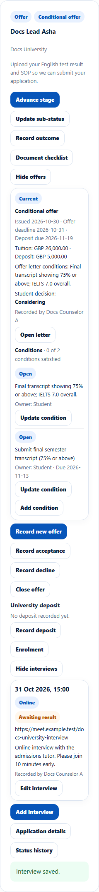
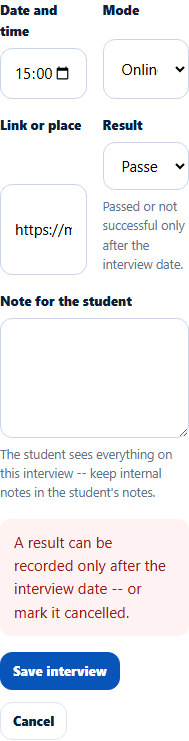
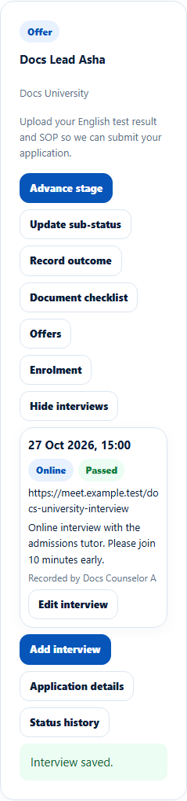

# Admission interviews
> Doc ID: DOC-CNS-OFR-003 · Verified on 2026-10-30 against `main` @ `045d8c40` · Roles: Counselor

## Purpose
Record a university admission interview so the student knows when and how it happens, then record the result.

## Who Can Use This Feature
The counselor assigned to the application (read only once the application is closed).

## Prerequisites
None.

## How to Access
**Evaluate Applications** → the application → **Interviews**.

## Steps
### Step 1 — Add the interview
Select **Add interview**. Enter the **Date and time**, **Mode** (**Online**, **In person** or **Phone**), **Link or place**, **Result** (**Awaiting result** for now) and a **Note for the student**. "The student sees everything on this interview -- keep internal notes in the student's notes." Select **Save interview**. **Interview saved.** appears.

### Step 2 — Record the result after the interview
Select **Edit interview** and set **Result** to **Passed** or **Not successful**. You can only do this once the interview date has passed; before then you can only mark it **Cancelled**.

After the interview date, choose **Passed** (or **Not successful**) and select **Save interview**.

## Fields
| Field | Description | Required | Example |
|---|---|---|---|
| Date and time | When | Yes | 31 Oct 2026, 15:00 |
| Mode | Online, In person, Phone | Yes | Online |
| Link or place | Meeting link or address | No | https://meet.example.test/… |
| Result | Awaiting result, Passed, Not successful, Cancelled | Yes | Awaiting result |
| Note for the student | Shown to the student | No | Please join 10 minutes early. |

## Expected Result
The student is notified ("Interview scheduled", then "Interview updated" or the result).

## Validation Messages
| Message | When |
|---|---|
| Interview saved. | Success |
| A result can be recorded only after the interview date -- or mark it cancelled. | Result too early |
| An application can hold at most 20 interviews | Limit reached |

## Related Features
- [Record, close or decide an offer](ofr-001-offers.md)
