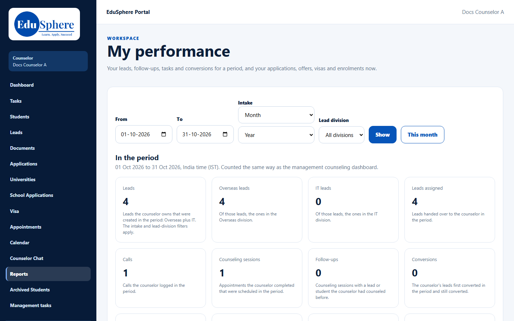
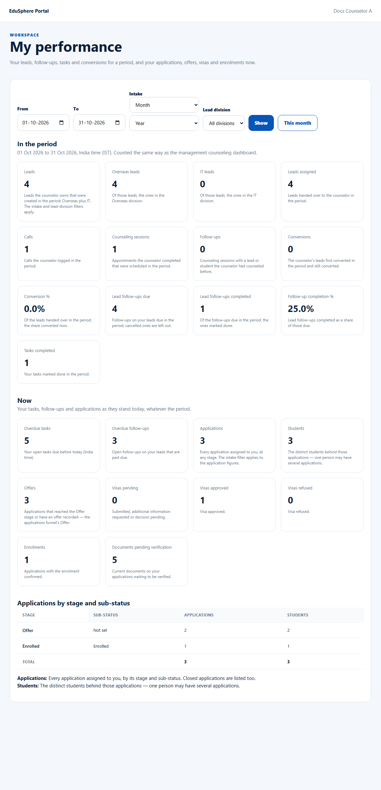
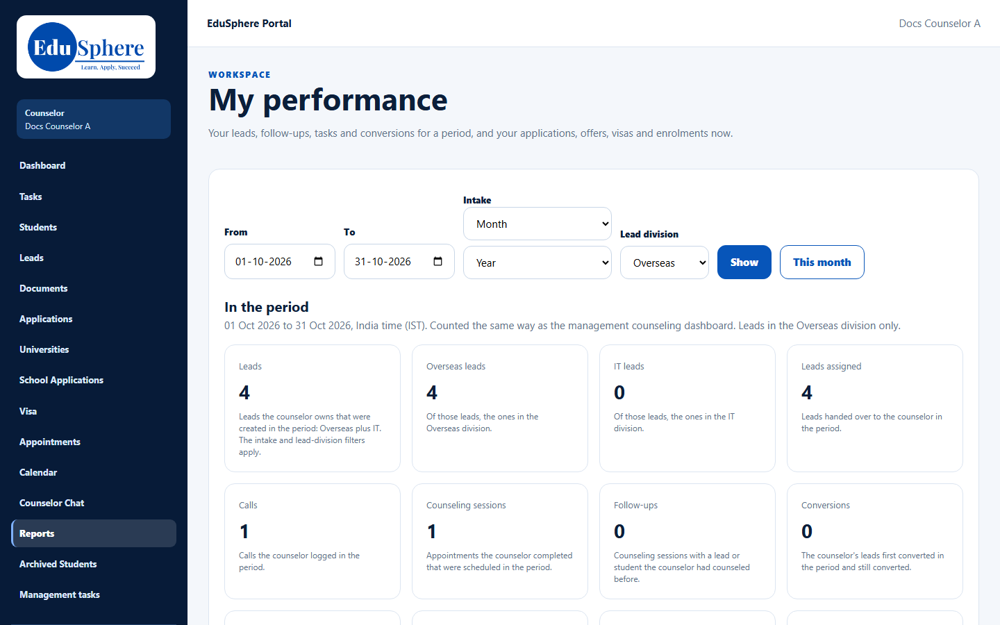

# My performance
> Doc ID: DOC-CNS-REP-001 · Verified on 2026-10-30 against `main` @ `045d8c40` · Roles: Counselor

## Purpose
See your own figures for a period (leads, calls, sessions, follow-ups, conversions), and where your applications stand today.

## Who Can Use This Feature
Overseas counselors (your own figures only). The Overseas Admin sees every counselor (see [Team performance](../../admin-manual/performance/perf-001-team-performance.md)).

## Prerequisites
None.

## How to Access
Sidebar **Reports** (page title **My performance**).

## Steps
### Step 1 — Choose the period
Set **From** and **To** (the default is this month), and optionally an **Intake** and **Lead division** (**All divisions**, **Overseas** or **IT**). Select **Show**, or **This month** to reset.

### Step 2 — Read the figures
- **In the period** (India time): Leads, Overseas leads, IT leads, Leads assigned, Calls, Counseling sessions, Follow-ups, Conversions, Conversion %, Lead follow-ups due, Lead follow-ups completed, Follow-up completion % and Tasks completed. Each figure has its definition beside it.
- **Now**: Overdue tasks, Overdue follow-ups, Applications, Students, Offers, Visas pending/approved/refused, Enrolments and Documents pending verification.
- **Applications by stage and sub-status**: a table with a total row.

## Expected Result
The figures are counted the same way as the management counseling dashboard.

## Validation Messages
| Message | When |
|---|---|
| Your performance figures are unavailable right now. Please try again. | Loading failed |
| Choose the Overseas or IT lead division | Invalid division |
| No applications are assigned to you yet. | No applications |

## Tips
- **Leads** counts leads in both divisions; use **Lead division** to see Overseas only.

## Related Features
- [Counselor dashboard](../dashboard/dash-001-dashboard.md)
- [One counselor's report (admin)](../../admin-manual/performance/perf-002-counselor-report.md)
