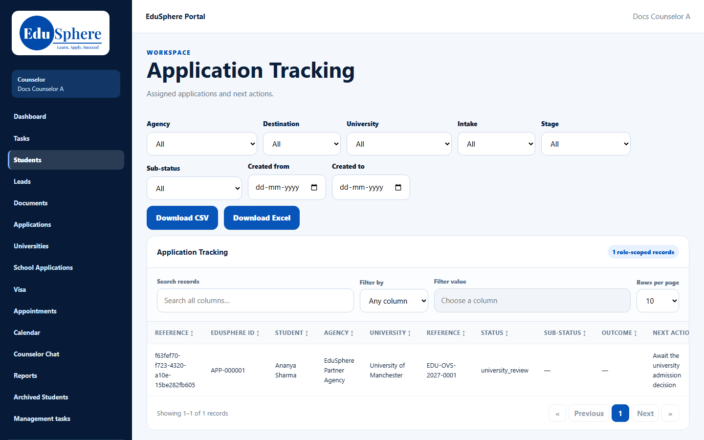
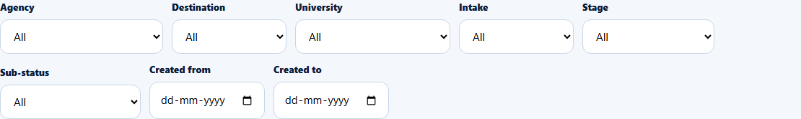

# Students page: Application Tracking table and filters
> Doc ID: DOC-CNS-STU-001 · Verified on 2026-10-30 against `main` @ `045d8c40` · Roles: Counselor (Overseas Admin sees more)

## Purpose
See every application assigned to you in one table and narrow it down with filters.

## Who Can Use This Feature
### What each role sees
| | Counselor | Overseas Admin |
|---|---|---|
| Rows | Applications assigned to you | All applications |
| Extra column | — | **EduSphere counsellor**, with Assign/Change counsellor |
| Counsellor filter | — | Yes (including **Not assigned**) |

## Prerequisites
At least one application is assigned to you.

## How to Access
Sidebar **Students** (or **Applications**). The page title is **Application Tracking**.

## Steps
### Step 1 — Read the table
There is one row per application, not per student. The columns are:
- **reference** (an internal code) and **EduSphere ID** (APP-…);
- **Student**, **Agency** and **University**;
- **Reference** (the university's reference), **Status**, **Sub-status**, **Outcome** and **Next action**;
- **Open**, **Notes** and **Profile** links to the student.

Use **Search records** or **Filter by** a column, and **Rows per page**.

### Step 2 — Filter
Use **Agency** (All, Any agency, Not from an agency, or a named agency), **Destination**, **University**, **Intake**, **Stage**, **Sub-status** (narrowed by the stage), and **Created from** / **Created to**. The lists only offer values that appear in your applications.

### Step 3 — Download
**Download CSV** or **Download Excel** exports the filtered applications.

## Expected Result
You see your applications and can jump to each student's 360 view.

## Validation Messages
| Message | When |
|---|---|
| No applications match these filters | Filters exclude every row |
| {error} -- showing all applications. | A filter value was refused |
| The start date must be on or before the end date | Dates reversed |

## Common Errors
**Problem:** **Status** shows a code such as `university_review`. **Cause:** This table shows the internal stage key, not its label. **Resolution:** Open the student's 360 view or the application for the readable stage.

**Problem:** A student has no **Open** link. **Cause:** The student has no EduSphere login (an agency record).

## Tips
- The **My students** card on the same page lists students rather than applications. See [My students](stu-002-my-students.md).
- Applications of archived students are hidden.

## Related Features
- [My students](stu-002-my-students.md)
- [Student 360](stu-004-student-360.md)
