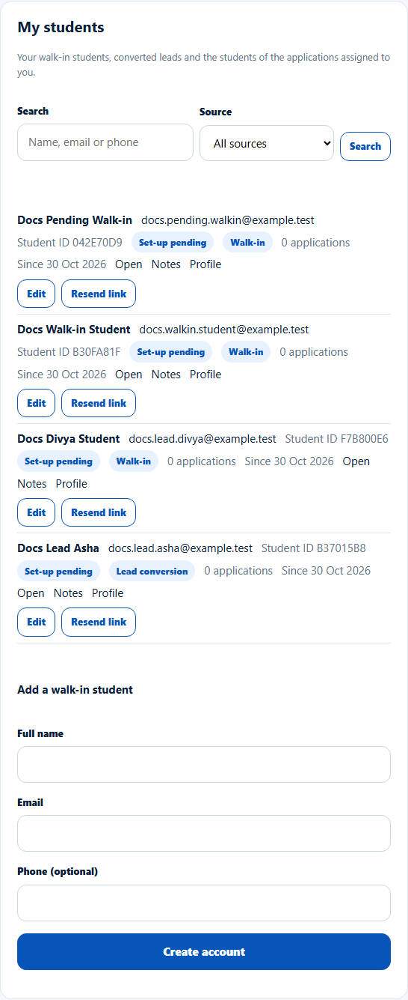
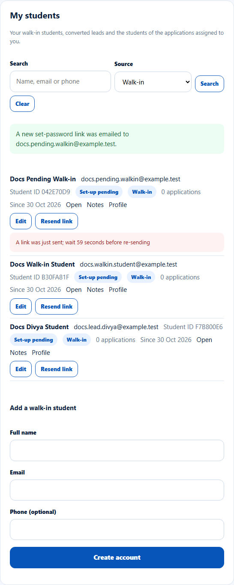
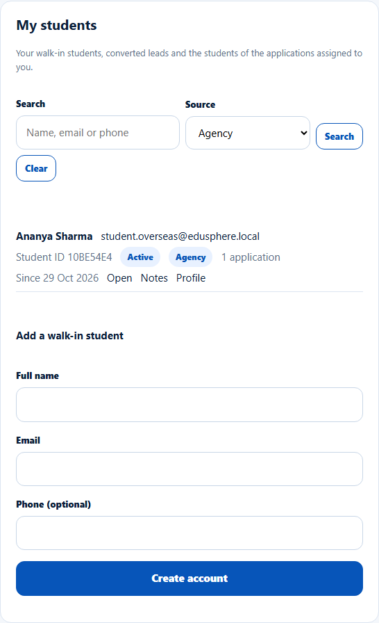
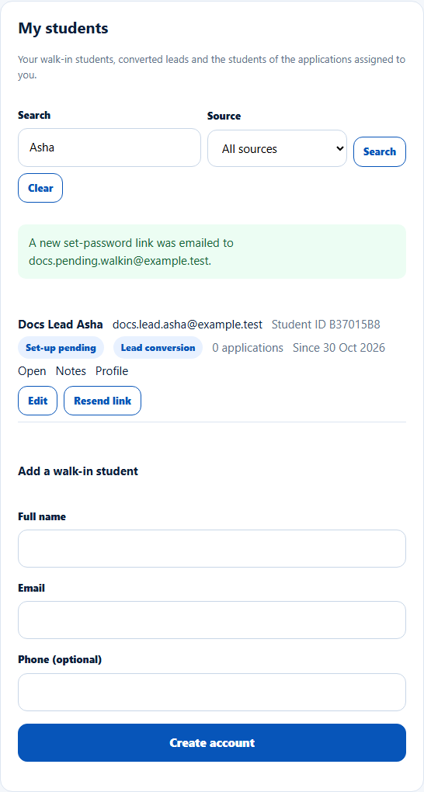
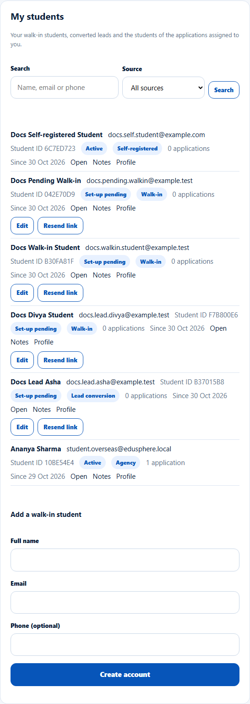

# My students
> Doc ID: DOC-CNS-STU-002 · Verified on 2026-10-30 against `main` @ `045d8c40` · Roles: Counselor

## Purpose
List every student you work with: walk-ins you added, leads you converted, students the Overseas Admin assigned to you, and students of applications assigned to you.

## Who Can Use This Feature
Overseas counselors.

## Prerequisites
None.

## How to Access
Sidebar **Students** → the **My students** card (below the table).

## Steps
### Step 1 — Read the list
Each student shows:
- name, email and Student ID;
- an account badge (**Active**, **Set-up pending** or **Link expired**) and a source badge;
- the number of applications and **Since** {date};
- **Open** (Student 360), **Notes** and **Profile** links.

Students still setting up their account also have **Edit** and **Resend link** (see [Add a walk-in student](stu-003-walk-in-student.md)).

### Step 2 — Filter by source
Choose **Source**: **All sources**, **Walk-in**, **Lead conversion**, **Self-registered** or **Agency**. The list updates at once.

### Step 3 — Search
Type a name, email or phone in **Search** and select **Search**. Select **Clear** to reset.

## Fields
| Source | Meaning |
|---|---|
| Walk-in | You added the student at the office |
| Lead conversion | You converted their lead |
| Self-registered | They registered on the website |
| Agency | They came through an education agent |

## Expected Result
20 students per page, newest first, with **Previous** and **Next**. Archived students are not listed.

## Validation Messages
| Message | When |
|---|---|
| No students yet. Add a walk-in student below. | No students |
| No students match these filters. | Filters exclude everyone |
| Unable to load your students. (Retry) | Loading failed |

## Common Errors
**Problem:** A student shows more applications than you handle. **Cause:** The count includes all of the student's applications, including other counselors'.

## Tips
- After the Overseas Admin assigns a student to you, they appear here with their source.

## Related Features
- [Add a walk-in student](stu-003-walk-in-student.md)
- [Student 360](stu-004-student-360.md)
- [When a student is reassigned to you](stu-010-reassignment.md)
