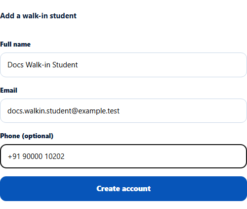
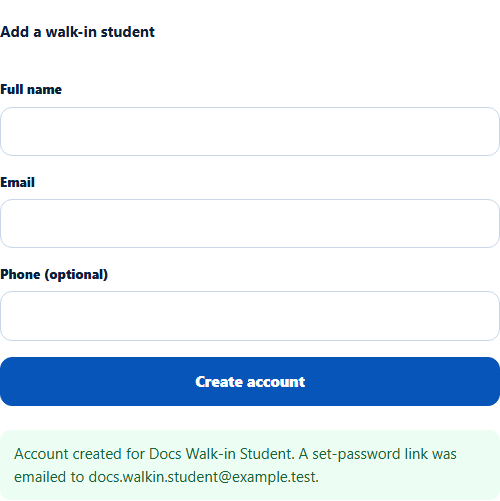
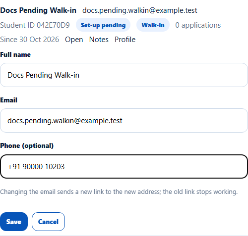
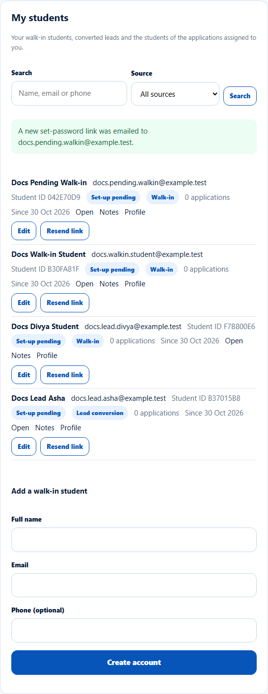
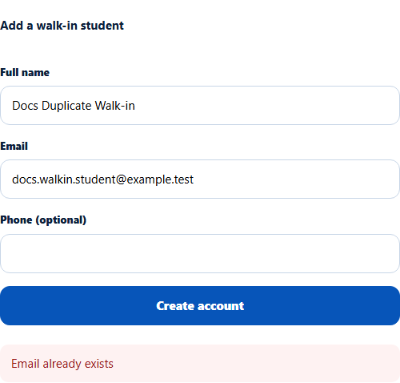

# Add a walk-in student, edit a pending one, resend the link
> Doc ID: DOC-CNS-STU-003 · Verified on 2026-10-30 against `main` @ `045d8c40` · Roles: Counselor

## Purpose
Give a student who visits the office their own EduSphere account straight away, linked to you.

## Who Can Use This Feature
Overseas counselors.

## Prerequisites
The student's email isn't used by another EduSphere account.

## How to Access
Sidebar **Students** → **My students** → **Add a walk-in student**.

## Steps
### Step 1 — Fill in the student
Enter **Full name**, **Email** and **Phone (optional)**.

### Step 2 — Create the account
Select **Create account**. **Account created for {name}. A set-password link was emailed to {email}.** appears. The student shows in **My students** with **Set-up pending** and source **Walk-in**.

### Step 3 — Correct a pending student
While a student is **Set-up pending**, select **Edit** on their row to change **Full name**, **Email** or **Phone (optional)**, then **Save**. "{name} updated." appears. Changing the email sends a new link to the new address, and the old link stops working.

### Step 4 — Resend the link
Select **Resend link**. **A new set-password link was emailed to {email}.** appears. You can resend once a minute.

## Fields
| Field | Description | Required | Example |
|---|---|---|---|
| Full name | Up to 160 characters | Yes | Docs Walk-in Student |
| Email | The student's sign-in email | Yes | docs.walkin.student@example.test |
| Phone (optional) | Mobile number | No | +91 90000 10202 |

## Expected Result
The student receives a welcome email with a 72-hour set-password link and is linked to you as their counselor.

## Validation Messages
| Message | When |
|---|---|
| Account created for {name}. A set-password link was emailed to {email}. | Success |
| Account created for {name}, but the set-password email was not delivered. | Email failed; use **Resend link** |
| Email already exists | Another account uses the email |
| A link was just sent; wait {n} seconds before re-sending | Resent less than a minute ago |
| You have sent 20 account emails in the last 24 hours. Try again later. | Daily limit for creates, resends and email changes |
| This student has already set a password | Too late to edit or resend |

## Common Errors
**Problem:** "Email already exists". **Cause:** The student already has an account (for example they registered online). **Resolution:** Ask the Overseas Admin to assign that student to you instead.

## Tips
- To turn a walk-in into a lead you can track through counselling, use [Record a new walk-in lead](../leads/lead-002-new-walk-in-lead.md). Use this page when they need an account now.

## Related Features
- [My students](stu-002-my-students.md)
- [Link an existing student to a lead](../conversion/conv-002-link-student.md)
