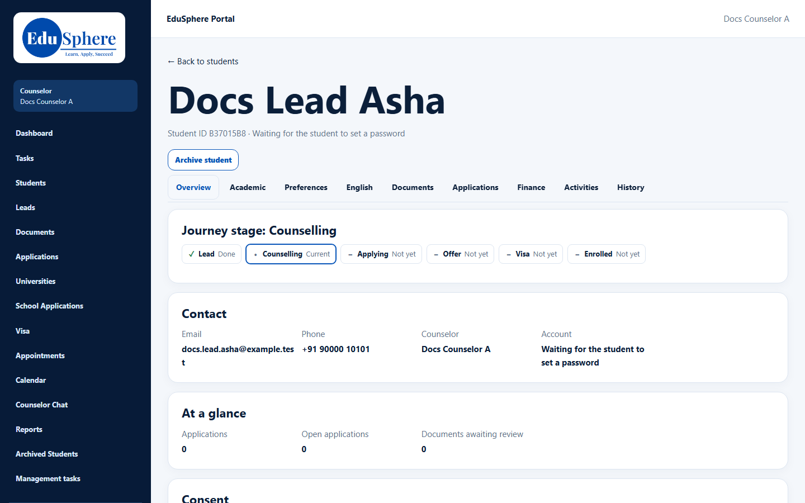
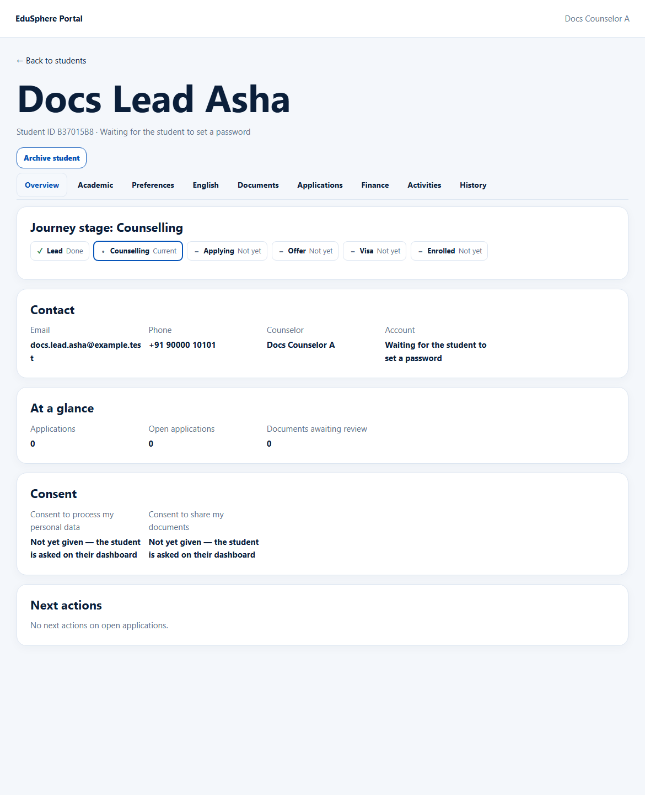

# Student 360: header, tabs and Overview
> Doc ID: DOC-CNS-STU-004 · Verified on 2026-10-30 against `main` @ `045d8c40` · Roles: Counselor, Overseas Admin

## Purpose
See one student's whole picture: contact, journey stage, applications, consent and next actions.

## Who Can Use This Feature
- **Counselor**: students in your caseload.
- **Overseas Admin**: every student.

## Prerequisites
The student is one of yours.

## How to Access
**My students** → **Open** (or **Open** in the Application Tracking table).

## Steps
### Step 1 — Read the header
The header shows **← Back to students**, the student's name, **Student ID** and account status. The account status is **Active**, **Waiting for the student to set a password**, **Set-password link expired** or **Deactivated**. **Archive student** is here too (see STU-008).

### Step 2 — Use the tabs
**Overview · Academic · Preferences · English · Documents · Applications · Finance · Activities · History**. Each tab loads only when you open it.

### Step 3 — Read the Overview
- **Journey stage:** Lead → Counselling → Applying → Offer → Visa → Enrolled, showing which are done or current.
- **Contact:** Email, Phone, Counselor and Account.
- **At a glance:** Applications, Open applications, Documents awaiting review.
- **Consent:** each consent with "Given {time}" or "Not yet given — the student is asked on their dashboard".
- **Next actions:** next actions on open applications.

## Expected Result
You can see at a glance where the student is and what is next.

## Validation Messages
| Message | When |
|---|---|
| This section could not be loaded. Refresh the page to try again. | A tab failed to load |

## Common Errors
**Problem:** **Counselor** says "Not assigned" although you handle their application. **Cause:** The field shows only the student's own counselor link (walk-in, conversion or admin assignment), not application counselors.

**Problem:** "Not found" when opening a student. **Cause:** The student is not in your caseload.

## Tips
- Consent can only be given by the student, on their own dashboard.

## Related Features
- [Structured profile](stu-005-profile.md)
- [Internal notes](stu-006-notes.md)
- [Activities and History](stu-007-activities-history.md)
