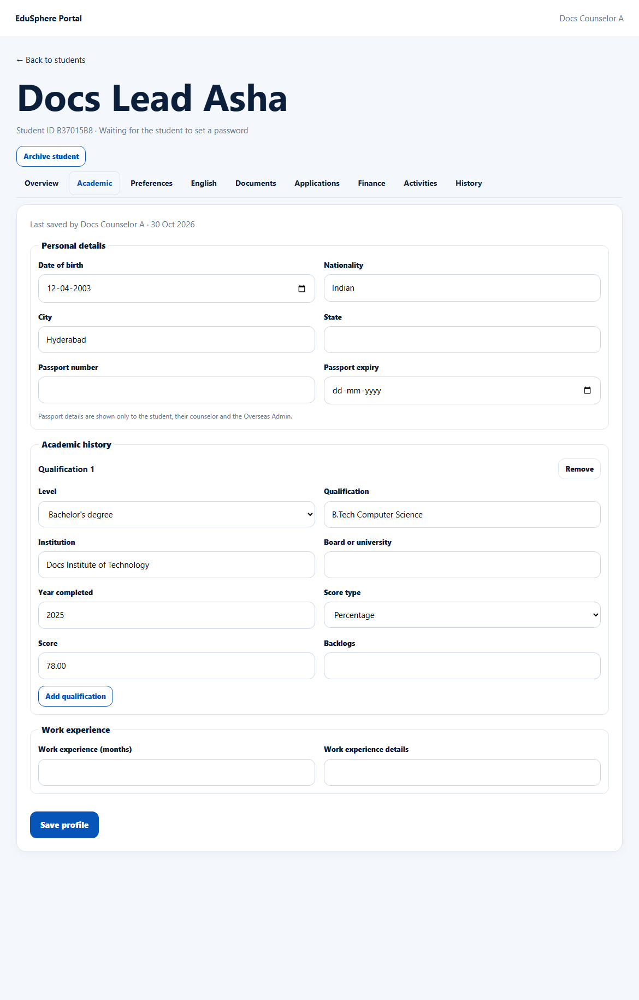
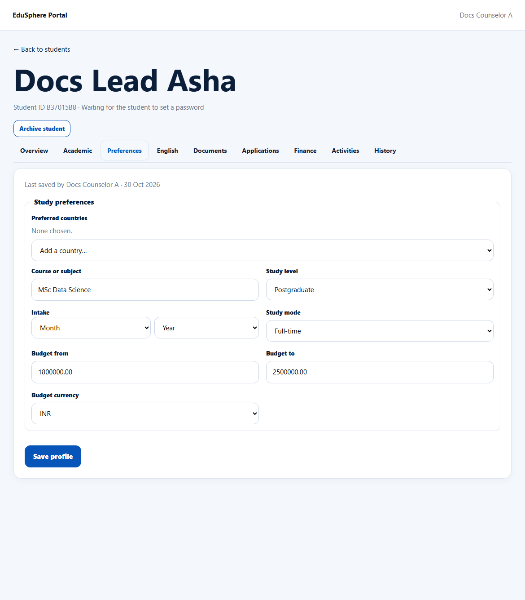
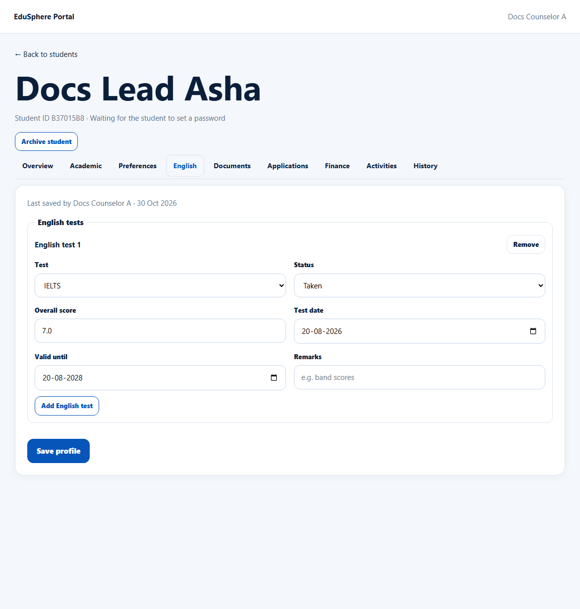
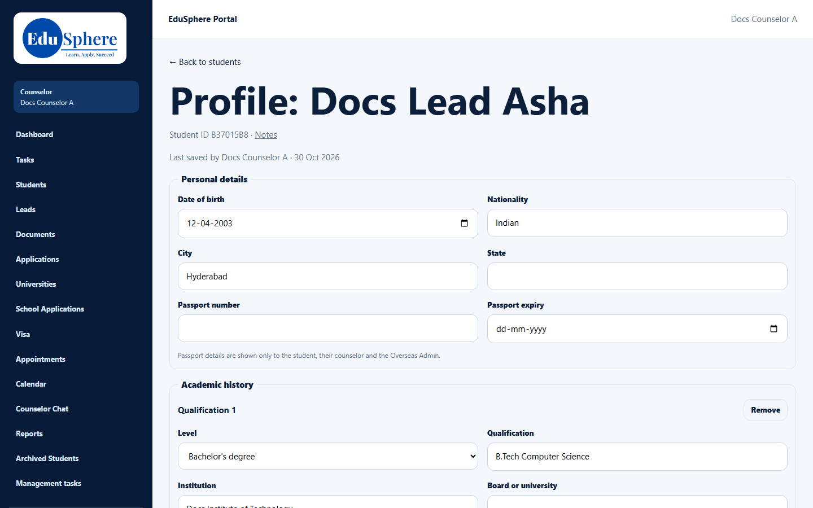

# Structured profile: Academic, Preferences, English
> Doc ID: DOC-CNS-STU-005 · Verified on 2026-10-30 against `main` @ `045d8c40` · Roles: Counselor, Overseas Admin, Student

## Purpose
Keep the student's personal details, academic history, study preferences and English tests in one structured profile. You and the student can both edit it.

## Who Can Use This Feature
- **Counselor** (your students) and **Overseas Admin**.
- The **student**, from their own portal.

## Prerequisites
None. A converted lead's qualification is copied in automatically.

## How to Access
Student 360 → **Academic**, **Preferences** or **English** tab, or **Profile** (the whole form on one page).

## Steps
### Step 1 — Academic
Fill **Personal details**: Date of birth, Nationality, City, State, Passport number and Passport expiry. Passport details are shown only to the student, their counselor and the Overseas Admin.

Under **Academic history**, each **Qualification** has Level, Qualification, Institution, Board or university, Year completed, Score type, Score and Backlogs. Use **Add qualification** and **Remove**.

Add **Work experience** (months and details). Select **Save profile**. **Profile saved.** appears with "Last saved by {name} · {date}".

### Step 2 — Preferences
Add up to 5 **Preferred countries**. Then fill **Course or subject**, **Study level**, **Intake** (month and year), **Study mode**, **Budget from** / **Budget to** and **Budget currency**. Select **Save profile**.

### Step 3 — English
Select **Add English test** and choose the **Test** (IELTS, TOEFL, PTE, Duolingo, Other) and its **Status** (Not taken yet, Booked, Taken). Add the **Overall score**, **Test date**, **Valid until** and any **Remarks**, then **Save profile**. You can record up to 5 tests. A test whose validity has passed is marked **Expired**.

### Step 4 — The Profile page
The **Profile** link opens the whole form on one page ("Profile: {name}").

## Fields
| Field | Allowed values |
|---|---|
| Level | Class 10, Class 12, Diploma, Bachelor's degree, Master's degree, PhD, Other |
| Score type | Percentage, CGPA (out of 10) |
| Backlogs | 0–99 |
| Work experience (months) | 0–600 |
| Study level | Undergraduate, Postgraduate, PhD, Diploma, Foundation |
| Study mode | Full-time, Part-time, Online |
| Budget currency | INR, USD, GBP, EUR, CAD, AUD, NZD |

## Expected Result
Each save is recorded in the student's **History** ("Profile updated: {fields}").

## Validation Messages
| Message | When |
|---|---|
| Profile saved. | Success |
| Qualification 1 · Score: … | A field in a qualification is invalid |
| Choose a listed country | A country isn't in the list |

## Tips
- Remove empty qualification rows before saving.
- The intake chosen here is the student's preference; each application has its own intake.

## Related Features
- [Student 360](stu-004-student-360.md)
- [Activities and History](stu-007-activities-history.md)
