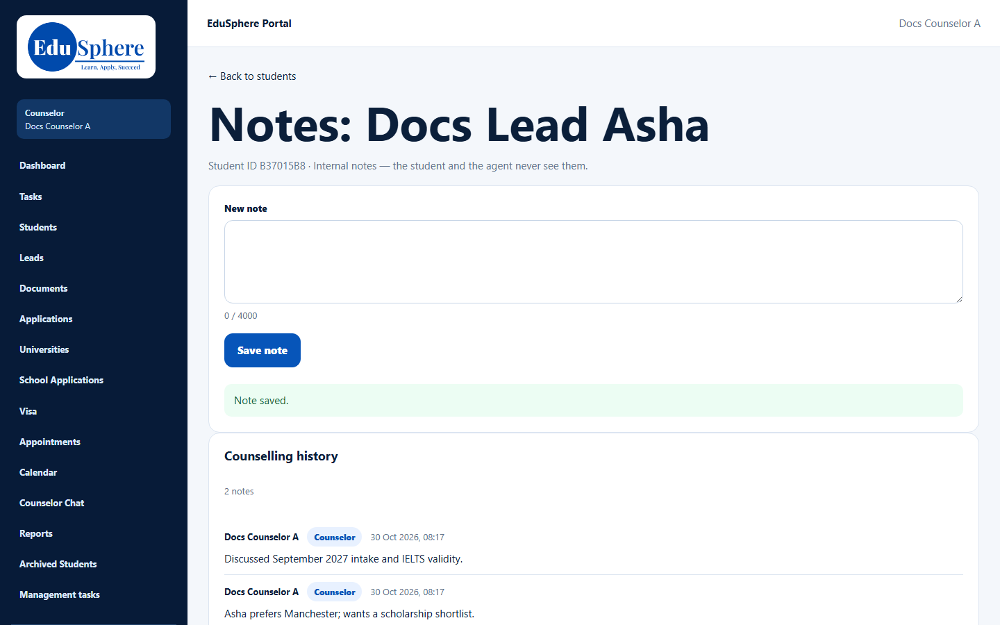

# Internal student notes
> Doc ID: DOC-CNS-STU-006 · Verified on 2026-10-30 against `main` @ `045d8c40` · Roles: Counselor, Overseas Admin

## Purpose
Keep the counselling history of a student: internal notes that the student and the agent never see.

## Who Can Use This Feature
Overseas counselors (your students) and the Overseas Admin.

## Prerequisites
None.

## How to Access
**My students** → **Notes**, or Student 360 → **Activities** → **Notes**.

## Steps
### Step 1 — Write a note
On **Notes: {name}**, type in **New note** (up to 4000 characters). If the student has applications, you can tie the note to one in **About an application (optional)**.

### Step 2 — Save
Select **Save note**. **Note saved.** appears and the note is added to **Counselling history**, newest first, with your name, role and time.

## Fields
| Field | Description | Required | Example |
|---|---|---|---|
| New note | Up to 4000 characters | Yes | Asha prefers Manchester; wants a scholarship shortlist. |
| About an application (optional) | The student in general, or one of their applications | No | — |

## Expected Result
Notes stay permanently; they can't be edited or deleted.

## Validation Messages
| Message | When |
|---|---|
| Note saved. | Success |
| Write a note first. | Empty note |
| Choose one of this student's applications | Invalid application |

## Tips
- Use **Load older notes** to see more than 20.

## Related Features
- [Activities and History](stu-007-activities-history.md)
- [Lead notes](../activity/act-005-notes.md)
