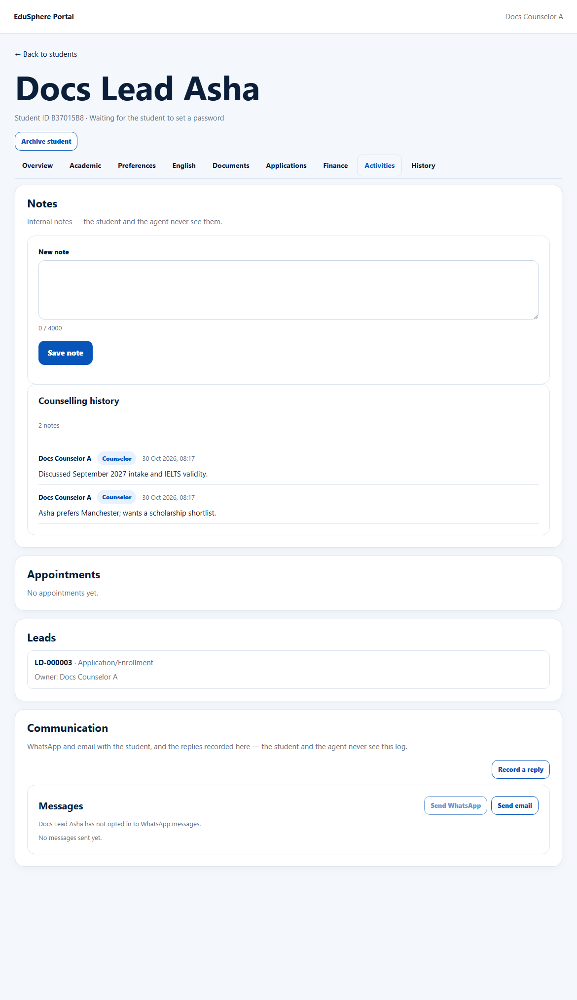
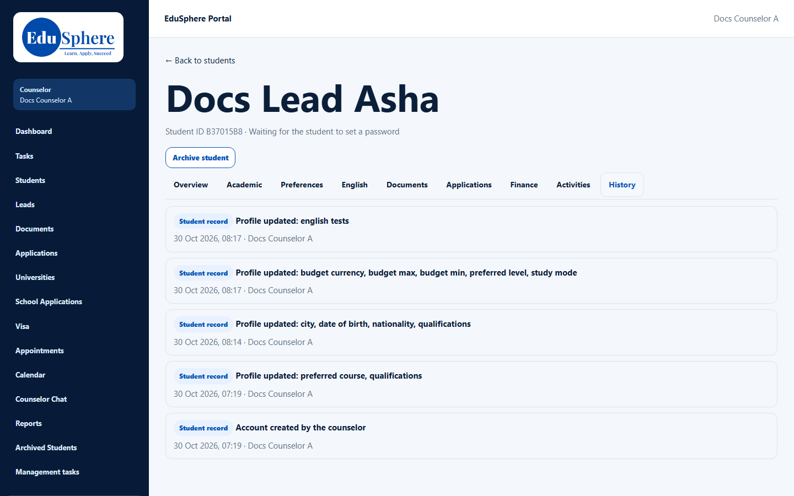

# Activities and History tabs
> Doc ID: DOC-CNS-STU-007 · Verified on 2026-10-30 against `main` @ `045d8c40` · Roles: Counselor, Overseas Admin

## Purpose
See the student's notes, appointments, linked leads and communication (**Activities**), and an audit trail of everything that changed (**History**).

## Who Can Use This Feature
Overseas counselors (your students) and the Overseas Admin.

## Prerequisites
None.

## How to Access
Student 360 → **Activities** or **History**.

## Steps
### Step 1 — Activities
The cards on this tab:
- **Notes**: see [Internal student notes](stu-006-notes.md).
- **Appointments**: the student's appointments ("No appointments yet.").
- **Leads**: the linked lead, its stage and owner.
- **Communication**: WhatsApp and email with the student, plus replies you record (**Record a reply**, **Send WhatsApp**, **Send email**). The student and the agent never see this log. WhatsApp is available only if the student has opted in.

### Step 2 — History
History lists changes newest first (up to 200), each tagged **Application**, **Student record** or **Document**. Examples:
- "Account created by the counselor".
- "Profile updated: {fields}".
- "Counselor assigned" with its reason.
- Stage, sub-status and outcome changes.
- Uploads and reviews.

## Expected Result
You can see who did what and when.

## Validation Messages
| Message | When |
|---|---|
| Nothing has been recorded yet. | Empty history |

## Related Features
- [Internal student notes](stu-006-notes.md)
- [When a student is reassigned to you](stu-010-reassignment.md)
