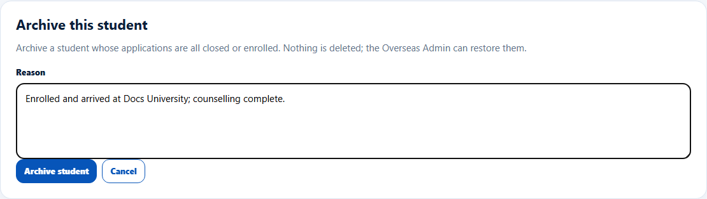
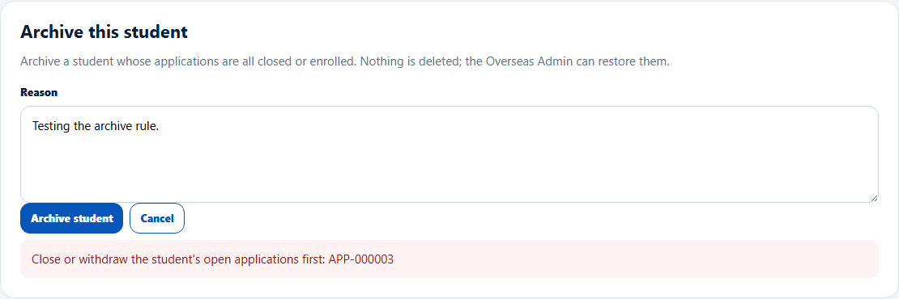
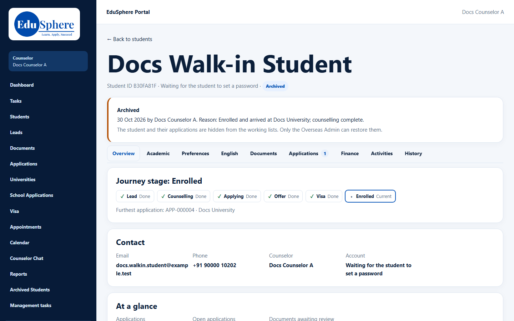
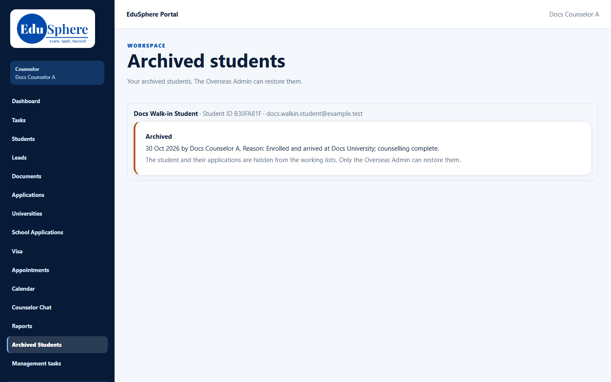
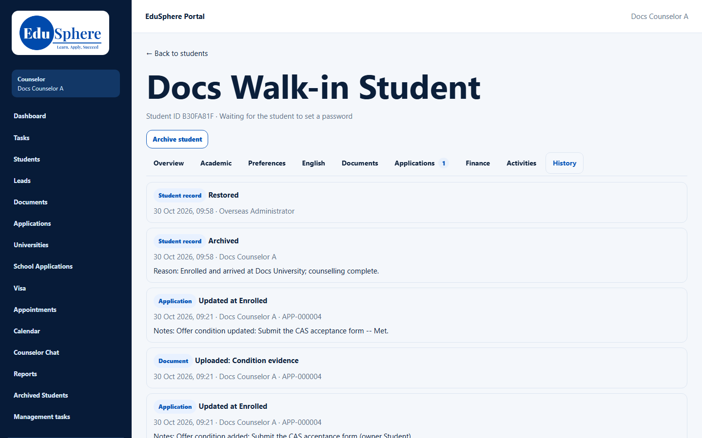

# Archive a student / Archived students
> Doc ID: DOC-CNS-STU-008 · Verified on 2026-10-30 against `main` @ `045d8c40` · Roles: Counselor, Overseas Admin

## Purpose
Hide a student whose work is finished, so your lists only show students you are still helping. Nothing is deleted.

## Who Can Use This Feature
- **Counselor:** students linked to you (walk-ins you added, leads you converted, students the Overseas Admin assigned to you).
- **Overseas Admin:** any student; only the Overseas Admin can restore (see [Restore](../../admin-manual/config/cfg-004-archived-students.md)).

## Prerequisites
All the student's applications are closed or enrolled.

## How to Access
Student 360 → **Archive student** (under the student's name).

## Steps
### Step 1 — Give a reason
Select **Archive student**. The panel says "Archive a student whose applications are all closed or enrolled. Nothing is deleted; the Overseas Admin can restore them." Enter the **Reason** and select **Archive student**.

If an application is still open, the archive is refused: "Close or withdraw the student's open applications first: {EduSphere IDs}".

### Step 2 — The archived student
The 360 shows an **Archived** badge and a banner: "Archived — {date} by {name}. Reason: … The student and their applications are hidden from the working lists. Only the Overseas Admin can restore them." **Add application** and **Upload a document** are no longer offered.

### Step 3 — Archived Students
Sidebar **Archived Students** (page **Archived students**) lists your archived students with their Student ID, email and the archive banner. Select a name to open their 360.

## Fields
| Field | Description | Required | Example |
|---|---|---|---|
| Reason | 3–500 characters | Yes | Enrolled and arrived at Docs University; counselling complete. |

## Expected Result
The student and their applications leave **My students**, **Application Tracking** and the dashboard. The archive and any restore are recorded in **History**.

## Validation Messages
| Message | When |
|---|---|
| Give a reason of at least 3 characters. | Reason too short |
| Close or withdraw the student's open applications first: APP-… | Open applications |
| Only the student's counselor or the Overseas Admin can archive this student | You handle only one of their applications |
| This student is already archived | Already archived |

## Common Errors
**Problem:** You can't archive a student you handle. **Cause:** You are only the counselor of one of their applications, not linked to the student. **Resolution:** Ask the Overseas Admin.

**Problem:** A student archived by the Admin isn't on your Archived Students page. **Cause:** The page lists only students linked to you.

## Tips
- Document requests can still be sent to an archived student; check before you send one.

## Related Features
- [Archived students: restore (admin)](../../admin-manual/config/cfg-004-archived-students.md)
- [My students](stu-002-my-students.md)
