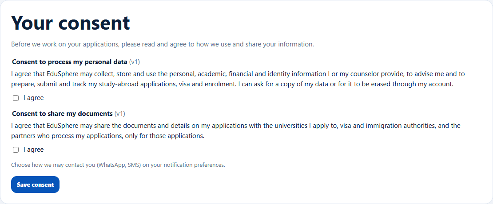
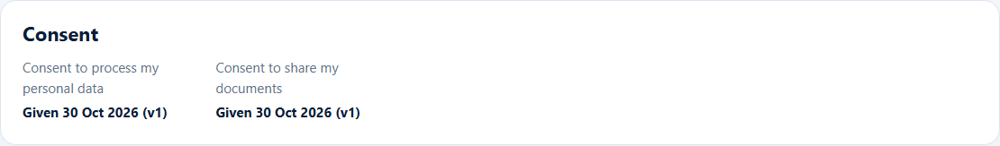
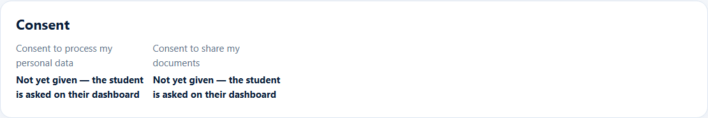

# Overseas consent
> Doc ID: DOC-CNS-STU-009 · Verified on 2026-10-30 against `main` @ `045d8c40` · Roles: Student, Counselor, Overseas Admin

## Purpose
Check that a student has agreed to how EduSphere processes their data and shares their documents, before working on their applications.

## Who Can Use This Feature
- **Student:** gives consent on their own dashboard.
- **Counselor and Overseas Admin:** see it, read only. Nobody can consent on a student's behalf.

## Prerequisites
The student has signed in at least once.

## How to Access
- **Student:** their Overseas dashboard → **Your consent**.
- **Counselor:** Student 360 → **Overview** → **Consent**.

## Steps
### Step 1 — The student agrees
On their dashboard the student sees **Your consent**: "Before we work on your applications, please read and agree to how we use and share your information." There are two agreements, **Consent to process my personal data (v1)** and **Consent to share my documents (v1)**, each with **I agree**. The student ticks them and selects **Save consent**.

### Step 2 — You check it
On the Student 360 Overview, **Consent** shows each agreement as "Given {date} (v1)".

Until then it shows "Not yet given — the student is asked on their dashboard".

## Expected Result
The consent date and version are recorded.

## Validation Messages
| Message | When |
|---|---|
| No consent is requested at the moment. | No active agreement |

## Common Errors
**Problem:** The student hasn't given consent. **Cause:** They haven't signed in, or didn't save the card. **Resolution:** Ask them to sign in and save **Your consent**; you can't do it for them.

## Related Features
- [Student 360](stu-004-student-360.md)
