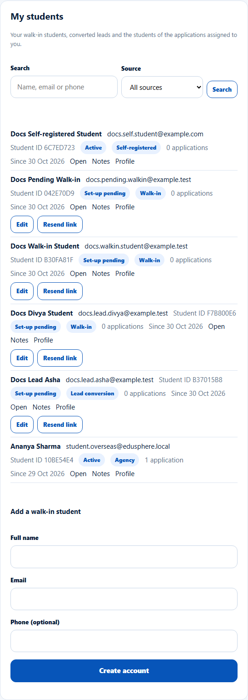
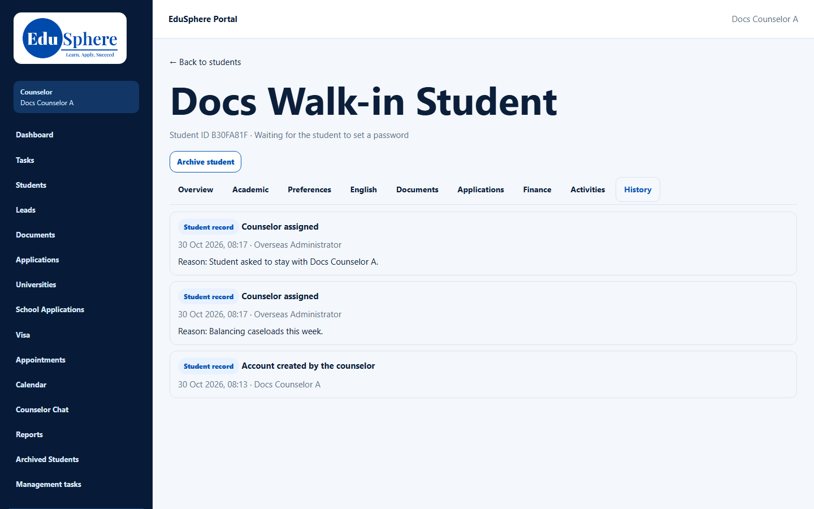
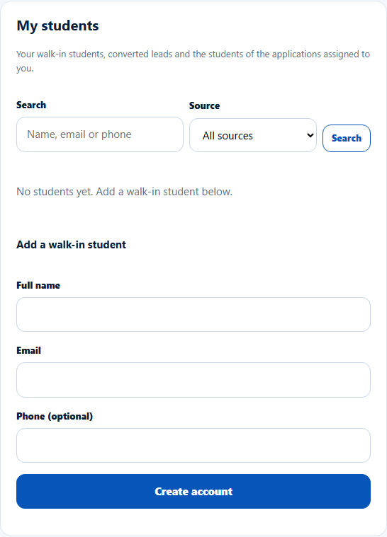

# When a student or application is reassigned to you
> Doc ID: DOC-CNS-STU-010 · Verified on 2026-10-30 against `main` @ `045d8c40` · Roles: Counselor

## Purpose
Know what changes for you when the Overseas Admin moves a student or an application between counselors.

## Who Can Use This Feature
Overseas counselors. The Overseas Admin makes the change (see [admin guide](../../admin-manual/accounts/adm-003-student-counselor.md)).

## Prerequisites
None.

## How to Access
Sidebar **Students** (My students, Application Tracking) and the student's **History** tab.

## Steps
### Step 1 — The student appears in My students
A student assigned to you shows in **My students** with their source. An application assigned to you appears in **Application Tracking**, and its student appears in My students (for example an **Agency** student).

### Step 2 — The reason is in History
Open the student → **History**. Each change shows **Counselor assigned**, who made it, when, and **Reason: …**.

### Step 3 — Moved away
When a student moves to another counselor, they disappear from your lists, unless you still handle one of their applications.

## Expected Result
Your lists always reflect the current assignment.

## Common Errors
**Problem:** You weren't told about a new student. **Cause:** EduSphere creates in-app notices ("Student assigned to you", "Application assigned to you"), but counselors have no notifications page. **Resolution:** Check **My students** and **Application Tracking** regularly.

## Related Features
- [My students](stu-002-my-students.md)
- [Agency students and applications](../handoffs/ho-003-agency-students.md)
