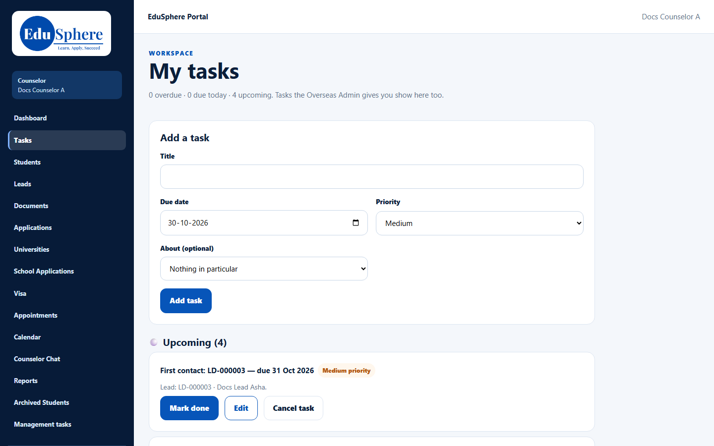
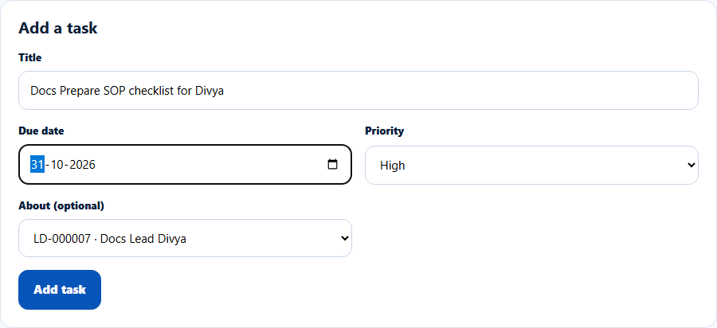
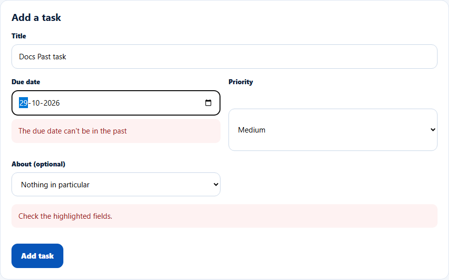
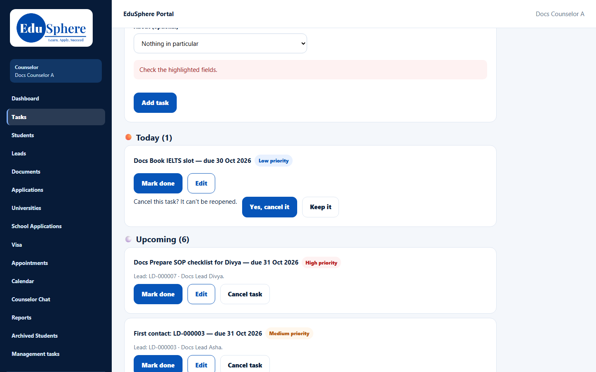
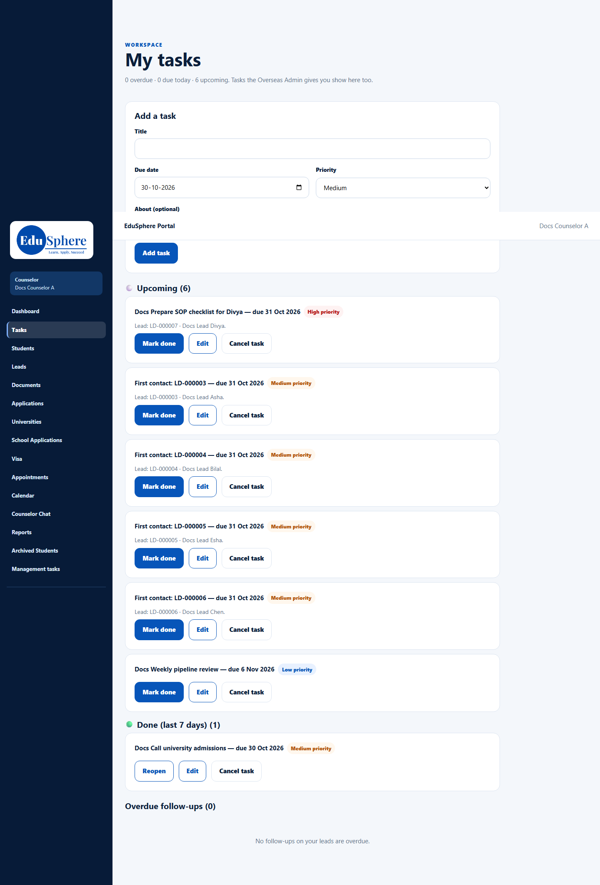
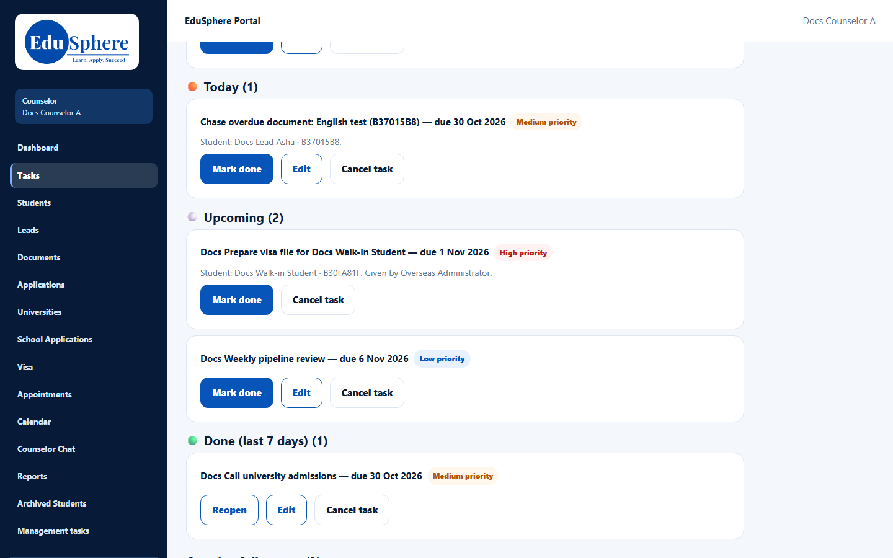

# My tasks
> Doc ID: DOC-CNS-TASK-001 · Verified on 2026-10-30 against `main` @ `045d8c40` · Roles: Counselor

## Purpose
Keep your own to-do list, linked to leads, students or applications. It also collects tasks that reminders and the Overseas Admin create for you.

## Who Can Use This Feature
Overseas counselors.

## Prerequisites
None.

## How to Access
Sidebar **Tasks** (page title **My tasks**).

## Steps
### Step 1 — Read the summary
The top line counts your tasks, for example "0 overdue · 0 due today · 6 upcoming". Tasks the Overseas Admin gives you show here too.

### Step 2 — Add a task
In **Add a task**, enter the **Title**, choose the **Due date** (today or later) and **Priority**, and optionally link it in **About (optional)** to one of your leads, students or applications. Select **Add task**. **Task added.** appears.

A past due date is refused (**Check the highlighted fields.**).

### Step 3 — Work the list
Tasks are grouped in bands by IST day: **Overdue**, **Today**, **Upcoming** and **Done (last 7 days)**. Each shows its title, due date, priority badge and what it is about. The **About** link opens the lead, the student's notes, or **Application Tracking** for an application.
- **Mark done** moves a task to **Done**; **Reopen** brings it back.
- **Edit** changes your own tasks.
- **Cancel task** asks "Cancel this task? It can't be reopened."; confirm with **Yes, cancel it**, or **Keep it**.

### Tasks the Overseas Admin gives you
A task the Overseas Admin adds for you shows "Given by {name}". You can **Mark done** or **Cancel task**, but not edit it.

### Reminder tasks
Tasks such as **First contact: LD-000003** or **Chase overdue document: English test** are created automatically by the reminder rules, for example when a lead is handed to you. See [Automatic reminders](../follow-ups/fup-003-automatic-reminders.md).

## Fields
| Field | Description | Required | Example |
|---|---|---|---|
| Title | 2–200 characters | Yes | Docs Prepare SOP checklist for Divya |
| Due date | Today up to two years ahead | Yes | 31 Oct 2026 |
| Priority | High, Medium, Low (default Medium) | Yes | High |
| About (optional) | One of your leads, students or applications | No | LD-000007 · Docs Lead Divya |

## Expected Result
Your tasks show in the right band and on your dashboard's **Tasks due** tile.

## Validation Messages
| Message | When |
|---|---|
| Task added. | Success |
| Give the title (2-200 characters) | Title too short or long |
| Check the highlighted fields. / The due date can't be in the past | Past date |
| Choose a due date from today up to two years ahead | Due date more than two years ahead |
| You can change only the status of a task someone else gave you | Editing an admin's task |
| This task was cancelled; it can't be changed | Cancelled task |

## Common Errors
**Problem:** A cancelled task has disappeared. **Cause:** Cancelled tasks are not listed in any band. **Resolution:** Cancel only tasks you will never need; otherwise mark them done.

**Problem:** Reminder tasks remain for a lead you closed or returned. **Resolution:** Mark them done.

## Tips
- Overdue follow-ups from your leads are listed at the bottom of this page. See [Overdue follow-ups](../follow-ups/fup-002-overdue-follow-ups.md).

## Related Features
- [Overdue follow-ups](../follow-ups/fup-002-overdue-follow-ups.md)
- [Automatic reminders](../follow-ups/fup-003-automatic-reminders.md)
