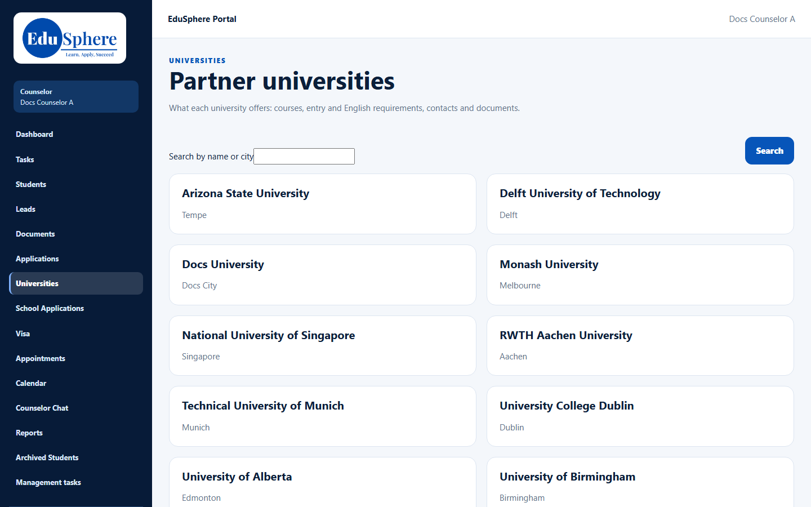
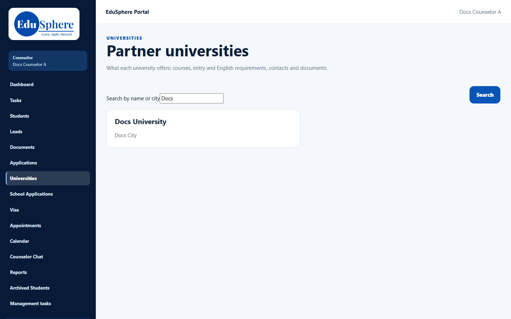

# Partner universities list
> Doc ID: DOC-CNS-UNI-001 · Verified on 2026-10-30 against `main` @ `045d8c40` · Roles: Counselor

## Purpose
Find a partner university quickly and open what it offers: courses, entry and English requirements, contacts and documents.

## Who Can Use This Feature
Overseas counselors.

## Prerequisites
Universities are published in the catalogue.

## How to Access
Sidebar **Universities**. The page title is **Partner universities**.

## Steps
### Step 1 — Browse
The page lists the published universities with their city, the first 50 at a time.

### Step 2 — Search
Type in **Search by name or city** and select **Search**. Select a university to open it (see [University 360 view](uni-002-university-360.md)).

## Expected Result
Only published, active universities are listed.

## Validation Messages
| Message | When |
|---|---|
| No universities match "{search}". | Nothing found |
| Showing 50 of {n}. Search to narrow the list. | More than 50 |

## Related Features
- [University 360 view](uni-002-university-360.md)
- [Add an application](../applications/app-001-add-application.md)
