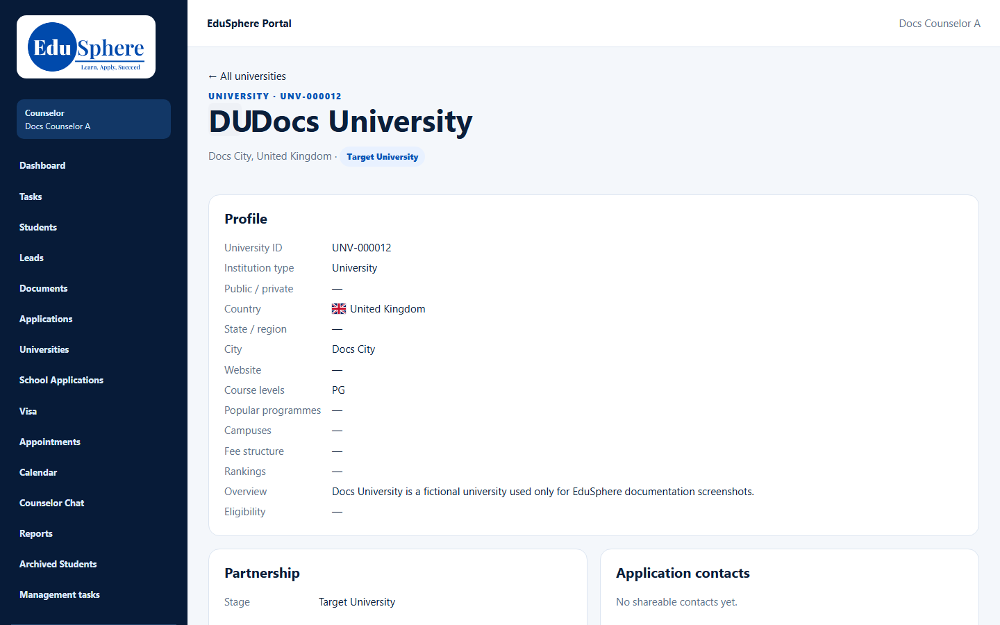
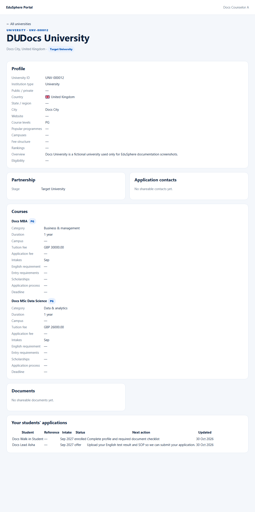

# University 360 view
> Doc ID: DOC-CNS-UNI-002 · Verified on 2026-10-30 against `main` @ `045d8c40` · Roles: Counselor

## Purpose
See one university's profile, courses, shareable contacts and documents, and your students' applications to it.

## Who Can Use This Feature
Overseas counselors.

## Prerequisites
The university is published.

## How to Access
**Universities** → select the university.

## Steps
### Step 1 — Profile and partnership
The **Profile** card shows the University ID, type, country, city, course levels, programmes, campuses, fee structure, rankings, overview and eligibility. **Partnership** shows its partnership stage.

### Step 2 — Courses, contacts and documents
- **Courses** lists each active course with level, category, duration, campus, tuition fee, application fee, intakes, English requirement, entry requirements, scholarships, application process and deadline.
- **Application contacts** and **Documents** show only items marked shareable.

### Step 3 — Your students' applications
The table lists your students' applications to this university: Student, Reference, Intake, Status, Next action and Updated.

## Expected Result
You have what you need to advise a student on this university.

## Validation Messages
| Message | When |
|---|---|
| No shareable contacts yet. / No active courses yet. / No shareable documents yet. | Nothing to show |
| No applications for this university yet. | None of your students applied |

## Common Errors
**Problem:** The heading reads "DUDocs University". **Cause:** For a university without a logo, the logo's initials are printed in front of the name. **Resolution:** Read the name without the initials.

**Problem:** The application **Status** shows codes such as `offer` or `enrolled`. **Cause:** This table shows the internal status. **Resolution:** Read the stage on the application itself.

## Tips
- Agent-Master commission is not shown to counselors.

## Related Features
- [Partner universities list](uni-001-partner-universities.md)
