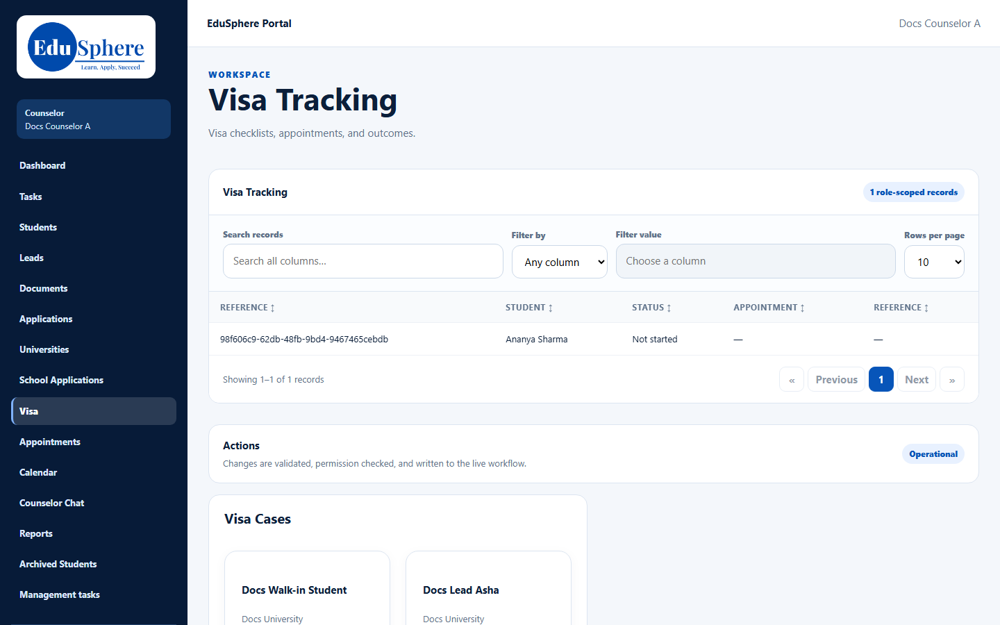
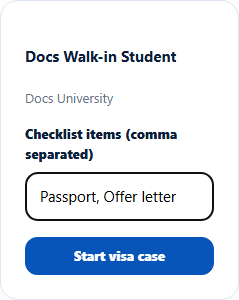
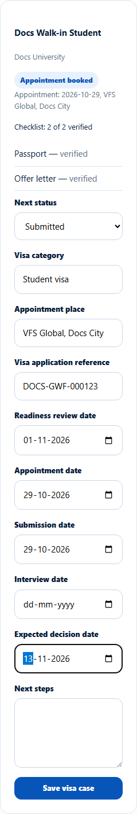
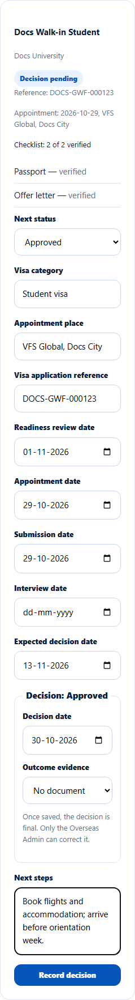
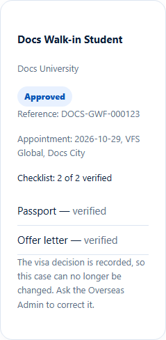

# Start and track a visa case
> Doc ID: DOC-CNS-VISA-001 · Verified on 2026-10-30 against `main` @ `045d8c40` · Roles: Counselor

## Purpose
Track a student's visa from preparation to decision: checklist, appointment, submission and the final outcome.

## Who Can Use This Feature
The counselor assigned to the application.

## Prerequisites
- An agency application must be at **Offer** or later; a direct application can start a visa case at any stage.
- The documents on the visa checklist are uploaded and **Verified** before the case can move past preparation (see [Documents page](../documents/doc-002-documents-and-status.md)).

## How to Access
Sidebar **Visa**. The page title is **Visa Tracking**, and the **Visa Cases** card has one block per application.

## Steps
### Step 1 — Start the visa case
In the student's block, enter the **Checklist items (comma separated)**, for example "Passport, Offer letter", and select **Start visa case**. **Visa case started.** appears.

### Step 2 — Move the case forward
Choose the **Next status** and fill the fields for that step, then select **Save visa case**. **Visa status set to {status}.** appears.
- **Preparing:** Readiness review date, Visa category.
- **Appointment booked:** Appointment date, Appointment place.
- **Submitted:** Submission date, Visa application reference, Expected decision date.
- **Decision pending.**

The block shows "Checklist: {x} of {y} verified" with each item's status.

### Step 3 — Record the decision
Choose **Approved**, **Refused** or **Withdrawn**. Enter the **Decision date**, optional **Outcome evidence** and **Next steps**; a refusal also needs the **Refusal reason (counselor and admin only)**. "Once saved, the decision is final. Only the Overseas Admin can correct it." Select **Record decision**.

## Fields
| Status | Meaning |
|---|---|
| Not started → Preparing → Appointment booked → Submitted | Forward only |
| Additional information requested ⇄ Decision pending | Can go back and forth |
| Approved / Refused / Withdrawn | Final |

## Expected Result
- The student is notified "Your visa case is now: {status}." They never see the refusal reason.
- The application's sub-status follows the case: Visa preparation, Visa applied, Visa decision pending, Visa approved.
- **Approved** moves the application to **Status Tracking**. **Refused** closes the application.

## Validation Messages
| Message | When |
|---|---|
| Visa case started. / Visa status set to {label}. / Visa details saved. | Success |
| Cannot advance past the checklist stage -- not yet verified: {items}. | Checklist documents not verified |
| That status change is not allowed -- a visa case moves forward, except between Additional information requested and Decision pending | Moving backwards |
| Add the appointment date before marking the appointment booked | Missing date |
| Add the submission date before marking the visa application submitted | Missing date |
| Add the refusal reason before recording a refusal | Refusal without reason |
| The decision date cannot be in the future | Future date |

## Common Errors
**Problem:** "Cannot advance past the checklist stage". **Cause:** A checklist document isn't uploaded and verified. **Resolution:** Upload it, tied to the application, and verify it in **Documents**.

## Tips
- "Visa decisions are made by the relevant government or immigration authority. EduSphere does not decide visa outcomes."
- The Student 360 has no Visa tab; use the **Visa** page.
- Your [calendar feed](../calendar/cal-002-calendar-feed.md) includes students' visa appointments.

## Related Features
- [Confirm enrolment](../arrival/arr-001-confirm-enrolment.md)
- [Documents page and document status](../documents/doc-002-documents-and-status.md)
