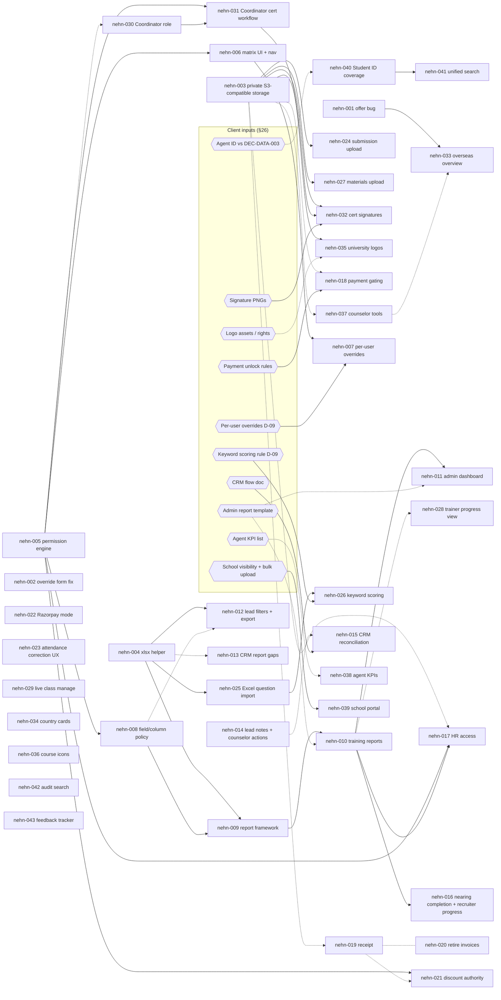

# Consolidated Review — Enhancement Backlog (`nehn-001` … `nehn-043`)

NO-ASSUMPTION MODE. Prepared 2026-10-17 at the owner's request. **No code was written or changed.**

**Source.** "EduSphere Portal – Consolidated Review & Requirements" (PDF, 24 pages, 28 sections, 25 action items). The owner supplied it on 2026-10-17. It is not yet in `docs/sources/`, and it has no `SOURCE_MANIFEST.csv` row.

**Evidence class.** The PDF is the written-up consolidation of the 12 Sep 2026 review call. That call is already `EVID-011`/`EVID-012`, and several decisions came from it: `DEC-ROLE-003` (Coordinator), `DEC-DATA-003` (Student ID) and the open `CLIENT_QUESTIONS.md` D-09 items.
- **Classification:** `MEETING_TRANSCRIPT_REQUEST`.
- **Its "Confirmed Key Decisions" table (§24)** is the document's own wording. Under the constitution it is **not** `EXPLICIT_APPROVAL`.
- **What each item may treat as decided:** only what an existing DEC already records. Everything else is `NEEDS_CONFIRMATION`, and each item's build still needs its own clarifying questions, a Decision ID and spec → plan → build.

**Baseline.** Every "existing behaviour" statement was checked against code on `origin/main` @ `4396b4eb`, by seven read-only audits plus spot checks of the key claims. Graphify was used for orientation. Its graph was built at `36d4c9cb`, which is older than main, so the code was the authority.

**Numbering.** `nehn-0NN` is this backlog's item number, not a Feature ID. When an item is picked up, it gets a Feature ID and a `DEC-SCOPE` number, checked against fresh `origin/main` at that time.

Next free numbers as of today:
- **On main:** migration `0164`, `DEC-SCOPE-224`.
- **Already taken:** the unmerged `feature/agn-024` branch holds `0164`, `DEC-SCOPE-224`, API `12EK` and RBAC `2.147`.
- **So the first new item would use:** `0165`, `DEC-SCOPE-225`.

## 1. Headline

- **Already done.** Most of the PDF describes things that work today: the public site (§3), roles (§4), the student portal (§6), payments (§7), attendance (§8), the trainer portal (§10, mostly), recruiter CRM (§12), the agent portal (§20), the school portal (§21) and the internal lead CRM (§16, the Telecaller CRM `tel-001…026`).
- **Biggest real gap: permissions (§5).** There is no permission engine. About 687 inline `user.role` checks sit across 130 routers and roughly 927 endpoints. The unused `require_permission` dependency exists in `api/deps.py`, but no router calls it. There is no admin permission matrix and no per-user override.
- **Next-largest gaps:**
  - **Reporting (§14/§15):** no LMS reports, no `.xlsx` output, no role-based columns.
  - **Uploads:** submissions are URL-only, and question import is JSON-only.
  - **Certificate workflow (§11):** no Coordinator role and no signatures.
  - **Overseas student overview (§18):** missing.
- **One live defect.** A counselor-advanced `offer` never shows to the overseas student: `services/portal.py:567,617` checks `offer_received`/`accepted`. AGN-010 fixed the agent side only.
- **One live security exposure.** Production stores uploads on a local Volume (`DEC-INFRA-002` ID4). `/local-files` is mounted publicly over the whole upload directory (`main.py:166`), and certificate PDFs also land there. `psb-017` already records this. This backlog raises it to a prerequisite for file-upload work.
- **Three conflicts with recorded decisions, to settle with the owner before building:**
  1. **Agent ID.** The PDF asks for a business-facing Agent ID (§22, action 21). `DEC-DATA-003` (2026-09-15) says "students only, no Agent ID".
  2. **Bulk school upload.** The PDF says reconfirm before treating it as Phase 1 (§21). It is already **built**: `/school/students/bulk-upload`, migration `0051`.
  3. **Certificate issuance.** `DEC-ROLE-003` moves issuance **exclusively** to a Coordinator. The PDF's "controlled override for authorized personnel" and "trainer participates in eligibility/approval" need mapping onto that.

## 2. Section-by-section coverage audit

Status values:
- **BUILT:** present on main.
- **PARTIAL:** present with gaps.
- **GAP:** missing.
- **CLIENT:** waiting on a client input.
- **CONTEXT:** narrative, with no requirement.

| § | Section | Status | Evidence (main @ 4396b4eb) | Backlog |
|---|---|---|---|---|
| 1 | Purpose | CONTEXT | — | — |
| 2 | Overall status (10 focus areas) | CONTEXT | Each focus area maps to the rows below | all |
| 3 | Public website and course discovery | BUILT | `ProgramCatalogue.tsx:29` sort options include `fee-asc`/`fee-desc`; featured/testimonials `public.py:137`; `/it/placements`, `/it/careers` + `CareerApply` (`/public/jobs`) | — |
| 4 | User roles | PARTIAL | 28 roles in `core/rbac.py:20-65` include `hr_team` and `university_rep`. The generic **Coordinator** does not exist (`rbac.py:35-39`, only `school_coordinator`) | nehn-030 |
| 5 | RBAC, per-user/role action permissions, admin matrix, UI and API enforcement | GAP | Static `PERMISSIONS` dict, read-only admin "roles" view (`services/portal.py:1405`); 0 routers use `require_permission`; `middleware.ts` checks only that the cookie exists; static nav `lib/navigation.ts` | nehn-005, 006, 007, 008 |
| 6 | Student portal (17 abilities) | BUILT, except payment gating | `auth.py:116` self-register … `workflows.py:1316` certificate download | nehn-018 (gating), nehn-023 (correction UX) |
| 7 | Payments: gateway, receipt fields, invoice, discounts | PARTIAL | Razorpay `services/payment.py:69`; receipt `billing_documents.py:13-50` has no student details, course, payment date, discount, balance or status; invoices exist (`payments.py:28`); discount `admin.py:1112` overwrites the amount in place; no test/live switch | nehn-019, 020, 021, 022 |
| 8 | Attendance corrections | BUILT, except notifications | `workflows.py:576-645`; no notification; UUID-typed UI | nehn-023 |
| 9 | Assignments: text and file; storage; Excel questions; evaluation | PARTIAL | Text BUILT (`models.py:305`); file is URL-only (`AssignmentSubmissionPanel.tsx:101`); 20 MB global limit (`config.py:56`); S3 or local storage with no `endpoint_url`; questions JSON-only (`workflows.py:942`); MCQ auto-scored (`workflows.py:1035`); no keyword scoring | nehn-003, 004, 024, 025, 026 |
| 10 | Trainer portal | PARTIAL | Batches, attendance, assignments and grading BUILT; materials URL-only (`models.py:315`); no per-student progress breakdown (`portal.py:500`); live classes have no reschedule/cancel (`communications.py:97`) | nehn-027, 028, 029 |
| 11 | Certificates: eligibility, override, Coordinator, signatures | PARTIAL | Eligibility BUILT, hardcoded (`workflows.py:1191`); issue = trainer/it_admin (`workflows.py:1258`); trainer form lacks `override_reason`, so override always returns 422; no signature/designation (`services/certificates.py`) | nehn-002, 030, 031, 032 |
| 12 | Placement / Recruitment | PARTIAL | Recruiter CRM BUILT (24 `recruiter_*` routers); no "completing in 15 days" list (`Batch.end_date` unused by recruiter code); no recruiter read of progress/attendance | nehn-016 |
| 13 | HR portal | PARTIAL | Candidates, jobs, interviews BUILT for `hr_team` (`workflows.py:1498-1650`); no student progress/attendance; no HR reports (`services/portal.py:968`) | nehn-017 |
| 14 | Reporting and analytics, filters, Excel | GAP | Admin dashboard counts only (`admin.py:235`); no student/trainer/attendance/completion reports; CSV-only exports per module (`agent_reports.py:93` `to_csv`); no enquiry export | nehn-004, 009, 010, 011, 012 |
| 15 | Role-based report download | PARTIAL | Row scope matches the dashboard per module (e.g. `telecaller_reports.py:29`); **no field-level column policy** | nehn-008 |
| 16 | Internal CRM | BUILT core / CLIENT | Telecaller CRM on `Enquiry` (stages `lead_stages.py:4-23` include contacted/qualified/converted/lost); round-robin, product, city and manual distribution; no workload or source allocation; no date/counselor list filter; no lead-list export; no standalone notes; no Zoho CRM in code (Zoho Meeting only) | nehn-012, 013, 014, 015 |
| 17 | Overseas student portal and visuals | PARTIAL | Apply, documents, visa checklist, scholarship, chat BUILT; country cards lack university count/"View universities"; logo is URL-only (`UniversityForm.tsx:244`); flags phase 1 only (`DEC-SCOPE-222`, phase 2 = `psb-019`); offer bug | nehn-001, 034, 035, 036 |
| 18 | Overseas student overview / progress | GAP | No stage tracker; agency-only journey exists (`services/agent_journey.py:75`) | nehn-033 |
| 19 | Counselor functions | PARTIAL | Review, advance, visa, appointments, chat BUILT; no non-agency missing-document request, scholarship update, admission interview or free notes; counselor cannot update lead status/follow-ups | nehn-014, 037 |
| 20 | Agent portal and performance dashboard | PARTIAL | Agent CRM BUILT; `/crm/dashboard` (`agent_dashboard.py:24`) lacks "applications submitted", conversion rate and visa refused/withdrawn | nehn-038 |
| 21 | School / Institution portal | BUILT core | 4 school roles, scoped by `profile.school_id` (`schools.py:348`); summaries BUILT; school document review GAP; bulk upload BUILT but marked deferred in `DEC-SCOPE-009` | nehn-039 |
| 22 | Business-facing Student/Agent ID | PARTIAL / CONFLICT | `User.student_code` + `SchoolStudent.student_code` (`0028`); `AgentStudent` rows get no code; no search by `User.student_code`; Agent ID out of scope per `DEC-DATA-003`; `AgentOrg.prefix`/member codes exist | nehn-040 |
| 23 | Search and history | PARTIAL | `/admin/users` has no `q`; lead search has no date range or counselor filter; `/audit` = last 500 rows, no filters (`admin.py:1225`) | nehn-012, 041, 042 |
| 24 | "Confirmed key decisions" | CONTEXT | Not `EXPLICIT_APPROVAL` (see top) | all |
| 25 | Action items 1–25 | mapped | See §3 below | all |
| 26 | Client inputs | CLIENT | CRM flow, report template, signature PNGs, logo assets, school fields, agent KPIs | §7 below |
| 27 | Next review | CONTEXT | — | nehn-043 |
| 28 | Conclusion | CONTEXT | — | — |

## 3. Action items → backlog

| # | Action item (PDF) | Owner / priority (PDF) | Backlog |
|---|---|---|---|
| 1 | Granular role/page/action permission matrix | Dev, High | nehn-005, 006, 007 |
| 2 | Excel download with filters | Dev, High | nehn-004, 009, 012 |
| 3 | Downloads respect role permissions | Dev, High | nehn-008 |
| 4 | Provide CRM workflow document | Client, required dependency | client input → nehn-015 |
| 5 | Review/finalize CRM functional flow | Dev + Client, after flow received | nehn-015 |
| 6 | Implement Internal CRM | Dev, High / after flow approval | core BUILT (tel-*); delta = nehn-012, 013, 014, 015 |
| 7 | Configure CRM roles, statuses, assignment | Dev, after flow approval | nehn-015 |
| 8 | Direct assignment file upload | Dev, High | nehn-003, 024 |
| 9 | Assignment text submission | Dev, High | **BUILT** (`Submission.answer`); no item |
| 10 | Trainer Excel question upload | Dev, High | nehn-004, 025 |
| 11 | Founder + Coordinator signatures | Dev, High | nehn-032 |
| 12 | Provide signature PNGs | Client, required dependency | client input → nehn-032 |
| 13 | Coordinator certificate workflow | Dev, High | nehn-030, 031 |
| 14 | Overseas Student Overview/Progress | Dev, High | nehn-033 (+ nehn-001) |
| 15 | Country icons/flags/images | Dev, High | nehn-034 |
| 16 | University logos/icons/images | Dev, High | nehn-035 |
| 17 | Course/program icons | Dev, Optional | nehn-036 |
| 18 | School/Institution login | Dev, Mon eve / Tue am | **BUILT** (school roles + login); delta nehn-039 |
| 19 | Confirm Phase-1 bulk school upload | Client + Dev, next review | nehn-039 (already built, so this is a confirmation) |
| 20 | Agent Performance Dashboard | Dev, Medium | nehn-038 |
| 21 | Business-facing Student/Agent ID | Dev, High | nehn-040 (Agent ID conflicts with DEC-DATA-003) |
| 22 | Student/agent search | Dev, High | nehn-040, 041 |
| 23 | Admin report template | Client, pending | client input → nehn-010, 011 |
| 24 | Role-specific reports | Dev, after report definition | nehn-010, 016, 017 |
| 25 | Feedback tracker | Dev, before next review | nehn-043 |

## 4. Items found during the audit that the PDF did not ask for

Each was found while checking a PDF line. Listed so they are not silently dropped.

| Finding | Evidence | Backlog |
|---|---|---|
| Overseas student never sees a counselor-advanced offer | `services/portal.py:567,617,1018,1038` vs stage `offer` (`agent_applications.py:27`) | nehn-001 |
| Trainer "Issue certificate" override always returns 422 (form has no `override_reason`) | `WorkflowPanel.tsx:300`, `workflows.py:1284` | nehn-002 |
| Public `/local-files` mount serves submissions and certificates in prod (local Volume) | `main.py:166`; `DEC-INFRA-002` ID4; `psb-017` | nehn-003 |
| Discount overwrites `Payment.amount`, so the original amount survives only in the audit log | `admin.py:1112-1164` | nehn-019 |
| Admin lead PATCH sets `owner_id` from a raw dict without validating the counselor | `admin.py:479-480` | nehn-014 |
| Student visa `decision` and `offer_type` are written but never shown to the student | `models.py:1813,1925`; `portal.py:620-634` | nehn-033 |
| `/audit` division filtering is done in Python after a 500-row cap | `admin.py:1225-1234` | nehn-042 |

## 5. Enhancement items

Every item uses the same fields. "Source" cites the PDF section (and the line numbers from the traceability appendix).

Complexity:
- **small:** at most 1 day, one layer.
- **medium:** 2–5 days, API + web.
- **large:** more than 1 week, or cross-cutting.

Risk is the risk of regression or of a wrong outcome.

### A. Defects and foundations

#### `nehn-001` — Overseas student sees offers advanced by a counselor
- **Source:** §17 "View offer status" (L465), §18; audit finding. Evidence: code defect.
- **Business requirement:** A student must see their offer status as soon as the counselor records it.
- **Existing behavior:**
  - The student dashboard "Offers" tile and the offers list count only `status in {"offer_received","accepted"}` (`services/portal.py:567,617`; the same pattern at `:1018,:1038`).
  - The counselor's forward-only `/advance` uses the stage `offer` (`services/agent_applications.py:27`). So an offer advanced through the normal path never appears.
  - AGN-010 (`DEC-SCOPE-056` O5) fixed the agent view only (`portal.py:838`).
- **Expected behavior:** Offers count and list whenever the application has reached the `offer` stage or a later one (`OFFER_STAGES_ON`), or has an offer letter. Legacy `offer_received`/`accepted` rows still count.
- **User roles affected:** overseas_student, plus any portal section that reuses the same lines (`:1018`/`:1038`: verify which role).
- **Frontend impact:** none (data-driven tiles).
- **Backend impact:** `services/portal.py`, four predicates. Reuse the AGN-010 predicate.
- **Database impact:** none.
- **API impact:** no contract change; response values change.
- **Integration impact:** none.
- **Authentication impact:** none.
- **Authorization impact:** none.
- **Security impact:** none.
- **Performance impact:** none.
- **Reusable existing modules:** `OFFER_STAGES_ON` (`agent_applications.py:31`); the AGN-010 fix at `portal.py:838`.
- **Dependencies:** none. Blocks nehn-033, which must not be built on the broken predicate.
- **Acceptance criteria:**
  1. An application advanced to `offer` appears in the student's offers list, and the Offers tile is 1.
  2. Applications at `visa_documentation`/`status_tracking`/`enrolled` still count as offers.
  3. Legacy `offer_received`/`accepted` rows still count.
  4. `withdrawn` before reaching offer does not count.
- **Positive scenarios:** counselor advances to offer, and the student sees it immediately.
- **Negative scenarios:** an application at `university_selection` does not count.
- **Edge cases:** an offer letter URL uploaded at an earlier stage still shows (existing `offer_letter_url` rule); an application withdrawn after the offer stage (`NEEDS_CONFIRMATION`: count or not).
- **Regression risks:** the agent-side tests for AGN-010; school global-education funnel counts if they share the predicate.
- **Open questions:** should a withdrawn-after-offer application stay in the offer count?
- **Complexity:** small · **Risk:** low
- **Status (2026-10-23):** built inside `ccrm-023` (owner OF1, `DEC-SCOPE-245`) with AGN-010's `counts_as_offer`, so an application
  withdrawn after a recorded offer still counts (the AGN-010 O5 answer).
- **Status (2026-10-26):** verified on main (`worktree-nehn-001`); tests added for the remaining AC stages, the edge cases and the
  university-rep list (`docs/quality/RTM.md`). No production change.

#### `nehn-002` — Trainer certificate override form: send the override reason
- **Source:** §11 "controlled override" (L244); audit finding. Evidence: code defect.
- **Business requirement:** An override must carry a reason (already enforced by the API).
- **Existing behavior:** The trainer "Issue certificate" form (`WorkflowPanel.tsx:300`) has an override checkbox but no `override_reason` field. The API requires one (`workflows.py:1284`), so ticking override always returns 422.
- **Expected behavior:** Ticking override shows a required reason field, and the request sends `override_reason`. **Interim fix only:** nehn-031 later moves issuance to the Coordinator (`DEC-ROLE-003`).
- **User roles affected:** trainer, it_admin.
- **Frontend impact:** `WorkflowPanel.tsx` trainer and admin issue forms.
- **Backend impact:** none.
- **Database impact:** none.
- **API impact:** none.
- **Integration impact:** none.
- **Authentication impact:** none.
- **Authorization impact:** none. Whether trainers may override at all is decided in nehn-031.
- **Security impact:** keeps the reason-required audit trail usable.
- **Performance impact:** none.
- **Reusable existing modules:** the existing WorkflowPanel form helpers.
- **Dependencies:** none. nehn-031 supersedes it.
- **Acceptance criteria:**
  1. With override ticked and a reason entered, the certificate is issued (201) and the reason is in the snapshot and audit log.
  2. With override ticked and no reason, the client-side validation message shows and no request is sent.
  3. Without override, the behaviour is unchanged.
- **Positive scenarios:** a trainer overrides a 70%-attendance student with a reason.
- **Negative scenarios:** a blank or whitespace-only reason is rejected.
- **Edge cases:** a very long reason is capped at the API's max length (`NEEDS_CONFIRMATION`: current limit).
- **Regression risks:** existing vitest for WorkflowPanel.
- **Open questions:** given `DEC-ROLE-003`, should this fix ship at all, or wait for nehn-031? (Cheap; recommended to ship.)
- **Complexity:** small · **Risk:** low
- **Status (2026-10-26):** built in `worktree-nehn-002`. Discovery found that the cited `WorkflowPanel` trainer spec is never rendered: `PortalPage` gives every IT trainer `TeacherWorkspaceActions`, whose card already showed and sent the reason. Changes: that card and `AdminCertificatePanel` now stop a blank or whitespace-only reason in the browser ("Enter a reason for the override."), send it trimmed, and the trainer card re-hides the reason after a successful issue (its controlled checkbox used to stay ticked through `form.reset()`). The unreachable reason-less `WorkflowPanel` spec was removed. No API/DB change. The max length stays `NEEDS_CONFIRMATION` (the API sets none).

#### `nehn-003` — Private, S3-compatible file storage with per-feature upload policy
- **Source:** §9 "external/cloud object storage" (L197-198), "~5 MB" (L191), formats (L193-196); §24 "Storage"; `DEC-INFRA-002` ID4; `psb-017`.
- **Business requirement:**
  - Uploaded files go to external/cloud object storage, not the app server's disk.
  - Limits and formats are configurable.
  - Private files are never publicly reachable.
- **Existing behavior:**
  - `StorageService` (`services/storage.py:9-58`) uses boto3 S3 when `aws_s3_bucket` is set, otherwise `/data/uploads`.
  - No `endpoint_url`, so DigitalOcean Spaces/MinIO can't be used. `DEC-INFRA-002` deferred Spaces for exactly this reason, and also because SSE `AES256` is untested on Spaces.
  - In production, files live on a local Volume and `/local-files` is a public `StaticFiles` mount over the whole directory (`main.py:166`).
  - `files.py:29-42` local-upload bypasses `storage.write_bytes` and reads the whole body into memory.
  - `certificates.py` and `billing_documents.py` write directly and bypass `StorageService`.
  - The upload limit is one global 20 MB (`config.py:56`). Types are checked from the client-sent content-type only (`config.py:57`). Legacy `.doc` and HEIC/WebP/TIFF are absent.
- **Expected behavior:**
  1. Every writer (uploads, certificates, receipts, invoices, testimonials) goes through one `StorageService`.
  2. `StorageService` accepts an S3-compatible `endpoint_url` and region, and SSE becomes configurable.
  3. Private objects are served only through authorised download routes (short-lived presigned URLs in S3 mode, streamed in local mode). The public `/local-files` mount is removed, or limited to an explicit public prefix such as logos and CMS images.
  4. An upload policy per purpose (`assignment_submission`, `learning_material`, `signature`, `university_logo`, …) sets max bytes (submission default 5 MB, `NEEDS_CONFIRMATION`) and allowed types, checked by magic-byte sniffing as well as content-type.
  5. Uploads are streamed to storage without buffering the whole body.
  6. A one-off migration script moves existing local files to object storage, if the owner chooses Spaces.
- **User roles affected:** all roles that upload or download. Ops (super_admin) for configuration.
- **Frontend impact:** download links switch to authorised routes. Upload components show per-purpose limits and accepted types.
- **Backend impact:**
  - Modified: `services/storage.py`, `api/files.py`, `services/certificates.py`, `services/billing_documents.py`, `api/public.py` (boto3 call), `main.py` (mount), `core/config.py`.
  - New: a `services/upload_policy.py` module.
  - Every caller of `presign_download` must be checked (psb-017 note).
- **Database impact:** optional `stored_files` metadata table (key, purpose, owner, size, mime, sha256, created_by) if per-file ownership checks are wanted. Otherwise none (`NEEDS_CONFIRMATION`).
- **API impact:**
  - New or changed: `POST /files/upload?purpose=` and `GET /files/{id}` authorised download.
  - Existing `/local-files/...` URLs stored in rows (`logo_url`, `file_url`) need rewriting or a compatibility route.
- **Integration impact:**
  - DigitalOcean Spaces (or AWS S3): bucket, keys, CORS, lifecycle.
  - **Requires an infra decision.** `DEC-INFRA-002` lists "moving uploads to Spaces (needs a Feature ID)". The constitution's `DEC-INFRA-001` gate applies to provider-specific infrastructure.
- **Authentication impact:** downloads require a session. The presigned URL TTL is short (`NEEDS_CONFIRMATION`: e.g. 5 min).
- **Authorization impact:** each download route checks the caller may see the owning record, e.g. submission → student, the batch's trainer, or admin.
- **Security impact:**
  - **High.** Closes the public exposure of private files in production.
  - Adds content sniffing.
  - Optionally add AV scanning (`NEEDS_CONFIRMATION`; not in the PDF).
  - Uses random keys.
- **Performance impact:** streaming removes memory spikes on the 2 GB droplet (see `prod-server-build-memory`). Presigned downloads take load off the API.
- **Reusable existing modules:** `StorageService`, `files.py`, `presign_download`; the `uploads` volume for local/dev.
- **Dependencies:** an infra decision (Spaces vs Volume + private serving). It is a prerequisite for nehn-024, 027, 032, 035 and ideally nehn-019 (receipts).
- **Acceptance criteria:**
  1. `GET /local-files/<private key>` returns 404 in every environment.
  2. An unauthenticated or unauthorised user gets 401/403 on `/files/{id}`, and the owner gets 200.
  3. With `S3_ENDPOINT_URL` set to a Spaces/MinIO endpoint, upload, download and presign work. With it unset, local mode works.
  4. A 5.1 MB submission is rejected with 413 when the policy max is 5 MB. A `.exe` renamed `.pdf` is rejected by the sniffing check.
  5. Certificates and receipts are written through `StorageService`.
  6. Existing stored URLs still resolve, through rewrite or compatibility routes.
- **Positive scenarios:** a student uploads a 3 MB PDF; the trainer downloads it through the authorised route.
- **Negative scenarios:** a guessable or leaked key without a session is denied; an oversize upload is denied; an MIME-spoofed upload is denied.
- **Edge cases:** a zero-byte file; duplicate filenames; a Unicode filename; a browser cancelling mid-upload (no orphan object, or an orphan swept up later); public CMS images that must stay public.
- **Regression risks:**
  - Every feature that stores a `/local-files/...` URL: testimonials (PUB-022), university logos, documents, resumes, offers, MoUs.
  - Certificate and receipt download.
  - E2E specs that fetch files directly.
- **Open questions:**
  - Spaces now, or keep the Volume with private serving?
  - The 5 MB limit for submissions only, or the default for everything?
  - Allowed formats: `.doc`? HEIC? TIFF?
  - AV scanning?
  - Which uploads must stay public (logos, CMS)?
- **Complexity:** large · **Risk:** high

#### `nehn-004` — Shared Excel (`.xlsx`) export and import helper
- **Source:** §14 "Excel Download" (L320-323); §9 "Excel" template (L200); §24 "Report Export", "Trainer Questions"; actions 2 and 10.
- **Business requirement:** Filtered data downloads as Excel. Trainers upload Excel templates.
- **Existing behavior:**
  - All exports are CSV with a BOM, through a shared `to_csv` (`api/agent_reports.py:93-102`).
  - All imports are CSV (`school_bulk.py:283,302`, reused by `telecaller_import.py:23`).
  - `openpyxl` is not a runtime dependency; it appears only in the dev-only CLI `direct_tieups/parse.py:649`.
- **Expected behavior:**
  - **`to_xlsx(columns, rows, sheet_name)`:** typed cells (dates as dates, numbers as numbers), a header style, frozen header, auto-filter and column widths.
  - **`read_tabular(upload)`:** reads `.xlsx` and `.csv` into rows with header validation.
  - Formula-injection protection on both CSV and xlsx: cells starting `= + - @` are escaped.
  - Each existing CSV route gains an `.xlsx` sibling, or a `?format=xlsx` parameter (`NEEDS_CONFIRMATION`: whether CSV stays).
- **User roles affected:** every role that downloads reports (telecaller manager, placement manager, agent master, partnership, school, admin) and trainers (import).
- **Frontend impact:** `ReportDownloadButton` gains an Excel option.
- **Backend impact:**
  - New `services/tabular.py`.
  - Add `openpyxl` to `requirements.txt`. Pin it, and check build memory on the 2 GB droplet.
  - Retrofit the existing export routes: `telecaller_reports`, `telecaller_dashboard`, `recruiter_dashboard`, `agent_reports`, agent commissions, `partnership_reports`.
- **Database impact:** none.
- **API impact:** new `.xlsx` routes or a `format` parameter; content type `application/vnd.openxmlformats-officedocument.spreadsheetml.sheet`.
- **Integration impact:** none.
- **Authentication impact:** none.
- **Authorization impact:** each `.xlsx` route uses the same scope function as its JSON/CSV twin (the existing §15 pattern).
- **Security impact:**
  - Formula (CSV) injection escaping.
  - On import: `openpyxl` read-only mode with no macros, a size cap (the nehn-003 policy) and a row cap. Zip-bomb guard on uncompressed size.
- **Performance impact:** stream large exports with a write-only workbook. Cap rows (`NEEDS_CONFIRMATION`: e.g. 50,000) and keep the existing throttle.
- **Reusable existing modules:** `to_csv`, the audit-row-before-file pattern, no-store headers, `ReportDownloadButton`, `_read_upload`.
- **Dependencies:** none. Prerequisite for nehn-009, 010, 012, 016, 017 and 025.
- **Acceptance criteria:**
  1. Every existing CSV export can also be downloaded as a valid `.xlsx` that Excel and LibreOffice open without repair prompts.
  2. Dates and numbers are typed cells.
  3. A cell value `=HYPERLINK(...)` comes out as literal text.
  4. An xlsx with missing required headers is rejected with a per-column message.
  5. An audit row is written for every download, the same as for CSV.
- **Positive scenarios:** a manager downloads today's source report as xlsx.
- **Negative scenarios:** an `.xlsm` upload is rejected; a 100k-row export is refused or capped with a message.
- **Edge cases:** an empty result gives a header-only sheet; Unicode names (Tamil, Hindi); a timezone (IST) on datetimes; leading zeros in phone numbers stay text.
- **Regression risks:** the existing CSV tests (keep CSV unchanged); docker image size and build memory.
- **Open questions:** keep CSV alongside xlsx? Row cap?
- **Complexity:** medium · **Risk:** low

### B. Permissions (§5, §13, §15)

#### `nehn-005` — Permission engine: role × resource × action, DB-backed, enforced on the API
- **Source:** §5 L89-128; §24 "Permissions", "CRM Permissions"; action 1.
- **Business requirement:**
  - An administrator controls which pages/resources each role can use, at the level of actions: View, Add, Edit, Delete, Download, Approve, Review, Issue, Manage.
  - It is enforced on the backend so direct URLs and APIs cannot bypass it.
- **Existing behavior:**
  - A static `PERMISSIONS` dict of coarse bundles such as `it:*` (`core/rbac.py:20-65`).
  - About 687 inline `user.role ==/in` checks across `api/` and `services/`, plus module-level role sets (`READERS`, `WRITERS`, `REPORT_ROLES`).
  - `require_permission`, `require_role` and `require_division` exist in `api/deps.py:61-96` but are used by 0 routers.
  - The admin "roles" section is read-only (`services/portal.py:1405-1425`).
  - Per-record scope (own batch, own school, own agency, assigned counselor) is enforced in services. That is correct and must stay.
- **Expected behavior:**
  1. **Catalogue.** A permission catalogue as code: resources (pages/modules such as `students`, `payments`, `discounts`, `attendance`, `reports.training`, `crm.leads`, `certificates`, …) × actions (`view`, `add`, `edit`, `delete`, `download`, `approve`, `review`, `issue`, `manage`).
  2. **Grants.** DB tables hold the role grants, seeded from today's behaviour, so the day-one effective permissions are **identical** to the inline checks.
  3. **Check.** `require_permission(resource, action)` checks the grant. Existing record-scope rules stay in the services: the permission engine says *may*, the scope rule says *which rows*.
  4. **Migration path.** Wire it module by module. Each module keeps its inline check until its grant-based check is proven equivalent by tests.
  5. **Lock-out protection.** `super_admin` stays `*` and cannot be edited.
  6. **Caching.** The effective-permission set is cached per request (and in memory with invalidation on edit).
  7. **History.** Every grant change is written to the audit log.
- **User roles affected:** all 28 roles, and super_admin as editor.
- **Frontend impact:** none in this item (UI is nehn-006).
- **Backend impact:**
  - `core/rbac.py` (catalogue + seed), `api/deps.py` (`require_permission`), and a new `services/permissions.py`.
  - Incremental retrofit of routers. Heaviest first: `workflows.py` (76 checks), `admin.py` (75), `schools.py` (62), `services/portal.py` (35).
  - **Scope this item to the engine plus 1–2 pilot modules** (e.g. LMS reports and certificates). The other modules become follow-up slices.
- **Database impact:** **migration.** New tables `permissions` (resource, action), `role_permissions` (role, permission_id, granted_by, granted_at) and optionally `permission_audit`. Seed data reproduces the current behaviour.
- **API impact:** `GET /admin/permissions/catalogue`, `GET/PUT /admin/roles/{role}/permissions`, `GET /auth/me/permissions` (effective set, for the UI). Existing endpoints are unchanged except that their 403s become grant-driven.
- **Integration impact:** none.
- **Authentication impact:** the effective permissions are loaded with the session user. Token contents are unchanged (`NEEDS_CONFIRMATION`: whether to embed a permission version in the JWT for cache busting).
- **Authorization impact:** **core change.** Deny by default. Unknown resource/action means deny.
- **Security impact:**
  - **High.** A mis-seed can widen access.
  - A seeded-equivalence test is required: for each role × endpoint in the RBAC matrix, the old and new decisions match.
  - Privilege escalation guard: only super_admin edits grants. Nobody can grant a permission they don't hold (`NEEDS_CONFIRMATION`).
- **Performance impact:** one cached lookup per request. Avoid per-row checks.
- **Reusable existing modules:** `require_permission` (`deps.py`), the `PERMISSIONS` dict as the seed source, `docs/architecture/RBAC_MATRIX.md` as the oracle for the equivalence test, `AuditLog`, and the route-inventory test (tel-026).
- **Dependencies:** none upstream. It blocks nehn-006, 007, 008, 017 and 021, and should come before any item that adds new role checks (otherwise they add to the debt).
- **Acceptance criteria:**
  1. After migration, with seed grants only, the full backend suite passes unchanged (behaviour-equivalence).
  2. Revoking `payments.view` from `it_admin` makes `GET /admin/payments` return 403 for it_admin. Re-granting restores 200, with no restart.
  3. A direct API call to a revoked resource returns 403 even if the UI is bypassed.
  4. super_admin's grants cannot be reduced.
  5. Every grant change writes an audit row with who, what and before/after.
  6. The pilot modules use `require_permission` exclusively, and their inline checks are removed.
- **Positive scenarios:** admin removes "download" on telecaller reports for telecaller_manager, and the CSV/xlsx routes return 403 while the JSON view still works.
- **Negative scenarios:** a non-super-admin calls `PUT /admin/roles/x/permissions` and gets 403; an unknown resource key is rejected (422).
- **Edge cases:**
  - Users with multiple `UserRoleAssignment` rows get the union of their grants (`NEEDS_CONFIRMATION`).
  - Division-scoped roles: it_admin vs overseas_admin on a shared resource.
  - Agent Master vs Staff toggles (AGN-003 `can_verify_documents`/`can_view_reports`) stay as org-level flags or fold into the engine (`NEEDS_CONFIRMATION`).
  - Cache invalidation across multiple API workers.
- **Regression risks:**
  - **Very high**, because the change spans the whole app.
  - Mitigations: the module-by-module rollout, the equivalence test, and keeping the inline checks until each module flips.
- **Open questions:**
  1. The exact resource list ("page" granularity: per sidebar page, or per module?).
  2. Is an admin (it_admin/overseas_admin) allowed to edit grants for their own division's roles, or super_admin only?
  3. Do Agent Master → Staff flags stay separate?
  4. Should custom roles be supported ("Additional roles can be introduced when required", L88)?
- **Complexity:** large · **Risk:** high
- **Status (2026-10-26):**
  - Engine built on `worktree-nehn-005` (`DEC-SCOPE-281`; migration `0196`; API §12GG; RBAC §2.195). Open questions 2–4 took the
    builder's defaults: super_admin only, flags separate, no custom roles.
  - Pilots: the admin payment routes and the telecaller reports routes. The other modules are follow-up slices.

#### `nehn-006` — Admin permission-matrix UI and permission-driven navigation and route guard
- **Source:** §5 "Admin Permission Matrix" (L122-128), "User-interface level" (L126).
- **Business requirement:** A simple matrix with selectable toggles. The UI hides what a user cannot use.
- **Existing behavior:**
  - The read-only roles table (`services/portal.py:1405`).
  - `apps/web/middleware.ts:11-21` checks only that the `edusphere_access` cookie exists.
  - The nav is a static role → section map (`lib/navigation.ts:22-61,259`).
  - About 201 role-literal checks in web code.
- **Expected behavior:**
  - **Matrix screen:** `/admin/permissions` shows rows = resources (grouped by module), columns = actions, a role selector, and toggle checkboxes, with save and an "unsaved changes" guard.
  - **Nav and pages:** the nav and page guards are driven by `GET /auth/me/permissions`. A page whose `view` grant is missing redirects to a 403 page.
  - **Buttons:** Add/Edit/Delete/Download/Approve buttons render only when the grant exists.
  - **Safety:** the API remains the authority (nehn-005), so the UI is convenience plus defence in depth.
- **User roles affected:** super_admin (editor); every role (nav changes).
- **Frontend impact:**
  - New admin page and a `usePermissions()` hook.
  - `PermissionGate` component.
  - `lib/navigation.ts` gains a resource key per section.
  - `middleware.ts` cannot read permissions cheaply (edge), so page-level gating moves to the server components or layout.
- **Backend impact:** none beyond nehn-005's endpoints.
- **Database impact:** none (nehn-005 owns the tables).
- **API impact:** consumes nehn-005 endpoints.
- **Integration impact:** none.
- **Authentication impact:** none.
- **Authorization impact:** the UI reflects grants. No grant logic in the web app.
- **Security impact:** low on its own. Hidden UI is not security, and nehn-005 provides the enforcement.
- **Performance impact:** fetch permissions once per session and cache them in the client. Revalidate after the matrix is edited.
- **Reusable existing modules:** `PortalShell`, `CollectionExplorer`, `lib/navigation.ts`, existing admin page patterns.
- **Dependencies:** nehn-005.
- **Acceptance criteria:**
  1. super_admin toggles `recruiter → payments.view` off and saves. On their next navigation, the recruiter's sidebar no longer shows Payments, and typing the URL shows the 403 page.
  2. The matrix shows every catalogue resource × action. A disabled (non-applicable) cell is not clickable.
  3. Saving writes one audit entry per changed cell.
  4. Keyboard-accessible toggles with labels (WCAG 2.1 AA). The layout works on mobile without horizontal page scroll (the matrix scrolls in its own container).
- **Positive scenarios:** grant HR `attendance.view`, and HR sees the Attendance page.
- **Negative scenarios:** a non-super-admin opening `/admin/permissions` gets 403.
- **Edge cases:** two admins editing at once (last-write-wins vs version check: `NEEDS_CONFIRMATION`); revoking the editor's own access.
- **Regression risks:** all navigation; existing e2e specs that click sidebar links; role-literal checks left in components drifting from grants.
- **Open questions:** matrix per role only, or also per user (nehn-007)? Should non-applicable actions be shown?
- **Complexity:** large · **Risk:** medium
- **Status (2026-10-27):** built on `worktree-nehn-006` (`DEC-SCOPE-295`; API §12GS; RBAC §2.206; no migration). Open questions took the
  builder's defaults: per role only; non-applicable actions shown as "—".

#### `nehn-007` — Per-user permission overrides
- **Source:** §5 L92 "control individual permissions for individual users or roles"; `CLIENT_QUESTIONS.md` D-09 §3 (**open**).
- **Business requirement:** Grant or deny a specific permission to one user, on top of their role.
- **Existing behavior:** none. D-09 asks whether role-level granularity is enough.
- **Expected behavior:**
  - `user_permission_overrides` (user, permission, effect allow|deny, reason, expires_at?).
  - Effective permission = role grants ∪ allows − denies.
  - The matrix UI gains a "User" tab.
  - The user's effective-permission view shows the origin of each permission (role or override).
- **User roles affected:** super_admin (editor); any user.
- **Frontend impact:** user tab on the matrix; a badge on the user profile showing they have overrides.
- **Backend impact:** extends `services/permissions.py` resolution and the cache key.
- **Database impact:** **migration**, new table.
- **API impact:** `GET/PUT /admin/users/{id}/permissions`.
- **Integration impact:** none.
- **Authentication impact:** none.
- **Authorization impact:** the deny-overrides-allow rule.
- **Security impact:** medium. Overrides are easy to forget, so they need a report of all active overrides and an optional expiry.
- **Performance impact:** negligible.
- **Reusable existing modules:** nehn-005, nehn-006, `AuditLog`.
- **Dependencies:** nehn-005, nehn-006. **Blocked on the D-09 answer.**
- **Acceptance criteria:**
  1. A deny override on one recruiter removes `reports.placement.download` for that user only.
  2. An allow override grants HR `documents.view` for one user.
  3. An expired override stops applying without manual action.
  4. An "active overrides" list is available to super_admin.
- **Positive scenarios:** one senior recruiter gets the `fees.view` exception.
- **Negative scenarios:** an override for an unknown permission is rejected.
- **Edge cases:** the user's role changes (do overrides persist? `NEEDS_CONFIRMATION`); a deactivated user (overrides are ignored).
- **Regression risks:** low, once nehn-005 is in.
- **Open questions:** D-09: is it required this release? Is expiry required?
- **Status (2026-10-27):** built on `worktree-nehn-007` (`DEC-SCOPE-299`; API §12GW; RBAC §2.210; migration
  `0206_user_permission_overrides`). Builder's defaults: built this release; expiry optional; overrides persist across a role change;
  a deactivated user cannot sign in, so their overrides never apply. AC keys mapped to catalogue keys (see DEC-SCOPE-299).
- **Complexity:** medium · **Risk:** medium

#### `nehn-008` — Role-based field (column) policy for views and downloads
- **Source:** §15 L324-350; §5 recruiter/HR examples (L104-121); action 3.
- **Business requirement:**
  - A user may not download what they cannot see.
  - Recruiters get contact, course, progress and placement fields but no financials.
  - HR gets attendance, progress and completion but no payments, discounts, admin or unrelated placement information.
  - Admin gets everything.
- **Existing behavior:**
  - Row scope matches the dashboard per module (e.g. `telecaller_reports.py:29-38`, `recruiter_dashboard.py:37-44`).
  - Columns are fixed per report kind. There is no field-level filtering anywhere.
  - `Candidate.current_salary`/`expected_salary` exist (`models.py:4754-4755`).
- **Expected behavior:**
  - Each report/list declares its columns with a **sensitivity class**: `identity`, `contact`, `academic`, `attendance`, `placement`, `financial`, `admin`, `document`.
  - Field-class permissions (`field.financial.view`, …) in the nehn-005 catalogue decide which columns are returned in JSON **and** in CSV/xlsx.
  - One shared serializer applies the policy, so the screen and the download can never differ.
- **User roles affected:** placement_team, placement_manager, hr_team, admins, and anyone else downloading.
- **Frontend impact:** tables render the columns returned by the API, not a hardcoded list.
- **Backend impact:** new `services/field_policy.py`; report and list services declare column metadata.
- **Database impact:** none, beyond nehn-005 seed rows for the field classes.
- **API impact:** response column sets vary by caller. **Document this per endpoint.**
- **Integration impact:** none.
- **Authentication impact:** none.
- **Authorization impact:** adds field-level authorization.
- **Security impact:** high value: stops financial data leaking through exports.
- **Performance impact:** negligible.
- **Reusable existing modules:** the report `columns`/`items` pattern, nehn-004 writers, and nehn-005.
- **Dependencies:** nehn-005; nehn-004 for xlsx. Used by nehn-009, 010, 012, 016, 017.
- **Acceptance criteria:**
  1. A recruiter's student report (JSON and xlsx) has no fee, discount or payment columns. Admin's version has them.
  2. HR's export has no payment or discount columns.
  3. A test asserts that the JSON column set equals the download column set for every role × report.
  4. Granting `field.financial.view` to a recruiter adds the financial columns to both.
- **Positive scenarios:** a recruiter exports the nearing-completion list with name, phone, email, address, course, progress and placement status.
- **Negative scenarios:** a recruiter calls the admin report endpoint and gets 403 (row/resource level); the HR export never contains `amount`.
- **Edge cases:** derived columns, e.g. a "balance due" computed from finance data, are classed `financial`; an aggregate column counts a sensitive class.
- **Regression risks:** existing exports must keep their current columns for current roles (pin with tests).
- **Open questions:**
  - Is "Address" a stored field for IT students today? (`NEEDS_CONFIRMATION`: verify the profile JSON keys.)
  - The exact field list per role awaits the client's report template (§26 Reports).
- **Status (2026-10-27):** built on `worktree-nehn-008` (`DEC-SCOPE-300`; API §12GX; RBAC §2.211; migration
  `0207_field_financial_grant`). `services/field_policy.strip` + catalogue key `field.financial.view`; piloted on the partnership
  Performance report's commission columns (the only financial columns in any report today), seeded to today's U2 readers so nothing
  changes on day one. Recruiter and HR roles hold no financial grant; their student reports (nehn-016/017) must tag their columns.
- **Complexity:** medium · **Risk:** medium

### C. Reporting (§14, §15)

#### `nehn-009` — Report framework: registry, standard filters, JSON/CSV/xlsx, audited
- **Source:** §14 "Filters" (L309-319), "Excel Download" (L320-323); §15; actions 2, 3 and 24.
- **Business requirement:**
  - Reports support from/to date, course, trainer, recruiter, student, status, latest N records and completion period.
  - Bulk filtered download to Excel.
- **Existing behavior:** Each module repeats `/{kind}` JSON + `/{kind}.csv` with its own filters. Date ranges exist per module. There is no trainer, student, "latest N" or completion-period filter, and no central LMS/admin report router.
- **Expected behavior:**
  1. **Registry.** A report registry (`services/reports/registry.py`): each report declares id, title, resource key (for nehn-005), columns with sensitivity classes (nehn-008), supported filters, default sort, and a scope function.
  2. **Endpoints.** One router: `GET /reports` (catalogue filtered by the caller's permissions), `GET /reports/{id}` (JSON, paged) and `GET /reports/{id}.{csv|xlsx}`.
  3. **Filters.** A standard filter model: `from`, `to` (inclusive, IST), `course_id`, `batch_id`, `trainer_id`, `recruiter_id`, `student` (ID/code/name), `status`, `latest` (N, capped) and `completion_from`/`completion_to`. Unsupported filters return 422.
  4. **Audit.** An audit row is written before every download (the existing pattern).
  5. **Web.** A generic `ReportPage` with a filter bar, a preview table and Download.
- **User roles affected:** admins, trainer (own), placement, HR, management.
- **Frontend impact:** new `/reports` hub and a `ReportPage` component that reuses `ReportDownloadButton`.
- **Backend impact:** new `api/reports.py` and `services/reports/*`. Existing module reports are **not** migrated (optional later).
- **Database impact:** none. Indexes may be needed on `enrollments(batch_id,status)`, `attendance(batch_id,student_id,date)`, `batches(end_date)` and `enquiries(created_at)` (`NEEDS_CONFIRMATION` after EXPLAIN).
- **API impact:** new `/api/v1/reports/*` contract (API section number assigned at build).
- **Integration impact:** none.
- **Authentication impact:** none.
- **Authorization impact:** the catalogue and every route are gated by nehn-005 resource keys. Rows come from the scope function (trainer = own batches, recruiter = opted-in/placement students). Columns come from nehn-008.
- **Security impact:** export throttle (reuse the agent-report throttle) and audit.
- **Performance impact:** server-side paging. Exports stream with a row cap. Long ranges may need a background job (`NEEDS_CONFIRMATION`: expected volumes).
- **Reusable existing modules:** `to_csv`/nehn-004 `to_xlsx`, the agent-report throttle, `ReportDownloadButton`, the date-range parsing in `telecaller_reports`.
- **Dependencies:** nehn-004, nehn-005, nehn-008.
- **Acceptance criteria:**
  1. `GET /reports` lists only the reports the caller may view.
  2. Every report honours each filter it declares, and an undeclared filter returns 422.
  3. `latest=50` returns the 50 most recent by the report's default date.
  4. The JSON, CSV and xlsx of the same filter give identical rows and columns.
  5. Each download writes an audit row with the filters.
- **Positive scenarios:** admin filters today's enquiries and downloads 50 rows as xlsx (the §14 example; the report itself is in nehn-012).
- **Negative scenarios:** `from > to` returns 422; a trainer asking for another trainer's `trainer_id` gets an empty or 403 result (`NEEDS_CONFIRMATION`: which).
- **Edge cases:** IST day boundaries; open-ended ranges; `latest` combined with `from/to`.
- **Regression risks:** low, as it is a new router.
- **Open questions:** should existing module reports move into the registry later? What is the maximum export row count?
- **Complexity:** medium · **Risk:** medium
- **Status (2026-10-27):** built on `worktree-nehn-009` (`DEC-SCOPE-303`; API §12HA; RBAC §2.214; migration
  `0210_training_report_grants`). `/api/v1/reports` + `services/reports/` registry; pilot report `enrollments` (`reports.training`,
  seeded to it_admin and trainer); Report library pages for super admin, IT admin and trainer. Builder's defaults: export cap 10,000
  rows (refused, not cut short); a trainer naming another trainer gets an empty result; completion period = batch end date for the pilot.

#### `nehn-010` — Training reports pack (student, trainer, course, completion, attendance)
- **Source:** §14 L298-308 (student-wise course report, students under each trainer, course-completion report, students completing within a selected period, attendance reports, trainer reports, course-wise reports); action 24; client input "Admin report template" (§26 L785-790).
- **Business requirement:** Operational training reports with filters and Excel export.
- **Existing behavior:**
  - `/admin/enrollments` is JSON with a 1000-row limit and only a `batch_id` filter (`admin.py:984`).
  - Management training is aggregate per-trainer counts and `completion_pct`/`attendance_pct` (`services/management_training.py:38,135`).
  - Nothing is exportable.
- **Expected behavior:** Registered reports (nehn-009):
  - (a) **Student-wise course report:** student code, name, course, batch, trainer, enrolment date, status, progress %, attendance %, assignments done/total, assessments passed/total, certificate status.
  - (b) **Students per trainer.**
  - (c) **Course completion report:** completed students per course/batch.
  - (d) **Completing within a period:** batch `end_date` in range, or actual completion date.
  - (e) **Attendance report:** per student per batch, with present/absent/late counts and %.
  - (f) **Trainer report:** batches, students, average attendance, average progress, pending grading.
  - (g) **Course-wise report:** enrolments, active, completed, dropped, revenue (financial class).
  - **Field lists are provisional until the client template arrives.**
- **User roles affected:** it_admin, super_admin; trainer (own batches for a, b, e); management roles (read).
- **Frontend impact:** report pages through `ReportPage`.
- **Backend impact:** report definitions and SQL in `services/reports/training.py`.
- **Database impact:**
  - Possibly an `Enrollment.completed_at` column (**migration**) if "completed" must be a date. Today completion is `progress_percent == 100` with no timestamp (`NEEDS_CONFIRMATION`).
  - Indexes as in nehn-009.
- **API impact:** new report ids under `/reports`.
- **Integration impact:** none.
- **Authentication impact:** none.
- **Authorization impact:** a resource key per report. Trainer rows are scoped to `Batch.trainer_id`.
- **Security impact:** revenue column is `financial` class (nehn-008).
- **Performance impact:** aggregates over attendance can be heavy, so use grouped SQL rather than N+1 queries.
- **Reusable existing modules:** `management_training.py` computations; `_certificate_eligibility` (`workflows.py:1191`) for the criteria columns. Refactor it into a shared, set-based progress calculator so the trainer view (nehn-028) and the reports agree.
- **Dependencies:** nehn-009 (so nehn-004, 005, 008). The client report template refines the fields.
- **Acceptance criteria:**
  1. Each of reports (a)–(g) exists, honours its filters, and exports to xlsx.
  2. The attendance % in report (e) equals the % used by certificate eligibility for the same student/batch.
  3. A trainer sees only their own batches.
  4. Recruiter and HR never see financial columns.
- **Positive scenarios:** admin lists students completing 1–15 Nov in the Python course and downloads them.
- **Negative scenarios:** a trainer requests report (g) with revenue and gets 403 or no revenue column.
- **Edge cases:** a student in two batches of one course; a batch with no attendance yet (0/0 is "—", not 0%); a dropped enrolment; batch end_date null.
- **Regression risks:** if eligibility logic is refactored into a shared helper, the certificate tests must stay green.
- **Open questions:**
  - What does "completed" mean: progress = 100, a certificate issued, or batch ended?
  - Is a completion date needed?
  - Waiting on the client template.
- **Status (2026-10-27):** built on `worktree-nehn-010` (`DEC-SCOPE-305`; API §12HC; RBAC §2.216; no migration). Seven reports
  registered in `services/reports/training.py` on the shared calculator `services/training_progress.py` (which certificate eligibility
  now reads too). Builder's defaults: completed = progress 100, dated by the batch end (no `completed_at`); trainers see their own batches
  in every report; revenue is the `financial` class (super_admin, or a `field.financial.view` grant; it_admin not seeded); management /
  recruiter / HR access waits for nehn-011/016/017. Field lists stay provisional until the client template.
- **Complexity:** large · **Risk:** medium

#### `nehn-011` — Admin dashboard: enrolments, student progress, course-wise and fee tiles
- **Source:** §14 L289-295; client input "Admin report template".
- **Business requirement:** The admin dashboard shows courses, leads, enrolments, users, fees and student progress.
- **Existing behavior:** `/admin/dashboard` (`admin.py:235-253`) returns counts of users, enquiries, revenue, programs, universities and overseas applications. It has no enrolments, progress or course-wise data.
- **Expected behavior:** Add an enrolment count (active, completed), average progress, students at risk (attendance < threshold), fee collected vs pending, and a course-wise mini table. Each tile links to its nehn-010 report. The tiles shown depend on permissions (financial tiles need `field.financial.view`).
- **User roles affected:** it_admin, overseas_admin (division), super_admin.
- **Frontend impact:** `apps/web/app/admin/page.tsx` tiles.
- **Backend impact:** extend the `admin.py` dashboard, or move it to a service.
- **Database impact:** none.
- **API impact:** new response fields (additive).
- **Integration impact:** none.
- **Authentication impact:** none.
- **Authorization impact:** division scoping as today; financial tiles behind nehn-008.
- **Security impact:** low.
- **Performance impact:** cache dashboard aggregates for 60 s (`NEEDS_CONFIRMATION`).
- **Reusable existing modules:** `management_training.py` and the nehn-010 calculators.
- **Dependencies:** nehn-010; the client template.
- **Acceptance criteria:**
  1. Tile values equal the totals of the linked reports for the same filters.
  2. Overseas admin sees only overseas figures.
  3. Without financial permission, the fee tiles are hidden.
- **Positive scenarios:** admin clicks "At-risk students" and lands on the attendance report pre-filtered.
- **Negative scenarios:** a role without dashboard access gets 403.
- **Edge cases:** an empty system shows zeros, not errors.
- **Regression risks:** existing dashboard consumers (management, e2e).
- **Open questions:** the at-risk threshold (75%, the same as eligibility?); the exact tile list per the client template.
- **Complexity:** small · **Risk:** low

### D. Internal CRM (§16, §23)

#### `nehn-012` — Lead list: date-range and counselor filters, filtered Excel export of permitted fields
- **Source:** §14 L322-323 (the "50 inquiries a day" example); §16 "Search and filter leads", "Export permitted lead information" (L363, L375); §23 L598-605.
- **Business requirement:** Filter enquiries/leads, including by date range and counselor, and download the filtered list to Excel.
- **Existing behavior:**
  - `/admin/leads` (`admin.py:419-442`) filters by status, source, product, campaign, telecaller, BDM org and `q` (lead_code/name/email/phone). It has no date range, no counselor (`owner_id`) filter, limit ≤ 100, and no export.
  - `/telecaller/leads` (`telecaller.py:98-122`) is similar and adds priority and follow-up.
  - Only aggregate CRM reports are exportable.
- **Expected behavior:**
  - Add `created_from`/`created_to` (IST), `owner_id` (counselor), `division` and paging.
  - Add `GET /admin/leads.xlsx` and `/telecaller/leads.xlsx` (manager scope), with columns per nehn-008: lead code, name, phone, email, source, course interest, status, telecaller, counselor, created, last contact, next follow-up.
  - Each download is audited and throttled.
- **User roles affected:** super_admin, it_admin, overseas_admin, telecaller_manager (own teams), counselor (own leads: `NEEDS_CONFIRMATION`).
- **Frontend impact:** filter bar on the admin and telecaller lead lists, plus a download button.
- **Backend impact:** `admin.py` lead list, `telecaller.py` list, and a shared lead-query builder.
- **Database impact:** index `enquiries(created_at)` and `(owner_id)` if missing (verify).
- **API impact:** new query parameters (additive) and new `.xlsx` routes.
- **Integration impact:** none.
- **Authentication impact:** none.
- **Authorization impact:** the existing scope (`services/lead_pipeline.py:41-52`), unchanged; the export uses the same scope.
- **Security impact:** contact data export is PII, so it is audited and throttled, with an optional reason prompt (`NEEDS_CONFIRMATION`).
- **Performance impact:** paging, plus a row cap on export.
- **Reusable existing modules:** lead-list queries, `services/lead_pipeline.py` scope, nehn-004.
- **Dependencies:** nehn-004. nehn-008 for the column policy (or ship with a fixed admin-only column set first).
- **Acceptance criteria:**
  1. Filtering `created_from=today&created_to=today` returns exactly today's leads in IST.
  2. `owner_id` filters by counselor.
  3. The xlsx contains the same rows as the filtered list (all pages).
  4. A telecaller manager's export contains only their scope.
  5. The audit row records filters and row count.
- **Positive scenarios:** 50 website enquiries today are filtered and downloaded in one file.
- **Negative scenarios:** a telecaller (not a manager) calling the export gets 403 (`NEEDS_CONFIRMATION`).
- **Edge cases:** leads at 23:59 IST; repeat enquiries (`LeadEnquiry`): one row per lead or per enquiry? (`NEEDS_CONFIRMATION`).
- **Regression risks:** existing lead-list tests and the admin leads page.
- **Open questions:** may counselors and telecallers export their own leads? One row per lead or per enquiry?
- **Complexity:** medium · **Risk:** low
- **Status (2026-10-27):** built on `worktree-nehn-012` (`DEC-SCOPE-298`; API §12GV; RBAC §2.209; migration
  `0205_enquiry_list_indexes`, indexes only). Open questions took the builder's defaults: admins and telecaller managers export,
  telecallers and counselors do not; one row per lead; fixed admin column set until nehn-008.

#### `nehn-013` — CRM report gaps: lost, conversion rate, counselor-wise, date-wise, follow-up status, pending follow-ups
**Status (2026-10-27): built** on `worktree-nehn-013` (`DEC-SCOPE-301`, API §12GY, RBAC §2.212, no migration). The definitions (R1–R10) are builder's defaults, `NEEDS_CONFIRMATION` until the client CRM workflow document (CI-01) arrives.
- **Source:** §16 "CRM Reporting" (L405-419); §14 "Converted leads", "Contacted leads" (L304-305).
- **Business requirement:** CRM reports for new/contacted/qualified/converted/lost, counselor-, source-, course- and date-wise, conversion rates, follow-up status and pending follow-ups.
- **Existing behavior:**
  - Telecaller reports `source`, `product`, `telecaller`, `handover` and `campaign` (`services/telecaller_reports.py:47-53`).
  - Funnel columns: leads/connected/qualified/counselling/enrolled.
  - No `lost` column, no conversion-rate column, no counselor-wise report (only handover), no date-wise grouping (date is only a filter), and no pending-follow-up report (dashboard and alerts only).
- **Expected behavior:**
  - Add `lost` and `conversion_rate` (converted ÷ leads, definition `NEEDS_CONFIRMATION`) to every funnel report.
  - Add report kinds `counselor`, `date` (group by day/week/month) and `follow_ups` (status counts plus a pending list with overdue days). All are exportable (CSV/xlsx).
  - **Final list awaits the client CRM flow** (§16 L419).
- **User roles affected:** telecaller_manager, admins, counselor (own: `NEEDS_CONFIRMATION`).
- **Frontend impact:** new tabs on the telecaller reports page.
- **Backend impact:** `services/telecaller_reports.py`.
- **Database impact:** none.
- **API impact:** new `kind` values (additive).
- **Integration impact:** none.
- **Authentication impact:** none.
- **Authorization impact:** reuse the `REPORT_ROLES` scope (or the nehn-005 key).
- **Security impact:** low.
- **Performance impact:** grouped SQL with the date index.
- **Reusable existing modules:** the telecaller report framework, `telecaller_metrics.py` (the shared definitions source, see `tel-021`).
- **Dependencies:** nehn-004 (xlsx). It can ship CSV-first without it. The definitions should be reconfirmed after nehn-015.
- **Acceptance criteria:**
  1. Funnel rows include `lost` and `conversion_rate`, and the rates match a hand-computed fixture.
  2. The counselor report groups by `owner_id`.
  3. The date report supports day/week/month.
  4. Pending follow-ups lists open follow-ups with due < now, with overdue days.
- **Positive scenarios:** manager views this month's conversion rate by source.
- **Negative scenarios:** a telecaller (non-manager) gets 403.
- **Edge cases:** a lead converted outside the date range but created inside it (which date anchors the count? `NEEDS_CONFIRMATION`); reopened lost leads.
- **Regression risks:** existing report column order (append only).
- **Open questions:** the conversion-rate definition and date anchor (created vs stage-change date).
- **Complexity:** medium · **Risk:** low

#### `nehn-014` — Lead notes and counselor lead actions (status and follow-ups)
**Status (2026-10-22): SUPERSEDED** by `ccrm-002` and `ccrm-003` (`docs/delivery/COUNSELOR_CRM_BACKLOG.md`, owner answer CC7). Kept for history.
- **Source:** §16 "Maintain notes/comments" (L368); §19 "Manage assigned CRM leads", "Update lead/follow-up status", "Maintain relevant CRM notes/history" (L532-533, L542); audit finding (`admin.py:479`).
- **Business requirement:** Counselors manage their assigned leads (status, follow-ups, notes), and notes are part of the lead history.
- **Existing behavior:**
  - No standalone notes. Text lives only in follow-up `notes`, call `remarks` and the return reason (`models.py:2317,2359`).
  - The counselor can view, return and link a lead (`CounselorLeadDetail.tsx:36,98,167`) but cannot set the status or create or close follow-ups.
  - Admin PATCH sets `owner_id` from a raw dict with no counselor validation (`admin.py:479-480`).
- **Expected behavior:**
  - `lead_notes` (lead, author, body, created_at; append-only, with edit within N minutes: `NEEDS_CONFIRMATION`) appear in the lead timeline (`services/lead_timeline.py`).
  - Counselors may move their own leads through the stages permitted for counselors (`NEEDS_CONFIRMATION`: which, e.g. counselling_scheduled/completed, application_enrollment, lost) and create and complete follow-ups.
  - Admin owner reassignment validates that the target is an active counselor of the same division.
- **User roles affected:** counselor, telecaller, telecaller_manager, admins.
- **Frontend impact:** notes panel; status and follow-up controls on `CounselorLeadDetail`.
- **Backend impact:** `services/lead_pipeline.py` (counselor transitions), `api/telecaller_follow_ups.py` (counselor scope), `admin.py` owner validation, and the timeline UNION.
- **Database impact:** **migration**, new `lead_notes` table.
- **API impact:** `GET/POST /leads/{id}/notes`; counselor access to the existing status and follow-up routes.
- **Integration impact:** none.
- **Authentication impact:** none.
- **Authorization impact:** counselor is limited to `owner_id = self` and the same division (the existing rule `lead_handover.py:62`).
- **Security impact:** note bodies are plain text (escaped on render), with a length cap.
- **Performance impact:** the timeline UNION gains one branch.
- **Reusable existing modules:** the stage engine (`lead_stages.py`), the follow-up service, the timeline, `AuditLog`.
- **Dependencies:** none hard. Stage permissions should be confirmed alongside nehn-015.
- **Acceptance criteria:**
  1. A counselor adds a note, and it shows in the timeline with author and time.
  2. A counselor moves their own lead to an allowed stage. A disallowed stage returns 422 or 403.
  3. A counselor cannot act on another counselor's lead (404).
  4. Admin PATCH to a non-counselor owner returns 422.
- **Positive scenarios:** a counselor logs a counselling call outcome and schedules a follow-up.
- **Negative scenarios:** a telecaller editing a note by another user is rejected.
- **Edge cases:** a lead returned to the telecaller after notes (the notes stay); a converted lead (read-only?).
- **Regression risks:** telecaller stage tests (`tel-003`/`tel-018`); the timeline ordering.
- **Open questions:** which stages a counselor may set; whether notes are editable or deletable.
- **Complexity:** medium · **Risk:** medium

#### `nehn-015` — Internal CRM workflow reconciliation (blocked on the client CRM flow)
**Status (2026-10-27): still waiting for client input (CI-01).** A readiness template is prepared on `worktree-nehn-015`: [`NEHN_015_CRM_DELTA_MATRIX.md`](NEHN_015_CRM_DELTA_MATRIX.md) maps all 26 client-flow items (§16 L424–L448, §26 L760–L783) to the as-built code and decisions, with every client and delta column `NEEDS_CONFIRMATION`. No code, migration or DEC is involved. AC1–AC3 stay open until the client document arrives.
- **Source:** §16 L351-357, L377-404, L420-449; §26 L758-784; actions 4–7. Evidence: `MEETING_TRANSCRIPT_REQUEST` plus a pending client document.
- **Business requirement:** Implement the client's final CRM process: sources, stages, transitions, assignment rules (including workload- and source-based), ownership, reassignment, escalation, duplicates, IT/Overseas/Agent flows, notifications, dashboards, reports, filters, export fields, permissions and approvals.
- **Existing behavior:** The Telecaller CRM covers most of the list:
  - 16 stages (`lead_stages.py:4-23`); 13 sources.
  - Manual/bulk reassignment; round-robin, product and city rules (`services/lead_distribution.py`).
  - Duplicate attach by `phone_normalized`.
  - Alerts for assigned/returned/follow-up/appointment and threshold escalation alerts (`services/telecaller_alerts.py:229,241`).
  - Counselor handover.
  - **Missing:** workload-based and source-based allocation, an escalation chain / SLA reassignment, an approval workflow, and an agent ↔ CRM lead link (`AgentStudent` is separate).
  - No Zoho CRM integration exists, which matches the "internal CRM" direction.
- **Expected behavior:**
  - When the client document arrives: produce a delta matrix (client flow vs `TELECALLER_CRM_BACKLOG.md` as built), get owner sign-off, then split it into build items.
  - **Do not change stages or distribution before that.** Candidate deltas known today: workload-based allocation, source-based allocation, escalation/SLA, and the agent lead flow.
- **User roles affected:** telecaller, telecaller_manager, counselor, admins, agent (if the agent flow is merged).
- **Frontend impact:** TBD by the delta.
- **Backend impact:** `services/lead_distribution.py`, `lead_stages.py`, `telecaller_alerts.py` (likely).
- **Database impact:** likely (rule types, SLA config): **migration TBD**.
- **API impact:** TBD.
- **Integration impact:** none (the internal CRM replaces Zoho; the optional `crm_webhook_url` stays as is: `NEEDS_CONFIRMATION`).
- **Authentication impact:** none.
- **Authorization impact:** CRM permissions through the nehn-005 matrix (§16 L404).
- **Security impact:** low.
- **Performance impact:** workload allocation needs open-lead counts per user at assignment time (indexed).
- **Reusable existing modules:** the whole Telecaller CRM (tel-001…026), `TelRoundRobinCursor`, the distribution rule model (`models.py:2722`).
- **Dependencies:** **client CRM document (action 4)**; nehn-005 for configurable CRM permissions.
- **Acceptance criteria:**
  1. A delta matrix exists, with every client-flow line mapped to built / changed / new.
  2. The owner approves the delta.
  3. Build items are created with their own DECs.
- **Positive scenarios:** n/a (analysis item).
- **Negative scenarios:** n/a.
- **Edge cases:** the client flow contradicts a confirmed tel-* decision (raise it as a conflict, don't silently override it).
- **Regression risks:** high once building, because stages drive dashboards, alerts and reports.
- **Open questions:** when will the client provide the flow? Should the agent CRM leads merge into `enquiries`?
- **Complexity:** large (analysis = small) · **Risk:** high

### E. Placement and HR (§12, §13)

#### `nehn-016` — Nearing-completion list and recruiter read-only training progress
- **Source:** §12 L271-276 ("complete … within the next 15 days", "read-only access to appropriate training-progress data"); §5 recruiter example (L104-109); §14 "Recruiter-specific student reports", "Placement reports" (L303, L307).
- **Business requirement:**
  - Recruiters see the students approaching completion, so placement can start early.
  - They get read-only training progress (registration status, basic info, attendance, completion, placement readiness) without admin access.
- **Existing behavior:**
  - The Recruiter CRM is fully built.
  - `Batch.end_date` exists (`models.py:159`), but no recruiter query uses it.
  - No recruiter route reads `Enrollment.progress_percent` or `Attendance`. `placement_pool.latest_courses` returns only the course title (`services/placement_pool.py:52-67`).
  - Placement reports are aggregates only (`recruiter_dashboard.py:47`).
- **Expected behavior:**
  1. **Nearing completion:** a report/list "Completing in N days" (default 15, configurable) of IT students whose active batch `end_date` falls within today … today+N. Columns: student code, name, phone, email, course, batch, trainer, end date, progress %, attendance %, opted-in to placement (Y/N), placement status.
  2. **Training panel:** a read-only "Training progress" panel on the recruiter's candidate/student view.
  3. **Placement report:** a student-level placement report with candidate, course, opted-in, applications, interviews, offers, joined.
  - **Data population (`NEEDS_CONFIRMATION`):** only opted-in candidates (rec-010 consent), or all IT students?
- **User roles affected:** placement_team, placement_manager; admins.
- **Frontend impact:** recruiter dashboard tile and list; panel on the recruiter candidate detail.
- **Backend impact:** a report in the nehn-009 registry (scope = recruiter population) and a shared progress calculator (nehn-010).
- **Database impact:** index `batches(end_date)` (verify).
- **API impact:** new report ids; additive `training` block on the candidate detail.
- **Integration impact:** none.
- **Authentication impact:** none.
- **Authorization impact:**
  - Read-only.
  - Columns per nehn-008: never fees, discounts or payments.
  - **The consent boundary matters.** rec-010 (`DEC-SCOPE-138`) made placement visibility opt-in. Showing students who have not opted in may contradict it, so the owner must decide.
- **Security impact:** PII exposure to recruiters, so it is audited on export.
- **Performance impact:** grouped attendance aggregates.
- **Reusable existing modules:** `placement_pool.py`, rec-010 opt-in, the nehn-010 calculators, recruiter dashboard tiles.
- **Dependencies:** nehn-009/010 (so nehn-004, 005, 008); the rec-010 consent decision.
- **Acceptance criteria:**
  1. A student whose batch ends in 10 days appears. One ending in 20 days does not (with N=15).
  2. Changing N to 30 includes them.
  3. No financial column appears in JSON or xlsx.
  4. A non-opted-in student is excluded (or included, per the decision).
  5. The recruiter cannot edit any training data (no write routes).
- **Positive scenarios:** a recruiter downloads this fortnight's completers and starts mock interviews.
- **Negative scenarios:** HR without the grant gets 403; a recruiter requesting `include=fees` gets no fee data.
- **Edge cases:** a batch with null end_date; a student in two batches (use the latest end); a dropped enrolment; an already-placed student.
- **Regression risks:** recruiter candidate detail tests (rec-009/rec-013).
- **Open questions:**
  - Does the population include non-opted-in students?
  - Is "expected completion" the batch end_date, or derived from progress?
  - Is "placement readiness" a defined flag? (Today `placement_status` is in the profile JSON: `workflows.py:1515`.)
- **Complexity:** medium · **Risk:** medium

#### `nehn-017` — HR access to permitted student progress, attendance and documents, plus HR reports
- **Source:** §13 L277-286; §5 HR example (L116-121); §15 HR example (L337-347).
- **Business requirement:** HR reviews permitted student information (progress, attendance, completion, selected documents) and downloads HR-specific reports, all controlled by the permission matrix.
- **Existing behavior:**
  - `hr_team` has jobs, candidates, shortlists, interviews and offers (`workflows.py:1498-1650`; `services/portal.py:848-975`).
  - No student progress or attendance.
  - HR is excluded from `reports` (`services/portal.py:968-975`), and `reports:placement` in its bundle is not enforced.
  - The recruiter requirements module bars HR (`services/recruiter.py:111`).
- **Expected behavior:**
  - HR gets read-only views of student progress, attendance and completion, plus a "selected documents" list for the document types the matrix allows (`NEEDS_CONFIRMATION`: which types, e.g. resume and certificates but not ID/finance documents).
  - HR reports: attendance, progress and completion (nehn-010 reports with the HR column policy).
  - Every view is gated by nehn-005 grants, not by the `hr_team` literal.
- **User roles affected:** hr_team.
- **Frontend impact:** HR portal sections for Students and Reports.
- **Backend impact:**
  - Report scope for HR.
  - Document listing filtered by type through grants.
  - Remove the hardcoded HR exclusion in `services/portal.py:968`.
- **Database impact:** none (document types already exist: verify the `Document.type` values).
- **API impact:** reuse `/reports/*`; a read-only student detail projection for HR.
- **Integration impact:** none.
- **Authentication impact:** none.
- **Authorization impact:** **the HR population scope (`NEEDS_CONFIRMATION`):** all IT students? Only candidates in HR's jobs? The PDF says "where authorized".
- **Security impact:** document access is the most sensitive part: type allow-list, audited downloads, nehn-003 private serving.
- **Performance impact:** low.
- **Reusable existing modules:** the Student 360 projections (`api/student_360.py:62-85`) currently cover school roles only; extend them with an HR projection. Also nehn-010 reports.
- **Dependencies:** nehn-005, nehn-008, nehn-010; nehn-003 for document downloads.
- **Acceptance criteria:**
  1. HR sees a student's attendance %, progress % and completion state, and nothing financial.
  2. HR can open only the allowed document types. A disallowed type returns 403.
  3. HR downloads the HR attendance report with no payment or discount columns.
  4. Revoking HR's `attendance.view` hides it in the UI and returns 403 from the API.
- **Positive scenarios:** HR checks a shortlisted candidate's attendance before an interview.
- **Negative scenarios:** HR opening `/admin/payments` gets 403.
- **Edge cases:** a student who is also an employee candidate (`Candidate` vs `User`); overseas students (excluded? `NEEDS_CONFIRMATION`).
- **Regression risks:** the existing HR portal sections; the tel-026/rec-038 403 sweeps.
- **Open questions:** the HR population scope; the allowed document types; whether HR should get the recruiter requirements module.
- **Complexity:** medium · **Risk:** medium

### F. Student portal, payments, attendance (§6, §7, §8)

#### `nehn-018` — Student feature access by enrolment and payment status
- **Source:** §6 "Access Before and After Payment" (L148-151); §24 "Student Access".
- **Business requirement:** Before payment, students see mainly course and enrolment information. Other features unlock by enrolment/payment status under business rules.
- **Existing behavior:**
  - No gating. Every `it_student` sees every section (`lib/navigation.ts:256`); the API checks role and division only (`api/portal.py:14-48`).
  - Only certificate eligibility checks fees (`pending_fee == 0`, `workflows.py:1224`).
  - Assessments require `Enrollment.status == "active"` (`workflows.py:990`). That status means consent was accepted, not payment.
- **Expected behavior:**
  - A configurable access policy: for each feature (attendance, assignments, assessments, resources, live classes, questions, feedback, certificates), the minimum state among `registered`, `enrolled_pending_payment`, `partially_paid` (first instalment) or `fully_paid`.
  - **The rules are `NEEDS_CONFIRMATION`**, e.g. does the first EMI instalment unlock everything?
  - The API enforces the policy. The UI shows a locked section with a "Complete payment to unlock" call to action instead of hiding it.
- **User roles affected:** it_student (and overseas_student: `NEEDS_CONFIRMATION` whether service fees gate anything).
- **Frontend impact:** locked-state components in `PortalShell` sections; nav badges.
- **Backend impact:**
  - A new `services/student_access.py`: state derived from Enrollment + Payment, including EMI plans (`payments.py:100`).
  - Guards on the student routes in `workflows.py` and the portal sections in `services/portal.py`.
- **Database impact:** a policy table (feature → minimum state), or config (`NEEDS_CONFIRMATION`). A migration if it is a table.
- **API impact:** student routes return 402/403 with a code `payment_required` and the unlock condition (`NEEDS_CONFIRMATION`: status code).
- **Integration impact:** Razorpay webhook (`payments.py:241`): the unlock must happen on webhook confirmation, not on the client callback.
- **Authentication impact:** none.
- **Authorization impact:** adds a per-student entitlement layer under the role check.
- **Security impact:** prevents unpaid access to paid content. Content URLs (recordings, materials) must also be gated, so this depends on nehn-003 private serving.
- **Performance impact:** compute the state once per request and cache it.
- **Reusable existing modules:** the payment-status tracking, EMI plans, the `pending_fee` calculation in `_certificate_eligibility`.
- **Dependencies:** a business-rule decision; nehn-003 (otherwise gated resources stay reachable by URL).
- **Acceptance criteria:**
  1. An enrolled-but-unpaid student sees course info, fees and payment, and sees the gated sections as locked with a call to action. The API returns `payment_required` for gated routes.
  2. After the webhook marks the payment paid, the same student gets access without logging in again.
  3. A partially paid student gets exactly what the policy says.
  4. An admin changing the policy takes effect immediately.
- **Positive scenarios:** a student pays and immediately sees assignments.
- **Negative scenarios:** an unpaid student calls `GET /workflows/it/assignments` directly and gets `payment_required`.
- **Edge cases:**
  - A fee waived through a 100% discount counts as paid.
  - Refunds (re-lock?).
  - An overdue EMI (re-lock? `NEEDS_CONFIRMATION`).
  - Free courses.
  - Scholarship-funded students.
  - Multiple enrolments with different states.
- **Regression risks:** **high for e2e.** Many specs log in as seeded students with no payment, so seeds and fixtures need paid states.
- **Open questions:**
  - The unlock rule per feature.
  - Does EMI instalment 1 unlock everything?
  - Does an overdue instalment re-lock?
  - Does the overseas portal gate anything?
- **Complexity:** medium · **Risk:** high
- **Status (2026-10-27):** built on `worktree-nehn-018` (`DEC-SCOPE-304`; API §12HB; RBAC §2.215; migration
  `0211_student_access_rules`). OD-06 took the builder's defaults, editable by the IT admin: every gated feature opens at the first
  payment; overdue instalments and refunds do not re-lock; state per student; overseas not gated; 403 `payment_required`.

#### `nehn-019` — Payment discount ledger and complete receipt
- **Source:** §7 "Payment Receipt" (L157-166); "Discounts" (L169-172).
- **Business requirement:** The receipt shows student details, course, receipt number, payment date, amount paid, discount (if any), remaining balance (if any) and payment status.
- **Existing behavior:**
  - The ReportLab receipt (`services/billing_documents.py:13-50`) shows receipt no, generation date, payer name, a reference type and amount.
  - **It is missing:** student code, email and phone; course/batch; payment status; discount; balance; and the actual payment date.
  - A discount overwrites `Payment.amount` in place (`admin.py:1112-1164`), so the original amount survives only in the audit log.
- **Expected behavior:**
  - `Payment` gains `gross_amount`, `discount_amount`, `discount_reason`, `discounted_by` and `paid_at` (backfilled where derivable).
  - Balance = enrolment fee total − paid to date (across EMI instalments).
  - The receipt shows every listed field, rendered through `StorageService` (nehn-003).
  - Older receipts are regenerated on demand with the new layout (`NEEDS_CONFIRMATION`: allowed, or must issued receipts be immutable?).
- **User roles affected:** it_student, overseas_student (if overseas fees use it), admins.
- **Frontend impact:** `FeePaymentPanel.tsx` shows gross/discount/net/balance.
- **Backend impact:** `billing_documents.py`, `admin.py` discount route (write the discount fields instead of overwriting), `payments.py` (`paid_at` on `_mark_paid`).
- **Database impact:** **migration**: new Payment columns plus a backfill of `gross_amount = amount + discount` from audit rows where possible (`NEEDS_CONFIRMATION` on fidelity).
- **API impact:** additive fields on the payment responses.
- **Integration impact:** Razorpay amounts stay net (the order amount = payable).
- **Authentication impact:** none.
- **Authorization impact:** unchanged (the student downloads their own receipt).
- **Security impact:** receipt numbers stay non-guessable; downloads are authorised.
- **Performance impact:** none.
- **Reusable existing modules:** `billing_documents.py`, `_mark_paid`, the audit log, EMI plans.
- **Dependencies:** nehn-003 (storage path) is recommended; nehn-020 (invoice decision) affects shared code.
- **Acceptance criteria:**
  1. A discounted, partially paid EMI enrolment's receipt shows gross, discount, amount paid, remaining balance, status "Partially paid", course, batch, student code, email and payment date.
  2. Applying a discount no longer overwrites the gross amount.
  3. Existing payments render without errors (missing values show "—").
- **Positive scenarios:** a student downloads the receipt immediately after the webhook.
- **Negative scenarios:** a student downloading another student's receipt gets 404.
- **Edge cases:** a 100% discount (amount 0: receipt or none?); currency other than INR (`DEC-PAY-002` is open); a refund.
- **Regression risks:** payment and webhook tests; the discount audit tests; `pending_fee` used by certificate eligibility (must use the net figures).
- **Open questions:** are receipts immutable once issued? Should a 0-amount receipt be issued?
- **Complexity:** medium · **Risk:** medium

#### `nehn-020` — Retire student-facing invoices where not required
- **Source:** §7 L167-168 ("invoice functionality can be removed where not required").
- **Business requirement:** The receipt is the primary student payment document.
- **Existing behavior:** Invoices are created at checkout (`payments.py:195`), at enrolment (`workflows.py:448-450`) and on discount (`admin.py:1145-1151`). There is a download route (`payments.py:130-144`) and a button (`FeePaymentPanel.tsx:162`).
- **Expected behavior:**
  - Hide the invoice download from students.
  - Stop generating invoices where "not required" (`NEEDS_CONFIRMATION`: which contexts still need one, e.g. corporate/B2B billing, GST).
  - Keep the data for history.
- **User roles affected:** it_student, overseas_student, admins.
- **Frontend impact:** remove the button.
- **Backend impact:** guard or remove the `_ensure_invoice` call sites.
- **Database impact:** none (keep the existing rows).
- **API impact:** the invoice route returns 404/410 for students, or stays for admin.
- **Integration impact:** none.
- **Authentication impact:** none.
- **Authorization impact:** none.
- **Security impact:** none.
- **Performance impact:** fewer PDFs generated.
- **Reusable existing modules:** n/a.
- **Dependencies:** a client decision on GST/tax invoices. Coordinate with nehn-019, which shares `billing_documents.py`.
- **Acceptance criteria:**
  1. The student portal shows no invoice download.
  2. No new invoice rows are created in the removed contexts.
  3. The admin can still access historical invoices (if kept).
- **Positive scenarios:** a student sees only the receipt.
- **Negative scenarios:** n/a.
- **Edge cases:** corporate payers needing tax invoices.
- **Regression risks:** payment tests that assert an invoice exists.
- **Open questions:** **is any invoice legally required (GST)?** If so, this item may close as "keep".
- **Complexity:** small · **Risk:** low
- **Status (2026-10-26):**
  - Built on `worktree-nehn-020` (`DEC-SCOPE-290`; no migration; API §12GO; RBAC §2.201). AC1 met (no student invoice button; the
    route answers 404 to students). AC3 met (admins keep historical invoices).
  - AC2 deferred to OD-11: generation is unchanged, because the rows feed the Accounts pending-invoices KPI (AD6).

#### `nehn-021` — Discount/scholarship authority through a finance permission
- **Source:** §7 L169-172; §5 recruiter "should not … Discounts" (L112).
- **Business requirement:** Only authorised users manage discounts/scholarships. By default that is IT Admin/Super Admin, unless a separate financial permission is granted.
- **Existing behavior:**
  - `POST /admin/payments/{id}/discount` uses `ensure_admin` (super_admin, it_admin, overseas_admin) with a division check (`admin.py:1112-1127`). A reason is required and it is audited.
  - `overseas_admin` can discount overseas payments. **The PDF names IT Admin/Super Admin only** (`NEEDS_CONFIRMATION`).
  - There is no IT scholarship mechanism (scholarships are overseas-only).
- **Expected behavior:**
  - Discount actions require `discounts.manage` (nehn-005), seeded to super_admin and it_admin (plus overseas_admin if confirmed).
  - It can be granted to an `accountant` or another role through the matrix.
  - Optional cap/approval rule (e.g. discounts > X% need super_admin approval: `NEEDS_CONFIRMATION`, not in the PDF).
- **User roles affected:** it_admin, overseas_admin, super_admin, accountant (mgmt role).
- **Frontend impact:** the discount control is gated by the grant.
- **Backend impact:** replace `ensure_admin` on the discount route with `require_permission`.
- **Database impact:** none beyond nehn-005 seeds (and nehn-019 columns).
- **API impact:** none (only who gets a 403 changes).
- **Integration impact:** none.
- **Authentication impact:** none.
- **Authorization impact:** yes (the change described above).
- **Security impact:** financial control.
- **Performance impact:** none.
- **Reusable existing modules:** the discount route and audit.
- **Dependencies:** nehn-005; nehn-019 recommended (discount stored separately).
- **Acceptance criteria:**
  1. Without `discounts.manage`, the route returns 403 and the control is hidden.
  2. Granting it to the accountant enables it.
  3. Every discount is audited with the reason.
- **Positive scenarios:** the accountant applies a 10% scholarship with a reason.
- **Negative scenarios:** the trainer or recruiter gets 403.
- **Edge cases:** a discount on an already paid payment (refund flow: out of scope); a discount > amount (422).
- **Regression risks:** the overseas_admin discount tests (if it loses access).
- **Open questions:** does overseas_admin keep discount rights? Is an IT scholarship concept needed? Approval thresholds?
- **Complexity:** small · **Risk:** low

#### `nehn-022` — Razorpay test/live mode switch and go-live checklist
- **Source:** §7 L153-156 ("switched from test mode to live mode after final verification").
- **Business requirement:** Move the payment gateway safely from test to live.
- **Existing behavior:** No mode flag. The mode is implied by which keys are configured (`rzp_test_` vs `rzp_live_`) (`core/config.py:58-60`).
- **Expected behavior:**
  - A `RAZORPAY_MODE=test|live` setting, validated at startup against the key prefix (mismatch means the app refuses to start).
  - A test-mode banner on payment screens outside live mode.
  - An admin system-status indicator.
  - A documented go-live runbook: live keys, webhook secret, webhook URL registration, a ₹1 live test and refund, and reconciliation.
- **User roles affected:** super_admin (ops); students (banner).
- **Frontend impact:** banner and status indicator.
- **Backend impact:** `core/config.py` validation, `services/payment.py`.
- **Database impact:** optionally a `mode` on Payment rows to separate test from live (`NEEDS_CONFIRMATION`); a migration if so.
- **API impact:** `GET /health` or `/admin/system` exposes the mode (non-secret).
- **Integration impact:** **Razorpay live account and webhook configuration (client-owned).**
- **Authentication impact:** none.
- **Authorization impact:** none.
- **Security impact:** secrets stay in env; never log keys.
- **Performance impact:** none.
- **Reusable existing modules:** the payment service, `PROD_SETUP_DIGITALOCEAN.md` runbook style.
- **Dependencies:** client live account and KYC; the owner's go-live decision.
- **Acceptance criteria:**
  1. Mode `live` with `rzp_test_` keys fails startup with a clear error.
  2. Test mode shows the banner, and live hides it.
  3. The runbook exists and is linked from the deployment docs.
- **Positive scenarios:** ops flips to live after verification.
- **Negative scenarios:** mismatched keys block the start.
- **Edge cases:** test-mode payment rows in the production DB (filter out of revenue).
- **Regression risks:** CI env must set the mode.
- **Open questions:** mark the test/live mode on Payment rows? Who performs the live verification?
- **Complexity:** small · **Risk:** medium
- **Status (2026-10-26):**
  - Built on `worktree-nehn-022` (`DEC-SCOPE-283`; no migration; API §12GI; RBAC §2.197). AC1-AC3 met; runbook
    `docs/architecture/RAZORPAY_GO_LIVE.md`.
  - Open questions took the builder's defaults: no `payments.mode` column (the runbook's cut-over time separates test rows), and the
    live ₹1 verifier is the client's call.

#### `nehn-023` — Attendance correction usability and notifications
- **Source:** §8 L173-182 ("Email notifications for pending approvals may be added if required").
- **Business requirement:** Students raise corrections easily. The trainer is told about pending requests, and the student is told the outcome.
- **Existing behavior:**
  - The flow is BUILT (`workflows.py:576-645`), but students must type the attendance record UUID (`WorkflowPanel.tsx:273`) and trainers must paste the correction UUID (`:295`).
  - The review endpoint takes an untyped `payload: dict`.
  - No in-app or email notification.
- **Expected behavior:**
  - The student picks the session from their attendance list ("Request correction" on a row).
  - The trainer sees a pending queue with Approve/Reject buttons and an optional comment.
  - A typed request schema.
  - Notifications:
    - **To the trainer:** in-app, plus an email on a new request (`NEEDS_CONFIRMATION`: email or in-app only; digest or instant).
    - **To the student:** in-app, plus an email on the decision.
- **User roles affected:** it_student, trainer, it_admin.
- **Frontend impact:** attendance table action; trainer queue.
- **Backend impact:** Pydantic schema for review; notification calls through the existing mailer/notification service.
- **Database impact:** none (the existing correction table: verify that it has a reviewer comment column; add one if not, which means a **migration**).
- **API impact:** typed request body. **Same JSON shape, stricter validation.**
- **Integration impact:** SMTP (existing mailer).
- **Authentication impact:** none.
- **Authorization impact:** unchanged (trainer scoped to own batches).
- **Security impact:** low.
- **Performance impact:** emails are sent from the worker, not inline.
- **Reusable existing modules:** `services/mailer.py`, the worker, the notification patterns from the tel-020 alerts.
- **Dependencies:** none.
- **Acceptance criteria:**
  1. The student raises a correction from the row without seeing any UUID.
  2. The trainer gets an in-app notification (and an email if confirmed).
  3. Approve updates the attendance and notifies the student.
  4. A malformed review body returns 422.
- **Positive scenarios:** a wrong absent mark is corrected the same day.
- **Negative scenarios:** a second pending request for the same record is refused (existing rule); another batch's trainer cannot review (403/404).
- **Edge cases:** the trainer is reassigned while a request is pending; a batch with no trainer (route to it_admin).
- **Regression risks:** existing correction tests; e2e that type UUIDs.
- **Open questions:** email or in-app only? Instant or daily digest?
- **Complexity:** small · **Risk:** low
- **Status (2026-10-26):** built in `worktree-nehn-023` (`DEC-SCOPE-284`, API §12GJ). The student picks the session row in `AttendanceCorrectionPanel` (no UUID anywhere); trainers decide from a pending queue (Approve / Reject + optional comment). In-app + instant email to the trainer on a request (no active trainer → the IT Admins) and to the student on the decision, sent by the worker. Typed review body (422), re-review refused (409). No migration: `review_notes` already existed. Digest vs instant stays `NEEDS_CONFIRMATION`.

### G. Assignments, assessments, trainer portal (§9, §10)

#### `nehn-024` — Direct file upload for assignment submissions
- **Source:** §9 "File Submission" (L188-198); §24 "Assignments"; action 8.
- **Business requirement:** Students upload files directly (PDF, Word, images, scanned handwriting, about 5 MB) instead of pasting external URLs. Text submission stays.
- **Existing behavior:**
  - `Submission.file_url` is a String(500) (`models.py:304`) and the schema takes `file_url: str` (`schemas.py:358`).
  - The UI is a "File URL" text box (`AssignmentSubmissionPanel.tsx:101-102`).
  - `submission_type` text/file/text_or_file is enforced (`workflows.py:512-517`).
  - A generic `/files/local-upload` exists but isn't used here.
- **Expected behavior:**
  - The submission panel has a file picker, with drag-and-drop on desktop and camera capture on mobile for scans.
  - It uploads through nehn-003 (`purpose=assignment_submission`, 5 MB, PDF/DOC/DOCX/JPG/PNG/HEIC as confirmed). The submission stores a storage reference plus filename, size and MIME.
  - The trainer downloads it through an authorised route.
  - Multiple files per submission (`NEEDS_CONFIRMATION`: 1 or up to N).
  - External URLs: still allowed, or removed (`NEEDS_CONFIRMATION`)?
- **User roles affected:** it_student, trainer, it_admin.
- **Frontend impact:** `AssignmentSubmissionPanel.tsx`; trainer submission review.
- **Backend impact:** `workflows.py` submit and grade routes; a `submission_files` relation.
- **Database impact:** **migration**: `submission_files` (submission_id, storage_key, filename, size, mime, uploaded_at), or new columns on `Submission` if limited to a single file.
- **API impact:** submit accepts `file_ids[]`; review returns the file list with download links.
- **Integration impact:** object storage (nehn-003).
- **Authentication impact:** none.
- **Authorization impact:**
  - **Upload:** only the enrolled student, and only for their own submission.
  - **Download:** that student, the batch's trainer, it_admin.
  - **Late or resubmission:** the existing late flag; resubmission rules (`NEEDS_CONFIRMATION`).
- **Security impact:** MIME sniffing, size cap and private storage (nehn-003). Optional AV scan.
- **Performance impact:** direct-to-storage upload (presigned PUT) is possible later.
- **Reusable existing modules:** nehn-003 storage and policy; `submission_type` enforcement.
- **Dependencies:** **nehn-003**.
- **Acceptance criteria:**
  1. A student submits a 3 MB PDF on a `file` assignment and the trainer downloads it.
  2. A 6 MB file is rejected with a clear message.
  3. A `text_or_file` assignment accepts either.
  4. Another student cannot download it (403/404).
  5. On mobile, the camera capture produces an image submission.
- **Positive scenarios:** a scanned handwritten JPG is accepted.
- **Negative scenarios:** a `.zip` (if not allowed) is rejected; an upload after the deadline gets the late flag (if allowed).
- **Edge cases:** an upload succeeds but the submit fails (orphan sweep); a resubmission replaces or versions the file; HEIC preview in the browser.
- **Regression risks:** submission tests that use `file_url` strings; grading UI.
- **Open questions:** allow multiple files? Keep external URLs? Resubmission versioning?
- **Complexity:** medium · **Risk:** medium
- **Status (2026-10-26):**
  - Built on `worktree-nehn-024` (`DEC-SCOPE-292`; migration `0200_submission_files`; API §12GQ; RBAC §2.203). AC1-AC5 met.
  - Builder's defaults (`NEEDS_CONFIRMATION`): up to 5 files; links kept as optional; a resubmission replaces the files (no versioning);
    no orphan sweep.

#### `nehn-025` — Trainer question upload from a standard Excel template
- **Source:** §9 "Trainer Assessment Upload" (L199-208); §10 "Upload assignment/question templates" (L222); action 10.
- **Business requirement:**
  - Trainers upload questions using a standard template with question, options, correct answer, text-answer questions and question type.
  - The platform generates the assessment/assignment automatically.
- **Existing behavior:**
  - A bulk question API takes a JSON list of up to 500 (`workflows.py:942-961`).
  - The type/options/correct-answer model exists (`models.py:258-268`; `schemas.py:410-417`).
  - There is no xlsx parsing, no template download, and the UI adds one question at a time (`WorkflowPanel.tsx:297`).
- **Expected behavior:**
  - **Template:** `GET …/question-template.xlsx` with columns `type` (mcq_single/mcq_multiple/text/file), `question`, `option_1…option_6`, `correct` (e.g. `2` or `1,3`), `marks`, `keywords` (for nehn-026), `explanation`. It includes an instructions sheet and an example row.
  - **Preview:** upload → validate every row → preview with per-row errors → confirm → create a **draft** assessment (or append to an existing one) through the existing bulk path.
  - **Publish:** the trainer publishes it.
  - **Assignments:** should "assignment" also be generated from the template (`NEEDS_CONFIRMATION`: the PDF says "assessment/assignment")?
- **User roles affected:** trainer, it_admin.
- **Frontend impact:** upload wizard (upload → preview → confirm).
- **Backend impact:** parsing with nehn-004 `read_tabular`; mapping onto the bulk-create service.
- **Database impact:** none, unless keywords are stored (that is nehn-026's migration).
- **API impact:** `POST /it/assessments/{id}/questions/import` (dry-run + commit) and the template download.
- **Integration impact:** none.
- **Authentication impact:** none.
- **Authorization impact:** the trainer only on assessments of their own batches (existing scope).
- **Security impact:** xlsx parsing hardening (nehn-004); no formulas evaluated.
- **Performance impact:** 500-row cap (the existing limit).
- **Reusable existing modules:** the bulk question route; the tel-006 per-row import report pattern (`DEC-SCOPE-091` IM1); nehn-004.
- **Dependencies:** nehn-004.
- **Acceptance criteria:**
  1. The downloaded template, filled with 20 mixed questions, imports with 0 errors and creates a draft.
  2. A row with `correct=7` on 4 options is reported with its row number and nothing is committed (all-or-nothing, `NEEDS_CONFIRMATION`).
  3. Imported MCQs auto-grade exactly like manually created ones.
  4. Students do not see the draft until it is published.
- **Positive scenarios:** a trainer imports a 50-question quiz in one step.
- **Negative scenarios:** a wrong header row produces a clear error; a CSV is accepted too, if allowed.
- **Edge cases:** Unicode/maths symbols; images in questions (not supported: say so); duplicate questions; blank trailing rows.
- **Regression risks:** the bulk question API tests.
- **Open questions:** all-or-nothing vs partial import? Do assignments use the template too? Are image questions needed?
- **Complexity:** medium · **Risk:** low

#### `nehn-026` — Keyword-based auto-scoring for descriptive answers
- **Source:** §9 "Evaluation" (L209-213: "final scoring rules should be confirmed before implementation"); `CLIENT_QUESTIONS.md` D-09 §4 (an ~80% keyword threshold was discussed informally; **open**).
- **Business requirement:** Optionally score descriptive answers automatically by keywords, with the trainer able to review.
- **Existing behavior:** Text and file answers set `manual=True` (`workflows.py:1043-1044`). There is no keyword logic. MCQ multiple is all-or-nothing.
- **Expected behavior (provisional; rules must be confirmed):**
  - `AssessmentQuestion.keywords` (list, with optional synonyms and weights).
  - On submit, compute a match % (case-insensitive, order-independent, with normalisation) and award marks by the confirmed rule, e.g. ≥ threshold → full marks, else proportional or zero.
  - Mark the answer `auto_scored` and leave it overridable by the trainer.
  - Show the matched keywords to the trainer.
- **User roles affected:** trainer, it_student.
- **Frontend impact:** keyword editor in the question form; "auto-scored" badge and override in grading.
- **Backend impact:** scoring function in the assessment submit path.
- **Database impact:** **migration**: `keywords` JSON on `AssessmentQuestion`; `auto_score` and `score_source` on the answer.
- **API impact:** question schema adds `keywords`; the attempt detail adds a score breakdown.
- **Integration impact:** none (no AI/NLP service unless decided).
- **Authentication impact:** none.
- **Authorization impact:** students never see the keywords (they must not leak through the API).
- **Security impact:** keyword leakage = answer leakage, so exclude them from all student payloads.
- **Performance impact:** trivial.
- **Reusable existing modules:** the MCQ scoring path, per-answer grading (`workflows.py:1141-1188`).
- **Dependencies:** **the D-09 §4 scoring-rule decision.** nehn-025 (keywords column in the template).
- **Acceptance criteria:**
  1. With keywords [a,b,c,d,e] and an 80% threshold, an answer containing 4 of them gets the confirmed marks.
  2. The trainer override replaces the auto score and is audited.
  3. A student's view of the question or attempt never includes the keywords.
  4. Questions without keywords stay manual.
- **Positive scenarios:** auto-score speeds up grading of 200 answers.
- **Negative scenarios:** keyword stuffing (a list of keywords with no sentence). A mitigation rule is `NEEDS_CONFIRMATION`.
- **Edge cases:** plurals and stemming; multi-word keywords; non-English answers; file answers (not scorable).
- **Regression risks:** assessment grading, attempt status (`graded` vs pending manual).
- **Open questions:** threshold %, partial credit, synonym support, stemming, and stuffing mitigation, or keep it trainer-reviewed only?
- **Complexity:** medium · **Risk:** medium

#### `nehn-027` — Trainer learning materials: file upload and manage
- **Source:** §10 "Upload course materials", "Upload documents/videos/links", "Manage batch-specific resources", "Manage learning resources" (L223-225, L230).
- **Business requirement:** Trainers upload and manage course materials (files, videos, links) per batch.
- **Existing behavior:** `LearningResource` stores a `url` only (`models.py:315-322`); create only (`workflows.py:719-733`); no list/edit/delete for trainers. Batch scoping exists.
- **Expected behavior:**
  - Trainers create a resource by uploading a file (nehn-003 `learning_material` policy; video size limit `NEEDS_CONFIRMATION`, or keep video as links only) or by giving a link.
  - They list, edit (title, type, visibility), reorder and delete (soft) their batch resources.
  - Students download files through authorised routes. Downloads gated by payment state are covered by nehn-018.
- **User roles affected:** trainer, it_admin, it_student.
- **Frontend impact:** trainer resource manager; student resources list (existing "downloads" section).
- **Backend impact:** CRUD routes; storage reference on `LearningResource`.
- **Database impact:** **migration**: `storage_key`, `filename`, `size`, `mime`, `deleted_at` and `sort_order` on `learning_resources`.
- **API impact:** `GET/PATCH/DELETE /it/batches/{id}/resources/{rid}`; create accepts `file_id` or `url`.
- **Integration impact:** object storage; video hosting stays external (YouTube/Drive links) unless decided otherwise.
- **Authentication impact:** none.
- **Authorization impact:** the trainer only on own batches; students only on enrolled batches.
- **Security impact:** private serving (nehn-003); a link allow-list is optional.
- **Performance impact:** large files go direct-to-storage.
- **Reusable existing modules:** `LearningResource`, nehn-003.
- **Dependencies:** nehn-003.
- **Acceptance criteria:**
  1. The trainer uploads a PDF to batch A, and only batch A's students see and download it.
  2. The trainer edits the title and soft-deletes it, so it disappears for students.
  3. A link resource still works.
  4. A student in batch B gets 404.
- **Positive scenarios:** weekly notes are uploaded after a class.
- **Negative scenarios:** an oversize video upload is rejected with guidance to use a link.
- **Edge cases:** a resource shared across batches (copy or link? `NEEDS_CONFIRMATION`); a trainer reassigned away from the batch.
- **Regression risks:** the student downloads section.
- **Open questions:** video uploads or links only? Sharing across batches?
- **Complexity:** medium · **Risk:** low
- **Status (2026-10-27):** built on `worktree-nehn-027` (`DEC-SCOPE-294`; migration `0202_learning_resource_files`; API §12GR; RBAC
  §2.205). AC1-AC4 met. Builder's defaults (`NEEDS_CONFIRMATION`): videos stay links (20 MB file limit, with link guidance); no
  cross-batch sharing (publish per batch); no visibility flag; delete is soft.

#### `nehn-028` — Trainer per-student progress view
- **Source:** §10 "View student progress" and L232-236 (attendance, assignments, assessments, overall completion).
- **Business requirement:** A trainer sees each student's progress based on attendance, assignments, assessments and overall completion.
- **Existing behavior:**
  - The `student-progress` portal section shows only the progress % (`services/portal.py:500-514`), and its subtitle claims "attendance risk" that is never shown.
  - Progress % is set by hand (`workflows.py:736-748`). The full criteria are only in the per-enrolment eligibility endpoint (`workflows.py:1240`).
- **Expected behavior:**
  - A batch progress table: student code, name, attendance % (with a risk flag below the threshold), assignments submitted/graded/total, assessments passed/total, progress %, certificate eligibility (✓/✗ with reasons).
  - Click through to the student's detail.
  - Whether progress % stays manual or is computed (`NEEDS_CONFIRMATION`).
- **User roles affected:** trainer, it_admin.
- **Frontend impact:** replace the student-progress section with a table that has filters and sorting.
- **Backend impact:** the set-based progress calculator shared with nehn-010 and with `_certificate_eligibility`.
- **Database impact:** none.
- **API impact:** `GET /it/batches/{id}/progress`.
- **Integration impact:** none.
- **Authentication impact:** none.
- **Authorization impact:** the trainer's own batches only.
- **Security impact:** low.
- **Performance impact:** one grouped query per batch (avoid N+1).
- **Reusable existing modules:** `_certificate_eligibility` (refactor into the shared calculator), the nehn-010 calculator.
- **Dependencies:** best built together with nehn-010 (shared calculator). No hard blocker.
- **Acceptance criteria:**
  1. For each student, the attendance % and eligibility match the eligibility endpoint.
  2. Students below the attendance threshold are flagged.
  3. The subtitle claim matches what is shown.
  4. Another trainer's batch returns 403/404.
- **Positive scenarios:** a trainer spots three at-risk students mid-course.
- **Negative scenarios:** an unassigned trainer gets 403.
- **Edge cases:** a batch with no sessions yet; dropped students (hidden or shown greyed).
- **Regression risks:** the certificate eligibility refactor.
- **Open questions:** should progress % be computed automatically from the criteria?
- **Complexity:** small · **Risk:** low

#### `nehn-029` — Live class reschedule and cancel
- **Source:** §10 "Schedule/manage live classes" (L217).
- **Business requirement:** Trainers manage live classes, not only create them.
- **Existing behavior:** Create (`communications.py:97-148`), list (`:149`) and recording link (`:178`). No reschedule or cancel.
- **Expected behavior:** `PATCH` time/link/title and `POST …/cancel` with a reason. Students are notified (in-app and email). The meeting provider (Google Meet/Zoho Meeting/manual) is updated where an API exists, or the trainer is warned to update it manually.
- **User roles affected:** trainer, it_admin, it_student.
- **Frontend impact:** edit and cancel actions on the live-session list.
- **Backend impact:** `communications.py`, `services/meetings.py`.
- **Database impact:** `status` and `cancel_reason` on live sessions if absent (verify; a **migration** if needed).
- **API impact:** new PATCH and cancel routes.
- **Integration impact:** Zoho Meeting / Google Meet update APIs (`DEC-LIVE-*`; `PENDING_ZOHO_LIVE_CLASSES.md` is open).
- **Authentication impact:** none.
- **Authorization impact:** the trainer on own batches.
- **Security impact:** low.
- **Performance impact:** notification fan-out runs in the worker.
- **Reusable existing modules:** the meetings service and the mailer.
- **Dependencies:** the Zoho live-class decision, for provider sync.
- **Acceptance criteria:**
  1. A rescheduled session shows the new time to students, who are notified.
  2. A cancelled session shows "Cancelled" with the reason and is excluded from attendance marking.
  3. Past sessions cannot be rescheduled.
- **Positive scenarios:** the trainer moves a class by one hour.
- **Negative scenarios:** another trainer gets 403.
- **Edge cases:** attendance already marked for the session; provider API failure (the local change succeeds, and the trainer is warned).
- **Regression risks:** live-session tests.
- **Open questions:** must the provider (Zoho/Meet) be updated automatically?
- **Complexity:** small · **Risk:** low

### H. Certificates (§11)

#### `nehn-030` — IT Coordinator role and account model
- **Source:** §4 "Coordinator" (L87); §11 "Coordinator → Issues Certificate" (L245-248); `DEC-ROLE-003` (CONFIRMED_CURRENT 2026-09-12: new distinct role, exclusive issuance; **account model and duty list still open**).
- **Business requirement:** A Coordinator role exists for certificate issuance and any further duties.
- **Existing behavior:** No `coordinator` in `core/rbac.py` (`:35-39` says it is "not implemented"). Only `school_coordinator`, which is a different, school-scoped role.
- **Expected behavior:**
  - Add the `coordinator` role (division `it`; overseas `NEEDS_CONFIRMATION`).
  - Admin can create coordinator accounts (the existing staff provisioning).
  - The coordinator portal shell and nav have a Certificates section.
  - Once nehn-005 exists, the coordinator's grants come from the matrix.
- **User roles affected:** coordinator (new), super_admin, it_admin.
- **Frontend impact:** coordinator portal route; admin user-creation role option.
- **Backend impact:** `core/rbac.py`, `seed.py` demo user, admin provisioning allow-list, `lib/navigation.ts`.
- **Database impact:** none (`User.role` is a free string); seed only.
- **API impact:** none new (nehn-031 adds the issuance routes).
- **Integration impact:** none.
- **Authentication impact:** the standard login. MFA for the coordinator is `NEEDS_CONFIRMATION` (certificate authority).
- **Authorization impact:** a new role across the RBAC matrix doc and the route-inventory test.
- **Security impact:** medium (a new privileged role).
- **Performance impact:** none.
- **Reusable existing modules:** the staff provisioning and invite flow, `PortalShell`.
- **Dependencies:** the `DEC-ROLE-003` open parts (account model, duties). nehn-005 is preferred first, so the role is born on the matrix.
- **Acceptance criteria:**
  1. Admin creates a coordinator, who can log in and lands on the coordinator portal.
  2. The coordinator sees no admin, finance or other module pages (403 on direct URL).
  3. The RBAC matrix doc and route-inventory test include coordinator.
- **Positive scenarios:** a coordinator logs in and sees the Certificates queue (built in nehn-031).
- **Negative scenarios:** a coordinator calling `/admin/users` gets 403.
- **Edge cases:** one person who is both trainer and coordinator (multi-role? `NEEDS_CONFIRMATION`).
- **Regression risks:** role lists in web code (about 201 literal checks) that assume a closed set.
- **Open questions:**
  - New account type or a permission on existing staff (`DEC-ROLE-003` open part)?
  - IT only, or overseas too?
  - Any duties other than certificates?
- **Complexity:** small · **Risk:** medium

#### `nehn-031` — Coordinator certificate workflow (eligibility, recommend, issue, override)
- **Source:** §11 L237-248; §10 "Participate in certificate eligibility/approval workflow" (L231); action 13; `DEC-ROLE-003`.
- **Business requirement:**
  - Certificates are issued only when eligibility is met.
  - Authorised personnel have a controlled override.
  - The Coordinator issues, not "unrestricted issuance across roles".
- **Existing behavior:**
  - Eligibility (progress 100, attendance ≥ 75%, all assignments graded, all assessments passed, pending fee 0) is hardcoded (`workflows.py:1191-1237`).
  - Issue = trainer or it_admin (`workflows.py:1258`).
  - Override + reason is allowed for those same roles (`:1271-1310`).
- **Expected behavior:**
  1. **Configurable thresholds** per course, or global (`NEEDS_CONFIRMATION`).
  2. **Trainer:** sees eligibility and may **recommend** a student (with a comment), or flag them not ready.
  3. **Coordinator:** gets a queue of eligible and recommended students and **issues** them (singly or in bulk).
  4. **Override:** issuing a not-eligible student needs the `certificates.override` permission (`NEEDS_CONFIRMATION`: coordinator? super_admin only?) plus a reason. It is audited.
  5. **Old path:** trainer/admin issue is removed **only after** the coordinator flow is live (the `DEC-ROLE-003` guard).
  6. **Revocation and reissue** are `NEEDS_CONFIRMATION` (not in the PDF).
- **User roles affected:** coordinator, trainer, it_admin, super_admin, it_student.
- **Frontend impact:** trainer recommend action; coordinator queue with bulk issue; nehn-002's form retired.
- **Backend impact:** `workflows.py` certificate routes; a new `certificate_requests` lifecycle; eligibility configuration.
- **Database impact:** **migration**: `certificate_requests` (enrollment, recommended_by, status pending/issued/rejected, comment) and `certificate_rules` (thresholds), or a settings row.
- **API impact:** `POST /it/certificates/{enrollment}/recommend`, `GET /it/certificates/queue`, `POST /it/certificates/issue` (bulk). The trainer/admin `issue` route is deprecated later.
- **Integration impact:** none (email to the student on issue: `NEEDS_CONFIRMATION`).
- **Authentication impact:** none.
- **Authorization impact:** issuance is exclusive to the coordinator (`DEC-ROLE-003`); override per grant.
- **Security impact:** certificate fraud prevention: an audit trail, a unique `certificate_no`, the verification code (exists).
- **Performance impact:** bulk issue generates PDFs in the worker.
- **Reusable existing modules:** `_certificate_eligibility`, `services/certificates.py`, the audit log, the public verification route.
- **Dependencies:** nehn-030; nehn-005 (override permission); nehn-032 (signatures) ideally lands together, otherwise certificates must be reissued later.
- **Acceptance criteria:**
  1. Only the coordinator can issue. Trainer and admin get 403 after cut-over.
  2. A not-eligible issue without the override permission returns 403. With it, a reason is required and audited.
  3. Thresholds changed by admin apply to new evaluations.
  4. Bulk issue of 30 students creates 30 unique numbers and PDFs.
  5. The trainer's recommendation is visible in the queue.
- **Positive scenarios:** the trainer recommends at course end, and the coordinator bulk-issues them.
- **Negative scenarios:** a duplicate issue for the same enrolment returns 409.
- **Edge cases:** eligibility changes between the recommendation and issue (re-check at issue); a fee paid after the recommendation; a student completing two courses.
- **Regression risks:** **existing certificate issuance tests and e2e**; the public verification page.
- **Open questions:**
  - Who may override?
  - Must the trainer's recommendation be **required** before the coordinator issues?
  - Are thresholds per course?
  - Revocation?
- **Complexity:** medium · **Risk:** high
- **Status (2026-10-27):** built in `worktree-nehn-031` (`DEC-SCOPE-297`, defaults W1-W9 `NEEDS_CONFIRMATION`): global thresholds
  (`certificate_rules`, it_admin edits), trainer recommend / not-ready, coordinator queue with bulk issue, override as its own grant with
  a reason, duplicate issue 409; trainer and it_admin issuance removed in the same change. Migration `0204`; API §12GU; RBAC §2.208.

#### `nehn-032` — Certificate digital signatures (Founder + Coordinator) and designation
- **Source:** §11 "Digital Signatures" (L249-260); §26 Certificates (L791-794); actions 11 and 12 (the **client provides the PNGs**).
- **Business requirement:**
  - Certificates automatically include the Founder and Coordinator signature images, positioned by the system.
  - Fields: student name, course name, certificate number, issue date, relevant designation/details.
- **Existing behavior:** ReportLab hand-coded layout (`services/certificates.py:30-128`) printing name, program, certificate no, issue date and a verification code. No images, no signatory, no designation. It writes to S3 or local directly, bypassing `StorageService`.
- **Expected behavior:**
  - `certificate_signatories` (role founder|coordinator, display name, designation, signature image key, active_from, active_to).
  - Admin uploads a PNG (transparent background, max size/dimensions; nehn-003 `signature` policy, private).
  - The renderer draws both signatures, names and designations in fixed slots, scaling to fit while keeping the aspect ratio.
  - The issued certificate snapshots which signatory versions were used, so a later signature change doesn't alter issued PDFs.
  - Final design changes come from the client (§26 L794).
- **User roles affected:** super_admin (upload), coordinator (issued certificates), it_student.
- **Frontend impact:** admin signatories page with upload and preview; certificate preview.
- **Backend impact:** `services/certificates.py` renderer; signatory CRUD; moving it onto `StorageService`.
- **Database impact:** **migration**: `certificate_signatories`; `signatory_snapshot` on certificates.
- **API impact:** `GET/POST/PATCH /admin/certificate-signatories`, `GET /admin/certificates/preview`.
- **Integration impact:** none.
- **Authentication impact:** none.
- **Authorization impact:** only super_admin (or the `certificates.manage` grant) manages signatories.
- **Security impact:**
  - **Signature images are sensitive:** private storage, no public URL, never sent to students as separate files.
  - The PNG is validated (dimensions, real PNG through magic bytes).
- **Performance impact:** cache the decoded images per worker.
- **Reusable existing modules:** ReportLab renderer, nehn-003, the verification code.
- **Dependencies:** **client PNG files (action 12)**; nehn-003; nehn-030/031 (the coordinator signatory is the issuing coordinator, or a fixed person? `NEEDS_CONFIRMATION`).
- **Acceptance criteria:**
  1. With both signatures uploaded, a new certificate shows them in the correct slots with names and designations, without overlap, for long student and course names.
  2. Replacing the founder signature affects only certificates issued afterwards.
  3. Signature files are not downloadable by students.
  4. Issuing without an active signatory is blocked (or uses a placeholder, `NEEDS_CONFIRMATION`).
- **Positive scenarios:** the client uploads PNGs, then previews and approves the layout.
- **Negative scenarios:** a JPEG or oversize upload is rejected; a non-admin upload gets 403.
- **Edge cases:** a very wide signature image; a non-transparent background; Unicode names; multiple coordinators (whose signature?).
- **Regression risks:** existing certificate PDFs and the verify page; visual regression on the layout.
- **Open questions:**
  - Is the coordinator signature the *issuing* coordinator's or a fixed person's?
  - Is a final design or template from the client expected?
  - What does "relevant designation/details" mean (signatory titles? course duration? grade?)?
- **Complexity:** medium · **Risk:** medium
- **Status (2026-10-27):** built in `worktree-nehn-032` (`DEC-SCOPE-302`, defaults S1-S9 `NEEDS_CONFIRMATION`): versioned
  `certificate_signatories` (founder, coordinator) managed by the new `certificates.manage` grant (super_admin), PNG upload with an
  alpha/dimension check, private image route, admin PDF preview; new certificates draw both signatures and snapshot them; issuing is 409
  while a slot is empty. The client's PNGs (CI-03) are still to be uploaded. Migration `0208`; API §12GZ; RBAC §2.213.

### I. Overseas Education (§17–§20)

#### `nehn-033` — Overseas student Overview / Progress page
- **Source:** §18 L497-517; §17 "Track overall application progress" (L470); §24 "Overseas"; action 14.
- **Business requirement:**
  - One page shows the student's current stage, missing documents and the next required actions, so they don't have to visit multiple tabs.
  - Visa outcomes: Approved, Rejected, Withdrawn.
- **Existing behavior:**
  - The student dashboard is a table plus 4 tiles (`services/portal.py:556-570`).
  - Application stages: `enquiry → eligibility_evaluation → university_selection → offer → visa_documentation → status_tracking → enrolled`, plus `withdrawn` (`agent_applications.py:27`).
  - `offer_type` (conditional/unconditional) and the visa `decision` (approved/refused/withdrawn) are stored but never shown to the student (`models.py:1813,1925-1938`).
  - There is no admission document checklist (visa checklist only).
  - An agency-only journey view exists (`services/agent_journey.py:75-118`).
- **Expected behavior:**
  - **Stage tracker:** a "Progress" page at the top of the overseas portal with one stepper per application, mapping the client's 10 display stages onto the stored data, e.g.:
    - submitted = application exists
    - under review = `eligibility_evaluation`
    - university selected = `university_selection`
    - offer processing = `university_selection` + submitted_on
    - conditional/unconditional offer = `offer` + `offer_type`
    - documentation pending/completed = visa checklist completeness
    - visa processing = visa case open
    - visa decision = `decision`
    - final outcome = enrolled / refused / withdrawn
    - **The mapping is `NEEDS_CONFIRMATION`.**
  - **Missing documents:** from the visa checklist plus the admission checklist (nehn-037), each linking to upload.
  - **Next actions:** derived from the stage (upload X, book appointment, accept offer, pay deposit).
  - **Read-only:** counselor-controlled (§19 L543).
- **User roles affected:** overseas_student; counselor and agent (optionally the same component).
- **Frontend impact:** new `OverseasProgress` page/component (stepper, responsive). It reuses `AgentStudentJourney` visuals where possible.
- **Backend impact:** `GET /overseas/me/progress` builds the stage, missing documents and next actions; a shared stage-mapper module.
- **Database impact:** none if the mapping uses existing fields. If "under review" or "offer processing" must be explicit stages, the stage list changes (**migration + high regression**). Avoid that if the mapping suffices.
- **API impact:** new read endpoint.
- **Integration impact:** none.
- **Authentication impact:** none.
- **Authorization impact:** the student sees only their own applications. Counselor and agent reuse is scoped as today.
- **Security impact:** low.
- **Performance impact:** one aggregated query per student.
- **Reusable existing modules:** `services/agent_journey.py`, `OFFER_STAGES_ON`, the visa checklist service, `ApplicationStatusHistory`.
- **Dependencies:** **nehn-001** (offer predicate); nehn-037 for an admission checklist (the page can ship with the visa checklist first).
- **Acceptance criteria:**
  1. A student at `offer` with `offer_type=conditional` sees "Conditional offer" as the current step, with earlier steps complete.
  2. A visa decision of `refused` shows "Visa decision: Rejected" as the final outcome.
  3. Missing documents are listed and each links to upload.
  4. Two applications show two trackers.
  5. Works at 360 px width with no horizontal scroll, and the stepper is accessible (`aria-current`).
- **Positive scenarios:** the student opens Progress and sees "Upload financial documents" as the next step.
- **Negative scenarios:** a student viewing another student's progress gets 404.
- **Edge cases:** a withdrawn application; multiple offers; deferred intake; no application yet (show "Start your application").
- **Regression risks:** low if no stage changes; the shared stage mapper must not alter agent views.
- **Open questions:**
  - Approve the 10-stage mapping above.
  - Does "Rejected" visa map to the stored `refused`?
  - Does a "Final outcome" for a non-visa country exist?
- **Complexity:** medium · **Risk:** medium

#### `nehn-034` — Country visual cards and flags in the student overseas portal
- **Source:** §17 "Country Selection" (L479-485), "Country icons/images – Required" (L474), consistency across desktop and mobile (L496); action 15; `DEC-SCOPE-222` (PUB-023 flags phase 1); `psb-019` (phase 2).
- **Business requirement:** Country cards show a flag/icon/image, name, basic destination info, number of universities and a "View Universities" button, consistently across desktop and mobile.
- **Existing behavior:**
  - Public `countries/page.tsx:16` cards have flag, name, overview, tuition and "Country guide". **No university count, no "View universities".**
  - The country detail lists universities as plain links.
  - The student portal has no country browsing (only a university reference list, `portal.py:592`).
  - `OverseasApplyPanel` skips the country step.
  - Flags phase 2 (`psb-019`) still lists many screens without flags.
- **Expected behavior:**
  - Cards gain `university_count` (published universities) and a "View universities" button that goes to the universities filtered by country.
  - The student portal gets an "Explore countries" section reusing the card.
  - The apply flow starts from a country choice.
  - Custom country images are optional (client assets, §26 L797).
  - Fold in the `psb-019` screens that the student/agent journeys touch (`NEEDS_CONFIRMATION`: all of `psb-019`, or only the student-facing ones).
- **User roles affected:** public visitors, overseas_student, agent.
- **Frontend impact:** `countries/page.tsx`, a `CountryCard` component, the portal section, `OverseasApplyPanel`.
- **Backend impact:** `university_count` in the public country payload; a country filter on the public universities list.
- **Database impact:** none (optional `Country.image_url` exists? verify. A migration is needed only for custom images).
- **API impact:** additive fields; a `country` query parameter.
- **Integration impact:** none.
- **Authentication impact:** none.
- **Authorization impact:** none (public data).
- **Security impact:** none.
- **Performance impact:** count by GROUP BY; cache the public payload.
- **Reusable existing modules:** PUB-023 flag component (`iso2`), `UniversityCatalogue`.
- **Dependencies:** none hard; `psb-019` scope decision.
- **Acceptance criteria:**
  1. Each country card shows flag, name, a short description, "N universities" and a "View universities" link that goes to a filtered list.
  2. Countries with 0 universities show "Coming soon", or are hidden (`NEEDS_CONFIRMATION`).
  3. The same card renders in the portal.
  4. 360 px and 1280 px screenshots are consistent.
- **Positive scenarios:** a student picks the UK, then sees UK universities.
- **Negative scenarios:** an unknown country slug returns 404.
- **Edge cases:** a country without `iso2` (fallback icon); unpublished universities excluded from the count.
- **Regression risks:** PUB-023 e2e; public page snapshots.
- **Open questions:** hide empty countries? Include all of `psb-019`? Custom images from the client?
- **Complexity:** small · **Risk:** low
- **Status (2026-10-26):**
  - Built on `worktree-nehn-034` (`DEC-SCOPE-286`; no migration; API §12GL; RBAC §2.198). AC1-AC4 met: shared `CountryCard` on the
    public page and the student portal's new Explore Countries page; the apply form starts with a country choice.
  - Open questions took the builder's defaults: empty countries show "Coming soon" (not hidden); only the screens this item touches
    (rest of `psb-019` deferred); custom images wait for client assets and a migration.

#### `nehn-035` — University logo upload and richer university cards
- **Source:** §17 "University Selection" (L486-492), "University icons/logos/images – Required" (L475); §26 L798-800 (logos, copyright restrictions); action 16.
- **Business requirement:** University cards show logo/image, name, country/location, available programs and a View Details / Apply button.
- **Existing behavior:**
  - `University.logo_url` exists (`models.py:1160`); `UniversityLogo.tsx` has a monogram fallback; 21 bundled logos.
  - The admin form takes a logo URL only (`UniversityForm.tsx:244`; `schemas.py:6993` restricts to `/universities/logos/*` or https). **No upload.**
  - Cards have logo, city, name and "University profile". **No program count, no Apply on the card, no country filter.**
- **Expected behavior:**
  - Admin uploads a logo (nehn-003 `university_logo` policy, **public** prefix; PNG/SVG/WebP; SVG sanitised or disallowed) with preview and crop guidance.
  - Cards add country flag + city, "N programs", and "View details" + "Apply" (Apply → login/apply flow with the university preselected).
  - The catalogue gets a country filter.
- **User roles affected:** overseas_admin, super_admin, partnership roles (if they edit universities), public, overseas_student.
- **Frontend impact:** `UniversityForm.tsx` upload; `UniversityCatalogue.tsx` cards and filter.
- **Backend impact:** upload route; `programs_count` in the public payload; the `logo_url` validator accepts storage URLs.
- **Database impact:** none (reuse `logo_url`).
- **API impact:** additive fields; upload endpoint.
- **Integration impact:** none.
- **Authentication impact:** none.
- **Authorization impact:** upload limited to users who can edit universities (existing rule, later the nehn-005 grant).
- **Security impact:** **SVG XSS risk.** Disallow SVG or sanitise it. Check image dimensions. Logos are public by design.
- **Performance impact:** image optimisation (Next `<Image>`), width cap.
- **Reusable existing modules:** `UniversityLogo.tsx`, nehn-003, the dtu-001 logo approach.
- **Dependencies:** nehn-003; the **client's logo-usage/copyright guidance** (§26 L800).
- **Acceptance criteria:**
  1. Admin uploads a PNG logo, and it appears on cards and the detail page.
  2. A card shows country, city, "N programs", View details and Apply.
  3. Apply when logged out goes to login, then returns to apply with the university preselected.
  4. Filtering by country works.
  5. An SVG containing a `<script>` is rejected or sanitised.
- **Positive scenarios:** a partner university's logo is uploaded and shown.
- **Negative scenarios:** a 10 MB upload is rejected.
- **Edge cases:** universities with 0 programs (Apply hidden?); the monogram fallback still works.
- **Regression risks:** the dtu-001/PUB-023 university displays; the `logo_url` validator tests.
- **Open questions:** allow SVG? Copyright restrictions on logos? Is Apply allowed on universities with no programs?
- **Complexity:** medium · **Risk:** low

#### `nehn-036` — Course/program icons (optional)
- **Source:** §17 L476, L493-495; §26 L803; action 17 (**Optional**).
- **Business requirement:** Optional icons for courses/programs to aid visual identification.
- **Existing behavior:** Course rows show only a flag. IT programs: verify whether there is an icon/image field.
- **Expected behavior:** An optional `icon` per course/program, chosen from a curated icon set by subject area, or uploaded. Rendered on course cards and rows, with a default subject icon fallback.
- **User roles affected:** admins, public, students.
- **Frontend impact:** course card/row icon slot; admin picker.
- **Backend impact:** field plus validation.
- **Database impact:** **migration** (`icon` column) unless it is derived from subject area.
- **API impact:** additive field.
- **Integration impact:** none.
- **Authentication impact:** none.
- **Authorization impact:** none.
- **Security impact:** if upload is allowed, the nehn-035 SVG rules apply.
- **Performance impact:** none.
- **Reusable existing modules:** the icon set already used in the UI (lucide or similar: verify).
- **Dependencies:** none (nehn-003 only if upload).
- **Acceptance criteria:** courses with an icon show it, and those without show the subject default, on desktop and mobile.
- **Positive scenarios:** a CS program shows a code icon.
- **Negative scenarios:** n/a.
- **Edge cases:** unknown subject area.
- **Regression risks:** card layout snapshots.
- **Open questions:** **in scope this cycle at all?** Curated set or upload?
- **Complexity:** small · **Risk:** low
- **Status (2026-10-26):**
  - Built on `worktree-nehn-036` (`DEC-SCOPE-285`; migration `0197_course_icons`; API §12GK; no new route). Acceptance met for overseas
    courses: a chosen icon shows, otherwise the subject default from the category (General when unknown), on desktop and mobile.
  - Open questions took the builder's defaults: a curated set of 12 subject icons + General (no upload); IT `programs` stay without icons
    (`NEEDS_CONFIRMATION`); whether this optional item is in scope this cycle remains the owner's call.

#### `nehn-037` — Counselor overseas tools: document requests, admission checklist, scholarship update, interviews, notes
**Status (2026-10-22): SUPERSEDED** for parts 1, 2, 3 and 5 by `ccrm-020`, `ccrm-018`/`ccrm-019`, `ccrm-013` and `ccrm-010` (`docs/delivery/COUNSELOR_CRM_BACKLOG.md`, CC7). Part 4 (admission interviews) remains open here. **Part 4 built (2026-10-27)** on `worktree-nehn-037` (`DEC-SCOPE-296`, migration `0203_application_interviews`, API §12GT); defaults I1–I9 `NEEDS_CONFIRMATION`.
- **Source:** §19 L518-544 (request missing documents, update university progress, update scholarship, schedule/track interviews, CRM notes/history); §17 "View document checklist", "View interview/appointment information" (L463, L468).
- **Business requirement:** Counselors run the student's application: they request missing documents, record scholarship and interview information, and keep notes. The student sees the results.
- **Existing behavior:**
  - **BUILT:** review, advance, visa, appointments, chat.
  - `DocumentRequest` exists only for agency records (`models.py:1865`).
  - There is no scholarship update by the counselor (student apply only, `workflows.py:2523`).
  - `interview_date` is agency-only.
  - Notes exist only as `ApplicationStatusHistory.notes` on advance.
- **Expected behavior:**
  1. **Document requests:** extend document requests to direct (non-agency) students. The counselor requests a document type with a due date and a note; the student sees it on Progress (nehn-033) and uploads against it; the counselor accepts or rejects it.
  2. **Admission checklist:** a per-country/university template (`NEEDS_CONFIRMATION`: does a template exist in agent CRM? reuse it).
  3. **Scholarship:** the counselor updates the scholarship status/amount on the application.
  4. **Interviews:** admission interview entries (date, mode, outcome) visible to the student.
  5. **Notes:** free-standing counselor notes (internal, not visible to the student).
- **User roles affected:** counselor, overseas_student, overseas_admin.
- **Frontend impact:** counselor application detail tabs; student Progress sections.
- **Backend impact:** generalise `DocumentRequest` (or add a parallel table); scholarship update route; interview entity; notes.
- **Database impact:** **migration**: `document_requests` gains `user_id`/application link (nullable agency link) or a new table; `application_interviews`; `application_notes`; scholarship fields on the application if absent.
- **API impact:** new counselor routes plus student read routes.
- **Integration impact:** email to the student on a document request (`NEEDS_CONFIRMATION`).
- **Authentication impact:** none.
- **Authorization impact:** the counselor only for assigned students (the AGN-023 assignment); the student read-only (§19 L543); notes are never exposed to the student.
- **Security impact:** document uploads through nehn-003.
- **Performance impact:** low.
- **Reusable existing modules:** the agent CRM `DocumentRequest` and journey, the AGN-023 counselor assignment, the visa checklist.
- **Dependencies:** nehn-003 (uploads); nehn-033 consumes the result.
- **Acceptance criteria:**
  1. A counselor requests "IELTS scorecard". The student sees it with the due date, uploads it, and the counselor accepts it, which clears it from missing documents.
  2. The scholarship update shows on the student's page.
  3. An interview entry is visible to the student, with outcome after the date.
  4. Counselor notes never appear in any student payload.
  5. A counselor who is not assigned gets 403/404.
- **Positive scenarios:** a full document chase within the portal, with no email back-and-forth.
- **Negative scenarios:** a student cannot change the request status.
- **Edge cases:** an agency student (the existing agency flow must keep working); the counselor reassigned mid-request.
- **Regression risks:** **agent CRM document request tests** if the table is generalised.
- **Open questions:** generalise the agency `DocumentRequest` or add a new table? Do admission checklist templates exist? Email the student on requests?
- **Complexity:** large · **Risk:** medium

#### `nehn-038` — Agent Performance Dashboard: KPI completion
- **Source:** §20 L553-560 ("students referred, applications submitted, offers received, conversions, visa outcomes"; "final KPI list can be confirmed separately"); §26 L810-811; action 20 (Medium).
- **Business requirement:** An agent performance dashboard with the listed KPIs.
- **Existing behavior:**
  - `GET /crm/dashboard` (`agent_dashboard.py:24`) returns students, applications, offers, visa applications, visa approvals, enrolments, pending docs/actions, by country/university, staff and commission (`schemas.py:1317-1336`).
  - Staff performance funnel (`agent_performance.py:29`); 7 reports.
  - **Missing:** "applications submitted" (`submitted_on` exists but isn't counted), conversion rate, and visa refused/withdrawn.
- **Expected behavior:**
  - Add the KPIs: applications submitted (`submitted_on` not null), conversion rate (definition `NEEDS_CONFIRMATION`: enrolled ÷ students referred?), and visa outcomes split approved/refused/withdrawn.
  - Date-range filter, per staff member for the Master.
  - Optionally an admin view across agents (AGN-022 network exists).
  - **KPI definitions are documented in an appendix.**
- **User roles affected:** agent (Master/Staff), overseas_admin, management.
- **Frontend impact:** `AgentDashboardPanel` tiles and filter.
- **Backend impact:** `agent_dashboard.py` aggregates.
- **Database impact:** none.
- **API impact:** additive fields.
- **Integration impact:** none.
- **Authentication impact:** none.
- **Authorization impact:** existing org scope; staff see own vs Master all (AGN-003 `can_view_reports`).
- **Security impact:** low.
- **Performance impact:** grouped counts.
- **Reusable existing modules:** `agent_dashboard.py`, `agent_performance.py`, agent reports.
- **Dependencies:** the **client KPI confirmation**.
- **Acceptance criteria:**
  1. Each KPI matches a hand-computed fixture.
  2. The date filter applies to all tiles.
  3. Visa outcomes sum to the total decided.
  4. Staff without `can_view_reports` see only their own figures (per AGN-003).
- **Positive scenarios:** a Master compares staff conversion this quarter.
- **Negative scenarios:** another agency's data is never included.
- **Edge cases:** a student with several applications (conversion counts per student or per application?).
- **Regression risks:** agent dashboard tests (AGN-0xx).
- **Open questions:** the final KPI list and definitions; whether admin needs a cross-agent ranking.
- **Complexity:** small · **Risk:** low
- **Status (2026-10-27):** built in `worktree-nehn-038` (`DEC-SCOPE-306`, defaults D1-D6 `NEEDS_CONFIRMATION` pending CI-06):
  `/crm/dashboard` gains `applications_submitted`, the visa outcome split (decisions / approvals / refusals / withdrawals, which sum),
  per-student conversions and rate (also per staff row), and an optional referral-date range (`date_from`/`date_to`, the AGN-019
  cohort) applied to every KPI tile, the breakdowns and the staff table. Pending queues and commission stay current. The dashboard has a
  GET From/To filter. No migration; API §12HD; RBAC §2.217. The admin cross-agent ranking is not built (open question).

### J. School / Institution (§21)

#### `nehn-039` — School portal: allowed documents/statuses, application depth, bulk-upload reconfirmation
- **Status (2026-10-27):** built in `worktree-nehn-039` (`DEC-SCOPE-307`, defaults D1-D7 `NEEDS_CONFIRMATION` pending CI-05/OD-13):
  `GET /school/students/{id}/document-statuses` (checklist statuses of bridged applications, financial class hidden, out of scope
  404, audited) and an "Overseas application documents" card on the four school student pages; bulk upload kept. No migration.
- **Source:** §21 L561-577; §26 School (L804-809); actions 18 and 19.
- **Business requirement:**
  - A dedicated login for the institution representative, limited to their students.
  - View students, progress, relevant application info and allowed documents/statuses; institution summaries.
  - Reconfirm the bulk upload.
- **Existing behavior:**
  - **BUILT:** 4 school roles (coordinator/principal/teacher/parent) on the shared login, scoped by `profile.school_id` (`schools.py:128-134, 348-357`); students, progress, timeline, grades, dashboards and reports.
  - **Application info:** high-level stage only (`school_global_education.py:16-34,74`). Started/submitted, deposit and scholarship are NOT_TRACKED by design.
  - **No endpoint for schools to review documents.**
  - **Bulk upload is BUILT** (`schools.py:1894`, migration `0051`) although `DEC-SCOPE-009` lists it as deferred.
  - The decision text says "one representative login", but the code has 4 roles with coordinator-issued invites.
- **Expected behavior:**
  - (a) Confirm with the client that the existing school roles satisfy the "dedicated institution login". Possibly add a dedicated `/school/login` entry point with school branding (`NEEDS_CONFIRMATION`).
  - (b) Allowed documents/statuses: school coordinators see a configurable list of document **statuses** (and optionally the documents) for their students. Which types is `NEEDS_CONFIRMATION` (§26 L809).
  - (c) Application info depth per the client's "information visible to institution representatives".
  - (d) Record the bulk-upload reconfirmation as a decision. It is built, so the choices are keep, hide or restrict.
- **User roles affected:** school_coordinator, school_principal, school_teacher, school_parent; overseas_admin.
- **Frontend impact:** school student detail documents panel; optional login entry page.
- **Backend impact:** document-status projection in `api/student_360.py` school projections.
- **Database impact:** none expected.
- **API impact:** additive school projection fields.
- **Integration impact:** none.
- **Authentication impact:** possibly a branded login route (same auth).
- **Authorization impact:** strict school scoping (existing); a document type allow-list.
- **Security impact:** minors' data (School CRM). Document visibility must be minimal and audited.
- **Performance impact:** low.
- **Reusable existing modules:** Student 360 school projections, `school_global_education.py`, the School CRM docs.
- **Dependencies:** **client confirmation of the school fields and visibility**; nehn-003 if documents themselves are viewable.
- **Acceptance criteria:**
  1. The school coordinator sees the document statuses for the allowed types of their own students only.
  2. Another school's student returns 404.
  3. The bulk-upload decision is recorded in the decision register.
  4. Application info shows exactly the confirmed fields.
- **Positive scenarios:** a principal checks which students' passports are verified.
- **Negative scenarios:** a parent sees only their child.
- **Edge cases:** a student who moved schools (`transfers`).
- **Regression risks:** School CRM tests (86 features); the school docs.
- **Open questions:**
  - Are the 4 school roles acceptable as "dedicated login", or is a branded entry wanted?
  - Which documents/statuses may schools see?
  - Bulk upload: keep, hide or restrict?
- **Complexity:** small (confirmation) to medium · **Risk:** low

### K. Identification and search (§22, §23)

#### `nehn-040` — Student ID coverage and lookup; Agent ID conflict
- **Status (2026-10-26):** built — `DEC-SCOPE-280` (builder's defaults; Agent ID stays out per `DEC-DATA-003`).
- **Source:** §22 L578-587; §23 "Student ID", "Agent ID" (L592, L596); actions 21 and 22; `DEC-DATA-003` (2026-09-15: 8-char, **students only, no Agent ID**).
- **Business requirement:** A unique, searchable, displayed business ID is assigned at registration for students (and agents, per the PDF).
- **Existing behavior:**
  - `User.student_code` (8-char hex, nullable, unique) and `SchoolStudent.student_code` (migration `0028`), generated at self-registration and on school creation.
  - **Gaps:**
    - `AgentStudent` (agent-created, no login) gets no code.
    - Admin `/users` doesn't return or search `student_code` (`admin.py:256-287`).
    - `lookups.py:133/144` searches name/email only.
    - Agent student search is name/email/phone only.
  - **Agent ID:** out of scope per `DEC-DATA-003`, but `AgentOrg.prefix` + `AgentOrgMember.code` (M001/S001) exist and are searchable in admin.
- **Expected behavior:**
  - (a) `student_code` is shown and searchable wherever students are listed: admin users, lookups, agent students, overseas lists.
  - (b) Agent-created students get a code too (`NEEDS_CONFIRMATION`: the same `User.student_code` space or `AgentStudent.student_code`, and whether it carries over when the student later gets a login).
  - (c) **Agent ID:** the owner decides whether the PDF's request supersedes `DEC-DATA-003`. If yes, formalise an agent business ID (reuse `AgentOrg.prefix` + member code, or a new one) and make it searchable.
  - (d) Codes are unique across tables if one search box serves all of them (`NEEDS_CONFIRMATION`).
- **User roles affected:** admins, agents, counselors, school roles, students (display).
- **Frontend impact:** columns and search placeholders on the lists.
- **Backend impact:** `admin.py` users list, `lookups.py`, `services/agent_students.py`, the generator for `AgentStudent`.
- **Database impact:** **migration** if `AgentStudent.student_code` is added (backfill existing rows) or an agent ID column is added.
- **API impact:** additive fields and the `q` matching code.
- **Integration impact:** none.
- **Authentication impact:** none.
- **Authorization impact:** none new (search stays scoped).
- **Security impact:** codes are not secrets. Do not use them as authentication.
- **Performance impact:** indexed exact match.
- **Reusable existing modules:** `core/identifiers.py` (`unique_student_code`).
- **Dependencies:** the `DEC-DATA-003` vs PDF decision for the Agent ID.
- **Acceptance criteria:**
  1. Searching `3FA9C21B` in admin users finds that student.
  2. Every agent-created student has a code after the backfill.
  3. The code shows in list rows and detail headers.
  4. (If an Agent ID is approved) every agent has one, and it is searchable.
- **Positive scenarios:** a counselor finds a student from a code read out on the phone.
- **Negative scenarios:** a partial code matches by prefix only (`NEEDS_CONFIRMATION`); search outside the caller's scope returns nothing.
- **Edge cases:** collisions across the two tables; an agent student who later registers (merge codes).
- **Regression risks:** the `0028` uniqueness tests; the agent student creation tests.
- **Open questions:**
  - **Does the PDF's Agent ID override `DEC-DATA-003`?**
  - Should agent-created students get a code?
  - Is cross-table uniqueness required?
- **Complexity:** small · **Risk:** low

#### `nehn-041` — Unified admin/operations student search
- **Status (2026-10-26):** built — `DEC-SCOPE-291` (builder's defaults; leads not included, no `pg_trgm`, no migration).
- **Source:** §23 L588-597 (Student ID, name, email, phone, Agent ID, course); action 22.
- **Business requirement:** Admin and operational users find student records quickly by ID or basic details.
- **Existing behavior:**
  - `/admin/users` has no `q`. Overseas-student lookups search name/email.
  - School-student lookup exists by name/code.
  - There is no global search across students, leads and agents, and no command palette.
- **Expected behavior:**
  - `GET /search/students?q=` matches code, name, email, phone (normalised) and agency code, with filters for course/program, division and role.
  - It returns unified result cards (IT student, overseas student, agent student, school student) with deep links.
  - Results are scoped to what the caller may see.
  - A header search box for admin and ops roles.
  - Optionally a combined search across students and leads (`NEEDS_CONFIRMATION`).
- **User roles affected:** super_admin, it_admin, overseas_admin, counselor, telecaller_manager, agent (own), school (own).
- **Frontend impact:** header search component; results page.
- **Backend impact:** a search service that unions the scoped queries; phone normalisation (reuse `phone_normalized` from tel).
- **Database impact:** indexes: lower(email), phone normalised, a trigram on name (`pg_trgm` extension, `NEEDS_CONFIRMATION` on managed PG) → **migration**.
- **API impact:** new search endpoint.
- **Integration impact:** none.
- **Authentication impact:** none.
- **Authorization impact:** per-type scope functions (the existing ones). **This is critical.**
- **Security impact:** an enumeration risk, so require a minimum query length, rate-limit, and audit searches of PII (`NEEDS_CONFIRMATION`).
- **Performance impact:** trigram indexes; limit 20 per type.
- **Reusable existing modules:** `lookups.py`, `services/agent_students.py` search, the telecaller phone normalisation, the scope functions.
- **Dependencies:** nehn-040 (codes searchable); nehn-005 is optional.
- **Acceptance criteria:**
  1. Searching by phone in any format finds the student.
  2. Searching by course name returns that course's enrolled students.
  3. A counselor finds only assigned students, and an agent only their own.
  4. Response time is under 300 ms at the expected volume.
- **Positive scenarios:** admin types a name and opens the student in one click.
- **Negative scenarios:** a 1-character query returns 422.
- **Edge cases:** the same person as an IT and an overseas student (two records); diacritics.
- **Regression risks:** low (new endpoint).
- **Open questions:** include leads in the same search? Is `pg_trgm` available on managed PostgreSQL? Audit every search?
- **Complexity:** medium · **Risk:** medium

#### `nehn-042` — Audit log search and filters
- **Source:** §23 L606 ("appropriate activity history/audit information").
- **Business requirement:** Activity history is maintained and can be found.
- **Existing behavior:** `AuditLog` (`models.py:2626-2637`, entity index migration `0067`). `/audit` returns the last 500 rows with no filters; division filtering is done in Python (`admin.py:1225-1234`). There is an export for super admin.
- **Expected behavior:**
  - Filters: actor, action, entity type, entity id, date range, division, with server-side paging.
  - An "History" tab on student/lead/payment detail pages showing that entity's audit rows.
  - Division filtering moved into SQL.
- **User roles affected:** super_admin, it_admin, overseas_admin.
- **Frontend impact:** audit page filters; entity History tabs.
- **Backend impact:** `admin.py` audit route.
- **Database impact:** indexes on `(created_at)` and `(actor_id)` if missing → **migration** (verify against `0067`).
- **API impact:** new query parameters and paging (additive).
- **Integration impact:** none.
- **Authentication impact:** none.
- **Authorization impact:** division admins see only their division (now enforced in SQL).
- **Security impact:** audit details may contain PII, so keep access restricted.
- **Performance impact:** paging plus indexes; no 500-row cap problem.
- **Reusable existing modules:** `AuditLog`, the existing export.
- **Dependencies:** none.
- **Acceptance criteria:**
  1. Filtering by entity id shows the full history of one payment.
  2. An it_admin never receives overseas rows (checked at SQL level).
  3. Paging goes beyond 500 rows.
- **Positive scenarios:** admin traces who applied a discount.
- **Negative scenarios:** a non-admin gets 403.
- **Edge cases:** deleted entities; actor deleted.
- **Regression risks:** the audit export.
- **Open questions:** retention period?
- **Complexity:** small · **Risk:** low

### L. Process

#### `nehn-043` — Feedback tracker (enhancements, bugs, pending items) for the next review
- **Source:** action 25 ("Prepare feedback tracker … Before next review"); §27 L812-828.
- **Business requirement:** A tracker covering enhancements, bugs and pending items, ready before the next review.
- **Existing behavior:** This backlog plus `RAID.md`, `CHANGE_CONTROL.md` and the per-module backlogs. There is no single client-facing tracker.
- **Expected behavior:**
  - A client-facing tracker generated from this backlog, with columns ID, area, item, type (enhancement/bug/client dependency), status, owner, target and client input needed.
  - Format: xlsx or a shared page (`NEEDS_CONFIRMATION`).
  - **Documentation only. No code.**
- **User roles affected:** owner, client.
- **Frontend impact:** none.
- **Backend impact:** none.
- **Database impact:** none.
- **API impact:** none.
- **Integration impact:** none.
- **Authentication impact:** none.
- **Authorization impact:** none.
- **Security impact:** must not include credentials or internal-only findings, e.g. the `/local-files` exposure detail (`NEEDS_CONFIRMATION`: what is client-visible).
- **Performance impact:** none.
- **Reusable existing modules:** this file.
- **Dependencies:** this backlog.
- **Acceptance criteria:** every PDF action item and every `nehn` item appears, with status and the client inputs needed.
- **Positive scenarios:** the client reviews it on Tuesday.
- **Negative scenarios:** n/a.
- **Edge cases:** n/a.
- **Regression risks:** none.
- **Open questions:** format and audience?
- **Complexity:** small · **Risk:** low

## 6. Enhancement dependency graph

Arrow notation:
- **Solid arrow (`A --> B`):** B cannot start until A is merged.
- **Dotted arrow (`A -.-> B`):** recommended order. It is not a hard block.
- **Hexagons:** client inputs.

### 6.1 Enhancements that must be sequential

The chains below are hard dependencies. Within a chain, items merge in order.

| Chain | Order | Why |
|---|---|---|
| Permissions | **005 → 006 → 007** | 006's UI and 007's overrides edit 005's tables. 007 is also blocked on D-09. |
| Reporting | **004 → (005 →) 008 → 009 → 010 → 011 / 016 / 017** | Reports need xlsx, the permission keys and the column policy. 011, 016 and 017 reuse 010's calculators. |
| Certificates | **(005 →) 030 → 031 → 032** | `DEC-ROLE-003`: the Coordinator must exist before issuance moves to it. Signatures name the issuing coordinator. **Do not remove trainer/admin issuance until 031 is live.** |
| Uploads | **003 → 024 / 027 / 032 / 035** | No new upload feature may land on the public `/local-files` mount. |
| Questions | **004 → 025 → 026** | The keyword column ships in the import template, and scoring needs its rule (D-09 §4). |
| Overseas progress | **001 → 033** (and 037 before 033 if the admission checklist is wanted on day one) | 033 must not reuse the broken offer predicate. |
| Search | **040 → 041** | Unified search needs the codes populated and indexed. |
| CRM | **client doc → 015** | Stages and distribution must not change before the client flow is reconciled. |

### 6.2 Enhancements that can run independently, in parallel

Each of these has no hard dependency, and none shares a hot file with the others in the same row group:

- **Group 1 (no shared files):** `nehn-001` (services/portal.py), `nehn-022` (config/payment), `nehn-034` (public countries), `nehn-038` (agent_dashboard), `nehn-042` (admin audit route only).
- **Group 2:**
  - `nehn-002` (WorkflowPanel, small)
  - `nehn-023` (attendance routes + WorkflowPanel; **avoid running it at the same time as 002**, see 6.3)
  - `nehn-029` (communications/meetings)
  - `nehn-036` (optional)
- **Group 3 (foundations, parallel with each other):** `nehn-003` (storage), `nehn-004` (tabular), `nehn-005` (rbac/deps).
  - They touch disjoint files, **except** that 003 and 004 each add a config or requirement line. That is a trivial merge.
- **Others:** `nehn-014` (lead notes) and `nehn-040` (Student ID coverage) are independent of the foundations.

### 6.3 Enhancements touching common files and modules

When two items edit the same hotspot, merge them one at a time and rebase the second onto the first. Avoid running them in parallel sessions without coordination ([[recheck-main-before-building]]).

| Hotspot | Items | Note |
|---|---|---|
| `apps/api/app/api/workflows.py` (76 role checks, all LMS and overseas routes) | 018, 023, 024, 025, 026, 027, 028, 031, 037 (and 005 retrofit slices) | **The highest-conflict file.** Serialise the LMS items. |
| `apps/api/app/services/portal.py` | 001, 017, 018, 028, 033 | 001 first (tiny). |
| `apps/api/app/api/admin.py` | 011, 012, 014, 019, 021, 040, 042 (and 005 retrofit) | Small, separate route functions. Rebase carefully. |
| `apps/api/app/core/rbac.py`, `api/deps.py` | 005, 030 | 005 first, so the Coordinator is created on the matrix. |
| `apps/web/lib/navigation.ts`, `middleware.ts` | 006, 018, 030, 033, 034 | 006 rewrites the nav model, so later nav additions follow it. |
| `apps/web/components/WorkflowPanel.tsx` | 002, 023, 025, 031 | 031 retires 002's form. |
| `services/storage.py`, `api/files.py`, `main.py`, `core/config.py` | 003, 022 (config only) | |
| `services/certificates.py` | 003, 031, 032 | 003 → 031 → 032. |
| `services/billing_documents.py`, `api/payments.py` | 003, 018, 019, 020, 022 | Do 019 and 020 together or back to back. |
| `services/telecaller_reports.py`, `api/telecaller.py`, lead services | 004 (retrofit), 012, 013, 014, 015 | |
| `services/agent_applications.py` / journey / `DocumentRequest` | 033, 037 | 037 may generalise the agency `DocumentRequest`, which **is at risk for agent CRM tests**. |
| `apps/api/app/models.py` + `alembic/versions` | every migration item (6.4) | The migration chain is linear, so each merge re-chains onto the current head. |
| `docs/architecture/RBAC_MATRIX.md`, route-inventory test | 005, 006, 016, 017, 021, 030, 031 and every new route | Every new route needs a row in the route-inventory test (tel-026 rule). |
| `docs/decisions/PRODUCT_DECISION_REGISTER.md` | every item (a DEC per item) | Number collisions with parallel sessions: recheck main. |

### 6.4 Enhancements requiring migrations

| Item | Migration | Certainty |
|---|---|---|
| nehn-005 | `permissions`, `role_permissions` (+ seed reproducing the current behaviour) | **Required** |
| nehn-007 | `user_permission_overrides` | **Required** |
| nehn-014 | `lead_notes` | **Required** |
| nehn-019 | Payment `gross_amount`, `discount_amount`, `discount_reason`, `discounted_by`, `paid_at` + backfill | **Required** |
| nehn-024 | `submission_files` (or columns on `submissions`) | **Required** |
| nehn-026 | `assessment_questions.keywords`; answer `auto_score`/`score_source` | **Required** |
| nehn-027 | `learning_resources` storage columns, `deleted_at`, `sort_order` | **Required** |
| nehn-031 | `certificate_requests`, certificate rules/thresholds | **Required** |
| nehn-032 | `certificate_signatories`; certificate `signatory_snapshot` | **Required** |
| nehn-037 | document requests for direct students, `application_interviews`, `application_notes` (+ scholarship fields if absent) | **Required** |
| nehn-003 | optional `stored_files` metadata table | Conditional |
| nehn-010 | `enrollments.completed_at` (+ report indexes) | Conditional (depends on the definition of "completed") |
| nehn-012, 042 | indexes on `enquiries(created_at, owner_id)`, `audit_logs(created_at, actor_id)` | Conditional (verify existing indexes) |
| nehn-015 | distribution rule types / SLA config | Likely, TBD after the client doc |
| nehn-018 | feature-access policy table | Conditional (table vs config) |
| nehn-022 | `payments.mode` | Optional |
| nehn-023 | reviewer comment on corrections | Conditional (verify the column) |
| nehn-029 | live session `status`/`cancel_reason` | Conditional (verify) |
| nehn-036 | course `icon` | Conditional (optional item) |
| nehn-040 | `agent_students.student_code` (+ backfill); agent ID if approved | Conditional |
| nehn-041 | `pg_trgm` extension + trigram/normalised indexes | Conditional (managed PG support) |
| nehn-001, 002, 004, 006, 008, 009, 011, 013, 016, 017, 020, 021, 025, 028, 030, 033, 034, 035, 038, 039, 043 | none expected | — |

The migration numbering starts after the current head. Today that is `0165`, because `agn-024` holds `0164`. **Recheck at build time.** Each migration needs an upgrade/downgrade test and must run on Managed PostgreSQL in prod, using the `--no-deps` deployment rule.

### 6.5 Recommended implementation order

The order follows the PDF's priorities (§25 High, the §27 next-review focus and the §28 order: Access Control → Reporting → Assignment → Certificates → CRM → Overseas visuals → Overseas progress → School → Agent analytics → Search), adjusted for risk and dependencies.

**Wave 0: quick wins and safety (start now, all parallel).**
1. `nehn-001`: live defect; a student-visible fix before the next review.
2. `nehn-003`: **security**. Private files are publicly reachable in prod. It is also the foundation for every upload item. Start the infra decision (Spaces vs Volume + private serving) on day 1.
3. `nehn-002`: a one-line form fix (unless the owner prefers to wait for nehn-031).
4. `nehn-043`: the feedback tracker, due "before next review".
5. `nehn-039`: the confirmation part only (school visibility, bulk upload). The school login is already built, so this is about getting the client to confirm it.

**Wave 1: foundations (parallel).**
6. `nehn-005`: the permission engine. This is the highest-impact item, PDF action 1 and the first in the §28 order. Rollout is module by module.
7. `nehn-004`: the xlsx helper. It unblocks Excel downloads (action 2) and the question import (action 10).

**Wave 2: visible next-review items, plus first consumers of the foundations.**
8. `nehn-034` and `nehn-035`: overseas visuals (actions 15 and 16).
9. `nehn-033`: overseas overview (action 14), after 001.
10. `nehn-006`: matrix UI (action 1, visible).
11. `nehn-024`: submission upload (action 8), after 003.
12. `nehn-025`: Excel question import (action 10), after 004.
13. `nehn-012`: lead list filters + Excel (actions 2 and 22, plus the §14 "50 enquiries" example).

**Wave 3: reporting and certificates.**
14. `nehn-008`, then `nehn-009`, then `nehn-010` (actions 2, 3 and 24), then `nehn-016` and `nehn-017` (recruiter/HR) and `nehn-011`.
15. `nehn-030`, then `nehn-031`, then `nehn-032` (actions 11 and 13). 032 also needs the client PNGs.
16. `nehn-019` + `nehn-020` (receipt/invoice), then `nehn-021`.
17. `nehn-040`, then `nehn-041` (actions 21 and 22).

**Wave 4: remaining and blocked items.**
18. `nehn-018` (needs the unlock rules), `nehn-026` (needs the scoring rule), `nehn-007` (needs D-09), `nehn-037`, `nehn-028`, `nehn-027`, `nehn-013`, `nehn-014`, `nehn-023`, `nehn-029`, `nehn-038`, `nehn-042`, `nehn-022` (before go-live), `nehn-036` (optional).
19. `nehn-015`: only after the client CRM document arrives.

**For the next review (§27, "Tuesday").** Realistically, items 001, 034, 035 (if 003's public-prefix path is ready), 033 and the 039 confirmation could be shown. The permission engine (005/006) cannot be finished safely by then. Show its design and catalogue instead.

## 7. Client inputs still required (§26)

| Input | Blocks | Status |
|---|---|---|
| Internal CRM workflow document | nehn-015 (and the final definitions in 013 and 014) | Pending, client |
| Admin report template, report names, fields, filters, role access | nehn-010, 011, 016, 017 (fields); nehn-008 (per-role columns) | Pending, client |
| Founder + Coordinator signature PNGs; final certificate design | nehn-032 | Pending, client |
| Country images, university logos, icon style, logo copyright restrictions | nehn-034, 035, 036 | Pending, client (standard visuals allowed meanwhile, §26 L801) |
| Phase-1 school functionality, bulk upload, school report fields, visibility | nehn-039 | Pending, client (defaults built, DEC-SCOPE-307) |
| Agent performance KPIs | nehn-038 | Pending, client (defaults built, DEC-SCOPE-306) |
| Razorpay live account and webhook | nehn-022 | Pending, client |

## 8. Owner decisions needed before building (`NEEDS_CONFIRMATION`)

These are listed for completeness. Each is asked one at a time through the question prompt when its item is picked up.

1. **Agent ID**: does the PDF (§22, action 21) override `DEC-DATA-003` "no Agent ID"? (nehn-040)
2. **Storage**: move uploads to DigitalOcean Spaces, or keep the Volume with private serving? (nehn-003; `DEC-INFRA-002` ID4)
3. **Per-user overrides**: required this release? (`CLIENT_QUESTIONS.md` D-09 §3; nehn-007)
4. **Permission granularity**: is the "page" unit a sidebar page or a module? Who may edit grants? Are custom roles needed? (nehn-005)
5. **Coordinator**: account model, duties beyond certificates, IT-only or also overseas (`DEC-ROLE-003` open parts; nehn-030); who may override eligibility (nehn-031).
6. **Payment unlock rules** per student feature (nehn-018).
7. **Keyword scoring rule** (D-09 §4; nehn-026).
8. **Recruiter population**: only opted-in students (rec-010 consent), or all? (nehn-016)
9. **HR population and document types** (nehn-017).
10. **Overseas stage mapping** from the client's 10 stages onto the stored stages (nehn-033).
11. **Invoices**: is a GST/tax invoice legally required? (nehn-020)
12. **Discounts**: does overseas_admin keep the right? (nehn-021)
13. **Bulk school upload**: keep, hide or restrict (it is built; nehn-039).

## Appendix A. Line-level traceability

This appendix was generated by `trace.py` from the PDF text (842 non-empty lines; page numbers and bullet glyphs removed). The script fails if any line is left unmapped or is mapped twice.

Coverage values: BUILT, PARTIAL, GAP, CLIENT (waiting on a client input) and CONTEXT (no requirement).

| L | Source text | Item | Coverage | Note |
|---|---|---|---|---|
| 1 | EduSphere Portal | — | CONTEXT | title |
| 2 | Consolidated Review & Requirements Report | — | CONTEXT | title |
| 3 | 1. Purpose of the Meeting | — | CONTEXT | §1 meeting purpose / demo list |
| 4 | The purpose of the session was to review the current implementation of the EduSphere platform, | — | CONTEXT | §1 meeting purpose / demo list |
| 5 | demonstrate the functionality available across the IT Training and Overseas Education portals, validate the | — | CONTEXT | §1 meeting purpose / demo list |
| 6 | workflows with the business team, and identify enhancements required before the next review. | — | CONTEXT | §1 meeting purpose / demo list |
| 7 | The demonstration covered: | — | CONTEXT | §1 meeting purpose / demo list |
| 8 | Public website and course discovery | — | CONTEXT | §1 meeting purpose / demo list |
| 9 | IT Admin portal | — | CONTEXT | §1 meeting purpose / demo list |
| 10 | Student portal | — | CONTEXT | §1 meeting purpose / demo list |
| 11 | Trainer portal | — | CONTEXT | §1 meeting purpose / demo list |
| 12 | Placement/Recruitment portal | — | CONTEXT | §1 meeting purpose / demo list |
| 13 | HR functionality | — | CONTEXT | §1 meeting purpose / demo list |
| 14 | Lead and Internal CRM workflow | — | CONTEXT | §1 meeting purpose / demo list |
| 15 | Payments | — | CONTEXT | §1 meeting purpose / demo list |
| 16 | Attendance and assignments | — | CONTEXT | §1 meeting purpose / demo list |
| 17 | Certificates | — | CONTEXT | §1 meeting purpose / demo list |
| 18 | Reporting and downloads | — | CONTEXT | §1 meeting purpose / demo list |
| 19 | Overseas Education portal | — | CONTEXT | §1 meeting purpose / demo list |
| 20 | Counselor/Agent workflows | — | CONTEXT | §1 meeting purpose / demo list |
| 21 | School/Institution access | — | CONTEXT | §1 meeting purpose / demo list |
| 22 | Role-based permissions | — | CONTEXT | §1 meeting purpose / demo list |
| 23 | 2. Overall Status | all | CONTEXT | §2 focus areas → §2 coverage table |
| 24 | The core platform and major user journeys have been implemented and demonstrated. | all | CONTEXT | §2 focus areas → §2 coverage table |
| 25 | The primary focus after this review is not a major redesign of the system, but enhancement of: | all | CONTEXT | §2 focus areas → §2 coverage table |
| 26 | Role and page-level permissions | all | CONTEXT | §2 focus areas → §2 coverage table |
| 27 | Reporting and Excel downloads | all | CONTEXT | §2 focus areas → §2 coverage table |
| 28 | Assignment/file upload functionality | all | CONTEXT | §2 focus areas → §2 coverage table |
| 29 | Certificate generation and signatures | all | CONTEXT | §2 focus areas → §2 coverage table |
| 30 | Internal CRM implementation | all | CONTEXT | §2 focus areas → §2 coverage table |
| 31 | Overseas student progress tracking | all | CONTEXT | §2 focus areas → §2 coverage table |
| 32 | Country, University and Course visual/icon enhancements | all | CONTEXT | §2 focus areas → §2 coverage table |
| 33 | School/Institution access | all | CONTEXT | §2 focus areas → §2 coverage table |
| 34 | Agent/student identification and search | all | CONTEXT | §2 focus areas → §2 coverage table |
| 35 | 1. | — | CONTEXT | PDF list-numbering artefact |
| 36 | 2. | — | CONTEXT | PDF list-numbering artefact |
| 37 | 3. | — | CONTEXT | PDF list-numbering artefact |
| 38 | 4. | — | CONTEXT | PDF list-numbering artefact |
| 39 | 5. | — | CONTEXT | PDF list-numbering artefact |
| 40 | 6. | — | CONTEXT | PDF list-numbering artefact |
| 41 | 7. | — | CONTEXT | PDF list-numbering artefact |
| 42 | 8. | — | CONTEXT | PDF list-numbering artefact |
| 43 | 9. | — | CONTEXT | PDF list-numbering artefact |
| 44 | Additional dashboards and operational reports | all | CONTEXT | §2 focus area 10 / CRM-after-flow note |
| 45 | The detailed Internal CRM workflow will be implemented after receiving the finalized CRM process and | all | CONTEXT | §2 focus area 10 / CRM-after-flow note |
| 46 | business-flow document from the client. | all | CONTEXT | §2 focus area 10 / CRM-after-flow note |
| 47 | 3. Public Website & Course Discovery | — | BUILT | §3 public site: catalogue, fee sort, placements, careers apply |
| 48 | The public website currently supports both: | — | BUILT | §3 public site: catalogue, fee sort, placements, careers apply |
| 49 | IT Training | — | BUILT | §3 public site: catalogue, fee sort, placements, careers apply |
| 50 | Overseas Education | — | BUILT | §3 public site: catalogue, fee sort, placements, careers apply |
| 51 | The course discovery functionality includes: | — | BUILT | §3 public site: catalogue, fee sort, placements, careers apply |
| 52 | Featured courses | — | BUILT | §3 public site: catalogue, fee sort, placements, careers apply |
| 53 | View All Courses | — | BUILT | §3 public site: catalogue, fee sort, placements, careers apply |
| 54 | Search | — | BUILT | §3 public site: catalogue, fee sort, placements, careers apply |
| 55 | Filtering | — | BUILT | §3 public site: catalogue, fee sort, placements, careers apply |
| 56 | Fee-based sorting | — | BUILT | §3 public site: catalogue, fee sort, placements, careers apply |
| 57 | Course/program details | — | BUILT | §3 public site: catalogue, fee sort, placements, careers apply |
| 58 | Upcoming batch information | — | BUILT | §3 public site: catalogue, fee sort, placements, careers apply |
| 59 | Counseling/program-selection information | — | BUILT | §3 public site: catalogue, fee sort, placements, careers apply |
| 60 | Structured training information | — | BUILT | §3 public site: catalogue, fee sort, placements, careers apply |
| 61 | Live-class information | — | BUILT | §3 public site: catalogue, fee sort, placements, careers apply |
| 62 | The Placement Services section includes areas such as: | — | BUILT | §3 public site: catalogue, fee sort, placements, careers apply |
| 63 | Resume building | — | BUILT | §3 public site: catalogue, fee sort, placements, careers apply |
| 64 | Mock interviews | — | BUILT | §3 public site: catalogue, fee sort, placements, careers apply |
| 65 | Communication skills | — | BUILT | §3 public site: catalogue, fee sort, placements, careers apply |
| 66 | Interview preparation | — | BUILT | §3 public site: catalogue, fee sort, placements, careers apply |
| 67 | Job referrals | — | BUILT | §3 public site: catalogue, fee sort, placements, careers apply |
| 68 | Campus drives | — | BUILT | §3 public site: catalogue, fee sort, placements, careers apply |
| 69 | Corporate hiring | — | BUILT | §3 public site: catalogue, fee sort, placements, careers apply |
| 70 | Placement records | — | BUILT | §3 public site: catalogue, fee sort, placements, careers apply |
| 71 | The Career Portal can display openings from partner companies and allow candidates to apply through the | — | BUILT | §3 public site: catalogue, fee sort, placements, careers apply |
| 72 | EduSphere platform. | — | BUILT | §3 public site: catalogue, fee sort, placements, careers apply |
| 73 | 4. User Roles | — | CONTEXT | §4 heading |
| 74 | The platform currently considers the following major roles: | — | CONTEXT | §4 heading |
| 75 | Super Admin | — | BUILT | super_admin role |
| 76 | 10. | — | CONTEXT | PDF list-numbering artefact |
| 77 | IT Admin | — | BUILT | roles exist in core/rbac.py:20-65 |
| 78 | Student | — | BUILT | roles exist in core/rbac.py:20-65 |
| 79 | Trainer | — | BUILT | roles exist in core/rbac.py:20-65 |
| 80 | Placement/Recruitment Team | — | BUILT | roles exist in core/rbac.py:20-65 |
| 81 | HR Team | — | BUILT | roles exist in core/rbac.py:20-65 |
| 82 | Overseas Admin | — | BUILT | roles exist in core/rbac.py:20-65 |
| 83 | Counselor | — | BUILT | roles exist in core/rbac.py:20-65 |
| 84 | Agent | — | BUILT | roles exist in core/rbac.py:20-65 |
| 85 | School/Institution Representative | — | BUILT | roles exist in core/rbac.py:20-65 |
| 86 | University Representative | — | BUILT | roles exist in core/rbac.py:20-65 |
| 87 | Coordinator | nehn-030 | GAP | generic Coordinator role missing |
| 88 | Additional roles can be introduced when required. | nehn-005 | PARTIAL | custom roles: open question |
| 89 | 5. Role-Based Access Control | nehn-005, nehn-007 | GAP | granular per-role / per-user control |
| 90 | One of the key requirements confirmed during the review is enhanced Role-Based Access Control (RBAC). | nehn-005, nehn-007 | GAP | granular per-role / per-user control |
| 91 | The system should not simply assign a broad role and expose every page belonging to that role. | nehn-005, nehn-007 | GAP | granular per-role / per-user control |
| 92 | The administrator should be able to control individual permissions for individual users or roles. | nehn-005, nehn-007 | GAP | granular per-role / per-user control |
| 93 | Examples include: | nehn-005 | GAP | action vocabulary |
| 94 | View | nehn-005 | GAP | action vocabulary |
| 95 | Add | nehn-005 | GAP | action vocabulary |
| 96 | Edit | nehn-005 | GAP | action vocabulary |
| 97 | Delete | nehn-005 | GAP | action vocabulary |
| 98 | Download | nehn-005 | GAP | action vocabulary |
| 99 | Approve | nehn-005 | GAP | action vocabulary |
| 100 | Review | nehn-005 | GAP | action vocabulary |
| 101 | Issue | nehn-005 | GAP | action vocabulary |
| 102 | Manage | nehn-005 | GAP | action vocabulary |
| 103 | Example | nehn-016 | CONTEXT | recruiter example heading |
| 104 | A recruiter may have access to: | nehn-016 | CONTEXT | recruiter example heading |
| 105 | Student registration status | nehn-016 | BUILT | registration status / basic info visible to recruiter |
| 106 | Basic student information | nehn-016 | BUILT | registration status / basic info visible to recruiter |
| 107 | Attendance | nehn-016 | GAP | attendance / completion / readiness not readable by recruiter |
| 108 | Course-completion status | nehn-016 | GAP | attendance / completion / readiness not readable by recruiter |
| 109 | Placement readiness | nehn-016 | GAP | attendance / completion / readiness not readable by recruiter |
| 110 | But should not automatically have access to: | nehn-008 | BUILT | excluded today (no recruiter route); keep via field policy |
| 111 | Payments | nehn-008 | BUILT | excluded today (no recruiter route); keep via field policy |
| 112 | Discounts | nehn-008 | BUILT | excluded today (no recruiter route); keep via field policy |
| 113 | User management | nehn-008 | BUILT | excluded today (no recruiter route); keep via field policy |
| 114 | Sensitive documents | nehn-008 | BUILT | excluded today (no recruiter route); keep via field policy |
| 115 | Administrative settings | nehn-008 | BUILT | excluded today (no recruiter route); keep via field policy |
| 116 | Similarly, HR may be provided access to: | nehn-017 | GAP | HR student progress/attendance/docs |
| 117 | Student progress | nehn-017 | GAP | HR student progress/attendance/docs |
| 118 | Attendance | nehn-017 | GAP | HR student progress/attendance/docs |
| 119 | Course-completion information | nehn-017 | GAP | HR student progress/attendance/docs |
| 120 | Selected documents | nehn-017 | GAP | HR student progress/attendance/docs |
| 121 | without receiving access to financial or unrelated recruitment information. | nehn-017 | GAP | HR student progress/attendance/docs |
| 122 | Admin Permission Matrix | nehn-006 | GAP | admin permission matrix UI |
| 123 | The Admin portal should provide a simple permission matrix where access can be enabled or disabled using | nehn-006 | GAP | admin permission matrix UI |
| 124 | selectable controls. | nehn-006 | GAP | admin permission matrix UI |
| 125 | Permissions must be enforced at both: | nehn-005, nehn-006 | CONTEXT | enforcement heading |
| 126 | User-interface level | nehn-006 | PARTIAL | UI enforcement: static nav, cookie-only middleware |
| 127 | Backend/API level | nehn-005 | PARTIAL | API enforced via hardcoded checks; grant-driven in 005 |
| 128 | This ensures that restricted users cannot access unauthorized data using direct URLs or APIs. | nehn-005 | PARTIAL | API enforced via hardcoded checks; grant-driven in 005 |
| 129 | 6. Student Portal | — | BUILT | student account/profile/browse/enrol/fees/pay |
| 130 | Students should be able to: | — | BUILT | student account/profile/browse/enrol/fees/pay |
| 131 | Create their own account | — | BUILT | student account/profile/browse/enrol/fees/pay |
| 132 | Maintain profile information | — | BUILT | student account/profile/browse/enrol/fees/pay |
| 133 | Browse available courses | — | BUILT | student account/profile/browse/enrol/fees/pay |
| 134 | Enroll/register for courses | — | BUILT | student account/profile/browse/enrol/fees/pay |
| 135 | View course fees | — | BUILT | student account/profile/browse/enrol/fees/pay |
| 136 | Make payments | — | BUILT | student account/profile/browse/enrol/fees/pay |
| 137 | Download payment receipts | nehn-019 | PARTIAL | receipt download built; content incomplete |
| 138 | View attendance | — | BUILT | view attendance |
| 139 | Raise attendance-correction requests | nehn-023 | PARTIAL | correction request built; UUID UX |
| 140 | View assignments | — | BUILT | view assignments |
| 141 | Submit assignments | nehn-024 | PARTIAL | submit built; file = URL only |
| 142 | View course progress | — | BUILT | progress/resources/assessments/feedback/questions/certificates |
| 143 | Access learning resources | — | BUILT | progress/resources/assessments/feedback/questions/certificates |
| 144 | View assessments | — | BUILT | progress/resources/assessments/feedback/questions/certificates |
| 145 | Provide feedback | — | BUILT | progress/resources/assessments/feedback/questions/certificates |
| 146 | Raise questions | — | BUILT | progress/resources/assessments/feedback/questions/certificates |
| 147 | Download eligible certificates | — | BUILT | progress/resources/assessments/feedback/questions/certificates |
| 148 | Access Before and After Payment | nehn-018 | GAP | no payment-based gating |
| 149 | Before payment, students should primarily have access to course and enrollment-related information. | nehn-018 | GAP | no payment-based gating |
| 150 | Additional course features should become available based on enrollment/payment status and applicable | nehn-018 | GAP | no payment-based gating |
| 151 | business rules. | nehn-018 | GAP | no payment-based gating |
| 152 | 7. Payment Module | — | BUILT | Razorpay test mode + status tracking |
| 153 | The payment integration was demonstrated in test mode. | — | BUILT | Razorpay test mode + status tracking |
| 154 | The system currently supports the payment flow and payment-status tracking. | — | BUILT | Razorpay test mode + status tracking |
| 155 | Before production launch, the payment gateway will be switched from test mode to live mode after final | nehn-022 | GAP | no test/live switch |
| 156 | verification. | nehn-022 | GAP | no test/live switch |
| 157 | Payment Receipt | nehn-019 | CONTEXT | receipt heading |
| 158 | The final receipt should contain relevant information such as: | nehn-019 | CONTEXT | receipt heading |
| 159 | Student details | nehn-019 | GAP | student details / course missing |
| 160 | Course | nehn-019 | GAP | student details / course missing |
| 161 | Receipt number | nehn-019 | BUILT | receipt number |
| 162 | Payment date | nehn-019 | GAP | payment date (generation date only) |
| 163 | Amount paid | nehn-019 | BUILT | amount paid |
| 164 | Discount, if applicable | nehn-019 | GAP | discount / balance / status missing |
| 165 | Remaining balance, if applicable | nehn-019 | GAP | discount / balance / status missing |
| 166 | Payment status | nehn-019 | GAP | discount / balance / status missing |
| 167 | The invoice functionality can be removed where not required, retaining the receipt as the primary student | nehn-020 | PARTIAL | invoices exist; removal pending decision |
| 168 | payment document. | nehn-020 | PARTIAL | invoices exist; removal pending decision |
| 169 | Discounts | nehn-021 | PARTIAL | ensure_admin incl. overseas_admin; no finance permission |
| 170 | Discounts/scholarships should be managed only by authorized users. | nehn-021 | PARTIAL | ensure_admin incl. overseas_admin; no finance permission |
| 171 | The current direction is that IT Admin/Super Admin manages discounts unless a separate financial | nehn-021 | PARTIAL | ensure_admin incl. overseas_admin; no finance permission |
| 172 | permission is explicitly granted. | nehn-021 | PARTIAL | ensure_admin incl. overseas_admin; no finance permission |
| 173 | 8. Attendance Management | — | BUILT | attendance correction flow |
| 174 | Students can view their attendance and raise correction requests where required. | — | BUILT | attendance correction flow |
| 175 | If a session has incorrectly been marked absent/present, the student can submit a correction request. | — | BUILT | attendance correction flow |
| 176 | The request is sent to the trainer for review. | — | BUILT | attendance correction flow |
| 177 | The trainer can: | — | BUILT | attendance correction flow |
| 178 | Review the request | — | BUILT | attendance correction flow |
| 179 | Approve it | — | BUILT | attendance correction flow |
| 180 | Reject it | — | BUILT | attendance correction flow |
| 181 | The attendance record is updated after approval. | — | BUILT | attendance correction flow |
| 182 | Email notifications for pending approvals may be added if required. | nehn-023 | GAP | no notifications |
| 183 | 9. Assignment & Assessment Enhancements | — | CONTEXT | §9 intro |
| 184 | Assignment submission should be made easier for students. | — | CONTEXT | §9 intro |
| 185 | The agreed direction is to support both: | — | CONTEXT | §9 intro |
| 186 | Text Submission | — | BUILT | text submission |
| 187 | Students should be able to type written answers directly into the portal. | — | BUILT | text submission |
| 188 | File Submission | nehn-024 | GAP | file upload submission |
| 189 | Students should also be able to upload files directly instead of manually creating and providing external | nehn-024 | GAP | file upload submission |
| 190 | URLs. | nehn-024 | GAP | file upload submission |
| 191 | The discussed file-size limit is approximately 5 MB, subject to final configuration. | nehn-003, nehn-024 | PARTIAL | 20MB global limit; formats partial |
| 192 | Typical supported formats can include: | nehn-003, nehn-024 | PARTIAL | 20MB global limit; formats partial |
| 193 | PDF | nehn-003, nehn-024 | PARTIAL | 20MB global limit; formats partial |
| 194 | Word documents | nehn-003, nehn-024 | PARTIAL | 20MB global limit; formats partial |
| 195 | Images | nehn-003, nehn-024 | PARTIAL | 20MB global limit; formats partial |
| 196 | Scanned handwritten assignments | nehn-003, nehn-024 | PARTIAL | 20MB global limit; formats partial |
| 197 | Uploaded files should preferably be stored in external/cloud object storage rather than consuming | nehn-003 | PARTIAL | S3 or local; prod = local Volume, public mount |
| 198 | application-server disk space. | nehn-003 | PARTIAL | S3 or local; prod = local Volume, public mount |
| 199 | Trainer Assessment Upload | nehn-025, nehn-004 | GAP | Excel question template |
| 200 | Trainers should be able to upload questions using a predefined standard template, such as Excel. | nehn-025, nehn-004 | GAP | Excel question template |
| 201 | The template may support: | nehn-025, nehn-004 | GAP | Excel question template |
| 202 | Question | nehn-025, nehn-004 | GAP | Excel question template |
| 203 | Multiple options | nehn-025, nehn-004 | GAP | Excel question template |
| 204 | Correct answer | nehn-025, nehn-004 | GAP | Excel question template |
| 205 | Text-answer questions | nehn-025, nehn-004 | GAP | Excel question template |
| 206 | Question type | nehn-025, nehn-004 | GAP | Excel question template |
| 207 | After upload, the platform should automatically generate the corresponding assessment/assignment for | nehn-025, nehn-004 | GAP | Excel question template |
| 208 | students. | nehn-025, nehn-004 | GAP | Excel question template |
| 209 | Evaluation | — | BUILT | MCQ auto-eval; trainer reviews written answers |
| 210 | Objective questions such as MCQs can be automatically evaluated. | — | BUILT | MCQ auto-eval; trainer reviews written answers |
| 211 | Written answers can be reviewed by the trainer. | — | BUILT | MCQ auto-eval; trainer reviews written answers |
| 212 | Keyword-based automatic evaluation for descriptive answers was also discussed; the final scoring rules | nehn-026 | GAP | keyword scoring; rule open (D-09 §4) |
| 213 | should be confirmed before implementation. | nehn-026 | GAP | keyword scoring; rule open (D-09 §4) |
| 214 | 10. Trainer Portal | — | BUILT | trainer batches |
| 215 | Trainer functionality includes: | — | BUILT | trainer batches |
| 216 | View assigned batches | — | BUILT | trainer batches |
| 217 | Schedule/manage live classes | nehn-029 | PARTIAL | create only; no reschedule/cancel |
| 218 | Mark attendance | — | BUILT | attendance, corrections, create/edit assignments |
| 219 | Review attendance-correction requests | — | BUILT | attendance, corrections, create/edit assignments |
| 220 | Create assignments | — | BUILT | attendance, corrections, create/edit assignments |
| 221 | Edit assignments | — | BUILT | attendance, corrections, create/edit assignments |
| 222 | Upload assignment/question templates | nehn-025 | GAP | template upload |
| 223 | Upload course materials | nehn-027 | PARTIAL | URL-only resources; batch scoping built |
| 224 | Upload documents/videos/links | nehn-027 | PARTIAL | URL-only resources; batch scoping built |
| 225 | Manage batch-specific resources | nehn-027 | PARTIAL | URL-only resources; batch scoping built |
| 226 | Create assessment questions | — | BUILT | questions, review, evaluate |
| 227 | Review student submissions | — | BUILT | questions, review, evaluate |
| 228 | Evaluate assignments | — | BUILT | questions, review, evaluate |
| 229 | View student progress | nehn-028 | PARTIAL | progress % only |
| 230 | Manage learning resources | nehn-027 | PARTIAL | no list/edit/delete |
| 231 | Participate in certificate eligibility/approval workflow | nehn-031 | PARTIAL | trainer issues directly; no approval workflow |
| 232 | The trainer can view student progress based on factors such as: | nehn-028 | PARTIAL | per-factor progress view missing |
| 233 | Attendance | nehn-028 | PARTIAL | per-factor progress view missing |
| 234 | Assignments | nehn-028 | PARTIAL | per-factor progress view missing |
| 235 | Assessments | nehn-028 | PARTIAL | per-factor progress view missing |
| 236 | Overall course completion | nehn-028 | PARTIAL | per-factor progress view missing |
| 237 | 11. Certificate Management | nehn-031 | BUILT | eligibility conditions (hardcoded) |
| 238 | Certificates should only be issued after required eligibility conditions are satisfied. | nehn-031 | BUILT | eligibility conditions (hardcoded) |
| 239 | Typical conditions include: | nehn-031 | BUILT | eligibility conditions (hardcoded) |
| 240 | Required attendance completed | nehn-031 | BUILT | eligibility conditions (hardcoded) |
| 241 | Assignments completed | nehn-031 | BUILT | eligibility conditions (hardcoded) |
| 242 | Assessment completed | nehn-031 | BUILT | eligibility conditions (hardcoded) |
| 243 | Applicable fee requirements completed | nehn-031 | BUILT | eligibility conditions (hardcoded) |
| 244 | A controlled override can exist for authorized personnel when required. | nehn-031, nehn-002 | PARTIAL | override built; authority + form bug |
| 245 | Certificate Authority | nehn-030, nehn-031 | GAP | Coordinator issuance (DEC-ROLE-003) |
| 246 | The requested business flow is: | nehn-030, nehn-031 | GAP | Coordinator issuance (DEC-ROLE-003) |
| 247 | Coordinator → Issues Certificate | nehn-030, nehn-031 | GAP | Coordinator issuance (DEC-ROLE-003) |
| 248 | rather than allowing unrestricted certificate issuance across roles. | nehn-030, nehn-031 | GAP | Coordinator issuance (DEC-ROLE-003) |
| 249 | Digital Signatures | nehn-032 | GAP | signature images |
| 250 | Certificates should automatically include uploaded digital signatures. | nehn-032 | GAP | signature images |
| 251 | The client will provide signature files, preferably PNG format. | nehn-032 | GAP | signature images |
| 252 | The certificate should support: | nehn-032 | GAP | signature images |
| 253 | Founder signature | nehn-032 | GAP | signature images |
| 254 | Coordinator signature | nehn-032 | GAP | signature images |
| 255 | Student name | nehn-032 | BUILT | name/course/number/date printed |
| 256 | Course name | nehn-032 | BUILT | name/course/number/date printed |
| 257 | Certificate number | nehn-032 | BUILT | name/course/number/date printed |
| 258 | Issue date | nehn-032 | BUILT | name/course/number/date printed |
| 259 | Relevant designation/details | nehn-032 | GAP | designation; auto-positioned signatures |
| 260 | The system will position the supplied digital signatures automatically when generating the certificate. | nehn-032 | GAP | designation; auto-positioned signatures |
| 261 | 12. Placement / Recruitment Portal | — | BUILT | recruiter CRM (rec-001..038) |
| 262 | The Placement/Recruitment team should be able to manage: | — | BUILT | recruiter CRM (rec-001..038) |
| 263 | Candidate pool | — | BUILT | recruiter CRM (rec-001..038) |
| 264 | Company requirements | — | BUILT | recruiter CRM (rec-001..038) |
| 265 | Job openings | — | BUILT | recruiter CRM (rec-001..038) |
| 266 | Applications | — | BUILT | recruiter CRM (rec-001..038) |
| 267 | Interviews | — | BUILT | recruiter CRM (rec-001..038) |
| 268 | Offers | — | BUILT | recruiter CRM (rec-001..038) |
| 269 | Placement status | — | BUILT | recruiter CRM (rec-001..038) |
| 270 | Placement reports | nehn-016 | PARTIAL | placement reports aggregate only |
| 271 | Recruiters should also be able to identify students approaching course completion so that placement | nehn-016 | GAP | nearing completion; recruiter progress read |
| 272 | activities can begin before course completion. | nehn-016 | GAP | nearing completion; recruiter progress read |
| 273 | Example requirement: | nehn-016 | GAP | nearing completion; recruiter progress read |
| 274 | Show students who are expected to complete their course within the next 15 days. | nehn-016 | GAP | nearing completion; recruiter progress read |
| 275 | Recruiters may receive read-only access to appropriate training-progress data without receiving full Admin | nehn-016 | GAP | nearing completion; recruiter progress read |
| 276 | access. | nehn-016 | GAP | nearing completion; recruiter progress read |
| 277 | 13. HR Portal | — | BUILT | HR reviews candidates |
| 278 | HR users should be able to: | — | BUILT | HR reviews candidates |
| 279 | Review candidates | — | BUILT | HR reviews candidates |
| 280 | Manage hiring requirements | nehn-017 | PARTIAL | jobs yes; recruiter requirements barred |
| 281 | Shortlist candidates | — | BUILT | shortlist / interviews |
| 282 | Coordinate interviews | — | BUILT | shortlist / interviews |
| 283 | Review permitted student information | nehn-017 | GAP | permitted student info, attendance, HR reports |
| 284 | Review attendance/progress where authorized | nehn-017 | GAP | permitted student info, attendance, HR reports |
| 285 | Download HR-specific reports | nehn-017 | GAP | permitted student info, attendance, HR reports |
| 286 | The exact information visible to an HR user must be controlled using the permission matrix. | nehn-017 | GAP | permitted student info, attendance, HR reports |
| 287 | 14. Reporting & Analytics | nehn-011 | CONTEXT | §14 intro |
| 288 | Reporting requires further enhancement. | nehn-011 | CONTEXT | §14 intro |
| 289 | The Admin dashboard currently provides high-level information such as: | nehn-011 | CONTEXT | §14 intro |
| 290 | Courses | nehn-011 | BUILT | programs / enquiries counts |
| 291 | Leads | nehn-011 | BUILT | programs / enquiries counts |
| 292 | Enrollments | nehn-011 | GAP | enrolments tile |
| 293 | Users | nehn-011 | BUILT | users / revenue |
| 294 | Fees | nehn-011 | BUILT | users / revenue |
| 295 | Student progress | nehn-011 | GAP | student progress tile |
| 296 | Additional reports are required. | nehn-010 | CONTEXT | reports intro |
| 297 | Examples discussed include: | nehn-010 | CONTEXT | reports intro |
| 298 | Student-wise course report | nehn-010 | GAP | student/trainer/completion/period/attendance reports |
| 299 | Students under each trainer | nehn-010 | GAP | student/trainer/completion/period/attendance reports |
| 300 | Course-completion report | nehn-010 | GAP | student/trainer/completion/period/attendance reports |
| 301 | Students completing courses within a selected period | nehn-010 | GAP | student/trainer/completion/period/attendance reports |
| 302 | Attendance reports | nehn-010 | GAP | student/trainer/completion/period/attendance reports |
| 303 | Placement reports | nehn-016 | PARTIAL | placement reports |
| 304 | Converted leads | nehn-013, nehn-012 | PARTIAL | funnel counts exist; lead list export missing |
| 305 | Contacted leads | nehn-013, nehn-012 | PARTIAL | funnel counts exist; lead list export missing |
| 306 | Trainer reports | nehn-010 | PARTIAL | management trainer KPIs only |
| 307 | Recruiter-specific student reports | nehn-016 | GAP | recruiter student reports |
| 308 | Course-wise reports | nehn-010 | PARTIAL | lead-funnel course report only |
| 309 | Filters | nehn-009 | PARTIAL | date+some dims per module; trainer/student/latest-N/completion missing |
| 310 | Reports should support filters including: | nehn-009 | PARTIAL | date+some dims per module; trainer/student/latest-N/completion missing |
| 311 | From date | nehn-009 | PARTIAL | date+some dims per module; trainer/student/latest-N/completion missing |
| 312 | To date | nehn-009 | PARTIAL | date+some dims per module; trainer/student/latest-N/completion missing |
| 313 | Course | nehn-009 | PARTIAL | date+some dims per module; trainer/student/latest-N/completion missing |
| 314 | Trainer | nehn-009 | PARTIAL | date+some dims per module; trainer/student/latest-N/completion missing |
| 315 | Recruiter | nehn-009 | PARTIAL | date+some dims per module; trainer/student/latest-N/completion missing |
| 316 | Student | nehn-009 | PARTIAL | date+some dims per module; trainer/student/latest-N/completion missing |
| 317 | Status | nehn-009 | PARTIAL | date+some dims per module; trainer/student/latest-N/completion missing |
| 318 | Latest N records | nehn-009 | PARTIAL | date+some dims per module; trainer/student/latest-N/completion missing |
| 319 | Completion period | nehn-009 | PARTIAL | date+some dims per module; trainer/student/latest-N/completion missing |
| 320 | Excel Download | nehn-004, nehn-009, nehn-012 | PARTIAL | CSV only; no enquiry export |
| 321 | Bulk report download functionality should be added. | nehn-004, nehn-009, nehn-012 | PARTIAL | CSV only; no enquiry export |
| 322 | For example, if 50 students submit inquiries in a day, the administrator should be able to filter those | nehn-004, nehn-009, nehn-012 | PARTIAL | CSV only; no enquiry export |
| 323 | records and download them into Excel instead of opening records individually. | nehn-004, nehn-009, nehn-012 | PARTIAL | CSV only; no enquiry export |
| 324 | 15. Role-Based Report Download | nehn-008 | BUILT | row scope shared by JSON+CSV per module |
| 325 | Report downloads must follow the same permissions as the user's dashboard. | nehn-008 | BUILT | row scope shared by JSON+CSV per module |
| 326 | A user should not be able to download information they cannot normally see. | nehn-008 | BUILT | row scope shared by JSON+CSV per module |
| 327 | Recruiter Example | nehn-008, nehn-016 | GAP | recruiter column policy |
| 328 | A recruiter may download: | nehn-008, nehn-016 | GAP | recruiter column policy |
| 329 | Student name | nehn-008, nehn-016 | GAP | recruiter column policy |
| 330 | Contact number | nehn-008, nehn-016 | GAP | recruiter column policy |
| 331 | Email | nehn-008, nehn-016 | GAP | recruiter column policy |
| 332 | Address | nehn-008, nehn-016 | GAP | recruiter column policy |
| 333 | Selected course | nehn-008, nehn-016 | GAP | recruiter column policy |
| 334 | Course progress | nehn-008, nehn-016 | GAP | recruiter column policy |
| 335 | Placement-related information | nehn-008, nehn-016 | GAP | recruiter column policy |
| 336 | but not financial information unless specifically authorized. | nehn-008, nehn-016 | GAP | recruiter column policy |
| 337 | HR Example | nehn-008, nehn-017 | GAP | HR column policy |
| 338 | HR may download: | nehn-008, nehn-017 | GAP | HR column policy |
| 339 | Attendance | nehn-008, nehn-017 | GAP | HR column policy |
| 340 | Course progress | nehn-008, nehn-017 | GAP | HR column policy |
| 341 | Completion information | nehn-008, nehn-017 | GAP | HR column policy |
| 342 | Other HR-authorized information | nehn-008, nehn-017 | GAP | HR column policy |
| 343 | but should not automatically receive: | nehn-008, nehn-017 | GAP | HR column policy |
| 344 | Payments | nehn-008, nehn-017 | GAP | HR column policy |
| 345 | Discounts | nehn-008, nehn-017 | GAP | HR column policy |
| 346 | Administrative information | nehn-008, nehn-017 | GAP | HR column policy |
| 347 | Unrelated placement information | nehn-008, nehn-017 | GAP | HR column policy |
| 348 | Admin | — | BUILT | admin full dataset |
| 349 | Authorized Admin/Super Admin users can access the complete reporting dataset. | — | BUILT | admin full dataset |
| 350 | The client will provide the desired Admin report template/field structure. | nehn-010, nehn-011 | CLIENT | client admin report template |
| 351 | 16. Internal CRM & Lead Management | — | BUILT | internal CRM = Telecaller CRM; no Zoho CRM |
| 352 | EduSphere will require its own Internal CRM rather than integrating the primary lead-management | — | BUILT | internal CRM = Telecaller CRM; no Zoho CRM |
| 353 | workflow with Zoho CRM. | — | BUILT | internal CRM = Telecaller CRM; no Zoho CRM |
| 354 | The Internal CRM should become the central platform for managing inquiries, leads, counselors, follow-ups, | — | BUILT | internal CRM = Telecaller CRM; no Zoho CRM |
| 355 | conversions and related activities. | — | BUILT | internal CRM = Telecaller CRM; no Zoho CRM |
| 356 | The exact CRM structure and workflow will be finalized after receiving the CRM process documentation from | nehn-015 | CLIENT | CRM structure after client doc |
| 357 | the client. | nehn-015 | CLIENT | CRM structure after client doc |
| 358 | Initial CRM Capabilities | — | BUILT | website capture, create, detail |
| 359 | At a minimum, the Internal CRM is expected to support: | — | BUILT | website capture, create, detail |
| 360 | Capture inquiries from the website | — | BUILT | website capture, create, detail |
| 361 | Create and manage leads | — | BUILT | website capture, create, detail |
| 362 | View lead details | — | BUILT | website capture, create, detail |
| 363 | Search and filter leads | nehn-012 | PARTIAL | no date-range / counselor filter |
| 364 | Update lead status | — | BUILT | status, assign, ownership, follow-ups |
| 365 | Assign leads to counselors/users where required | — | BUILT | status, assign, ownership, follow-ups |
| 366 | Maintain lead ownership | — | BUILT | status, assign, ownership, follow-ups |
| 367 | Track follow-ups | — | BUILT | status, assign, ownership, follow-ups |
| 368 | Maintain notes/comments | nehn-014 | PARTIAL | no standalone notes |
| 369 | Maintain communication/activity history | — | BUILT | history, interest, source, conversion, stage history |
| 370 | Track course/program interest | — | BUILT | history, interest, source, conversion, stage history |
| 371 | Track source of inquiry | — | BUILT | history, interest, source, conversion, stage history |
| 372 | Track lead conversion | — | BUILT | history, interest, source, conversion, stage history |
| 373 | View lead history | — | BUILT | history, interest, source, conversion, stage history |
| 374 | Generate CRM reports | nehn-013 | PARTIAL | CRM reports partial |
| 375 | Export permitted lead information | nehn-012 | GAP | lead list export |
| 376 | Restrict CRM information based on roles and permissions | — | BUILT | role-restricted CRM |
| 377 | Lead Status | — | BUILT | contacted/qualified/converted/lost stages exist |
| 378 | Current basic statuses demonstrated/discussed include: | — | BUILT | contacted/qualified/converted/lost stages exist |
| 379 | Contacted | — | BUILT | contacted/qualified/converted/lost stages exist |
| 380 | Qualified | — | BUILT | contacted/qualified/converted/lost stages exist |
| 381 | Converted | — | BUILT | contacted/qualified/converted/lost stages exist |
| 382 | Lost | — | BUILT | contacted/qualified/converted/lost stages exist |
| 383 | These are preliminary statuses only. | nehn-015 | CLIENT | final stages from client flow |
| 384 | The final lead stages and transitions will be based on the CRM workflow supplied by the client. | nehn-015 | CLIENT | final stages from client flow |
| 385 | Counselor / Lead Assignment | nehn-015 | CONTEXT | assignment intro |
| 386 | The Internal CRM may need to support assignment of leads to counselors. | nehn-015 | CONTEXT | assignment intro |
| 387 | Possible approaches may include: | nehn-015 | CONTEXT | assignment intro |
| 388 | Manual assignment | — | BUILT | manual / reassign / counselor handover |
| 389 | Reassignment | — | BUILT | manual / reassign / counselor handover |
| 390 | Counselor-wise allocation | — | BUILT | manual / reassign / counselor handover |
| 391 | Workload-based allocation | nehn-015 | GAP | workload-based allocation |
| 392 | Round-robin allocation | — | BUILT | round-robin / product rule |
| 393 | Course/program-based allocation | — | BUILT | round-robin / product rule |
| 394 | Source-based allocation | nehn-015 | GAP | source-based allocation |
| 395 | The final assignment logic will be implemented only after the client confirms the required CRM workflow. | nehn-015 | CLIENT | assignment logic after client confirmation |
| 396 | CRM Access Control | nehn-005 | CONTEXT | CRM RBAC intro |
| 397 | CRM access must follow the platform's Role-Based Access Control model. | nehn-005 | CONTEXT | CRM RBAC intro |
| 398 | For example: | nehn-005 | CONTEXT | CRM RBAC intro |
| 399 | Admin may see all leads. | — | BUILT | admin all / counselor assigned / recruiter+HR no access / agent own |
| 400 | Counselor may see only assigned leads. | — | BUILT | admin all / counselor assigned / recruiter+HR no access / agent own |
| 401 | Recruiter may receive only relevant student information. | — | BUILT | admin all / counselor assigned / recruiter+HR no access / agent own |
| 402 | HR should not automatically have access to complete CRM data. | — | BUILT | admin all / counselor assigned / recruiter+HR no access / agent own |
| 403 | Agent users may only see students/leads associated with their account. | — | BUILT | admin all / counselor assigned / recruiter+HR no access / agent own |
| 404 | The exact permissions will be configured through the Admin permission matrix. | nehn-005 | GAP | configurable via matrix |
| 405 | CRM Reporting | nehn-013 | CONTEXT | CRM reporting intro |
| 406 | Potential CRM reporting may include: | nehn-013 | CONTEXT | CRM reporting intro |
| 407 | New leads | nehn-013 | BUILT | funnel columns |
| 408 | Contacted leads | nehn-013 | BUILT | funnel columns |
| 409 | Qualified leads | nehn-013 | BUILT | funnel columns |
| 410 | Converted leads | nehn-013 | BUILT | funnel columns |
| 411 | Lost leads | nehn-013 | GAP | lost column |
| 412 | Counselor-wise leads | nehn-013 | PARTIAL | handover report only |
| 413 | Source-wise leads | nehn-013 | BUILT | source / product reports |
| 414 | Course-wise leads | nehn-013 | BUILT | source / product reports |
| 415 | Date-wise leads | nehn-013 | GAP | date-wise, conversion rate, follow-up status, pending |
| 416 | Conversion rates | nehn-013 | GAP | date-wise, conversion rate, follow-up status, pending |
| 417 | Follow-up status | nehn-013 | GAP | date-wise, conversion rate, follow-up status, pending |
| 418 | Pending follow-ups | nehn-013 | GAP | date-wise, conversion rate, follow-up status, pending |
| 419 | The final report requirements will depend on the client-provided CRM flow. | nehn-015 | CLIENT | client CRM flow dependency list |
| 420 | Client Dependency – CRM Flow | nehn-015 | CLIENT | client CRM flow dependency list |
| 421 | The client must provide the complete Internal CRM workflow/process document before the detailed | nehn-015 | CLIENT | client CRM flow dependency list |
| 422 | CRM implementation is finalized. | nehn-015 | CLIENT | client CRM flow dependency list |
| 423 | The client CRM flow should ideally define: | nehn-015 | CLIENT | client CRM flow dependency list |
| 424 | Lead sources | nehn-015 | CLIENT | client CRM flow dependency list |
| 425 | Lead creation process | nehn-015 | CLIENT | client CRM flow dependency list |
| 426 | Lead stages | nehn-015 | CLIENT | client CRM flow dependency list |
| 427 | Stage transitions | nehn-015 | CLIENT | client CRM flow dependency list |
| 428 | Counselor roles | nehn-015 | CLIENT | client CRM flow dependency list |
| 429 | Counselor assignment process | nehn-015 | CLIENT | client CRM flow dependency list |
| 430 | Follow-up workflow | nehn-015 | CLIENT | client CRM flow dependency list |
| 431 | Lead ownership | nehn-015 | CLIENT | client CRM flow dependency list |
| 432 | Reassignment rules | nehn-015 | CLIENT | client CRM flow dependency list |
| 433 | Escalation requirements | nehn-015 | CLIENT | client CRM flow dependency list |
| 434 | Communication tracking | nehn-015 | CLIENT | client CRM flow dependency list |
| 435 | Conversion criteria | nehn-015 | CLIENT | client CRM flow dependency list |
| 436 | Lost/rejected lead handling | nehn-015 | CLIENT | client CRM flow dependency list |
| 437 | Duplicate-lead handling | nehn-015 | CLIENT | client CRM flow dependency list |
| 438 | Student conversion process | nehn-015 | CLIENT | client CRM flow dependency list |
| 439 | Agent-related lead flow | nehn-015 | CLIENT | client CRM flow dependency list |
| 440 | Overseas Education lead flow | nehn-015 | CLIENT | client CRM flow dependency list |
| 441 | IT Training lead flow | nehn-015 | CLIENT | client CRM flow dependency list |
| 442 | Required notifications | nehn-015 | CLIENT | client CRM flow dependency list |
| 443 | Required dashboards | nehn-015 | CLIENT | client CRM flow dependency list |
| 444 | Required CRM reports | nehn-015 | CLIENT | client CRM flow dependency list |
| 445 | Required filters | nehn-015 | CLIENT | client CRM flow dependency list |
| 446 | Required export fields | nehn-015 | CLIENT | client CRM flow dependency list |
| 447 | Required permissions | nehn-015 | CLIENT | client CRM flow dependency list |
| 448 | Any approval workflow | nehn-015 | CLIENT | client CRM flow dependency list |
| 449 | Development of the detailed CRM flow should begin once this information is received and approved. | nehn-015 | CLIENT | client CRM flow dependency list |
| 450 | 17. Overseas Education Portal | — | CONTEXT | §17 intro |
| 451 | The Overseas Education module supports the student journey from initial country/university exploration | — | CONTEXT | §17 intro |
| 452 | through university application and visa stages. | — | CONTEXT | §17 intro |
| 453 | Students should be able to: | — | CONTEXT | §17 intro |
| 454 | Complete their profile | nehn-033 | PARTIAL | profile JSON, no completeness; surfaced as next action |
| 455 | Explore countries | nehn-034, nehn-035 | BUILT | public explore pages |
| 456 | Explore universities | nehn-034, nehn-035 | BUILT | public explore pages |
| 457 | Explore available courses/programs | nehn-034, nehn-035 | BUILT | public explore pages |
| 458 | Select a country | nehn-034 | GAP | no country step in apply |
| 459 | Select a university | — | BUILT | select university/course, apply, upload |
| 460 | Select a course/program where applicable | — | BUILT | select university/course, apply, upload |
| 461 | Submit applications | — | BUILT | select university/course, apply, upload |
| 462 | Upload documents | — | BUILT | select university/course, apply, upload |
| 463 | View document checklist | nehn-037 | PARTIAL | visa checklist only |
| 464 | Track university application | — | BUILT | application tracking |
| 465 | View offer status | nehn-001, nehn-033 | PARTIAL | offer predicate bug; offer_type hidden |
| 466 | View scholarship information | — | BUILT | scholarship info |
| 467 | View visa status | nehn-033 | PARTIAL | visa decision hidden from student |
| 468 | View interview/appointment information | nehn-037 | PARTIAL | appointments yes; admission interviews no |
| 469 | Communicate with the counselor | — | BUILT | counselor chat |
| 470 | Track overall application progress | nehn-033 | GAP | overall progress |
| 471 | Country, University and Course Visual Icons | nehn-034, nehn-035, nehn-036 | PARTIAL | visual requirements |
| 472 | The Overseas Education section should provide a more visual and user-friendly browsing experience. | nehn-034, nehn-035, nehn-036 | PARTIAL | visual requirements |
| 473 | The following visual elements should be added: | nehn-034, nehn-035, nehn-036 | PARTIAL | visual requirements |
| 474 | Country icons/images – Required | nehn-034, nehn-035, nehn-036 | PARTIAL | visual requirements |
| 475 | University icons/logos/images – Required | nehn-034, nehn-035, nehn-036 | PARTIAL | visual requirements |
| 476 | Course/program icons – Optional | nehn-034, nehn-035, nehn-036 | PARTIAL | visual requirements |
| 477 | Country and University information should not be presented only as plain text where a suitable visual | nehn-034, nehn-035, nehn-036 | PARTIAL | visual requirements |
| 478 | representation is available. | nehn-034, nehn-035, nehn-036 | PARTIAL | visual requirements |
| 479 | Country Selection | nehn-034 | BUILT | flag, name, info on public cards |
| 480 | Each country can be presented using a visual card containing: | nehn-034 | BUILT | flag, name, info on public cards |
| 481 | Country flag/icon/image | nehn-034 | BUILT | flag, name, info on public cards |
| 482 | Country name | nehn-034 | BUILT | flag, name, info on public cards |
| 483 | Basic destination information | nehn-034 | BUILT | flag, name, info on public cards |
| 484 | Number of available universities, where applicable | nehn-034 | GAP | university count / View Universities |
| 485 | View Universities / Explore option | nehn-034 | GAP | university count / View Universities |
| 486 | University Selection | nehn-035 | BUILT | logo, name, location on cards |
| 487 | Each university can be presented using a visual card containing: | nehn-035 | BUILT | logo, name, location on cards |
| 488 | University logo/icon/image | nehn-035 | BUILT | logo, name, location on cards |
| 489 | University name | nehn-035 | BUILT | logo, name, location on cards |
| 490 | Country/location | nehn-035 | GAP | programs count / Apply on card; logo upload |
| 491 | Available programs/courses | nehn-035 | GAP | programs count / Apply on card; logo upload |
| 492 | View Details / Apply option | nehn-035 | GAP | programs count / Apply on card; logo upload |
| 493 | Course Selection | nehn-036 | GAP | course icons (optional) |
| 494 | Course/program icons may be displayed where suitable to improve usability and visual identification. | nehn-036 | GAP | course icons (optional) |
| 495 | This remains optional compared with the Country and University visual requirements. | nehn-036 | GAP | course icons (optional) |
| 496 | The same visual style should be maintained consistently across desktop and mobile views. | nehn-034, nehn-035 | PARTIAL | consistency to verify in browser |
| 497 | 18. Overseas Student Overview | nehn-033 | GAP | overview/progress page, stages, visa statuses, missing docs |
| 498 | An important enhancement requested is a consolidated Overview/Progress page. | nehn-033 | GAP | overview/progress page, stages, visa statuses, missing docs |
| 499 | Students should not be required to visit multiple tabs simply to understand the current status of their | nehn-033 | GAP | overview/progress page, stages, visa statuses, missing docs |
| 500 | application. | nehn-033 | GAP | overview/progress page, stages, visa statuses, missing docs |
| 501 | The overview should show the student's current stage. | nehn-033 | GAP | overview/progress page, stages, visa statuses, missing docs |
| 502 | Possible stages include: | nehn-033 | GAP | overview/progress page, stages, visa statuses, missing docs |
| 503 | Application submitted | nehn-033 | GAP | overview/progress page, stages, visa statuses, missing docs |
| 504 | Application under review | nehn-033 | GAP | overview/progress page, stages, visa statuses, missing docs |
| 505 | University selected | nehn-033 | GAP | overview/progress page, stages, visa statuses, missing docs |
| 506 | Offer processing | nehn-033 | GAP | overview/progress page, stages, visa statuses, missing docs |
| 507 | Conditional offer | nehn-033 | GAP | overview/progress page, stages, visa statuses, missing docs |
| 508 | Unconditional offer | nehn-033 | GAP | overview/progress page, stages, visa statuses, missing docs |
| 509 | Documentation pending/completed | nehn-033 | GAP | overview/progress page, stages, visa statuses, missing docs |
| 510 | Visa processing | nehn-033 | GAP | overview/progress page, stages, visa statuses, missing docs |
| 511 | Visa decision | nehn-033 | GAP | overview/progress page, stages, visa statuses, missing docs |
| 512 | Final outcome | nehn-033 | GAP | overview/progress page, stages, visa statuses, missing docs |
| 513 | Visa statuses discussed include: | nehn-033 | GAP | overview/progress page, stages, visa statuses, missing docs |
| 514 | Approved | nehn-033 | GAP | overview/progress page, stages, visa statuses, missing docs |
| 515 | Rejected | nehn-033 | GAP | overview/progress page, stages, visa statuses, missing docs |
| 516 | Withdrawn | nehn-033 | GAP | overview/progress page, stages, visa statuses, missing docs |
| 517 | The overview should also highlight missing documents and required next actions. | nehn-033 | GAP | overview/progress page, stages, visa statuses, missing docs |
| 518 | 19. Counselor Functionality | — | BUILT | counselor reviews profiles |
| 519 | Counselors should be able to: | — | BUILT | counselor reviews profiles |
| 520 | Review student profiles | — | BUILT | counselor reviews profiles |
| 521 | 1. | — | CONTEXT | PDF list-numbering artefact (§18 stages) |
| 522 | 2. | — | CONTEXT | PDF list-numbering artefact (§18 stages) |
| 523 | 3. | — | CONTEXT | PDF list-numbering artefact (§18 stages) |
| 524 | 4. | — | CONTEXT | PDF list-numbering artefact (§18 stages) |
| 525 | 5. | — | CONTEXT | PDF list-numbering artefact (§18 stages) |
| 526 | 6. | — | CONTEXT | PDF list-numbering artefact (§18 stages) |
| 527 | 7. | — | CONTEXT | PDF list-numbering artefact (§18 stages) |
| 528 | 8. | — | CONTEXT | PDF list-numbering artefact (§18 stages) |
| 529 | 9. | — | CONTEXT | PDF list-numbering artefact (§18 stages) |
| 530 | 10. | — | CONTEXT | PDF list-numbering artefact (§18 stages) |
| 531 | Review applications | — | BUILT | review applications |
| 532 | Manage assigned CRM leads | nehn-014 | PARTIAL | counselor can't set lead status/follow-ups |
| 533 | Update lead/follow-up status | nehn-014 | PARTIAL | counselor can't set lead status/follow-ups |
| 534 | Update application status | — | BUILT | advance status, review documents |
| 535 | Review uploaded documents | — | BUILT | advance status, review documents |
| 536 | Request missing documents | nehn-037 | GAP | request missing documents (direct students) |
| 537 | Update university-related progress | nehn-037 | PARTIAL | university progress via stages only |
| 538 | Update scholarship information | nehn-037 | GAP | scholarship update |
| 539 | Update visa information | — | BUILT | visa info |
| 540 | Schedule/track interviews or appointments | nehn-037 | PARTIAL | appointments built; interviews missing |
| 541 | Communicate with students | — | BUILT | communicate |
| 542 | Maintain relevant CRM notes/history | nehn-014, nehn-037 | PARTIAL | no free-standing notes |
| 543 | The student should primarily view the resulting updates rather than directly modifying counselor-controlled | — | BUILT | student read-only on counselor stages |
| 544 | application stages. | — | BUILT | student read-only on counselor stages |
| 545 | 20. Agent Portal | — | BUILT | agent portal |
| 546 | Agents should be able to: | — | BUILT | agent portal |
| 547 | Add/manage students | — | BUILT | agent portal |
| 548 | Track their students | — | BUILT | agent portal |
| 549 | Track applications | — | BUILT | agent portal |
| 550 | View application progress | — | BUILT | agent portal |
| 551 | Monitor outcomes | — | BUILT | agent portal |
| 552 | Review relevant performance information | — | BUILT | agent portal |
| 553 | An Agent Performance Dashboard should also be introduced. | nehn-038 | PARTIAL | dashboard exists; KPIs incomplete |
| 554 | Possible performance indicators include: | nehn-038 | PARTIAL | dashboard exists; KPIs incomplete |
| 555 | Students referred | nehn-038 | PARTIAL | dashboard exists; KPIs incomplete |
| 556 | Applications submitted | nehn-038 | PARTIAL | dashboard exists; KPIs incomplete |
| 557 | Offers received | nehn-038 | PARTIAL | dashboard exists; KPIs incomplete |
| 558 | Conversions | nehn-038 | PARTIAL | dashboard exists; KPIs incomplete |
| 559 | Visa outcomes | nehn-038 | PARTIAL | dashboard exists; KPIs incomplete |
| 560 | The final KPI list can be confirmed separately. | nehn-038 | PARTIAL | dashboard exists; KPIs incomplete |
| 561 | 21. School / Institution Portal | — | BUILT | school login, scope, students, progress |
| 562 | A dedicated login is required for a school/institution representative. | — | BUILT | school login, scope, students, progress |
| 563 | The institution user should be limited to students associated with that institution. | — | BUILT | school login, scope, students, progress |
| 564 | Expected functionality includes: | — | BUILT | school login, scope, students, progress |
| 565 | View institution-linked students | — | BUILT | school login, scope, students, progress |
| 566 | View student progress | — | BUILT | school login, scope, students, progress |
| 567 | Track relevant application information | nehn-039 | PARTIAL | high-level stage only |
| 568 | Review allowed documents/statuses | nehn-039 | GAP | school document review |
| 569 | Access institution-level summaries | — | BUILT | institution summaries |
| 570 | Scope Clarification | nehn-039 | CLIENT | bulk upload built; reconfirm |
| 571 | Bulk student upload was discussed during the meeting. | nehn-039 | CLIENT | bulk upload built; reconfirm |
| 572 | However, the discussion later indicated that student/school data could initially be managed manually and | nehn-039 | CLIENT | bulk upload built; reconfirm |
| 573 | the bulk-upload capability could be enhanced later if required. | nehn-039 | CLIENT | bulk upload built; reconfirm |
| 574 | Therefore: | nehn-039 | CLIENT | bulk upload built; reconfirm |
| 575 | School/Institution login is confirmed as a priority. | nehn-039 | CLIENT | bulk upload built; reconfirm |
| 576 | Bulk-upload scope should be reconfirmed during the next review before being treated as a | nehn-039 | CLIENT | bulk upload built; reconfirm |
| 577 | mandatory first-phase deliverable. | nehn-039 | CLIENT | bulk upload built; reconfirm |
| 578 | 22. Unique Student / Agent Identification | nehn-040 | BUILT | student_code exists |
| 579 | The existing system has a technical UID, but an additional business-facing identifier is required. | nehn-040 | BUILT | student_code exists |
| 580 | A unique identifier should be assigned when a student/agent is registered. | nehn-040 | PARTIAL | students yes; agent-created students & agents no (DEC-DATA-003) |
| 581 | The identifier should: | nehn-040 | BUILT | unique |
| 582 | Be unique | nehn-040 | BUILT | unique |
| 583 | Be searchable | nehn-040, nehn-041 | PARTIAL | not searchable/displayed everywhere |
| 584 | Be displayed where operationally useful | nehn-040, nehn-041 | PARTIAL | not searchable/displayed everywhere |
| 585 | Allow Admin/Agent users to locate records quickly | nehn-040, nehn-041 | PARTIAL | not searchable/displayed everywhere |
| 586 | The final identifier format can be confirmed separately. | nehn-040 | BUILT | format decided (DEC-DATA-003); independent of DB id |
| 587 | The business identifier should remain independent of the application's internal technical/database ID. | nehn-040 | BUILT | format decided (DEC-DATA-003); independent of DB id |
| 588 | 23. Search & History | nehn-041 | CONTEXT | search intro |
| 589 | Admin and operational users should be able to search student records using relevant identifiers and basic | nehn-041 | CONTEXT | search intro |
| 590 | student information. | nehn-041 | CONTEXT | search intro |
| 591 | Search can include: | nehn-041 | CONTEXT | search intro |
| 592 | Student ID | nehn-040, nehn-041 | GAP | search by Student ID |
| 593 | Student name | nehn-041 | PARTIAL | name/email in some lookups |
| 594 | Email | nehn-041 | PARTIAL | name/email in some lookups |
| 595 | Phone number | nehn-041 | PARTIAL | phone in agent search only |
| 596 | Agent ID | nehn-040, nehn-041 | GAP | Agent ID (conflict) |
| 597 | Course | nehn-041 | GAP | course |
| 598 | The Internal CRM should additionally support searches such as: | nehn-012 | BUILT | lead code / name search |
| 599 | Lead ID | nehn-012 | BUILT | lead code / name search |
| 600 | Lead name | nehn-012 | BUILT | lead code / name search |
| 601 | Counselor | nehn-012 | GAP | counselor filter |
| 602 | Lead status | nehn-012 | BUILT | status / source / product filters |
| 603 | Lead source | nehn-012 | BUILT | status / source / product filters |
| 604 | Course/program interest | nehn-012 | BUILT | status / source / product filters |
| 605 | Date range | nehn-012 | GAP | date range |
| 606 | Where applicable, appropriate activity history/audit information should also be maintained. | nehn-042 | PARTIAL | audit log, no search |
| 607 | 24. Confirmed Key Decisions | see §3 | CONTEXT | §24 key decisions: restates §5-§22 (not EXPLICIT_APPROVAL) |
| 608 | Area | see §3 | CONTEXT | §24 key decisions: restates §5-§22 (not EXPLICIT_APPROVAL) |
| 609 | Decision | see §3 | CONTEXT | §24 key decisions: restates §5-§22 (not EXPLICIT_APPROVAL) |
| 610 | CRM | see §3 | CONTEXT | §24 key decisions: restates §5-§22 (not EXPLICIT_APPROVAL) |
| 611 | Build and use an Internal CRM within EduSphere | see §3 | CONTEXT | §24 key decisions: restates §5-§22 (not EXPLICIT_APPROVAL) |
| 612 | CRM Flow | see §3 | CONTEXT | §24 key decisions: restates §5-§22 (not EXPLICIT_APPROVAL) |
| 613 | Detailed CRM workflow must be provided by the client | see §3 | CONTEXT | §24 key decisions: restates §5-§22 (not EXPLICIT_APPROVAL) |
| 614 | Lead Management | see §3 | CONTEXT | §24 key decisions: restates §5-§22 (not EXPLICIT_APPROVAL) |
| 615 | Manage inquiries, leads, follow-ups and conversions internally | see §3 | CONTEXT | §24 key decisions: restates §5-§22 (not EXPLICIT_APPROVAL) |
| 616 | CRM Permissions | see §3 | CONTEXT | §24 key decisions: restates §5-§22 (not EXPLICIT_APPROVAL) |
| 617 | Apply role/page/action-level access controls to CRM functionality | see §3 | CONTEXT | §24 key decisions: restates §5-§22 (not EXPLICIT_APPROVAL) |
| 618 | Permissions | see §3 | CONTEXT | §24 key decisions: restates §5-§22 (not EXPLICIT_APPROVAL) |
| 619 | Implement granular role/page/action-based permissions | see §3 | CONTEXT | §24 key decisions: restates §5-§22 (not EXPLICIT_APPROVAL) |
| 620 | Reports | see §3 | CONTEXT | §24 key decisions: restates §5-§22 (not EXPLICIT_APPROVAL) |
| 621 | Reports and downloads must respect user permissions | see §3 | CONTEXT | §24 key decisions: restates §5-§22 (not EXPLICIT_APPROVAL) |
| 622 | Report Export | see §3 | CONTEXT | §24 key decisions: restates §5-§22 (not EXPLICIT_APPROVAL) |
| 623 | Add filtered Excel download functionality | see §3 | CONTEXT | §24 key decisions: restates §5-§22 (not EXPLICIT_APPROVAL) |
| 624 | Assignments | see §3 | CONTEXT | §24 key decisions: restates §5-§22 (not EXPLICIT_APPROVAL) |
| 625 | Support text input and direct file upload | see §3 | CONTEXT | §24 key decisions: restates §5-§22 (not EXPLICIT_APPROVAL) |
| 626 | Storage | see §3 | CONTEXT | §24 key decisions: restates §5-§22 (not EXPLICIT_APPROVAL) |
| 627 | Prefer external/cloud storage for uploaded files | see §3 | CONTEXT | §24 key decisions: restates §5-§22 (not EXPLICIT_APPROVAL) |
| 628 | Trainer Questions | see §3 | CONTEXT | §24 key decisions: restates §5-§22 (not EXPLICIT_APPROVAL) |
| 629 | Support standard Excel/template-based question upload | see §3 | CONTEXT | §24 key decisions: restates §5-§22 (not EXPLICIT_APPROVAL) |
| 630 | Certificates | see §3 | CONTEXT | §24 key decisions: restates §5-§22 (not EXPLICIT_APPROVAL) |
| 631 | Coordinator-led certificate issuance | see §3 | CONTEXT | §24 key decisions: restates §5-§22 (not EXPLICIT_APPROVAL) |
| 632 | Certificate Signatures | see §3 | CONTEXT | §24 key decisions: restates §5-§22 (not EXPLICIT_APPROVAL) |
| 633 | Founder and Coordinator digital signatures | see §3 | CONTEXT | §24 key decisions: restates §5-§22 (not EXPLICIT_APPROVAL) |
| 634 | Student Access | see §3 | CONTEXT | §24 key decisions: restates §5-§22 (not EXPLICIT_APPROVAL) |
| 635 | Restrict functionality appropriately based on enrollment/payment | see §3 | CONTEXT | §24 key decisions: restates §5-§22 (not EXPLICIT_APPROVAL) |
| 636 | Area | see §3 | CONTEXT | §24 key decisions: restates §5-§22 (not EXPLICIT_APPROVAL) |
| 637 | Decision | see §3 | CONTEXT | §24 key decisions: restates §5-§22 (not EXPLICIT_APPROVAL) |
| 638 | Overseas | see §3 | CONTEXT | §24 key decisions: restates §5-§22 (not EXPLICIT_APPROVAL) |
| 639 | Provide consolidated student application progress/overview | see §3 | CONTEXT | §24 key decisions: restates §5-§22 (not EXPLICIT_APPROVAL) |
| 640 | Country Visuals | see §3 | CONTEXT | §24 key decisions: restates §5-§22 (not EXPLICIT_APPROVAL) |
| 641 | Add Country icons/flags/images to Overseas Education browsing | see §3 | CONTEXT | §24 key decisions: restates §5-§22 (not EXPLICIT_APPROVAL) |
| 642 | University Visuals | see §3 | CONTEXT | §24 key decisions: restates §5-§22 (not EXPLICIT_APPROVAL) |
| 643 | Add University logos/icons/images to Overseas Education browsing | see §3 | CONTEXT | §24 key decisions: restates §5-§22 (not EXPLICIT_APPROVAL) |
| 644 | Course Visuals | see §3 | CONTEXT | §24 key decisions: restates §5-§22 (not EXPLICIT_APPROVAL) |
| 645 | Course/program icons can be added optionally | see §3 | CONTEXT | §24 key decisions: restates §5-§22 (not EXPLICIT_APPROVAL) |
| 646 | Unique IDs | see §3 | CONTEXT | §24 key decisions: restates §5-§22 (not EXPLICIT_APPROVAL) |
| 647 | Introduce searchable business-facing Student/Agent IDs | see §3 | CONTEXT | §24 key decisions: restates §5-§22 (not EXPLICIT_APPROVAL) |
| 648 | School Portal | see §3 | CONTEXT | §24 key decisions: restates §5-§22 (not EXPLICIT_APPROVAL) |
| 649 | Institution/School login required | see §3 | CONTEXT | §24 key decisions: restates §5-§22 (not EXPLICIT_APPROVAL) |
| 650 | Bulk School Upload | see §3 | CONTEXT | §24 key decisions: restates §5-§22 (not EXPLICIT_APPROVAL) |
| 651 | Reconfirm whether required in Phase 1 or later | see §3 | CONTEXT | §24 key decisions: restates §5-§22 (not EXPLICIT_APPROVAL) |
| 652 | Agent Analytics | see §3 | CONTEXT | §24 key decisions: restates §5-§22 (not EXPLICIT_APPROVAL) |
| 653 | Add Agent Performance Dashboard | see §3 | CONTEXT | §24 key decisions: restates §5-§22 (not EXPLICIT_APPROVAL) |
| 654 | 25. Action Items | see §3 | CONTEXT | §25 action items table → §3 mapping |
| 655 | # | see §3 | CONTEXT | §25 action items table → §3 mapping |
| 656 | Action Item | see §3 | CONTEXT | §25 action items table → §3 mapping |
| 657 | Owner | see §3 | CONTEXT | §25 action items table → §3 mapping |
| 658 | Priority / Target | see §3 | CONTEXT | §25 action items table → §3 mapping |
| 659 | Implement granular role/page/action | see §3 | CONTEXT | §25 action items table → §3 mapping |
| 660 | permission matrix | see §3 | CONTEXT | §25 action items table → §3 mapping |
| 661 | Development Team | see §3 | CONTEXT | §25 action items table → §3 mapping |
| 662 | High | see §3 | CONTEXT | §25 action items table → §3 mapping |
| 663 | Add Excel download with filters | see §3 | CONTEXT | §25 action items table → §3 mapping |
| 664 | Development Team | see §3 | CONTEXT | §25 action items table → §3 mapping |
| 665 | High | see §3 | CONTEXT | §25 action items table → §3 mapping |
| 666 | Ensure downloads respect role permissions | see §3 | CONTEXT | §25 action items table → §3 mapping |
| 667 | Development Team | see §3 | CONTEXT | §25 action items table → §3 mapping |
| 668 | High | see §3 | CONTEXT | §25 action items table → §3 mapping |
| 669 | Provide complete Internal CRM workflow/ | see §3 | CONTEXT | §25 action items table → §3 mapping |
| 670 | process document | see §3 | CONTEXT | §25 action items table → §3 mapping |
| 671 | Client | see §3 | CONTEXT | §25 action items table → §3 mapping |
| 672 | Required dependency | see §3 | CONTEXT | §25 action items table → §3 mapping |
| 673 | Review and finalize Internal CRM functional | see §3 | CONTEXT | §25 action items table → §3 mapping |
| 674 | flow | see §3 | CONTEXT | §25 action items table → §3 mapping |
| 675 | Development Team | see §3 | CONTEXT | §25 action items table → §3 mapping |
| 676 | + Client | see §3 | CONTEXT | §25 action items table → §3 mapping |
| 677 | After CRM flow received | see §3 | CONTEXT | §25 action items table → §3 mapping |
| 678 | Implement Internal CRM | see §3 | CONTEXT | §25 action items table → §3 mapping |
| 679 | Development Team | see §3 | CONTEXT | §25 action items table → §3 mapping |
| 680 | High / After flow | see §3 | CONTEXT | §25 action items table → §3 mapping |
| 681 | approval | see §3 | CONTEXT | §25 action items table → §3 mapping |
| 682 | Configure CRM roles, lead statuses and | see §3 | CONTEXT | §25 action items table → §3 mapping |
| 683 | assignment workflow | see §3 | CONTEXT | §25 action items table → §3 mapping |
| 684 | Development Team | see §3 | CONTEXT | §25 action items table → §3 mapping |
| 685 | After CRM flow approval | see §3 | CONTEXT | §25 action items table → §3 mapping |
| 686 | Add direct assignment file upload | see §3 | CONTEXT | §25 action items table → §3 mapping |
| 687 | Development Team | see §3 | CONTEXT | §25 action items table → §3 mapping |
| 688 | High | see §3 | CONTEXT | §25 action items table → §3 mapping |
| 689 | Support assignment text submission | see §3 | CONTEXT | §25 action items table → §3 mapping |
| 690 | Development Team | see §3 | CONTEXT | §25 action items table → §3 mapping |
| 691 | High | see §3 | CONTEXT | §25 action items table → §3 mapping |
| 692 | Add trainer standard-template/Excel | see §3 | CONTEXT | §25 action items table → §3 mapping |
| 693 | question upload | see §3 | CONTEXT | §25 action items table → §3 mapping |
| 694 | Development Team | see §3 | CONTEXT | §25 action items table → §3 mapping |
| 695 | High | see §3 | CONTEXT | §25 action items table → §3 mapping |
| 696 | Add Founder and Coordinator signatures to | see §3 | CONTEXT | §25 action items table → §3 mapping |
| 697 | certificates | see §3 | CONTEXT | §25 action items table → §3 mapping |
| 698 | Development Team | see §3 | CONTEXT | §25 action items table → §3 mapping |
| 699 | High | see §3 | CONTEXT | §25 action items table → §3 mapping |
| 700 | Provide digital signature PNG files | see §3 | CONTEXT | §25 action items table → §3 mapping |
| 701 | Client | see §3 | CONTEXT | §25 action items table → §3 mapping |
| 702 | Required dependency | see §3 | CONTEXT | §25 action items table → §3 mapping |
| 703 | # | see §3 | CONTEXT | §25 action items table → §3 mapping |
| 704 | Action Item | see §3 | CONTEXT | §25 action items table → §3 mapping |
| 705 | Owner | see §3 | CONTEXT | §25 action items table → §3 mapping |
| 706 | Priority / Target | see §3 | CONTEXT | §25 action items table → §3 mapping |
| 707 | Introduce Coordinator certificate workflow | see §3 | CONTEXT | §25 action items table → §3 mapping |
| 708 | Development Team | see §3 | CONTEXT | §25 action items table → §3 mapping |
| 709 | High | see §3 | CONTEXT | §25 action items table → §3 mapping |
| 710 | Enhance Overseas Student Overview/ | see §3 | CONTEXT | §25 action items table → §3 mapping |
| 711 | Progress page | see §3 | CONTEXT | §25 action items table → §3 mapping |
| 712 | Development Team | see §3 | CONTEXT | §25 action items table → §3 mapping |
| 713 | High | see §3 | CONTEXT | §25 action items table → §3 mapping |
| 714 | Add Country icons/flags/images in Overseas | see §3 | CONTEXT | §25 action items table → §3 mapping |
| 715 | Education portal | see §3 | CONTEXT | §25 action items table → §3 mapping |
| 716 | Development Team | see §3 | CONTEXT | §25 action items table → §3 mapping |
| 717 | High | see §3 | CONTEXT | §25 action items table → §3 mapping |
| 718 | Add University logos/icons/images in | see §3 | CONTEXT | §25 action items table → §3 mapping |
| 719 | Overseas Education portal | see §3 | CONTEXT | §25 action items table → §3 mapping |
| 720 | Development Team | see §3 | CONTEXT | §25 action items table → §3 mapping |
| 721 | High | see §3 | CONTEXT | §25 action items table → §3 mapping |
| 722 | Add Course/program icons where | see §3 | CONTEXT | §25 action items table → §3 mapping |
| 723 | appropriate | see §3 | CONTEXT | §25 action items table → §3 mapping |
| 724 | Development Team | see §3 | CONTEXT | §25 action items table → §3 mapping |
| 725 | Optional | see §3 | CONTEXT | §25 action items table → §3 mapping |
| 726 | Implement School/Institution login | see §3 | CONTEXT | §25 action items table → §3 mapping |
| 727 | Development Team | see §3 | CONTEXT | §25 action items table → §3 mapping |
| 728 | Monday evening / | see §3 | CONTEXT | §25 action items table → §3 mapping |
| 729 | Tuesday morning | see §3 | CONTEXT | §25 action items table → §3 mapping |
| 730 | Confirm Phase-1 requirement for bulk school | see §3 | CONTEXT | §25 action items table → §3 mapping |
| 731 | upload | see §3 | CONTEXT | §25 action items table → §3 mapping |
| 732 | Client + | see §3 | CONTEXT | §25 action items table → §3 mapping |
| 733 | Development Team | see §3 | CONTEXT | §25 action items table → §3 mapping |
| 734 | Next review | see §3 | CONTEXT | §25 action items table → §3 mapping |
| 735 | Implement Agent Performance Dashboard | see §3 | CONTEXT | §25 action items table → §3 mapping |
| 736 | Development Team | see §3 | CONTEXT | §25 action items table → §3 mapping |
| 737 | Medium | see §3 | CONTEXT | §25 action items table → §3 mapping |
| 738 | Implement business-facing unique Student/ | see §3 | CONTEXT | §25 action items table → §3 mapping |
| 739 | Agent ID | see §3 | CONTEXT | §25 action items table → §3 mapping |
| 740 | Development Team | see §3 | CONTEXT | §25 action items table → §3 mapping |
| 741 | High | see §3 | CONTEXT | §25 action items table → §3 mapping |
| 742 | Enhance student/agent search functionality | see §3 | CONTEXT | §25 action items table → §3 mapping |
| 743 | Development Team | see §3 | CONTEXT | §25 action items table → §3 mapping |
| 744 | High | see §3 | CONTEXT | §25 action items table → §3 mapping |
| 745 | Client to provide required Admin report | see §3 | CONTEXT | §25 action items table → §3 mapping |
| 746 | template | see §3 | CONTEXT | §25 action items table → §3 mapping |
| 747 | Client | see §3 | CONTEXT | §25 action items table → §3 mapping |
| 748 | Pending | see §3 | CONTEXT | §25 action items table → §3 mapping |
| 749 | Configure additional role-specific reports | see §3 | CONTEXT | §25 action items table → §3 mapping |
| 750 | Development Team | see §3 | CONTEXT | §25 action items table → §3 mapping |
| 751 | After report definition | see §3 | CONTEXT | §25 action items table → §3 mapping |
| 752 | Prepare feedback tracker covering | see §3 | CONTEXT | §25 action items table → §3 mapping |
| 753 | enhancements, bugs and pending items | see §3 | CONTEXT | §25 action items table → §3 mapping |
| 754 | Development Team | see §3 | CONTEXT | §25 action items table → §3 mapping |
| 755 | Before next review | see §3 | CONTEXT | §25 action items table → §3 mapping |
| 756 | 26. Client Inputs / Dependencies | nehn-015 | CLIENT | CRM inputs |
| 757 | To complete the remaining implementation efficiently, the following inputs are required from the client. | nehn-015 | CLIENT | CRM inputs |
| 758 | Internal CRM | nehn-015 | CLIENT | CRM inputs |
| 759 | The client must provide the detailed Internal CRM workflow, including: | nehn-015 | CLIENT | CRM inputs |
| 760 | Lead sources | nehn-015 | CLIENT | CRM inputs |
| 761 | Lead stages | nehn-015 | CLIENT | CRM inputs |
| 762 | Lead status transitions | nehn-015 | CLIENT | CRM inputs |
| 763 | Counselor workflow | nehn-015 | CLIENT | CRM inputs |
| 764 | Counselor assignment rules | nehn-015 | CLIENT | CRM inputs |
| 765 | Lead ownership rules | nehn-015 | CLIENT | CRM inputs |
| 766 | Follow-up process | nehn-015 | CLIENT | CRM inputs |
| 767 | Reassignment process | nehn-015 | CLIENT | CRM inputs |
| 768 | Escalation process, if applicable | nehn-015 | CLIENT | CRM inputs |
| 769 | Communication tracking requirements | nehn-015 | CLIENT | CRM inputs |
| 770 | Lead conversion criteria | nehn-015 | CLIENT | CRM inputs |
| 771 | Lost/rejected lead workflow | nehn-015 | CLIENT | CRM inputs |
| 772 | Duplicate handling | nehn-015 | CLIENT | CRM inputs |
| 773 | IT Training lead flow | nehn-015 | CLIENT | CRM inputs |
| 774 | Overseas Education lead flow | nehn-015 | CLIENT | CRM inputs |
| 775 | Agent-related lead flow | nehn-015 | CLIENT | CRM inputs |
| 776 | Student conversion process | nehn-015 | CLIENT | CRM inputs |
| 777 | Required dashboards | nehn-015 | CLIENT | CRM inputs |
| 778 | Required reports | nehn-015 | CLIENT | CRM inputs |
| 779 | Required notifications | nehn-015 | CLIENT | CRM inputs |
| 780 | Required filters | nehn-015 | CLIENT | CRM inputs |
| 781 | Required export fields | nehn-015 | CLIENT | CRM inputs |
| 782 | Role-based CRM permissions | nehn-015 | CLIENT | CRM inputs |
| 783 | Approval processes, if applicable | nehn-015 | CLIENT | CRM inputs |
| 784 | The development team will review this workflow with the client before finalizing the CRM implementation. | nehn-015 | CLIENT | CRM inputs |
| 785 | Reports | nehn-010, nehn-011, nehn-008 | CLIENT | report inputs |
| 786 | Admin report template | nehn-010, nehn-011, nehn-008 | CLIENT | report inputs |
| 787 | Required report names | nehn-010, nehn-011, nehn-008 | CLIENT | report inputs |
| 788 | Fields required in each report | nehn-010, nehn-011, nehn-008 | CLIENT | report inputs |
| 789 | Filters required | nehn-010, nehn-011, nehn-008 | CLIENT | report inputs |
| 790 | Role access for each report | nehn-010, nehn-011, nehn-008 | CLIENT | report inputs |
| 791 | Certificates | nehn-032 | CLIENT | signature inputs |
| 792 | Founder signature PNG | nehn-032 | CLIENT | signature inputs |
| 793 | Coordinator signature PNG | nehn-032 | CLIENT | signature inputs |
| 794 | Final certificate format/design if changes are required | nehn-032 | CLIENT | signature inputs |
| 795 | Overseas Education Visuals | nehn-034, nehn-035, nehn-036 | CLIENT | visual asset inputs |
| 796 | Where the client has preferred or approved branding assets, provide: | nehn-034, nehn-035, nehn-036 | CLIENT | visual asset inputs |
| 797 | Country images/icons if custom assets are required | nehn-034, nehn-035, nehn-036 | CLIENT | visual asset inputs |
| 798 | University logos/images where available | nehn-034, nehn-035, nehn-036 | CLIENT | visual asset inputs |
| 799 | Preferred image/icon style | nehn-034, nehn-035, nehn-036 | CLIENT | visual asset inputs |
| 800 | Any copyright/branding restrictions for university logos | nehn-034, nehn-035, nehn-036 | CLIENT | visual asset inputs |
| 801 | Where no custom asset is provided, the development team can use an approved standard visual | nehn-034, nehn-035, nehn-036 | CLIENT | visual asset inputs |
| 802 | representation. | nehn-034, nehn-035, nehn-036 | CLIENT | visual asset inputs |
| 803 | Course icons remain optional. | nehn-034, nehn-035, nehn-036 | CLIENT | visual asset inputs |
| 804 | School/Institution | nehn-039 | CLIENT | school inputs |
| 805 | Confirmation of: | nehn-039 | CLIENT | school inputs |
| 806 | Phase-1 school functionality | nehn-039 | CLIENT | school inputs |
| 807 | Bulk upload requirement | nehn-039 | CLIENT | school inputs |
| 808 | Required school report fields | nehn-039 | CLIENT | school inputs |
| 809 | Information visible to institution representatives | nehn-039 | CLIENT | school inputs |
| 810 | Agent Dashboard | nehn-038 | CLIENT | agent KPI input |
| 811 | Confirmation of required agent performance KPIs. | nehn-038 | CLIENT | agent KPI input |
| 812 | 27. Next Review | nehn-043 | CONTEXT | next review agenda |
| 813 | The School/Institution functionality should be targeted for completion by Monday evening / Tuesday | nehn-043 | CONTEXT | next review agenda |
| 814 | morning. | nehn-043 | CONTEXT | next review agenda |
| 815 | The next review is planned for Tuesday afternoon. | nehn-043 | CONTEXT | next review agenda |
| 816 | During that session, the team will review: | nehn-043 | CONTEXT | next review agenda |
| 817 | School/Institution portal | nehn-043 | CONTEXT | next review agenda |
| 818 | Role permission enhancements | nehn-043 | CONTEXT | next review agenda |
| 819 | Internal CRM workflow, if provided by the client | nehn-043 | CONTEXT | next review agenda |
| 820 | Overseas Country and University visual/icon enhancements | nehn-043 | CONTEXT | next review agenda |
| 821 | Student Overseas Overview/Progress | nehn-043 | CONTEXT | next review agenda |
| 822 | Pending functionality | nehn-043 | CONTEXT | next review agenda |
| 823 | Client feedback | nehn-043 | CONTEXT | next review agenda |
| 824 | Additional screenshots/comments | nehn-043 | CONTEXT | next review agenda |
| 825 | Remaining scope clarifications | nehn-043 | CONTEXT | next review agenda |
| 826 | Any missed requirements | nehn-043 | CONTEXT | next review agenda |
| 827 | The objective of the next review will be to close the remaining functional gaps and finalize the outstanding | nehn-043 | CONTEXT | next review agenda |
| 828 | requirements for completion. | nehn-043 | CONTEXT | next review agenda |
| 829 | 28. Conclusion | — | CONTEXT | conclusion |
| 830 | The demo successfully validated the overall architecture and primary workflows of the EduSphere platform. | — | CONTEXT | conclusion |
| 831 | The major modules for IT Training, Student Management, Trainer Management, Recruitment, HR, | — | CONTEXT | conclusion |
| 832 | Payments, Reporting and Overseas Education are in place. | — | CONTEXT | conclusion |
| 833 | The EduSphere platform will also include an Internal CRM for managing leads, counselors, follow-ups and | — | CONTEXT | conclusion |
| 834 | conversions. | — | CONTEXT | conclusion |
| 835 | The detailed Internal CRM implementation will proceed based on the finalized business workflow provided | — | CONTEXT | conclusion |
| 836 | by the client. | — | CONTEXT | conclusion |
| 837 | The next development cycle will primarily focus on strengthening: | — | CONTEXT | conclusion |
| 838 | Access Control → Reporting → Assignment Workflow → Certificate Workflow → Internal CRM → | — | CONTEXT | conclusion |
| 839 | Overseas Country/University Experience → Overseas Progress → School/Institution Access → Agent | — | CONTEXT | conclusion |
| 840 | Analytics → Search & Identification. | — | CONTEXT | conclusion |
| 841 | Once the identified enhancements and client dependencies are completed, the platform can proceed to the | — | CONTEXT | conclusion |
| 842 | next round of functional validation and closure. | — | CONTEXT | conclusion |

**Totals:** BUILT 222, CLIENT 101, CONTEXT 268, GAP 155, PARTIAL 96 (of 842 lines).
