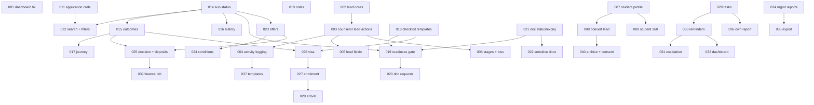

# Overseas Counselor CRM — Enhancement Backlog (`ccrm-001` … `ccrm-041`)

NO-ASSUMPTION MODE. Prepared 2026-10-22 at the owner's request. **No code was written or changed.**

**Owner statement (2026-10-22).** The owner supplied `Downloads\Edusphere_Overseas_Education_Counselor_CRM_Specification.pdf`
("Overseas Education Counselor CRM — Functional Requirements & Implementation Blueprint", v1.0, 11 pages), asked for it to be
compared with the existing counselor functionality, and then said: "I want to implement all this. Please prepare a backlog."

**Evidence class.** The PDF is not in `docs/sources/` and carries no approval record. It calls itself a set of *recommended*
requirements for "Zoho CRM, Zoho Creator or a custom web application". It is therefore `UNVERIFIED` as a source. The owner's
instruction to implement it, together with the answers CC1–CC10 below given through the clarifying-question prompt, makes it a
`MEETING_TRANSCRIPT_REQUEST`-equivalent owner request (the same standing as `COUNSELOR_WALKIN_BACKLOG.md`). Each answer becomes a
decision only when the item that uses it is built and its `DEC-SCOPE` entry is written.

**Baseline.** Every "existing behaviour" statement was checked against code on `origin/main` @ `557e6f69` (three read-only code
sweeps plus spot checks of the key claims). Paths are relative to `apps/api/app/` (backend) or `apps/web/` (frontend).

**Numbering.** `ccrm-0NN` is this backlog's item number, not a Feature ID. The next free numbers on main today are migration `0166`,
`DEC-SCOPE-238` (231–237 are proposed by `SEO_SMM_BACKLOG.md`), API `12EQ` and RBAC `2.153`. Recheck `origin/main` when each item is
picked up; parallel branches take numbers.

**Spec section references** (`§n`) are to the PDF. "AC n" is the PDF's §18 acceptance criterion n.

## 1. Owner answers

| ID | Question | Answer |
| --- | --- | --- |
| CC1 | Spec's 19 application statuses vs the confirmed 7 stages (`DEC-WF-001`) | **Stage + sub-status.** Keep the 7 stages. Add a detailed sub-status per application and exception outcomes (Rejected, Deferred, On Hold, Offer Declined, Visa Refused …). |
| CC2 | New roles (Application Processing Staff, Visa/Enrolment Coordinator, Team Leader, Auditor) | **None.** "Counsellor, application processing staff and visa co-ordinator activities are performed by counsellor only. Auditor is not required now." |
| CC3 | Team leader / escalation point | **Overseas Admin** is the escalation point and the team-wide view. No counselor teams. |
| CC4 | Who records offers, visa decisions and enrolment | **The counselor, on all applications** — direct and agency-owned. |
| CC5 | Agent and counselor both editing an agency application | **Last write wins, both notified.** Every change kept in history with its author; the other party is notified. No locking. |
| CC6 | Optional items in scope | **Student finance tab, arrival/orientation tracking, calendar integration.** **MFA is out.** |
| CC7 | Overlap with unbuilt `nehn-014` and `nehn-037` | **Supersede them.** This backlog absorbs their scope and acceptance criteria. `nehn-033` (student-facing Progress page) stays and consumes these items. |
| CC8 | Lead stages the counselor may set directly | **Counselling + close stages:** Follow-up, Counselling Scheduled, Counselling Completed, Qualified; close as Not Interested / Not Eligible / Lost (reason required). Application/Enrollment and Converted stay automatic. |
| CC9 | One-click "Convert to student" | **Yes, reuse csc-002:** create the `overseas_student` from the lead, prefilled; link lead→student (tel-018); copy qualification data into a structured profile; welcome email. Duplicate email → offer to link the existing student. |
| CC10 | Ready for Submission with required documents missing | **Configurable per checklist template:** Overseas Admin sets `block` or `warn`; warn lets the counselor override with a recorded reason. |

## 2. Existing behaviour (verified)

**Roles.** Overseas roles are `overseas_admin`, `overseas_student`, `counselor`, `university_rep`, `agent` (`core/rbac.py:27-31`). The
permission strings on `counselor` (`overseas:students:manage`, …) are not checked at route level; each route checks role + division.

**Leads.** Leads are `Enquiry` rows, code `LD-000001` (`models.py:2122-2124`). Sources: 13 fixed values (`tel_sources.py`). Stages:
11 open + 5 closed (`lead_stages.py:4-22`). Priority hot/warm/cold. Duplicate block on phone/email with a match panel
(`services/lead_intake.py:91-99`). A counselor's leads are `owner_id == counselor` in the same division
(`services/lead_handover.py:59-65`). **Every `/telecaller/leads/*` write goes through `lead_pipeline.scope()`, which returns 403 to a
counselor** (`services/lead_pipeline.py:41-52`). So the counselor can read a lead and its timeline, return it, link/unlink a student,
create a walk-in lead (csc-004), and act on lead appointments (`api/lead_appointments.py:89-149`) — but cannot change its stage, log a
call/message, create a follow-up or write a note. A handover cancels the telecaller's open follow-ups (`services/lead_handover.py:28`).

**Conversion.** The counselor links an **existing** student (`api/lead_handover.py:66-91`); no lead data is copied. The lead moves to
Application/Enrollment on link and to Converted when the student has an enrolled application (on-read check + 15-min sweep).

**Students.** `User` with `student_code` (8-char hex, `models.py:85-91`) and an untyped `profile` JSON (`models.py:84`). Structured
academic fields exist only on `AgentStudent` (`models.py:3564-3590`). Counselor visibility = students on their applications ∪ linked
students (csc-001, `services/counselor_students.py:50-59`). The counselor "students" page is an application table
(`services/portal.py:1042-1044`); there is no student 360 for the overseas counselor (`api/student_360.py` is school-only).

**Applications.** `OverseasApplication` (`models.py:1781-1824`): several per student, unique per (student, university, course) unless
withdrawn (`api/workflows.py:1820-1829`); UUID only. Stages `enquiry → eligibility_evaluation → university_selection → offer →
visa_documentation → status_tracking → enrolled` + `withdrawn` (`services/agent_applications.py:27-28`). The counselor `/advance` is
forward-only (`api/workflows.py:2046-2090`); the generic PATCH accepts only `intake, status, application_reference, offer_letter_url,
next_action` and **refuses rejected/waitlisted/deferred as "an open item"** (`api/workflows.py:1945-1952`). Withdraw is agent-only.
`ApplicationStatusHistory` stores from/to/next_action/notes/changed_by (`models.py:1840-1848`); the read route omits `changed_by` and
`notes` (`api/workflows.py:2108`).

**Offers, deposits, enrolment.** `offer_type/offer_date/offer_conditions/offer_document_id` and `enrollment_*` columns exist but **only
agency routes write them** (`api/agent_applications.py:209,247`). One offer per application, overwritten in place. `ApplicationDeposit`
is agency-only and INR-only (`models.py:3810-3844`).

**Documents.** `StudentDocument` (`models.py:1851`) with free-text `verification_status`; the counselor verify route stores any string
(`api/workflows.py:2200-2226`). `DocumentRequest` is agency-only (`agent_student_id` required, `models.py:1878-1895`). Append-only
`DocumentEvent` incl. `replaced` and `downloaded` (`models.py:1898-1920`). Counselor download is scoped, audited, 900-s link
(`api/workflows.py:2229-2261`); the generic `/files/download` writes no audit (`api/files.py:45-51`). No checklist templates, no
expiry, no sensitivity classes, no readiness count; no application-level ready gate (the visa case has one, `api/workflows.py:2430-2434`).

**Visa.** `VisaCase` one per application (`models.py:1938-1952`): status (checklist, documentation, interview_prep, tracking, decision),
appointment date, free-text checklist, tracking reference. `visa_application_date`, `interview_date`, `decision` are **agency-only;
decision final once recorded** (`DEC-SCOPE-057` V2). No coordinator, no expected-decision date, no refusal reason.

**Tasks / reminders.** No counselor task list (only management-assigned `ManagementTask`). The daily reminder job (AGN-017,
`worker.py:219`) covers **agency** applications only. No visa-appointment, decision-overdue or overdue-escalation reminders. Reassignment
notifies old and new owner (`api/workflows.py:~2011`). Delivery: in-app/email/WhatsApp/SMS with opt-in (`notifications/dispatch.py`).
No counselor templates, no calendar.

**Dashboard.** `services/portal.py:1010-1022`: one table + three tiles. **Live defect:** the tiles count statuses that are not in the
7-stage list (`profile_evaluation`, `documents_pending`, `offer_received`, `accepted`), so "Awaiting documents" and "Offers" always show
0 (→ `ccrm-001`). No search, no filters beyond agency (`services/application_filters.py`).

**Reports.** Management funnel, counselor performance, destination/intake filters, revenue (`services/management_*.py`). No
application ageing, university offer rate, visa refusal breakdown or CSV/Excel export of management reports.

**Security.** No MFA (out of scope, CC6). `ConsentRecord` exists (`models.py:193-203`) but no overseas data-processing consent. Retention
periods are open (`PRD_OPEN_ITEMS.md` item 15, item 85).

## 3. Items

Template per item: requirement · existing · expected · roles · FE / BE / DB / API / integration / authn / authz / security / performance ·
reuse · dependencies · acceptance · scenarios · edge cases · regression · complexity / risk · open questions (`NEEDS_CONFIRMATION`,
asked one at a time when the item is picked up).

---

### Phase 0 — Defect

### `ccrm-001` — Fix the counselor dashboard tile counts

- **Source:** §12 ("live dashboard values must be calculated from actual CRM records").
- **Business requirement:** the counselor's tiles must reflect real applications.
- **Existing behaviour:** "Awaiting documents" counts `profile_evaluation`/`documents_pending`; "Offers" counts `offer_received`/
  `accepted` (`services/portal.py:1018-1019`). None of these are stages, so both tiles are always 0 for the counselor and Overseas Admin.
- **Expected behaviour:** "Awaiting documents" = applications whose visa case or (after ccrm-019) checklist has unverified required
  items; until ccrm-019, = applications at `university_selection` with any pending document. "Offers" = applications at `offer` or later,
  excluding withdrawn — reuse `OFFER_COUNTED_STATUSES` (`services/agent_applications.py:199`).
- **Roles:** counselor, overseas_admin. **FE:** none. **BE:** `services/portal.py` predicates. **DB/API:** none.
- **Authz/security/perf:** unchanged.
- **Reuse:** `OFFER_COUNTED_STATUSES`, `OVERSEAS_APPLICATION_STAGES`.
- **Dependencies:** none.
- **Acceptance:** an application at `offer` counts in "Offers"; one at `enquiry` does not; withdrawn never counts.
- **Negative:** another counselor's applications are not counted.
- **Edge cases:** school-bridged rows keep today's exclusion.
- **Regression:** the Overseas Admin dashboard uses the same tiles — check both.
- **Complexity:** small. **Risk:** low.
- **Open questions:** exact "Awaiting documents" definition before ccrm-019 lands. **Answered 2026-10-22:** the expected-behaviour
  definition above (visa checklist or `university_selection` + pending document; withdrawn/enrolled never count).
- **Status:** built on `feature/ccrm-001` — `DEC-SCOPE-238`, no migration/API/RBAC change.

---

### Phase 1 — Core CRM: leads, conversion, student profile

### `ccrm-002` — Lead notes *(supersedes nehn-014 part 1)*

- **Source:** §3 "record every … counselling session as an activity"; §5 Activities; nehn-014.
- **Business requirement:** counselors and telecallers keep free notes on a lead; notes are part of the lead history.
- **Existing behaviour:** no standalone notes; text only in follow-up notes, call remarks and the return reason.
- **Expected behaviour:** append-only `lead_notes` (lead, author, body ≤ 4000 chars, created_at). Shown in the lead timeline.
  Writers: the lead's owner counselor, its telecaller, the telecaller manager in scope, admins.
- **Roles:** counselor, telecaller, telecaller_manager, overseas_admin, super_admin.
- **FE:** notes panel on `CounselorLeadDetail` and the telecaller lead detail. **BE:** new service; one more branch in
  `services/lead_timeline.py`. **DB:** migration, table `lead_notes`, index (lead_id, created_at). **API:** `GET/POST /leads/{id}/notes`.
- **Authz:** counselor = `owner_id = self` + same division (`lead_handover.py:62`); telecaller = existing T23 scope; out of scope → 404.
- **Security:** plain text, escaped on render; body never logged.
- **Perf:** one extra UNION branch.
- **Reuse:** timeline service, `AuditLog`.
- **Dependencies:** none.
- **Acceptance:** a counselor adds a note → timeline shows it with author and time; another counselor's lead → 404.
- **Edge cases:** a note on a closed lead is allowed (history); a lead returned to the telecaller keeps its notes.
- **Regression:** timeline ordering and pagination.
- **Complexity:** small. **Risk:** low.
- **Open questions:** edit/delete window (nehn-014 left it open) — default: none, append-only.
- **Status:** built on `worktree-ccrm-002` — `DEC-SCOPE-242`, migration `0167_lead_notes`, API §12EU, RBAC §2.157 (append-only, N1–N5).

### `ccrm-003` — Counselor lead actions: stage, next action, follow-ups *(supersedes nehn-014 part 2)*

- **Source:** §3 lead handling rules ("require an owner and a next action for active leads"); §11 "No response after contact"; CC8.
- **Business requirement:** the counselor works their leads directly — moves the stage, sets a next action and schedules follow-ups.
- **Existing behaviour:** counselor gets 403 from every lead write (`lead_pipeline.scope`); follow-ups are telecaller-only and are
  cancelled at handover; there is no next-action field on a lead; `owner_id` is nullable; Admin PATCH sets `owner_id` without validating
  the target (`api/admin.py:479-480`).
- **Expected behaviour:**
  - Counselor may move their own lead to **Follow-up, Counselling Scheduled, Counselling Completed, Qualified**, or close it as
    **Not Interested / Not Eligible / Lost** with a required reason (CC8). Application/Enrollment and Converted stay event-driven.
  - New lead fields `next_action` (text) and `next_action_due` (date). A counselor-owned open lead must have both; saving a stage move
    without them → 422.
  - Counselor creates, completes and cancels follow-ups on their own leads (the tel-011 service with a counselor scope).
  - Admin owner reassignment validates "active counselor of the same division" (→ 422 otherwise).
- **Roles:** counselor; telecaller (read-only on counselor-owned leads, D1/T19 unchanged); admins.
- **FE:** stage, next-action and follow-up controls on `CounselorLeadDetail`. **BE:** a counselor branch in `lead_pipeline` that
  reuses the stage engine with the CC8 allow-list; counselor scope in `services/lead_follow_ups.py`; `admin.py` validation.
- **DB:** migration: `enquiries.next_action`, `enquiries.next_action_due`. **API:** counselor access to the existing stage and follow-up
  routes, or `POST /counselor/leads/{id}/stage` and `/follow-ups` (builder's call).
- **Authz:** owner + division. **Security:** reason text not logged. **Perf:** none.
- **Reuse:** `lead_stages.py` (ORDER, MANUAL_BEFORE), tel-011 follow-up service, AuditLog.
- **Dependencies:** ccrm-002 (notes UI shares the panel), none hard.
- **Acceptance (from nehn-014):** a counselor moves their own lead to an allowed stage; a disallowed stage → 422; another counselor's
  lead → 404; Admin PATCH to a non-counselor owner → 422; a follow-up the counselor creates shows in their dashboard (ccrm-032).
- **Edge cases:** moving to Lost cancels open follow-ups and appointments (tel-016 AP15 pattern); a linked lead
  (Application/Enrollment) cannot be manually moved back (MANUAL_BEFORE).
- **Regression:** telecaller pipeline counts, tel-020 alerts (counselor leads are excluded today), tel-021/tel-024 metrics.
- **Complexity:** medium. **Risk:** high (touches the shared stage engine).
- **Open questions:** does "next action required" also apply to telecaller-owned leads (spec says "active leads")? Default: counselor
  leads only, telecaller unchanged.
- **Status:** built on `feature/ccrm-003` — `DEC-SCOPE-243`, migration `0169_lead_next_action`, API §12EV, RBAC §2.158 (A1–A8). The
  dashboard acceptance ("a follow-up the counselor creates shows in their dashboard") waits for ccrm-032; the follow-up shows on the
  counselor lead detail today.

### `ccrm-004` — Counselor activity logging on leads: calls, WhatsApp, email, meetings

- **Source:** §3 "record every call, email, meeting, WhatsApp interaction or counselling session as an activity"; §14 communication logging.
- **Existing behaviour:** calls (tel-010), WhatsApp (tel-013) and email (tel-014) are telecaller-scope only; counselor → 403. Counselling
  sessions exist as lead appointments (tel-016), with no outcome notes.
- **Expected behaviour:** the counselor logs calls (outcome, duration, remarks), sends/logs WhatsApp and email to their own leads through
  the existing services, and records a generic **meeting** activity (date, mode, notes). Appointment completion takes optional outcome
  notes. Everything appears in the lead timeline and carries over to the student after conversion (ccrm-008).
- **Roles:** counselor. **FE:** activity buttons on the lead detail, reusing the telecaller components.
- **BE:** counselor scope in `api/telecaller_calls.py`, `api/telecaller_messages.py`, the email service; a `lead_activities` type
  `meeting` or a new table. **DB:** migration only if a meeting table is needed; `appointments.outcome_notes`.
- **API:** counselor routes or widened scope (builder's call). **Integration:** ENH-032 Zoho email, wa.me links (no provider change).
- **Authz:** owner + division. **Security:** message bodies follow the DEC-SCOPE-100/106 retention stance (PRD open item 85).
- **Reuse:** tel-010/013/014 services, tel-016 appointments.
- **Dependencies:** ccrm-003 (calls drive next-action prompts).
- **Acceptance:** a counselor logs a call and sends an email to their own lead; both appear in the timeline; telecaller metrics do not
  count the counselor's calls.
- **Edge cases:** the lead has no email → email action hidden; consent opt-out respected (ccrm-040).
- **Regression:** telecaller call counts and targets (tel-022), daily report.
- **Complexity:** medium. **Risk:** medium.
- **Open questions:** should counselor calls count in management "counselor performance" (calls are marked untracked today)?
- **Status:** built on `feature/ccrm-004` — `DEC-SCOPE-259`, migration `0181_lead_meetings`, API §12FL, RBAC §2.173 (LG1–LG8; the open
  question answered yes by default: mgmt-018 Calls is tracked). Consent opt-out waits for ccrm-040.

### `ccrm-005` — Lead data fields: contact preference, study, academic, English, consent, referral

- **Source:** §3 lead creation field table.
- **Existing behaviour:** see §2. Missing: preferred contact method, enquiry date (only `created_at`), preferred country, preferred
  campus, CGPA, backlogs, English test type/score/date/validity, consent/marketing preferences, referral details.
- **Expected behaviour:** add the fields to `Enquiry` / `LeadQualification`. `preferred_country_id` (FK countries), `study_mode`
  (full-time/part-time/online — distinct from today's `preferred_mode`), `english_tests` (type ∈ IELTS, PTE, TOEFL, Duolingo, other;
  score; test date; valid until; status not taken/booked/taken), `contact_preference` (call/WhatsApp/email/SMS), `marketing_opt_in` +
  timestamp, `referral_name` / `referral_contact`, `enquiry_date` (defaults to created date, editable for imports).
- **Roles:** telecaller, counselor (on own leads), managers. **FE:** NewLeadForm, qualification form (tel-009), counselor lead detail.
- **BE:** schemas + validators; import mapping (tel-006). **DB:** migration (columns + an `lead_english_tests` child table or JSON —
  builder's call; child table preferred for reporting).
- **Authz:** existing write scopes plus ccrm-003's counselor scope. **Security:** consent change is audited.
- **Reuse:** LeadQualification, tel-006 import.
- **Dependencies:** ccrm-003 (counselor write scope).
- **Acceptance:** all fields round-trip on create, edit and CSV import; English test validity date in the past shows as expired.
- **Regression:** import template columns, qualification form, duplicate panel.
- **Complexity:** medium. **Risk:** low.
- **Open questions:** which new fields are mandatory, and at which stage (e.g. country + intake before Qualified)?
- **Status (2026-10-25):** built on `feature/ccrm-005` — `DEC-SCOPE-260` (LF1–LF9 defaults `NEEDS_CONFIRMATION`; LF2 nothing mandatory),
  migration `0182_lead_data_fields`, API §12FM, RBAC §2.174. Design `docs/superpowers/specs/2026-10-25-ccrm-005-lead-data-fields-design.md`.

### `ccrm-006` — Lead stage additions and structured loss capture

- **Source:** §3 alternative statuses (Duplicate, Invalid Contact); "capture lost reason and competitor/destination preference".
- **Existing behaviour:** closed stages Not Interested, Not Eligible, Wrong Number, No Response, Lost; free-text reason only; no
  competitor capture.
- **Expected behaviour:** add closed stage **Duplicate** (requires the surviving lead's code; links them) and treat **Wrong Number** as
  the spec's Invalid Contact (relabel, no new stage). Closing as Lost/Not Interested requires a reason from an admin-managed list plus
  optional "lost to" (competitor name / chosen destination).
- **Roles:** telecaller, telecaller_manager, counselor (CC8). **FE:** close dialog. **BE:** `lead_stages.py`, CHECK constraint.
- **DB:** migration: stage CHECK, `enquiries.duplicate_of_id`, `lost_reason_code`, `lost_to`; `lead_lost_reasons` lookup.
- **Authz:** unchanged. **Reuse:** stage engine, tel-002 catalogue pattern for the reason list.
- **Dependencies:** ccrm-003.
- **Acceptance:** closing as Duplicate without a target → 422; reports group losses by reason.
- **Regression:** tel-024 reports, management funnel "lost".
- **Complexity:** small. **Risk:** medium (stage list is shared by four modules).
- **Open questions:** relabel Wrong Number → "Invalid Contact", or add it beside? Default: relabel display only.
- **Status (2026-10-25):** built on `feature/ccrm-006` — `DEC-SCOPE-264` (D1–D10 defaults `NEEDS_CONFIRMATION`: relabel only; Duplicate
  for telecaller/manager/admin, not the counselor; reason list on the tel-002 pattern with six seeded reasons; call-logged closes keep no
  reason code; Lost Reasons report), migration `0186_lead_loss_capture` (after ccrm-022's 0185), API §12FQ, RBAC §2.178.

### `ccrm-007` — Structured overseas student profile

- **Source:** §5 tabs Academic, Study preferences, English tests; §15 Student record.
- **Existing behaviour:** untyped `User.profile` JSON read by the student portal (`services/portal.py:572-583`); structured fields only
  on `AgentStudent`.
- **Expected behaviour:** a table `overseas_student_profiles` (one per student user): DOB, nationality, city/state, passport no. +
  expiry (restricted, ccrm-022), qualifications (child rows: level, institution, board/university, year, percentage/CGPA, backlogs),
  work experience, preferred countries, course/subject, level, intake, study mode, budget range, English tests (child rows as ccrm-005).
  Counselor edits for students in scope; the student edits their own (field list `NEEDS_CONFIRMATION`); the existing JSON keys are
  migrated once into the new table and the portal reads the table.
- **Roles:** counselor, overseas_student, overseas_admin; agent reads for agency students (`AgentStudent` stays the agency's record).
- **FE:** Academic / Preferences / English tabs (ccrm-009); student "My profile". **BE:** service + validators.
- **DB:** migration: 3 tables (profile, qualifications, english tests); data migration from `users.profile`.
- **API:** `GET/PUT /counselor/students/{id}/profile`, `GET/PUT /overseas/me/profile`.
- **Authz:** counselor scope = `counselor_students` visibility; student = self. **Security:** passport fields restricted (ccrm-022).
- **Reuse:** AgentStudent field set, csc-001 scope helper.
- **Dependencies:** none.
- **Acceptance:** counselor saves two qualifications and an IELTS score; the student sees them; another counselor → 404.
- **Edge cases:** an agency student with a login — which record is master? Default: agency `AgentStudent` stays master for agency
  fields; the profile is shown read-only to the counselor when an `AgentStudent` exists.
- **Regression:** student portal profile page, `profile` JSON readers (grep all).
- **Complexity:** large. **Risk:** medium.
- **Open questions:** which fields the student may edit; agency-student master record.
- **Status (2026-10-24):** built on `worktree-ccrm-007` — `DEC-SCOPE-249` (P1 the student edits every field; P2 profile editable,
  agency reads it without the passport; P3–P6 defaults), migration `0174_student_profiles`, API §12FB, RBAC §2.164; pages
  `/overseas/{counselor|admin}/students/[id]/profile` and the student Profile section. Design `docs/superpowers/specs/2026-10-24-ccrm-007-structured-student-profile-design.md`.

### `ccrm-008` — Convert lead to student (one click, prefilled)

- **Source:** §4 steps 1–6 and conversion controls; §14 lead conversion; AC 2; CC9.
- **Existing behaviour:** link an existing student only; walk-in create re-types name/email/phone.
- **Expected behaviour:** on the counselor lead detail, **Convert to student**: shows the prefilled csc-002 form (name, email, phone from
  the lead); on submit, in one transaction: create the `overseas_student` (csc-002 path), csc-001 link, tel-018 lead→student link, copy
  qualification/study/English data into `overseas_student_profiles` (ccrm-007); after commit send the welcome email. If the email or
  normalized phone matches an existing student → no create; offer **Link existing** (tel-018 suggestions). Optionally continue straight
  to "Create first application" (§4 step 5).
- **Roles:** counselor. **FE:** convert dialog. **BE:** orchestration service calling `counselor_students.create_student` and
  `lead_handover.commit_link`. **DB:** none beyond ccrm-007. **API:** `POST /counselor/leads/{id}/convert`.
- **Integration:** welcome mail (ENH-032). **Authn:** ENH-003 welcome token. **Authz:** lead owner + division; csc-002 limits.
- **Security:** the csc-002 privilege-escalation guards apply unchanged. **Perf:** mail after commit.
- **Reuse:** csc-002 service, tel-018 link, ccrm-007.
- **Dependencies:** ccrm-007.
- **Acceptance:** converting a qualified lead creates the student with the lead's details, links the lead (Application/Enrollment
  stage), preserves source/owner/activities, and no field is re-typed; converting a lead whose email exists → 409 with link offer.
- **Negative:** a lead not at Qualified or later → 422 (`NEEDS_CONFIRMATION`); another counselor's lead → 404.
- **Edge cases:** mail not configured → student exists, status shown; concurrent convert → one 409.
- **Regression:** tel-018 conversion sweep, tel-021 conversion credit (csc-004 open item).
- **Complexity:** medium. **Risk:** high (account creation).
- **Open questions:** minimum lead stage to convert; whether the lead has no email (phone-only) blocks conversion.
- **Status (2026-10-24):** built on `worktree-ccrm-008` as `DEC-SCOPE-252`, API §12FE, RBAC §2.167, with no migration. Recommended
  defaults (NEEDS_CONFIRMATION):
  - K1: Qualified or later, else `422`.
  - K2: a phone-only lead converts with an email the counselor types.
  - K3: city, state, qualification, course, intake, level and work experience are copied; free text stays on the lead.
  - K4: a duplicate is `409` with the link offer.
  - K6: "Create first application" is deferred.

  Design: `docs/superpowers/specs/2026-10-24-ccrm-008-convert-lead-to-student-design.md`.

### `ccrm-009` — Counselor student 360 page

- **Source:** §5 "one central profile … tabs".
- **Existing behaviour:** none for the overseas counselor; the "students" section is an application table.
- **Expected behaviour:** `/overseas/counselor/students/{id}` with tabs **Overview** (code, contact, counselor, journey stage
  (ccrm-017), next action), **Academic**, **Preferences**, **English** (ccrm-007), **Documents** (ccrm-019/021), **Applications** (each
  with its own status), **Activities** (appointments, notes ccrm-010, messages, lead timeline), **Finance** (ccrm-039), **History**
  (status changes, edits, uploads, reassignment — AuditLog + status history). Tabs whose item is not built yet are hidden.
- **Roles:** counselor, overseas_admin. **FE:** new page + tab components. **BE:** one aggregate read route; tab data via existing routes.
- **API:** `GET /counselor/students/{id}/overview`. **Authz:** csc-001 scope; admin division-wide.
- **Perf:** tabs load lazily.
- **Reuse:** `PortalPage` shell, school 360 layout as UX reference only.
- **Dependencies:** ccrm-007 (tabs grow with later items).
- **Acceptance:** a student with three applications shows three independent statuses; another counselor's student → 404.
- **Complexity:** large. **Risk:** low.
- **Status (2026-10-24):** built on `worktree-ccrm-009` — `DEC-SCOPE-253` (V1 the counselor sees all the student's applications,
  documents and history read-only, marked "yours"; V2 Academic = personal + academic + work experience; B1–B6 defaults), no migration,
  API §12FF, RBAC §2.168; pages `/overseas/{counselor|admin}/students/[id]`. Design
  `docs/superpowers/specs/2026-10-24-ccrm-009-counselor-student-360-design.md`.

### `ccrm-010` — Student and application notes; counselling history *(supersedes nehn-037 part 5)*

**Status (2026-10-22): built on `feature/ccrm-010`** — `DEC-SCOPE-241`, API §12ET, RBAC §2.156, migration
`0169_overseas_student_notes`. Builder's calls N1–N5. Until ccrm-009 exists the notes live on their own page
(`/overseas/{counselor|admin}/students/{id}/notes`). Spec `docs/superpowers/specs/2026-10-22-ccrm-010-student-notes-design.md`.

- **Source:** §5 Activities; §6 "internal notes"; nehn-037 #5.
- **Existing behaviour:** notes only as `ApplicationStatusHistory.notes`; counselor PATCH `notes` goes into history only.
- **Expected behaviour:** append-only internal notes on a student and optionally an application (author, body, created_at); never
  visible to the student or the agent. Counselling appointments' outcome notes (ccrm-004) show in the same history.
- **DB:** migration, `overseas_student_notes` (student_user_id, application_id NULL). **API:** `GET/POST /counselor/students/{id}/notes`.
- **Authz:** counselor scope + admin. Student/agent never. **Dependencies:** none (UI in ccrm-009).
- **Acceptance:** note visible to counselor and admin; student API never returns it.
- **Complexity:** small. **Risk:** low.

### `ccrm-011` — Business IDs for applications; student code coverage

- **Source:** §6 Application ID; §14 unique IDs; §15 ID formats (examples only).
- **Existing behaviour:** applications are UUID only; `student_code` is 8-char hex; leads `LD-000001`.
- **Expected behaviour:** `OverseasApplication.application_code` from a Postgres sequence (format `NEEDS_CONFIRMATION`, e.g.
  `APP-000001` matching `LD-`), backfilled for existing rows, shown everywhere an application is listed, searchable. Student code
  stays as is unless the owner wants `STU-` (relates nehn-040).
- **DB:** migration: sequence, column, unique index, backfill. **API:** code in all application payloads.
- **Dependencies:** none. **Relates:** nehn-040.
- **Acceptance:** every application has a unique code; codes never reused after withdrawal.
- **Complexity:** small. **Risk:** low.
- **Open questions:** format (`APP-000001` vs `APP-2027-00001` with yearly reset).

**Status (2026-10-22): built on `feature/ccrm-011`** — `DEC-SCOPE-239`, migration `0166_application_codes`, API §12EQ, RBAC §2.153.
Format `APP-000001`, no yearly reset (recommended default); labelled "EduSphere ID" (agency "Application ID" is the university
reference, AGN-008). Spec `docs/superpowers/specs/2026-10-22-ccrm-011-application-codes-design.md`.

### `ccrm-012` — Counselor quick search and list filters

- **Source:** §12 quick search and filters.
- **Existing behaviour:** no search; only an agency filter on Students/Applications.
- **Expected behaviour:** one search box across the counselor's own leads, students and applications by name, phone (normalized), email,
  student code, application code, lead code. Lists filter by destination (country), university, intake, stage/sub-status, priority
  (leads), date range.
- **BE:** `services/application_filters.py` extended; search service with per-entity scope. **API:** `GET /counselor/search?q=`.
- **Authz:** results only within the counselor's scope. **Security:** min 3 chars; rate limit. **Perf:** trigram/indexes on normalized
  phone and lower(email).
- **Dependencies:** ccrm-011, ccrm-014 (sub-status filter).
- **Acceptance:** searching another counselor's student's phone returns nothing.
- **Relates:** nehn-041 (admin unified search) — share the search service.
- **Complexity:** medium. **Risk:** medium (scope leakage).
- **Status (2026-10-23):** built on `worktree-ccrm-012` — `DEC-SCOPE-246` (QS1–QS8 recommended defaults, `NEEDS_CONFIRMATION`), no
  migration, API §12EY, RBAC §2.161; `GET /counselor/search` (overseas counselor, 30/min) and the Students / Applications / Leads filters.
  Design `docs/superpowers/specs/2026-10-23-ccrm-012-counselor-search-filters-design.md`.

---

### Phase 2 — Applications

### `ccrm-013` — Application fields and counselor-editable dates *(absorbs nehn-037 part 3, scholarship)*

- **Source:** §6 application field table; nehn-037 #3.
- **Existing behaviour:** see §2. Missing on the application: faculty, campus, start date, portal link, university contact, tuition,
  scholarship, currency, documents-complete date, decision-due date. Counselor PATCH cannot set `submitted_on`/`application_deadline`/
  `offer_deadline`.
- **Expected behaviour:** add `faculty`, `campus`, `course_start_date`, `university_portal_url`, `university_contact` (name/email),
  `tuition_fee` + `currency`, `scholarship_status` (none/applied/awarded/declined) + `scholarship_amount` (only when officially confirmed),
  `documents_completed_on` (set by ccrm-019), `decision_due_on`. Counselor can edit these and the three existing dates.
- **Roles:** counselor (all applications, CC4/CC5), agent (unchanged agency fields), admin. **FE:** application edit form.
- **DB:** migration. **API:** extend PATCH allow-list (`api/workflows.py:1952`).
- **Authz:** counselor of the application or student scope. CC5: on agency applications the agent is notified of counselor edits.
- **Security:** portal URL stored only, never credentials.
- **Dependencies:** none.
- **Acceptance (nehn-037):** the scholarship update shows on the student's page; dates round-trip; currency required with a fee.
- **Regression:** agency application forms, AGN-017 deadlines.
- **Complexity:** medium. **Risk:** low.
- **Open questions:** currency list (INR, GBP, USD, EUR, CAD, AUD …?).
- **Status (2026-10-24):** built on `feature/ccrm-013` — `DEC-SCOPE-256` (F1–F9 recommended defaults, `NEEDS_CONFIRMATION`), migration
  `0179_application_fields`, API §12FI, RBAC §2.171. Design `docs/superpowers/specs/2026-10-24-ccrm-013-application-fields-design.md`.

### `ccrm-014` — Application sub-status (CC1)

- **Source:** §7 steps 1–11; Appendix A application statuses; CC1.
- **Existing behaviour:** 7 stages only; the PATCH refuses non-stage values.
- **Expected behaviour:** each application has `sub_status` from a fixed list keyed to its stage, e.g.
  - `university_selection`: Application Created, Documents Pending, Ready for Submission, Submitted, Under Review
  - `offer`: Conditional Offer, Unconditional Offer, Offer Accepted
  - `visa_documentation`: Visa Preparation, Visa Applied
  - `status_tracking`: Visa Decision Pending, Visa Approved
  - `enrolled`: Enrolled
  (the exact mapping is confirmed at build). Sub-status moves freely within a stage; moving to a sub-status of a later stage advances the
  stage (forward-only rule unchanged). Some sub-statuses are set automatically (Ready for Submission by ccrm-019, offer sub-statuses by
  ccrm-023, visa by ccrm-026). History records old/new stage and sub-status.
- **DB:** migration: `overseas_applications.sub_status`, `application_status_history.from_sub_status/to_sub_status`; backfill.
- **API:** `POST /workflows/overseas/applications/{id}/sub-status`. **FE:** status selector, badges everywhere.
- **Authz:** counselor (all applications), agent on agency applications within the agency's stage cap, admin.
- **Dependencies:** none. **Blocks:** ccrm-015, 019, 023, 026, 027, 032, 034.
- **Acceptance:** AC 6 (who changed the status and when) and AC 9 (one application's change never touches another).
- **Regression:** agent journey (`services/agent_journey.py`), management funnel, school global-education view.
- **Complexity:** medium. **Risk:** high (shared state machine). Needs a `DEC-WF` amendment beside `DEC-WF-001`.
- **Open questions:** the stage↔sub-status mapping table.
- **Status (2026-10-22):** built on `feature/ccrm-014` — owner answers SS1–SS4 (backlog mapping; backfill only where certain; clear on
  stage change, `enrolled` auto; roles as above), `DEC-SCOPE-240`, migration `0168_application_sub_status`, API §12ER, RBAC §2.154.

### `ccrm-015` — Application exception outcomes

- **Source:** §7 alternative/exception statuses; Appendix B "University C rejects"; AC 9; PRD open item on rejection/deferral.
- **Existing behaviour:** rejected/deferred/on hold refused (`api/workflows.py:1945-1949`); withdrawal agent-only; no exception data.
- **Expected behaviour:** an `outcome` on the application, independent of stage:
  - **Rejected** — date, reason, rejection letter (document), suggested next steps. Terminal.
  - **Withdrawn** — by counselor or agent; who requested (student/counselor/agent/university), date, reason. Terminal.
  - **Deferred** — new intake, revised deadlines; the application continues.
  - **On Hold** — reason, owner, review date (drives a reminder, ccrm-030); clears on resume.
  - **Offer Declined** — reason, whether another offer is preferred (ccrm-025 writes it).
  - **Visa Refused** — written by ccrm-026.
  Reopening a terminal outcome is admin-only with a reason.
- **DB:** migration: `application_outcomes` (or columns) + history rows. **API:** `POST …/applications/{id}/outcome`.
- **Authz:** counselor on all applications (CC4); agent keeps withdraw; admin reopen. CC5 notifications.
- **Dependencies:** ccrm-014.
- **Acceptance:** rejecting University C leaves A and B unchanged (AC 9, Appendix B); On Hold without review date → 422.
- **Regression:** the duplicate-application check treats rejected like withdrawn (allows a new application) — `NEEDS_CONFIRMATION`.
- **Complexity:** medium. **Risk:** high. Closes the PRD open item; needs a DEC.
- **Open questions:** waitlisted (named in the code comment) in or out; may a rejected application be re-applied as a new application.
- **Status (2026-10-23):** built on `worktree-ccrm-015` — owner answers O1–O4 (withdrawn keeps its status + outcome; rejected / withdrawn /
  offer declined / visa refused terminal, on hold pauses, deferred continues; terminal frees the duplicate slot; no waitlist),
  `DEC-SCOPE-244`, migration `0170_application_outcomes` (merges both 0169 heads), API §12EW, RBAC §2.159.

### `ccrm-016` — Status history with author and reason

- **Source:** §14 status history; AC 6; §5 History tab.
- **Existing behaviour:** stored; read route omits `changed_by` and `notes` (`api/workflows.py:2108`).
- **Expected behaviour:** history read returns author name, notes, reason, sub-status and outcome; shown on the application and in the
  student History tab. Agent sees history of agency applications (author shown as name for staff).
- **DB:** none (or `reason` column). **API:** extend response. **Authz:** unchanged scopes; student sees a filtered version
  (`NEEDS_CONFIRMATION`).
- **Dependencies:** ccrm-014. **Complexity:** small. **Risk:** low.
- **Status (2026-10-23):** built on `worktree-ccrm-016` — owner answers H1–H3 (`outcome` + `reason` columns on the history with a
  backfill; the student's read filtered on the server; UI on counselor cards and the student panel, student 360 tab with ccrm-009),
  `DEC-SCOPE-247`, migration `0172_status_history_reason`, API §12EZ, RBAC §2.162.

### `ccrm-017` — Student journey stage for direct students

- **Source:** §6 critical rule (journey stage separate from application statuses); §5 Overview.
- **Existing behaviour:** derived journey exists for agency students only (`services/agent_journey.py`).
- **Expected behaviour:** a derived, read-only journey stage for every overseas student (Lead → Counselling → Applying → Offer → Visa →
  Enrolled, or as confirmed), computed from the best application and outcome, never stored on an application.
- **BE:** generalise `agent_journey` to take a student user. **DB:** none. **Consumers:** ccrm-009, ccrm-032, nehn-033.
- **Dependencies:** ccrm-014, ccrm-015. **Complexity:** small. **Risk:** low.
- **Status (2026-10-25):** built on `feature/ccrm-017` — `DEC-SCOPE-258` (J1–J6 defaults `NEEDS_CONFIRMATION`; J6: a pure module
  `app/student_journey.py` instead of generalising `agent_journey`), no migration, API §12FK, no RBAC change; shown on the ccrm-009 360
  Overview. Design `docs/superpowers/specs/2026-10-25-ccrm-017-student-journey-stage-design.md`.

---

### Phase 3 — Documents and offers

### `ccrm-018` — Document checklist templates *(absorbs nehn-037 part 2)*

- **Source:** §8 "default checklist by country, university, course level and intake … configurable"; CC10.
- **Existing behaviour:** none (visa case has a free-text checklist).
- **Expected behaviour:** Overseas Admin maintains templates: scope (country, optional university, optional course level, optional
  intake), kind (admission / visa), items (document type, required/optional, per-item allowed statuses, notes), and **gate mode
  `block` or `warn`** (CC10). Most specific matching template applies; a version is frozen onto the application when instantiated.
  Templates must not be presented as universal (§8) — no seeded "default" list without owner sign-off.
- **Roles:** overseas_admin (write), counselor (read). **FE:** admin template editor. **DB:** migration: `document_checklist_templates`,
  `…_items`. **API:** admin CRUD under `/admin/overseas/checklists`.
- **Dependencies:** none. **Blocks:** ccrm-019, ccrm-026.
- **Acceptance:** a UK/Masters template applies to a UK Masters application; a university-specific one overrides it.
- **Complexity:** medium. **Risk:** low.
- **Open questions:** whether templates also vary by visa category (§8 "visa documents … by visa category").
- **Status (2026-10-23):** built on `worktree-ccrm-018` — `DEC-SCOPE-248` (CL1: no visa category for now), migration
  `0173_checklist_templates`, API §12FA, RBAC §2.163; routes under `/overseas-admin/checklists`, page `/overseas/admin/checklists`.
  Design `docs/superpowers/specs/2026-10-23-ccrm-018-document-checklist-templates-design.md`.

### `ccrm-019` — Application checklist, readiness summary, Ready-for-Submission gate

- **Source:** §8 readiness summary, flags; §14 document readiness; AC 5; CC10.
- **Expected behaviour:** an application gets checklist items from ccrm-018 (plus counselor-added application-specific items). Each item
  links to zero or more documents and has a status. Summary "8 of 10 required complete". Setting sub-status Ready for Submission:
  `block` → 409 listing missing items; `warn` → requires `override_reason`, stored in history. `documents_completed_on` (ccrm-013) set
  when all required items are complete.
- **DB:** migration: `application_checklist_items`. **API:** `GET/POST …/applications/{id}/checklist`.
- **Authz:** counselor (all applications), agent read/upload on agency apps, student read own.
- **Dependencies:** ccrm-014, ccrm-018, ccrm-021.
- **Acceptance:** AC 5 in both modes; Appendix B "University A requests a missing transcript" marks the transcript pending on A only.
- **Complexity:** large. **Risk:** medium.
- **Status (2026-10-24):** built on `feature/ccrm-019` — `DEC-SCOPE-257` (AC1 derived + marks, AC2 completion date: owner; AC3–AC9
  defaults `NEEDS_CONFIRMATION`), migration `0180_application_checklists`, API §12FJ, RBAC §2.172. Design
  `docs/superpowers/specs/2026-10-24-ccrm-019-application-checklist-design.md`.

### `ccrm-020` — Document requests for direct students *(supersedes nehn-037 part 1)*

- **Source:** §11 "Document missing → add a task … optionally send a student reminder"; nehn-037 #1.
- **Existing behaviour:** `DocumentRequest` requires `agent_student_id`.
- **Expected behaviour:** the counselor requests a document type (due date, note) from a direct student, optionally tied to an
  application/checklist item; the student is notified, sees it, uploads against it; the counselor accepts or rejects; a cancel is
  possible. Overdue requests feed ccrm-030.
- **DB:** migration: `document_requests.student_user_id`, `application_id`, `due_date`; owner CHECK (agency or student). **API:**
  counselor create/cancel; student list/upload-against.
- **Integration:** email/in-app to the student (opt-in rules).
- **Dependencies:** ccrm-019 (link to item), nehn-003 (uploads hardening).
- **Acceptance (nehn-037):** counselor requests "IELTS scorecard"; student sees due date, uploads; counselor accepts; it clears from
  missing documents.
- **Regression:** AGN-009 agency requests unchanged.
- **Complexity:** medium. **Risk:** medium.
- **Status (2026-10-25):** built on `feature/ccrm-020` — `DEC-SCOPE-266`, migration `0188_student_document_requests` (after ccrm-028's
  `0187_application_arrival`), API §12FS, RBAC §2.180; owner answers: proceed without nehn-003 (still open), R1 a rejection reopens the request, R2 a checklist
  request marks the item Requested and the upload auto-links; R3–R9 defaults. Design
  `docs/superpowers/specs/2026-10-25-ccrm-020-document-requests-design.md`.

### `ccrm-021` — Document status model, expiry and versions

- **Source:** §8 status table and document controls; Appendix A document statuses.
- **Existing behaviour:** free-text status, counselor stores any string; no expiry; counselor cannot replace (only add).
- **Expected behaviour:** fixed status list (Pending, Requested, Uploaded, Under Review, Verified, Incomplete, Re-upload Required,
  Expired, Not Required) with a mapping from today's values; CHECK constraint. `expiry_date` (required for passport, optional
  otherwise); a daily job marks Expired. **Replace** creates a new version (old file kept via `DocumentEvent.replaced`), never
  overwriting. Documents linked to a submitted application cannot be deleted (no delete route exists; keep it that way, add an archive
  flag). Reviewer, review date, notes shown on every document. CV/SOP use Draft/Review/Approved as per-type allowed statuses
  (configured in ccrm-018 items).
- **DB:** migration: CHECK + data migration, `expiry_date`, `archived_at`, `version_of_id`. **API:** counselor replace route.
- **Dependencies:** none. **Complexity:** medium. **Risk:** medium (data migration of existing statuses).
- **Status (2026-10-24):** built on `worktree-ccrm-021` — `DEC-SCOPE-251`, migration `0176_document_status` (after ccrm-029's 0175),
  API §12FD, RBAC §2.166; owner answer S1 (keep `pending`; rejected → reupload_required, changes_required → incomplete); S2–S7 defaults.
  Counselor replace route `POST /workflows/overseas/documents/{id}/versions` (backlog: "counselor replace route"). Design
  `docs/superpowers/specs/2026-10-24-ccrm-021-document-status-design.md`.

### `ccrm-022` — Sensitive documents and access logging

- **Source:** §2 "sensitive financial and identity documents only to authorized roles"; §8 secure access; §16; AC 10.
- **Existing behaviour:** every document has the same scope; counselor download audited; generic `/files/download` not audited.
- **Expected behaviour:** document types carry a sensitivity class (`standard`, `identity`, `financial`). Identity/financial: visible
  to the student, the student's counselor(s), the application's agent (agency apps), Overseas Admin; downloads always audited; list
  endpoints never return file keys. Every view/download of a sensitive file writes a `document.download`/`document.view` event.
  Close the `/files/download` audit gap for overseas documents.
- **DB:** migration: `sensitivity` on document types / checklist items. **Authz:** central check in the document service.
- **Dependencies:** ccrm-021. **Relates:** nehn-003 (`/local-files` exposure must be fixed first).
- **Acceptance:** AC 10 — a university_rep cannot open a financial document; each download appears in the audit log.
- **Complexity:** medium. **Risk:** high.
- **Open questions:** should university_rep ever see identity documents (passport for submission)?
- **Status (2026-10-25):** built on `worktree-ccrm-022` — `DEC-SCOPE-263`, migration `0185_document_sensitivity` (after ccrm-027's
  `0184_enrollment_confirmation`), API §12FP, RBAC §2.177; recommended defaults SD1–SD8 `NEEDS_CONFIRMATION` (university_rep: never). The
  `/local-files` mount stays with nehn-003. Design `docs/superpowers/specs/2026-10-25-ccrm-022-sensitive-documents-design.md`.

### `ccrm-023` — Offer records with history (counselor on all applications)

- **Source:** §9; §15 Offer record; CC4, CC5.
- **Existing behaviour:** one offer per application in columns, agency-only, overwritten in place.
- **Expected behaviour:** `application_offers` table: type (conditional, unconditional, pathway, other), issue date, offer letter
  (document, required), tuition + currency, scholarship (only when confirmed), deposit amount + deadline, offer deadline, status
  (active, superseded, withdrawn_by_university, expired) + reason. A new offer supersedes the previous one; nothing is overwritten.
  The current offer is mirrored to today's columns so agency routes, reports and the student portal keep working. Counselor writes on
  all applications; agent writes via the existing agency route which now writes a row too; **last write wins, the other party
  notified** (CC5). Recording an offer sets sub-status Conditional/Unconditional Offer (ccrm-014).
- **DB:** migration + backfill from existing columns. **API:** `GET/POST …/applications/{id}/offers`, `POST …/offers/{id}/withdraw`.
- **Authz:** counselor, agent (own agency apps), admin; student read.
- **Dependencies:** ccrm-014. **Regression:** AGN-010 offer route, nehn-001 offer predicate, management funnel offer counts.
- **Acceptance:** Appendix B "University B issues a conditional offer" — offer, conditions and deadline recorded, counselor alerted.
- **Complexity:** large. **Risk:** high (changes agency ownership rules; amend `DEC-SCOPE-056`).
- **Status (2026-10-23):** built on `worktree-ccrm-023` — `DEC-SCOPE-245`, migration `0171_application_offers` (after ccrm-015's
  `0170_application_outcomes`), API §12EX, RBAC §2.160; owner answers OF1–OF4 (nehn-001 folded in; letter required on the counselor route; 4 types; withdraw
  clears the mirror). Design `docs/superpowers/specs/2026-10-23-ccrm-023-application-offers-design.md`.

### `ccrm-024` — Offer conditions

- **Source:** §9 "conditions to satisfy, owner, due date and completion evidence"; §11 offer condition due.
- **Existing behaviour:** one free-text `offer_conditions`.
- **Expected behaviour:** condition rows per offer: description, owner (student/counselor/agent), due date, status (open, met, waived,
  failed), evidence document. Unconditional when all met (counselor may then record an unconditional offer). Due dates feed ccrm-030.
- **DB:** migration: `offer_conditions` table; existing text migrated into one row. **Dependencies:** ccrm-023.
- **Complexity:** small. **Risk:** low.
- **Status (2026-10-25):** built on `worktree-ccrm-024` — `DEC-SCOPE-261`, migration `0183_offer_conditions` (after ccrm-005's
  `0182_lead_data_fields`; table `application_offer_conditions`), API §12FN, RBAC §2.175; owner answers C1 (offer text seeds one open student condition), C2 (evidence
  required for Met), C3 (conditions stay with their offer), C4 (all satisfied → prompt to record an unconditional offer); C5–C11 defaults.
  Design `docs/superpowers/specs/2026-10-25-ccrm-024-offer-conditions-design.md`.

### `ccrm-025` — Student decision, acceptance and deposits (all applications)

- **Source:** §9 student decision, acceptance date, deposit; §7 Offer Accepted / Offer Declined.
- **Existing behaviour:** no decision tracking; `ApplicationDeposit` agency-only, INR-only, Razorpay.
- **Expected behaviour:** offer decision: considering / accepted (acceptance date) / declined (reason, preferred other offer) / expired
  (auto at deadline). Accepting sets sub-status Offer Accepted; declining writes outcome Offer Declined (ccrm-015). Deposits: the counselor
  records deposit required, amount, currency, due date, payment status (pending / paid directly to university / paid via EduSphere),
  receipt document — for **direct** applications too. The agency Razorpay flow is unchanged.
- **DB:** migration: decision columns on `application_offers`; deposit table relaxed (owner = application, currency not INR-only for
  manual records) or a parallel `application_deposit_records`. **Dependencies:** ccrm-023, ccrm-015.
- **Acceptance:** Appendix B "Student accepts University B" — acceptance, conditions, deposit and due dates recorded.
- **Regression:** AGN-011 deposit constraints and payments.
- **Complexity:** medium. **Risk:** high (payments-adjacent).
- **Open questions:** may a student accept more than one offer at once; currency handling for non-INR deposits.
- **Status:** merged (PR #317 @ `de55f72b`) — `DEC-SCOPE-255`, migration `0178_offer_decisions_deposits`, API §12FH, RBAC §2.170. Answered:
  several accepted offers allowed with a warning (D1); a parallel `application_deposit_records` table in any currency, AGN-011 untouched and
  shown read-only (D2); a daily job expires undecided offers past their deadline (D3).

---

### Phase 4 — Visa and enrolment

### `ccrm-026` — Visa case: counselor records the full visa lifecycle (all applications)

- **Source:** §10 visa tracking; Appendix A visa statuses; CC2 (counselor is the visa coordinator), CC4, CC5.
- **Existing behaviour:** see §2 — submission/interview dates and decision are agency-only, decision final once recorded (V2).
- **Expected behaviour:** the counselor (and agent on agency apps) records readiness review date, visa category, checklist from a ccrm-018
  `visa` template, appointment date + place, submission date, reference, interview date, expected decision date, status per Appendix A
  (Not Started, Preparing, Appointment Booked, Submitted, Additional Information Requested, Decision Pending, Approved, Refused,
  Withdrawn — mapped onto today's visa stages), decision date, outcome evidence, **refusal reason (restricted: counselor + admin, never in
  logs)**, next steps. Visa sub-statuses update the application (ccrm-014); refusal writes outcome Visa Refused (ccrm-015). CC5
  notifications.
- **DB:** migration: columns on `visa_cases`; status mapping. **API:** extend counselor visa routes (`api/workflows.py:2273-2471`).
- **Dependencies:** ccrm-014, ccrm-015, ccrm-018.
- **Acceptance:** Appendix B "Visa application is submitted" — checklist completion, appointment, submission date and reference.
- **Regression:** AGN-012 agency visa routes, the visa-checklist gate.
- **Complexity:** large. **Risk:** high.
- **Open questions:** **CC5 vs V2** — "last write wins" means a recorded decision becomes editable; keep V2 "final once recorded" with
  admin-only correction instead? Must be asked before build.
- **Status:** built on `feature/ccrm-026` — `DEC-SCOPE-254`, migration `0177_visa_lifecycle`, API §12FG, RBAC §2.169. Answered: V2 kept
  with Overseas Admin correction (VC1); agency sees the new fields read-only (VC2); counselor may record the agency decision (VC3);
  Appendix A mapping (VC4); every writer moves the application, superseding AGN-012 V5 (VC5). Admin correction screen: follow-up.

### `ccrm-027` — Enrolment confirmation and post-offer outcomes (all applications)

- **Source:** §10 enrolment tracking; §13 "do not count an offer or a visa approval as enrolment".
- **Existing behaviour:** counselor can advance to `enrolled` without recording anything; enrolment fields agency-only.
- **Expected behaviour:** the counselor records pre-enrolment checklist complete, enrolment confirmation (document required), university
  student number, course start date. **Enrolled only after confirmation** — advancing to `enrolled` without it → 422. Separate outcomes
  **Deferred (post-visa), Non-arrival, Cancelled** so reports stay accurate.
- **DB:** migration: confirmation document FK, outcome values. **API:** counselor `PUT …/enrollment`. **Dependencies:** ccrm-015, ccrm-026.
- **Acceptance:** Appendix B final row; the management funnel counts enrolments only with confirmation.
- **Regression:** tel-018 conversion sweep (Converted relies on `enrolled`), mgmt revenue.
- **Complexity:** medium. **Risk:** medium.
- **Status (2026-10-25):** built on `worktree-ccrm-027` — `DEC-SCOPE-266` (E1–E9 defaults `NEEDS_CONFIRMATION`: counselor/Admin
  `PUT …/enrollment` on direct and agency applications; other routes into `enrolled` → 422; "Deferred (post-visa)" = ccrm-015 `deferred`;
  new terminal outcomes `non_arrival`, `cancelled`), migration `0184_enrollment_confirmation`, API §12FS, RBAC §2.180. Design
  `docs/superpowers/specs/2026-10-25-ccrm-027-enrolment-confirmation-design.md`.

### `ccrm-028` — Arrival and orientation tracking (CC6)

- **Source:** §10 "track arrival/orientation confirmation if this is part of EduSphere's service".
- **Expected behaviour:** after enrolment, the counselor records arrival date, arrival confirmed (by whom), orientation attended, notes.
- **DB:** migration (columns or `application_arrivals`). **Dependencies:** ccrm-027. **Complexity:** small. **Risk:** low.
- **Open questions:** does arrival trigger anything (e.g. commission eligibility in UPC/mgmt)?
- **Status (2026-10-25):** built on `worktree-ccrm-028` — `DEC-SCOPE-266` (A1–A6 defaults `NEEDS_CONFIRMATION`: arrival triggers
  nothing; counselor/Admin `PUT …/arrival` on enrolled direct and agency applications; the server stamps who confirmed and when; orientation
  needs a confirmed arrival), migration `0187_application_arrival`, API §12FS, RBAC §2.180. Design
  `docs/superpowers/specs/2026-10-25-ccrm-028-arrival-orientation-design.md`.

---

### Phase 5 — Tasks, automation and reporting

### `ccrm-029` — Counselor tasks

- **Source:** §11; §15 Task/Activity; AC 7.
- **Existing behaviour:** no counselor task list; management tasks only.
- **Expected behaviour:** tasks (title, due, priority, status open/done/cancelled, linked lead/student/application, source manual or
  rule) assigned to a counselor. Counselor creates for self; Overseas Admin creates for any counselor; rules (ccrm-030) create them.
  "My tasks" with Overdue / Today / Upcoming.
- **DB:** migration: `counselor_tasks`. **API:** `/counselor/tasks` CRUD. **Dependencies:** none.
- **Acceptance:** AC 7 — counselor sees own tasks and overdue follow-ups.
- **Complexity:** medium. **Risk:** low.
- **Status:** built on `feature/ccrm-029` — `DEC-SCOPE-250`, migration `0175_counselor_tasks`, API §12FC, RBAC §2.165 (T1–T8,
  `NEEDS_CONFIRMATION`). Pages `/overseas/counselor/tasks` and `/overseas/admin/counselor-tasks`; overdue follow-ups via
  `GET /counselor/follow-ups`.

### `ccrm-030` — Counselor reminder and trigger engine

- **Source:** §11 trigger table; §14 deadline alerts, ownership; AC 12.
- **Existing behaviour:** AGN-017 daily job for agency applications only; tel-020 alerts for telecallers.
- **Expected behaviour:** a scheduled job with Overseas-Admin-configurable lead times for:
  new lead handed to counselor → first-contact task; no response after contact → follow-up; document missing/request overdue →
  task + optional student reminder; application deadline approaching; university decision overdue (decision_due_on); offer condition /
  deposit / offer deadline due; visa appointment approaching; On Hold review date. Recipients: counselor; agent on agency apps
  (existing AGN-017 behaviour kept); student via opted-in channels where the rule says so. De-duplicated per (rule, subject, day).
- **DB:** migration: `counselor_reminder_rules`, `counselor_reminder_log`. **Integration:** dispatch (in-app/email/WhatsApp/SMS).
- **Dependencies:** ccrm-003, 013, 019/020, 024/025, 026, 029. Can ship rule by rule.
- **Acceptance:** AC 12 with seeded sample records; no duplicate reminder on re-run.
- **Regression:** AGN-017 reminders (do not double-send on agency apps).
- **Complexity:** large. **Risk:** medium.
- **Status (2026-10-25):** built on `worktree-ccrm-030` — `DEC-SCOPE-270` (RM1–RM10 defaults `NEEDS_CONFIRMATION`), migration
  `0189_counselor_reminders`, API §12FW, RBAC §2.184; page `/overseas/admin/reminder-rules` (configure, run now, recent reminders). Design
  `docs/superpowers/specs/2026-10-25-ccrm-030-counselor-reminders-design.md`.

### `ccrm-031` — Overdue escalation to Overseas Admin (CC3)

- **Source:** §11 "Task overdue → escalate to team lead"; §14 escalation; CC3.
- **Expected behaviour:** tasks/follow-ups overdue by a configurable threshold notify Overseas Admin once; admin sees an "Overdue by
  counselor" list.
- **Dependencies:** ccrm-029, ccrm-030. **Complexity:** small. **Risk:** low.
- **Status (2026-10-25):** built on `worktree-ccrm-031` — `DEC-SCOPE-272` (E1–E8 defaults `NEEDS_CONFIRMATION`: rule
  `overdue_escalation` default 2 days, one notice per counselor to every active Overseas Admin), migration `0190_overdue_escalation`,
  API §12FY, RBAC §2.186; "Overdue by counselor" on `/overseas/admin/counselor-tasks`. Design
  `docs/superpowers/specs/2026-10-25-ccrm-031-overdue-escalation-design.md`.

### `ccrm-032` — Counselor action dashboard

- **Source:** §12 full list.
- **Existing behaviour:** one table + three tiles (ccrm-001 fixes the counts).
- **Expected behaviour:** sections: new / not-contacted leads; today's appointments, calls, follow-ups; overdue tasks and leads without a
  next action; students with pending documents, applications not ready; submitted awaiting decision; offers with conditions/deadlines
  approaching; visa appointments, pending decisions, enrolment tasks; quick search (ccrm-012) and filters. Every figure computed live.
- **FE:** replace the generic `PortalPage` dashboard for the counselor. **BE:** one aggregate endpoint.
- **Dependencies:** ccrm-001, 003, 012, 014, 019, 023, 026, 029. Sections ship as their data lands.
- **Complexity:** large. **Risk:** low.

### `ccrm-033` — Reassignment with a logged reason

- **Source:** §2 "administrators can reassign ownership and correct records with a logged reason"; §11 student reassigned.
- **Existing behaviour:** application, student-link and lead-owner reassignment exist; body has no reason (`schemas.py:474-477`).
- **Expected behaviour:** a required reason on every reassignment (application counselor, csc-005 student link, lead owner); stored in
  AuditLog and status history; shown in History. Old and new owners already notified — include the reason.
- **DB:** none (audit metadata) or `reason` column. **Dependencies:** none. **Complexity:** small. **Risk:** low.
- **Status (2026-10-25):** built on `worktree-ccrm-033` — `DEC-SCOPE-271` (RR1 reason required when replacing/removing an owner, optional
  on a first assignment; RR2 hidden from the agent; RR3 lead owner `owner_reason` + notices + timeline, no picker), no migration, API
  §12FX, RBAC §2.185. Design `docs/superpowers/specs/2026-10-25-ccrm-033-reassignment-reason-design.md`.

### `ccrm-034` — Management reports: ageing, university performance, visa outcomes, readiness, intake conversion

- **Source:** §13 report table and reporting requirements; §4 conversion by intake; AC 8.
- **Existing behaviour:** funnel, counselor performance, destination/intake filters exist.
- **Expected behaviour:** add application ageing (by stage/sub-status, days since last update); university performance (applications,
  offers, offer rate, rejections, acceptances, enrolments); visa outcomes (submitted, pending, approved, refused, enrolled);
  document readiness (applications blocked); lead conversion by intake; forecast by intake (method `NEEDS_CONFIRMATION`). Every report
  shows **student count and application count separately** and metric definitions. Filters: date, counselor, destination, university,
  course, intake (no team filter — CC3).
- **Roles:** management partner, super_admin, overseas_admin (tiered visibility per mgmt decisions M1–M14).
- **Dependencies:** ccrm-014, 015, 019, 023, 026, 027. **Complexity:** large. **Risk:** medium.
- **Open questions:** forecast method; whether counselors see a read-only version of their own figures (ccrm-036).
- **Status (2026-10-25):** built on `worktree-ccrm-034` — `DEC-SCOPE-267` (R1–R10 defaults `NEEDS_CONFIRMATION`; forecast method R10 =
  confirmed enrolments + open visa-approved applications; counselors' own figures stay ccrm-036), no migration, API §12FT, RBAC §2.181.
  Pages `/management/crm-reports` and `/overseas/admin/crm-reports`. Design
  `docs/superpowers/specs/2026-10-25-ccrm-034-management-crm-reports-design.md`.

### `ccrm-035` — Export of reports and records (CSV/Excel) with logging

- **Source:** §13 export; §16 "restrict bulk exports to authorized roles and log exports"; AC 11.
- **Existing behaviour:** CSV only in agent/partnership/telecaller/recruiter reports; none on management reports.
- **Expected behaviour:** CSV and xlsx export of management reports (ccrm-034) and the counselor's own lists; role-restricted;
  every export logged (who, report, filters, row count); sensitive columns never exported.
- **Reuse:** `_report_logged` (`api/workflows.py:2732`), nehn-004 xlsx helper if built. **Dependencies:** ccrm-034.
- **Complexity:** medium. **Risk:** medium.
- **Status (2026-10-25):** built on `worktree-ccrm-035` — `DEC-SCOPE-268` (E1–E9 defaults `NEEDS_CONFIRMATION`; xlsx from a
  standard-library writer since nehn-004 is not built; contact details never exported), no migration, API §12FU, RBAC §2.182. Design
  `docs/superpowers/specs/2026-10-25-ccrm-035-crm-exports-design.md`.

### `ccrm-036` — Counselor's own performance report

- **Source:** §1 "measure counselor performance"; §4 conversion rate by counselor.
- **Existing behaviour:** "My Caseload Report" counts applications only (`services/portal.py:1131-1155`).
- **Expected behaviour:** the counselor sees own leads assigned, follow-up completion, overdue tasks, conversions, applications by
  sub-status, offers, visas, enrolments — using the same definitions as `management_counseling.py`, no revenue.
- **Dependencies:** ccrm-029, ccrm-034. **Complexity:** small. **Risk:** low.
- **Status (2026-10-25):** built on `feature/ccrm-036` — `DEC-SCOPE-269` (P1–P9 defaults `NEEDS_CONFIRMATION`; period figures by
  mgmt-018's own builders, no revenue), no migration, API §12FV, RBAC §2.183. Page `/overseas/counselor/reports` ("My performance"). Design
  `docs/superpowers/specs/2026-10-25-ccrm-036-counselor-performance-design.md`.

---

### Phase 6 — Integrations and data protection

### `ccrm-037` — Counselor communication templates and student/application message log

- **Source:** §11 communication channels ("templates should be configurable; record outbound and responses against the student and
  application").
- **Existing behaviour:** templates exist for telecaller, partnership and recruiter only.
- **Expected behaviour:** Overseas-Admin-managed email/WhatsApp templates for counselors with merge fields (student, university, deadline);
  sends to students logged against student + application; replies recorded manually (no inbound provider) unless an inbound channel
  exists.
- **Reuse:** tel-013/014 and rec-026 template services. **Dependencies:** ccrm-004.
- **Complexity:** medium. **Risk:** low.
- **Status (2026-10-25):** built on `worktree-ccrm-037` — `DEC-SCOPE-273` (MT1–MT10 defaults `NEEDS_CONFIRMATION`; no student inbound
  channel exists, so replies are recorded by hand; the Overseas Admin reads but does not send), migration `0191_student_messages`, API
  §12FZ, RBAC §2.187. Page `/overseas/admin/message-templates`; the student 360 Activities tab's Communication card. Design
  `docs/superpowers/specs/2026-10-25-ccrm-037-counselor-student-messages-design.md`.

### `ccrm-038` — Calendar integration (CC6)

- **Source:** §11 "email, calendar"; Phase 6.
- **Expected behaviour:** phase 1: `.ics` invite attached to appointment emails (student and counselor) and a per-counselor read-only
  iCal feed of appointments and visa appointments. Phase 2 (Google/Outlook two-way sync) only after a provider decision.
- **Security:** feed URL is a revocable secret token. **Dependencies:** none.
- **Complexity:** medium. **Risk:** medium.
- **Open questions:** whether two-way sync is wanted; provider (Google Workspace / Microsoft 365 / Zoho Calendar).
- **Status (2026-10-25):** phase 1 built on `worktree-ccrm-038` — `DEC-SCOPE-274` (CA1–CA8 defaults: `.ics` REQUEST/CANCEL on overseas
  appointment emails to student + counselor, never a lead; per-counselor feed with a hash-only, shown-once, revocable token; visa
  appointments all-day; phase 2 sync still awaits the provider decision). Migration `0192_calendar_feeds`, API §12GA, RBAC §2.188.
  Design `docs/superpowers/specs/2026-10-25-ccrm-038-calendar-integration-design.md`.

### `ccrm-039` — Student finance tab (CC6)

- **Source:** §5 Finance (optional); §13 revenue (optional).
- **Existing behaviour:** `Payment`/`Invoice`/`Receipt` (`models.py:2057-2106`), agency deposits, management ledger.
- **Expected behaviour:** read view on the student 360: EduSphere service fees, payments, refunds, university deposits (ccrm-025),
  receipts. Recording service fees/refunds by the counselor or by Overseas Admin only — `NEEDS_CONFIRMATION`.
- **Authz:** restricted (§5 "subject to permissions"); never shown to university_rep; agent sees only agency deposits.
- **Dependencies:** ccrm-009, ccrm-025. **Complexity:** medium. **Risk:** high (money).
- **Open questions:** who may see and who may record; is the service fee a catalogue item or free amount.

### `ccrm-040` — Archive instead of delete; overseas consent capture

- **Source:** §2 "prefer archive/withdrawn statuses"; §16 consent and communication preferences, retention.
- **Existing behaviour:** no archive for counselor students/applications; no overseas data-processing consent.
- **Expected behaviour:** archive (not delete) for a counselor-owned student and their applications (admin restore); consent records for
  data processing and document sharing captured at conversion/first login (`ConsentRecord`), communication preferences honoured by ccrm-030
  and ccrm-037. **Retention periods are out of scope until PRD open items 15 and 85 are answered.**
- **Dependencies:** ccrm-008. **Complexity:** medium. **Risk:** medium.
- **Status (2026-10-25):** built on `worktree-ccrm-040` — `DEC-SCOPE-275` (AR1–AR7, CN1–CN7 defaults `NEEDS_CONFIRMATION`: archive by the
  student's counselor or Overseas Admin only when every application is closed, Admin restores; consents given by the student on their
  dashboard; ccrm-037 WhatsApp needs the student's opt-in), migration `0193_student_archive_consent`, API §12GB, RBAC §2.189; pages
  `/overseas/{admin|counselor}/archived-students`. Design `docs/superpowers/specs/2026-10-25-ccrm-040-archive-consent-design.md`.

### `ccrm-041` — Go-live verification: permission matrix and sample journey

- **Source:** §2 "every role and permission should be tested before go-live"; §17 launch approach; Appendix B; AC 1–12.
- **Expected behaviour:** tests and docs only — a route-inventory/RBAC test for every new counselor route (the tel-026 pattern), and one
  e2e journey: enquiry → convert → three applications → A missing transcript, B conditional offer, C rejected → accept B → visa →
  enrolment, asserting A and B never change when C is rejected; notifications fired on seeded deadlines.
- **Dependencies:** all items it covers. **Complexity:** medium. **Risk:** low.

## 4. Out of scope (owner answers)

- **MFA** (CC6).
- **New roles:** application processor, visa coordinator, counselor team lead, auditor (CC2, CC3). Owner fields for processor / visa
  coordinator on the application are therefore not added.
- **Admin-configurable status lists** (§7 note): replaced by fixed stage + sub-status lists (CC1). Destination differences are handled by
  checklist templates (ccrm-018).
- **Retention / deletion periods** (§16): blocked on PRD open items 15 and 85.
- **Backups and restore testing** (§16): an operations task, not a feature (see the prod setup guide).

## 5. Traceability: spec → items

| Spec | Requirement | Item(s) / status |
| --- | --- | --- |
| §2 | Roles | CC2/CC3 (no new roles); ccrm-033 reason; ccrm-022 sensitive docs; ccrm-040 archive; ccrm-041 tests |
| §3 | Lead fields | ccrm-005 (existing: identity, source, priority, campaign, LD- code) |
| §3 | Statuses | ccrm-006 (existing 16 stages cover the rest) |
| §3 | Duplicate warning | EXISTS (`lead_intake.py:91-99`) |
| §3 | Owner + next action | ccrm-003 |
| §3 | Activities | ccrm-002, ccrm-004 |
| §3 | Lost reason / competitor | ccrm-006 |
| §3 | Bulk import | EXISTS for managers (tel-006); new fields via ccrm-005 |
| §4 | Conversion | ccrm-008 (+ ccrm-007); conversion by intake ccrm-034 |
| §5 | Student profile tabs | ccrm-007, 009, 010, 039; History ccrm-016 |
| §6 | Application fields | ccrm-011, ccrm-013; independence EXISTS + asserted in ccrm-041 |
| §6 | Journey stage | ccrm-017 |
| §7 | Status workflow | ccrm-014, 015, 016 |
| §8 | Checklists / verification | ccrm-018, 019, 020, 021, 022 |
| §9 | Offers | ccrm-023, 024, 025 |
| §10 | Visa / enrolment | ccrm-026, 027, 028 |
| §11 | Triggers / notifications | ccrm-029, 030, 031, 037, 038; reassignment notice EXISTS |
| §12 | Counselor dashboard | ccrm-001, 012, 032 |
| §13 | Reports | ccrm-034, 035, 036 |
| §14 | Automation rules | IDs ccrm-011; duplicates EXISTS; conversion ccrm-008; readiness ccrm-019; deadlines ccrm-030; history ccrm-016; ownership ccrm-033; escalation ccrm-031; comms ccrm-004/037; separation ccrm-014/015 |
| §15 | Record structure | ccrm-007 (Student), 023 (Offer), 026 (Visa Case), 027 (Enrolment), 029 (Task) |
| §16 | Security | ccrm-022, 035, 040; MFA out |
| §17 | Phases / launch | §6 below; ccrm-041 |
| §18 | AC 1 | ccrm-003 (+ csc-004 EXISTS) |
| | AC 2 | ccrm-008 |
| | AC 3 | EXISTS; asserted in ccrm-041 |
| | AC 4 | ccrm-014, 019, 023, 026, 027 |
| | AC 5 | ccrm-019 |
| | AC 6 | ccrm-016 |
| | AC 7 | ccrm-029, ccrm-003 |
| | AC 8 | ccrm-034 |
| | AC 9 | ccrm-014, ccrm-015, ccrm-041 |
| | AC 10 | ccrm-022 |
| | AC 11 | ccrm-035 |
| | AC 12 | ccrm-030, ccrm-041 |
| App. B | Sample journey | ccrm-041 |

## 6. Build order

Recommended waves (follows §17 phases):

1. **Wave 1 — Core CRM:** 001, 002, 003, 007, 008, 033, 010, 011.
2. **Wave 2 — Applications:** 014, 015, 016, 013, 017, 009 (first tabs), 004, 005, 006.
3. **Wave 3 — Documents and offers:** 021, 018, 019, 020, 022, 023, 024, 025.
4. **Wave 4 — Visa and enrolment:** 026, 027, 028.
5. **Wave 5 — Automation and reporting:** 029, 030, 031, 012, 032, 034, 035, 036.
6. **Wave 6 — Integrations and data protection:** 037, 038, 039, 040, then 041.

`nehn-033` (student Progress page) should be built after ccrm-014/015/019/023/026 so it reads the new data; `nehn-001` (offer
predicate bug) must land before ccrm-023.

## 7. Superseded items

| Old | Superseded by | Note |
| --- | --- | --- |
| `nehn-014` | ccrm-002, ccrm-003 | Acceptance criteria carried over; owner validation on Admin PATCH kept in ccrm-003. Stage list settled by CC8. |
| `nehn-037` | ccrm-020 (requests), ccrm-018/019 (checklist), ccrm-013 (scholarship), ccrm-010 (notes) | Part 4 (admission interviews) is **not** covered by the spec; it stays open as `nehn-037` part 4 until the owner decides. |
