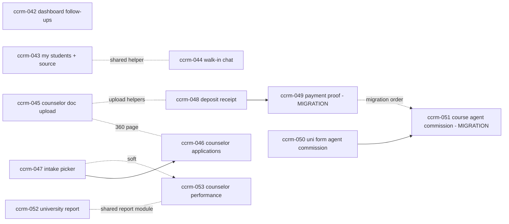

# Overseas Counselor CRM — Enhancement & Bug-fix Backlog 2 (`ccrm-042` … `ccrm-053`)

NO-ASSUMPTION MODE. Prepared 2026-10-28 at the owner's request. **No code was written or changed.**

**Owner statement (2026-10-28).** The owner pasted two lists of counselor-CRM changes (a free-form list and
"EduSphere CRM – Required Changes" items 1–7, reproduced verbatim in Appendix A) and asked for them to be converted into an
engineering enhancement backlog, IDs continuing the counselor series, "these are all extends to ccrm or bug fixes". The owner asked
for IDs from `ccrm-041`; `ccrm-041` is already built (PR #341, go-live permission matrix), so the owner chose **`ccrm-042` onward**.

**Evidence class.** `MEETING_TRANSCRIPT_REQUEST`-equivalent owner request (same standing as `COUNSELOR_CRM_BACKLOG.md`). The answers
Q1–Q9 below were given through the clarifying-question prompt. Each answer becomes a decision only when the item that uses it is built
and its `DEC-SCOPE` entry is written. Everything marked `NEEDS_CONFIRMATION` is a default, not a decision.

**Baseline.** Every "existing behaviour" statement was checked against code on `origin/main` @ `ec4257a0` (graphify orientation plus
four read-only code sweeps). Paths are relative to `apps/api/app/` (backend) or `apps/web/` (frontend) unless stated.

**Numbering.** Next free numbers on main today: migration `0212` (note: `0209` is absent on main — check for an open branch holding it),
`DEC-SCOPE-309`, API `12HG`, RBAC `2.220`. Recheck `origin/main` when each item is picked up; parallel branches take numbers.

## 1. Owner answers (2026-10-28)

| ID | Question | Answer |
| --- | --- | --- |
| Q1 | IDs start | **`ccrm-042` onward** (`ccrm-041` exists). |
| Q2 | "Every lead has to be converted to student" | **Ignore — already exists** once the lead is Qualified (ccrm-008 one-click convert, CC9). No item. |
| Q3 | Dashboard follow-up window ("short for a week from now") | **Overdue + next 7 days**, soonest first, overdue flagged; counselor tasks get the same window. |
| Q4 | Which "Payments section" gets receipt upload | **Student 360 → Finance tab → "Fees and payments" card**; counselor + Overseas Admin attach; student sees it. |
| Q5 | Agent-Master commission field placement | **Add/Edit University form AND a new per-course agent-Master commission** on the course form. |
| Q6 | University vs course agent commission precedence | **Course overrides university**; agent Master sees the effective value per course. |
| Q7 | Counselor performance audience | **Counselor (own) + Overseas Admin (all counselors, drill-in, date + intake filters, CSV).** |
| Q7b | Meaning of "overseas/it" | **Split the counselor's leads by lead division** (`Enquiry.division`), also usable as a filter. |
| Q8 | Intake field format | **Month + Year picker ("Sep 2027") reusing existing columns, no migration**; on lead create/edit, student profile (student + counselor) and application; legacy free text shown as-is. |
| Q9 | University-wise report | **Extend the existing CRM reports → Universities report** with deposits, visas approved/refused, and a per-university drill-down. **No commission.** |
| Q10 | `/overseas/counselor/students` content | **All my students + Source filter** (Walk-in, Lead conversion, Self-registered, Agency) + search. |

**Factual answer to "when will commission add field be visible?"** Today the agent-Master commission (dtu-001) is **not** on the Add
or Edit University form (`UniversityCreate` `schemas.py:8152` is `extra="forbid"` with no commission fields; `components/UniversityForm.tsx`
has none). It appears only as `AgentCommissionCard` on the university **detail** page (`app/partnership/universities/[id]/page.tsx:188`)
**after the university is created**, and only for Super Admin or Overseas Admin (`services/agent_commission_access.py:9-13`). The
agent Master sees the value only in Agent portal → Partner Universities, only for **published + active** universities, and only once a
value has been set (else "—") (`api/agent_shortlist.py:57,71`; `components/AgentPartnerUniversitiesPanel.tsx:95,142`). ccrm-050/051
change this.

## 2. Existing behaviour (verified, `origin/main` @ `ec4257a0`)

| Area | Finding |
| --- | --- |
| Dashboard follow-ups | `services/counselor_dashboard.py:105-107` window `end = start-of-today-IST + 1 day`; follow-ups `LeadFollowUp.status=="open", due_at < end` (`:139-146`); tasks only `due_on < today` (overdue) (`:147-151`). Creating a follow-up requires `due_at > now` (`services/lead_follow_ups.py:146-150`). **A new follow-up is always future-dated and so never shows until its day — root cause of the bug.** UI text "No follow-ups due today." (`components/CounselorDashboardPanel.tsx:21`). Scope = lead `owner_id` + division (`services/lead_handover.py:97-101`). |
| Counselor students page | `app/overseas/counselor/[section]/page.tsx` → `PortalPage` section `students`: (1) "Application Tracking" table, rows = applications with `counselor_id == me` (`services/portal.py:1091-1098`); (2) "Walk-in students" card (`components/CounselorWalkInStudents.tsx`) from `GET /counselor/students` = `OverseasStudentCounselor` rows only (`services/counselor_students.py:250-268`), no filter/search. Combined set already exists as `visible_student_ids()` (`counselor_students.py:66-71`). Source = `User.profile["registration_source"]` JSON key: `counselor_walk_in`, `lead_conversion`, `self_service`, agency source. |
| Counselor chat | `components/CounselorChatPanel.tsx:28-33` builds the student picker only from `/portal/overseas/counselor/applications`; student side `POST /workflows/overseas/student/counselor-chat` resolves counselor only via `OverseasApplication.counselor_id` (`api/workflows.py:2411-2440`) → 409 "No counselor is assigned" for a walk-in without an application. Fallback pattern exists in `services/counselor_reminders.py:253-257`, `services/calendar_feeds.py:101-106`. |
| Counselor document upload | `POST /workflows/overseas/documents` (`api/workflows.py:2816`) allows counselor but requires an application where they are counselor (`:2827-2833`) → **403 for an application-less walk-in**. Application-bound counselor uploads exist (`api/application_offers.py:119-138`: offer-letters, deposit-receipts, condition-evidence, enrollment-documents). Student 360 Documents tab (`components/OverseasStudent360Page.tsx:111-121`, `:242`) has **no upload control**; `can_download` uses the same application rule (`services/counselor_student_360.py:145`, `api/workflows.py:3020-3026`). Every non-archived `StudentDocument` with `student_id` is listed in the student portal (`services/portal.py:667`); the portal "Offer Letters" section reads legacy `offer_letter_url`, not `ApplicationOffer.offer_document_id` (`portal.py:693`). No AV scanning exists. |
| Counselor applications | Shared `POST /workflows/overseas/applications` (`api/workflows.py:2350`) already admits role counselor, sets `counselor_id` = caller (`:2384-2386`), archive guard (`:2357`), duplicate guard same student+university+course while open (`:2374-2383`), **but has no caseload check** (counselor can post for any overseas student). Only create UI is `OverseasApplyPanel` shown to `overseas_student` only (`components/WorkflowPanel.tsx:447`). 360 Applications panel is read-only (`OverseasStudent360Page.tsx:213-239`). Multiple applications per student are already allowed by the data model. |
| Intake | Free text everywhere: `LeadQualification.intake` String(40) (`models.py:2936`, overseas product group only), `OverseasStudentProfile.preferred_intake` String(40) (`models.py:4399`, editable by student `/overseas/me/profile` and counselor/admin), `OverseasApplication.intake` String(80) required (`models.py:1926`). `Enquiry` has no intake and `TelecallerLeadCreate` (`schemas.py:7042`) cannot capture it at creation. Course master has `intakes` month list (`models.py:1838`). No intake master table. |
| Finance tab deposit | `components/OverseasStudentFinance.tsx` read-only by design (ccrm-039 F1, `:79`, `:84`). Counselor deposit `ApplicationDepositRecord.receipt_document_id` exists (`models.py:2083`); editable only in `ApplicationDepositPanel` under the counselor evaluation panel (`components/ApplicationDepositPanel.tsx:145,230`); Overseas Admin has no edit UI. Agency deposit (`ApplicationDeposit`, AGN-011, Razorpay) has no proof column; counselor write → 409 (`api/application_offers.py:359`). |
| Payments | `Payment` (`models.py:2655`) has no attachment column; `Receipt` is a system PDF (`api/payments.py:44-60`). Finance tab "Fees and payments" card read-only; downloads admin-only (`services/counselor_student_360.py:304`). Pattern for receipt upload on a money record: `PUT /management/ledger/{id}/receipt` (`api/management_ledger.py:249`). |
| Agent commission | University-level `agent_commission_percent/_amount/_currency/_note` (`models.py:1255-1258`, migration 0157); edit Super Admin / Overseas Admin; view + agent Master (`services/agent_commission_access.py`); `PUT/DELETE /partnership/universities/{id}/agent-commission` audited (`api/partnership_universities.py:245,251`). Course-level U2 commission (`commission_*`, `models.py:1846-1848`) is university→EduSphere, visible only to `COMMISSION_ROLES`; guarded by the upc-033 sweep test. |
| University report | Overseas Admin "CRM reports" → universities (`services/management_crm_reports.py:177`, page `app/overseas/admin/crm-reports/page.tsx`, export `api/management.py:211`): applications, students, offers, offer rate, rejections, acceptances, enrolments; filters date/counselor/country/university/course/intake. **No deposit or visa columns.** upc-018 `funnel_counts` (`services/partnership_metrics.py:154,189`) has deposits/visas per university. |
| Counselor performance | `GET /counselor/performance` self only, overseas counselor only (`api/counselor_performance.py:26`); metrics in `services/counselor_performance.py:23-42,75-91`; date range only, no intake filter. Overseas Admin has no per-counselor view (mgmt-018 `/management/counseling` is partner/super_admin). `overseas_applications.counselor_id` has **no index**. |

## 3. Items

### `ccrm-042` — Dashboard follow-ups: overdue + next 7 days; new follow-ups appear (bug fix)

- **Title:** Counselor dashboard shows overdue and next-7-day follow-ups and tasks.
- **Business requirement:** "follow up should short for a week from now in the counsellor dashboard. Also adding a new follow is not
  appearing in the dashboard." (Q3)
- **Existing behaviour:** dashboard shows lead follow-ups due before midnight IST today and tasks only once overdue; a newly added
  follow-up (must be future-dated) is invisible until its due day.
- **Expected behaviour:** follow-ups section = open `LeadFollowUp` on the counselor's leads with `due_at < start_of_today_IST + 8 days`
  (overdue + today + next 7 days), sorted ascending by `due_at`, overdue flagged. Tasks section = open `CounselorTask` with
  `due_on <= today + 7` (overdue flagged). A follow-up created now appears on the next dashboard load. Empty-state text updated
  ("No follow-ups in the next 7 days").
- **User roles affected:** overseas counselor.
- **Frontend impact:** `components/CounselorDashboardPanel.tsx` labels, overdue badge, due date column.
- **Backend impact:** `services/counselor_dashboard.py:105-151` window + ordering; keep `{count, more, items[≤10]}` shape.
- **Database impact:** none (index `ix_lead_follow_ups_open_due` covers it).
- **API impact:** `GET /counselor/dashboard` response semantics change (section window); add `overdue` flag per item if absent. Doc API §12HG.
- **Integration impact:** none. **Authentication impact:** none.
- **Authorization impact:** unchanged — `role=="counselor" and division=="overseas"` (`api/counselor_dashboard.py:20-23`), lead scope by owner.
- **Security impact:** none (scope unchanged).
- **Performance impact:** negligible; bounded by limit 10 + count.
- **Reusable modules:** `today_ist`, existing `overdue` computation, `GET /counselor/follow-ups` `view/day` logic (`api/telecaller_follow_ups.py:51-63`).
- **Dependencies:** none.
- **Acceptance criteria:** AC1 a follow-up due tomorrow appears immediately after creation; AC2 one due in 8 days does not; AC3 overdue
  open follow-ups appear flagged; AC4 sorted soonest first; AC5 tasks follow the same window; AC6 done/cancelled never appear; AC7
  another counselor's lead follow-ups never appear.
- **Positive scenarios:** add follow-up for +2 days → visible; complete it → disappears.
- **Negative scenarios:** IT counselor / telecaller → 403; follow-up on a lead handed to another counselor → not shown.
- **Edge cases:** due exactly at `start+8d` boundary (exclusive); IST midnight rollover; lead closed (F4 cancels follow-ups);
  >10 items → `more=true`.
- **Regression risks:** ccrm-032 dashboard tests asserting "today only"; ccrm-041 matrix unaffected; `/counselor/tasks` page unchanged.
- **Complexity:** small. **Risk:** low.
- **Status (2026-10-28):** built on `worktree-ccrm-042` (`DEC-SCOPE-316`; API §12HN; no migration; response key `overdue_tasks`
  kept, titled "Tasks due").

### `ccrm-043` — Counselor "My students" list with Source filter and search

- **Title:** `/overseas/counselor/students` lists all my students with a Source filter.
- **Business requirement:** "filters (walk in and identify others). Right now it shows only walkin students." (Q10)
- **Existing behaviour:** "Walk-in students" card lists only `OverseasStudentCounselor` links; students reaching the counselor via an
  application appear only in the application table; no filter/search.
- **Expected behaviour:** one paged list of every student in `visible_student_ids(counselor)` (csc-001 link ∪ applications where
  `counselor_id == me`, incl. agency students), excluding archived. Columns: name, email/phone, source, applications count, linked-since.
  Filter **Source** = Walk-in (`counselor_walk_in`) / Lead conversion (`lead_conversion`) / Self-registered (`self_service` or missing)
  / Agency (has an agency `AgentStudent`/agency application). Text search on name/email/phone. Card retitled "My students".
- **User roles affected:** overseas counselor (Overseas Admin view unchanged — `NEEDS_CONFIRMATION` whether Admin wants the same filter).
- **Frontend impact:** `components/CounselorWalkInStudents.tsx` (rename/extend), filter bar, `WorkflowPanel.tsx:453` wiring.
- **Backend impact:** `services/counselor_students.py:250-268` `page()` reads the union + `source`/`q` params; derive source.
- **Database impact:** none (JSON key filter on `users.profile`). Optional expression index if volume grows — not required now.
- **API impact:** `GET /counselor/students?source=&q=&page=` (additive params, unknown source → 422), response adds `source`, `applications`.
- **Integration impact:** none. **Authentication impact:** none.
- **Authorization impact:** `require_overseas_counselor`; rows strictly from `visible_student_ids`.
- **Security impact:** must not leak students outside the counselor's caseload; agency students shown only where this counselor holds an
  application (no agency contact data beyond what 360 already shows).
- **Performance impact:** union query + count; paginate server-side; avoid per-row application count N+1 (grouped subquery).
- **Reusable modules:** `visible_student_ids`, `student_archive.not_archived()`, ccrm-012 search helpers, `Page` type in `lib/apiErrors.ts`.
- **Dependencies:** none (shares `visible_student_ids` with ccrm-044, ccrm-046).
- **Acceptance criteria:** AC1 a self-registered student with my application is listed (source Self-registered); AC2 walk-in listed as
  Walk-in; AC3 converted lead listed as Lead conversion; AC4 agency student with my application listed as Agency; AC5 filter narrows
  correctly; AC6 archived excluded; AC7 another counselor's students never listed.
- **Positive / negative / edge:** search by phone; invalid `source` → 422; student both walk-in and with my application listed once;
  student whose application moved to another counselor drops off; legacy users without `registration_source` → Self-registered.
- **Regression risks:** csc-001..005 tests on the walk-in card; ccrm-040 archive hiding; ccrm-041 route matrix (params only).
- **Complexity:** medium. **Risk:** low.
- **Status (2026-10-28):** built on `worktree-ccrm-043` (`DEC-SCOPE-317`; API §12HO; no migration; source D1 first-match rule).

### `ccrm-044` — Counselor chat with walk-in students (bug fix)

- **Title:** Chat works for students linked to the counselor without an application.
- **Business requirement:** List 2 item 7 — "Counsellors are unable to access the chat functionality for students added through the Walk-in option."
- **Existing behaviour:** counselor picker built from applications only; student-side resolver uses `OverseasApplication.counselor_id`
  only → walk-ins excluded (409 on the student side).
- **Expected behaviour:** counselor picker = `visible_student_ids` (same source as ccrm-043); student resolver falls back to
  `OverseasStudentCounselor.counselor_user_id` when no application counselor exists (application counselor wins when present —
  `NEEDS_CONFIRMATION` if they differ).
- **User roles affected:** overseas counselor, overseas student.
- **Frontend impact:** `components/CounselorChatPanel.tsx:28-33` picker source.
- **Backend impact:** `api/workflows.py:2411-2440` resolver; optional `GET /counselor/chat/students` or reuse ccrm-043 list.
- **Database impact:** none. **API impact:** resolver behaviour change (409 now only when neither link exists).
- **Integration impact:** email/notification of new messages unchanged. **Authentication impact:** none.
- **Authorization impact:** tighten: counselor may message only `is_visible_student`; generic `/communications/messages` currently checks
  only division (`api/communications.py:22-70`) — add caseload check for counselor senders (`NEEDS_CONFIRMATION`: may affect other
  overseas staff flows).
- **Security impact:** closes a cross-caseload messaging gap; audit unchanged.
- **Performance impact:** negligible.
- **Reusable modules:** `visible_student_ids`, `is_visible_student`, fallback in `counselor_reminders.py:253-257`.
- **Dependencies:** none; touches same helper as ccrm-043 (merge order irrelevant).
- **Acceptance criteria:** AC1 counselor sees walk-in student (no application) in picker and sends a message; AC2 walk-in student opens
  chat and reaches the linked counselor; AC3 student with neither link → 409; AC4 counselor cannot message a student outside caseload (403).
- **Positive / negative / edge:** student with app counselor A and link counselor B → A (default); counselor reassigned by csc-005 →
  new counselor; archived student → hidden from picker.
- **Regression risks:** `tests/test_i19_counselor_chat.py` (application path); messaging for other roles if the caseload check is broadened.
- **Complexity:** small. **Risk:** medium (messaging authz).
- **Status (2026-10-28):** built on `worktree-ccrm-044` (`DEC-SCOPE-320`; API §12HR; no migration; caseload check only for counselor → overseas student).

### `ccrm-045` — Counselor uploads student documents (incl. offer letter) without an application

- **Title:** Upload documents on the Student 360 Documents tab; visible to the student.
- **Business requirement:** "Documents can also be uploaded by the counsellor on behalf of student and they are visible to students. It
  also includes offer letter." + List 2 item 2.
- **Existing behaviour:** no upload control on the 360 Documents tab; the generic upload route requires an application the counselor owns
  (403 for walk-ins); application-bound offer-letter upload exists only inside the evaluation panel; student portal "Offer Letters"
  section reads legacy `offer_letter_url`.
- **Expected behaviour:** "Upload document" on the 360 Documents tab: document type (checklist types incl. **Offer letter**), optional
  application (my applications for that student), file. Stored as `StudentDocument(student_id, application_id?, uploaded_by_user_id)`,
  event logged, checklist sync when application given. Visible to the student in Documents immediately. Student portal "Offer Letters"
  also lists offers' `offer_document_id` documents. `can_download` for the counselor uses caseload (`is_visible_student`), not "has application".
- **User roles affected:** overseas counselor, Overseas Admin (same control — default yes, `NEEDS_CONFIRMATION`), overseas student (viewer).
- **Frontend impact:** `OverseasStudent360Page.tsx` Documents tab upload form; student portal Offer Letters list.
- **Backend impact:** new `POST /counselor/students/{id}/documents` (multipart, `read_upload` byte-sniff, 20 MB) — or relax
  `workflows.py:2827-2833` to caseload; fix `counselor_student_360.py:145`, `workflows.py:3020-3026`, `portal.py:693`.
- **Database impact:** none (no visibility flag — owner: always visible).
- **API impact:** new route (API §12HG/next); download permission semantics change.
- **Integration impact:** storage (S3/Spaces/local) via `storage.store`; optional email "new document added" — `NEEDS_CONFIRMATION`.
- **Authentication impact:** none.
- **Authorization impact:** counselor only for `is_visible_student`; application must belong to that student; agency application →
  allowed? (CC4 counselor records on all applications) — default allowed, `NEEDS_CONFIRMATION`.
- **Security impact:** file type by magic bytes (PDF/images), size cap, server-generated key, EXIF strip, signed 15-min downloads,
  sensitivity class honoured; no AV scanning exists — record as residual risk.
- **Performance impact:** upload size bound; none on reads.
- **Reusable modules:** `agent_documents.read_upload/store/discard`, `application_offers._upload`, `add_event`, `application_checklists.sync_for_documents`, `DocumentsPanel`.
- **Dependencies:** none hard; shares `OverseasStudent360Page.tsx` with ccrm-046, upload helpers with ccrm-048/049.
- **Acceptance criteria:** AC1 counselor uploads a passport for a walk-in with no application → 201, student sees it; AC2 offer letter
  uploaded against an application appears in the student's Offer Letters; AC3 non-PDF/image → 415; >20 MB → 413; AC4 other counselor's
  student → 404/403; AC5 counselor can download what they uploaded; AC6 event history records uploader.
- **Positive / negative / edge:** upload then ccrm-021 review/new version; archived student → 409; application of a different student → 422;
  DB failure → stored file discarded.
- **Regression risks:** ccrm-019/020/021/023 document tests; student portal documents list; download audit.
- **Complexity:** medium. **Risk:** medium (file handling + visibility).

### `ccrm-046` — Counselor creates and manages multiple applications for a student

- **Title:** "Add application" on the Student 360 Applications tab.
- **Business requirement:** "Counsellor also should be able to apply to a university on behalf of student." + List 2 items 3 and 4.
- **Existing behaviour:** backend already allows a counselor to create (sets themselves as counselor) but with no caseload check; no counselor UI.
- **Expected behaviour:** "Add application" opens the apply form (university → course → intake picker from ccrm-047 → notes) prefilled for
  the student; creates `OverseasApplication(counselor_id=me)`; repeatable for any number of universities/courses; duplicate open
  student+university+course → 409 (unchanged); new row appears in the Applications panel and the evaluation panel actions apply.
- **User roles affected:** overseas counselor; student sees new applications in portal; Overseas Admin UI — `NEEDS_CONFIRMATION` (API already allows).
- **Frontend impact:** `OverseasApplyPanel.tsx` accepts `studentId` prop; button in `OverseasStudent360Page.tsx:213-239`.
- **Backend impact:** `api/workflows.py:2350` add caseload check for counselor (`is_visible_student`) — **security fix**.
- **Database impact:** none (intake stays String(80); duplicate key unchanged).
- **API impact:** same route; new 403/404 for out-of-caseload counselor.
- **Integration impact:** application notifications/emails fire as for student-created applications (verify). **Authentication impact:** none.
- **Authorization impact:** counselor: only own caseload; agent path unchanged; archive guard unchanged.
- **Security impact:** closes IDOR-style gap (counselor creating for any student).
- **Performance impact:** none.
- **Reusable modules:** `create_overseas_application`, `open_clause`, `refuse_new_application`, `OverseasApplyPanel`, APP- code generator (ccrm-011).
- **Dependencies:** soft on ccrm-047 (intake picker); shares 360 page with ccrm-045.
- **Acceptance criteria:** AC1 counselor creates 3 applications for one walk-in student at different universities; AC2 each has
  `counselor_id=me`, APP- code, stage 1; AC3 duplicate open → 409; AC4 student outside caseload → 403; AC5 archived → 409; AC6 new
  applications appear in student portal and counselor dashboard.
- **Positive / negative / edge:** same university different course allowed; withdrawn then re-apply allowed; inactive/unpublished course
  rejected (verify current rule); agency student — counselor-created app is direct, not agency (`NEEDS_CONFIRMATION`).
- **Regression risks:** student self-apply tests, ccrm-041 journey, ccrm-011 code sequence, agent application duplicate rule.
- **Complexity:** medium. **Risk:** medium.

### `ccrm-047` — Intake Month+Year picker for lead, student profile and application

- **Title:** Structured intake selection (Month YYYY) everywhere intake is entered.
- **Business requirement:** "Also add a fields of intake for a lead." + List 2 item 5 (student portal and counsellor login). (Q8)
- **Existing behaviour:** intake is free text; a lead gets an intake only via the qualification form (overseas product), not at creation;
  student portal already has free-text "Preferred intake".
- **Expected behaviour:** shared `IntakePicker` (month Jan–Dec + year current..current+3) writing `"Sep 2027"` into existing columns:
  lead create (telecaller `NewLeadForm`, counselor walk-in lead) and lead qualification edit → `LeadQualification.intake` (row created at
  lead creation when intake given); student profile (student `MyStudentProfile`, counselor/admin profile page) → `preferred_intake`;
  application create (ccrm-046 / `OverseasApplyPanel`) → `intake`. Backend validates format on write for new values; legacy values
  displayed as-is and accepted unchanged on unrelated edits.
- **User roles affected:** telecaller, overseas counselor, Overseas Admin, overseas student, agent (application form — `NEEDS_CONFIRMATION`).
- **Frontend impact:** new `components/IntakePicker.tsx`; `NewLeadForm`, `LeadQualificationForm`, `StudentProfileForm`, `OverseasApplyPanel`.
- **Backend impact:** `TelecallerLeadCreate` (`schemas.py:7042`) gains optional `intake`; walk-in lead schema; validator `^(Jan|…|Dec) \d{4}$`.
- **Database impact:** none (String(40)/(80) fit).
- **API impact:** additive optional field on lead create; 422 on malformed new intake.
- **Integration impact:** CSV lead import (tel-006) — accept intake column? `NEEDS_CONFIRMATION`; reports/filters by intake (ccrm-052/053) get consistent values.
- **Authentication / authorization impact:** none beyond existing form gates (qualification intake overseas product only — keep).
- **Security impact:** input validation only.
- **Performance impact:** none.
- **Reusable modules:** `COURSE_MONTHS` (`models.py:1800`), `lead_conversion.py:58` copy of intake to profile (unchanged).
- **Dependencies:** none hard; ccrm-046 consumes the picker; ccrm-053 benefits.
- **Acceptance criteria:** AC1 telecaller creates a lead with intake "Sep 2027" → stored and shown on lead detail; AC2 student sets
  preferred intake via picker; AC3 counselor edits student intake; AC4 application intake via picker; AC5 "September next year" (new) → 422;
  AC6 a legacy free-text value still displays and an unrelated profile edit does not fail.
- **Positive / negative / edge:** IT-product lead → intake hidden (overseas only); past month of current year — allowed? (`NEEDS_CONFIRMATION`, default allowed);
  conversion copies intake to profile.
- **Regression risks:** tel-005 intake, tel-009 qualification form, ccrm-005 lead fields, ccrm-007 profile, agency application forms.
- **Complexity:** medium. **Risk:** low.
- **Status (2026-10-28):** built on `worktree-ccrm-047` (`DEC-SCOPE-319`; API §12HQ; no migration; agent forms, CSV import and
  application `PATCH` unchanged — `NEEDS_CONFIRMATION`).

### `ccrm-048` — University deposit document upload on the Finance tab

- **Title:** Upload deposit receipt next to University Deposit (Finance tab).
- **Business requirement:** List 2 item 1 — "add a document upload option next to the University Deposit section."
- **Existing behaviour:** Finance tab read-only (ccrm-039 F1); counselor deposit receipt editable only inside the evaluation panel;
  Overseas Admin has no edit UI; agency (Razorpay) deposits have no proof column.
- **Expected behaviour:** on each **counselor-recorded** deposit (`ApplicationDepositRecord`) card: "Upload receipt" / "Replace receipt"
  for counselor (own applications) and Overseas Admin; reuses `POST .../deposit-receipts` + set `receipt_document_id`. Agency deposits
  stay read-only (system receipt). If no deposit record exists or `required=false` → button hidden with hint "Record the deposit first".
- **User roles affected:** overseas counselor, Overseas Admin; student sees the receipt in Documents.
- **Frontend impact:** `components/OverseasStudentFinance.tsx` deposit card; banner text adjusted (ccrm-039 F1 superseded for this card).
- **Backend impact:** small attach endpoint or reuse `PUT /applications/{id}/deposit`; `finance()` (`services/counselor_student_360.py:252`) returns `can_upload`.
- **Database impact:** none. **API impact:** additive `can_upload`; optional `POST /…/deposit/receipt`.
- **Integration impact:** storage only. **Authentication impact:** none.
- **Authorization impact:** counselor only on `_assigned_application`; Overseas Admin any; agency deposit → 409 (unchanged).
- **Security impact:** same upload controls as ccrm-045.
- **Performance impact:** none.
- **Reusable modules:** `application_offers._upload`, `_writable`, `ApplicationDepositPanel` upload code.
- **Dependencies:** sequential before ccrm-049 (same component/service); shares upload helpers with ccrm-045.
- **Acceptance criteria:** AC1 counselor uploads a receipt on a required deposit → shown with download; AC2 Overseas Admin replaces it;
  AC3 agency deposit shows no upload; AC4 other counselor's application → 403; AC5 deposit not required → no upload, API 422.
- **Positive / negative / edge:** replace keeps old document as a version (ccrm-021) — `NEEDS_CONFIRMATION`; archived student → 409.
- **Regression risks:** ccrm-025 deposit tests, ccrm-039 finance read-only tests (update intentionally).
- **Complexity:** small. **Risk:** medium (money-related record).

### `ccrm-049` — Payment receipt / proof upload on the Finance tab (Fees and payments)

- **Title:** Attach a payment receipt file to a student payment.
- **Business requirement:** List 2 item 6 — "Add a document upload option for payment receipts." (Q4)
- **Existing behaviour:** `Payment` has no attachment; `Receipt` is a system-generated PDF; card read-only; counselor cannot record payments.
- **Expected behaviour:** on each payment row of the Finance tab "Fees and payments" card: "Upload receipt" (counselor for students in
  caseload, Overseas Admin) → stored as `StudentDocument` type "Payment receipt" and linked via new `payments.proof_document_id`;
  student sees the file in the portal Payments page and Documents. System PDF receipt unchanged and distinct ("System receipt" vs "Uploaded proof").
- **User roles affected:** overseas counselor, Overseas Admin, overseas student (viewer).
- **Frontend impact:** `OverseasStudentFinance.tsx` payment rows; student portal payments table column.
- **Backend impact:** `POST /counselor/students/{id}/payments/{pid}/proof` (and admin equivalent or shared); `finance()` and
  `portal.py:752` payload add proof.
- **Database impact:** **migration** `0212_payment_proof_documents` (next free; recheck): `payments.proof_document_id` FK →
  `student_documents.id` ON DELETE SET NULL, nullable.
- **API impact:** new route + additive fields (API §12H?).
- **Integration impact:** none with Razorpay (online payments already have system receipts — upload allowed? `NEEDS_CONFIRMATION`, default manual payments only).
- **Authentication impact:** none.
- **Authorization impact:** counselor read of payments today is admin-gated for downloads (`counselor_student_360.py:304`) — counselor may
  download only the proof they can see (`NEEDS_CONFIRMATION`); payment must belong to that student.
- **Security impact:** money record — audit log entry on attach/replace; same upload controls; no edit of amount/status.
- **Performance impact:** none.
- **Reusable modules:** ledger receipt upload pattern (`api/management_ledger.py:249`), `read_upload`, `StudentDocument`.
- **Dependencies:** after ccrm-048 (same files); after ccrm-045 helper if a shared staff-upload service is extracted.
- **Acceptance criteria:** AC1 counselor attaches a PDF proof to a manual payment → student sees it; AC2 Overseas Admin replaces it
  (audited); AC3 payment of another student → 404; AC4 counselor outside caseload → 403; AC5 migration up/down clean; AC6 system receipt unaffected.
- **Positive / negative / edge:** pending (unpaid) payment — allowed (proof of offline transfer) by default; deleted document → proof null.
- **Regression risks:** payments/receipts tests, ccrm-039 finance, mgmt revenue reports (no read change).
- **Complexity:** medium. **Risk:** high (money + migration).

### `ccrm-050` — Agent-Master commission on the Add/Edit University form

- **Title:** Show the agent-Master commission fields on Add/Edit University.
- **Business requirement:** "while adding the university commission, the commission field should be available that is visible to only
  agent master" + "when will commission add field will be visible?" (Q5)
- **Existing behaviour:** see §1 factual answer — detail-page card only, after create.
- **Expected behaviour:** `UniversityForm` shows an "Agent Master commission" fieldset (percent or amount + currency + note) only for
  `AGENT_COMMISSION_EDITORS` (Super Admin, Overseas Admin); on create, saved after the university insert in the same request (or a
  follow-up PUT — design choice); on edit, prefilled. Hidden for partnership roles. Agent Master view unchanged (published only).
- **User roles affected:** Super Admin, Overseas Admin (edit); agent Master (view).
- **Frontend impact:** `components/UniversityForm.tsx`, new/edit pages.
- **Backend impact:** `UniversityCreate`/update schemas accept optional `agent_commission` only when caller can edit (else 403/ignored —
  default 403); reuse `agent_commission_access` + audit.
- **Database impact:** none.
- **API impact:** additive optional object on create/update.
- **Integration impact:** none. **Authentication impact:** none.
- **Authorization impact:** partnership_manager/head submitting the field → 403; upc-033 sweep extended for the new input path.
- **Security impact:** commission confidentiality — must never be echoed to non-viewers.
- **Performance impact:** none.
- **Reusable modules:** `agent_commission_access`, `PUT /partnership/universities/{id}/agent-commission` service, `AgentCommissionCard` fields.
- **Dependencies:** before ccrm-051 (same module/tests).
- **Acceptance criteria:** AC1 Overseas Admin creates a university with 10% agent commission → stored + audited; AC2 partnership manager
  never sees the fieldset, API rejects the field; AC3 agent Master sees 10% after publish; AC4 agent staff never see it.
- **Positive / negative / edge:** both percent and amount → 422 (existing check constraint); inactive university — 409 rule kept on edit.
- **Regression risks:** dtu-001 tests, upc-033 commission sweep, partnership university CRUD.
- **Complexity:** small. **Risk:** medium (confidential commercial data).

### `ccrm-051` — Course-level agent-Master commission (overrides university)

- **Title:** Agent-Master commission per course with university fallback.
- **Business requirement:** owner answer Q5/Q6 ("Also on Add Course form"; course overrides university).
- **Existing behaviour:** agent-Master commission exists only at university level; course has only U2 university→EduSphere commission.
- **Expected behaviour:** `CourseForm` "Agent Master commission" fieldset for Super Admin / Overseas Admin; agent Master Partner
  Universities view shows **effective** commission per course = course value if set else university value, labelled source.
- **User roles affected:** Super Admin, Overseas Admin (edit); agent Master (view); agent staff/partnership roles never.
- **Frontend impact:** `components/CourseForm.tsx`, `AgentPartnerUniversitiesPanel.tsx` course list.
- **Backend impact:** course create/update schemas; `agent_commission_access` payload for courses; effective-value helper.
- **Database impact:** **migration** `0213_course_agent_commission` (after ccrm-049; recheck): `overseas_courses.agent_commission_percent/
  _amount/_currency/_note` + same check constraints as universities.
- **API impact:** additive fields on course endpoints (view-gated), `GET /partner-universities/{id}` courses carry `agent_commission_effective`.
- **Integration impact:** dtu-001 loader unaffected (university level). **Authentication impact:** none.
- **Authorization impact:** identical to university agent commission; upc-033 sweep must tolerate the new course keys for viewers only.
- **Security impact:** must not mix with U2 `commission_*` keys; never exposed via public course APIs.
- **Performance impact:** none (columns on fetched rows).
- **Reusable modules:** `agent_commission_access`, university check constraints in `models.py:1172-1175`.
- **Dependencies:** after ccrm-050.
- **Acceptance criteria:** AC1 course 12% overrides university 10% for agent Master; AC2 course unset → 10% shown "(university)"; AC3
  public course API never includes it; AC4 partnership roles never see it; AC5 audit on change; AC6 migration up/down.
- **Positive / negative / edge:** clearing course value reverts to fallback; university unset + course unset → "—".
- **Regression risks:** upc-033 sweep, course master tests, public catalogue snapshot tests.
- **Complexity:** medium. **Risk:** high (confidential commercial data + migration).

### `ccrm-052` — University-wise report: deposits, visas and drill-down

- **Title:** Extend CRM reports → Universities for Overseas Admin.
- **Business requirement:** "university wise report for overseas admin" (Q9).
- **Existing behaviour:** universities report has applications, students, offers, offer rate, rejections, acceptances, enrolments; no deposits/visas.
- **Expected behaviour:** add columns **deposits paid** (counselor-recorded paid + agency paid), **visas approved**, **visas refused**,
  **visa pending**; click a university → drill-down list of its applications (student, course, intake, stage, counselor). Same filters;
  CSV/xlsx include new columns. **No commission.**
- **User roles affected:** Overseas Admin, Super Admin, partner (existing readers).
- **Frontend impact:** `app/overseas/admin/crm-reports/page.tsx` columns + drill-down.
- **Backend impact:** `services/management_crm_reports.py:177` `_universities` + definitions (`:62-69`); drill-down endpoint or `?university_id=` detail.
- **Database impact:** none. **API impact:** additive columns; new drill-down route.
- **Integration impact:** none. **Authentication impact:** none.
- **Authorization impact:** `require_crm_reports` unchanged.
- **Security impact:** drill-down exposes student names — same readers only; export audited/throttled (`crm_exports.export`).
- **Performance impact:** grouped SELECTs (reuse `funnel_counts` pattern); index on `overseas_applications.university_id` exists.
- **Reusable modules:** `partnership_metrics.funnel_counts`, `ReportFilters`, `table()` export.
- **Dependencies:** none hard; shares `management_crm_reports.py` with ccrm-053 (intake filter) — sequence or coordinate.
- **Acceptance criteria:** AC1 seeded university with 2 visas approved/1 refused shows 2/1; AC2 deposits counted once per application;
  AC3 filters apply to new columns; AC4 export includes them; AC5 drill-down rows match the count.
- **Positive / negative / edge:** university with no applications → zero row or hidden (match existing); withdrawn application visa excluded (`NEEDS_CONFIRMATION` definitions).
- **Regression risks:** ccrm-034 report tests, export column order consumers.
- **Complexity:** medium. **Risk:** low.
- **Status (2026-10-28):** built on `worktree-ccrm-052` (`DEC-SCOPE-321`; API §12HS; no migration; new columns appended to the export).

### `ccrm-053` — Counselor performance: Overseas Admin view, intake filter, Overseas/IT lead split

- **Title:** Counselor performance for counselor (own) and Overseas Admin (all counselors).
- **Business requirement:** "counsellor performance ---> leads, overseas/it, students, intake(filter), visas, enrollments" (Q7, Q7b).
- **Existing behaviour:** self-only, overseas counselor only, date range only; lead figures overseas only; admin has no per-counselor view.
- **Expected behaviour:** metrics per counselor: leads (total, **Overseas**, **IT** by `Enquiry.division`), students (caseload), visas
  (pending/approved/refused), enrolments, plus existing figures. Filters: date range, **intake** (Month YYYY; matches
  `OverseasApplication.intake` for app metrics and `LeadQualification.intake` for lead metrics), lead division. Overseas Admin page: one row
  per counselor (one grouped query), click → that counselor's existing report; CSV export.
- **User roles affected:** overseas counselor (own), Overseas Admin (all overseas counselors), Super Admin (`NEEDS_CONFIRMATION`).
- **Frontend impact:** `components/CounselorPerformance.tsx` (intake filter, split), new admin page `/overseas/admin/counselor-performance` + nav.
- **Backend impact:** `services/counselor_performance.py` parameterised by counselor + intake; admin endpoint `GET /overseas/admin/counselor-performance`;
  counselor endpoint keeps self-only.
- **Database impact:** optional **migration** index `ix_overseas_applications_counselor_id` (recommended for admin aggregation; recheck number).
- **API impact:** `GET /counselor/performance?intake=`; new admin list + `?counselor_id=` detail; CSV.
- **Integration impact:** none. **Authentication impact:** none.
- **Authorization impact:** counselor cannot pass another counselor_id (ignored/403); admin limited to overseas division counselors.
- **Security impact:** export audited; no revenue figures (as today).
- **Performance impact:** group-by queries, no per-counselor loops; index above.
- **Reusable modules:** mgmt-018 `management_counseling` grouping, `ReportFilters.intake`, ccrm-047 picker.
- **Dependencies:** soft on ccrm-047 (clean intake values); shares report helpers with ccrm-052.
- **Acceptance criteria:** AC1 counselor sees own report with intake filter; AC2 Admin sees all counselors with correct counts; AC3
  Overseas/IT lead split sums to total; AC4 intake filter narrows app metrics; AC5 counselor cannot read another's figures; AC6 CSV matches screen.
- **Positive / negative / edge:** counselor with zero activity listed with zeros; deactivated counselor — included in period? (`NEEDS_CONFIRMATION`, default included if any activity);
  legacy free-text intake not matching picker format excluded from intake filter (documented).
- **Regression risks:** existing counselor performance tests, mgmt-018, ccrm-041 matrix (new admin route).
- **Complexity:** medium. **Risk:** medium.

## 4. Out of scope (owner answers)

- **Lead → student conversion for every lead source** — already exists once the lead is Qualified (Q2; ccrm-008 / CC9). Telecaller /
  website / BDM leads reach the counselor through tel-018 handover or Admin owner change, then convert.
- Commission (university→EduSphere, U2) in the university-wise report (Q9).
- Antivirus scanning of uploads — not present platform-wide; recorded as residual risk for ccrm-045/048/049.

## 5. Dependency graph

Solid arrow = must be sequential. Dotted = shared files (coordinate merge) or soft dependency.

1. **Must be sequential:** ccrm-048 → ccrm-049 (same `OverseasStudentFinance.tsx` + `finance()`); ccrm-050 → ccrm-051 (same commission
   access module + upc-033 sweep); ccrm-047 → ccrm-046 (apply form uses the picker; if 046 must ship first, it ships with the free-text field
   and 047 swaps it); migrations in order 0212 (049) → 0213 (051) → optional index (053).
2. **Can run independently:** ccrm-042, ccrm-044, ccrm-052, ccrm-050; ccrm-043 (only shares a read helper); ccrm-045.
3. **Touch common files/modules:**
   - `components/OverseasStudent360Page.tsx` — 045, 046 (048/049 via its Finance tab child).
   - `services/counselor_students.py` (`visible_student_ids`, `is_visible_student`) — 043, 044, 045, 046.
   - `components/WorkflowPanel.tsx` — 043, 044, 046.
   - `services/counselor_student_360.py` — 045, 048, 049.
   - `api/workflows.py` — 044 (chat resolver), 045 (document route), 046 (create route).
   - Upload helpers (`agent_documents.read_upload`, `application_offers._upload`) — 045, 048, 049.
   - `services/agent_commission_access.py`, upc-033 sweep test — 050, 051.
   - `services/management_crm_reports.py` — 052, 053.
   - `tests/test_ccrm_041_matrix.py` route inventory — every item adding a route (043?, 045, 049, 052, 053).
4. **Require migrations:** ccrm-049 (`payments.proof_document_id`), ccrm-051 (course agent commission columns); ccrm-053 optional index.
   All others: no migration.
5. **Implement first:** ccrm-042 (live bug, small, isolated) → ccrm-044 (live bug, small) → ccrm-045 and ccrm-047 in parallel →
   ccrm-046 → ccrm-043 → ccrm-048 → ccrm-049 → ccrm-050 → ccrm-051 → ccrm-052 ∥ ccrm-053.

## 6. Summary

| Item | Type | Complexity | Risk | Migration |
| --- | --- | --- | --- | --- |
| ccrm-042 | bug fix + enhancement | small | low | no |
| ccrm-043 | enhancement (reported as bug) | medium | low | no |
| ccrm-044 | bug fix | small | medium | no |
| ccrm-045 | enhancement | medium | medium | no |
| ccrm-046 | enhancement + security fix | medium | medium | no |
| ccrm-047 | enhancement | medium | low | no |
| ccrm-048 | enhancement | small | medium | no |
| ccrm-049 | enhancement | medium | high | yes |
| ccrm-050 | enhancement | small | medium | no |
| ccrm-051 | enhancement | medium | high | yes |
| ccrm-052 | enhancement | medium | low | no |
| ccrm-053 | enhancement | medium | medium | optional index |

## Appendix A. Line-level traceability (owner text → item)

| # | Owner line (verbatim) | Item / status |
| --- | --- | --- |
| A1 | "follow up should short for a week from now in the counsellor dashboard." | ccrm-042 (Q3) |
| A2 | "Also adding a new follow is not appearing in the dashboard." | ccrm-042 (root cause §2) |
| A3 | "https://edusphere.org.uk/overseas/counselor/students filters(walk in and identify others). Right now it shows only walkin students" | ccrm-043 (Q10) |
| A4 | "Also add a fields of intake for a lead." | ccrm-047 (Q8) |
| A5 | "Counsellor also should be able to apply to a university on behalf of student." | ccrm-046 |
| A6 | "university wise report for overseas admin" | ccrm-052 (Q9) |
| A7 | "Every lead has to converted to student. either walk in lead or telecallar or any other lead" | Out of scope — exists (Q2) |
| A8 | "while adding the university commission, the commision field should be available that is visible to only agent master" | ccrm-050, ccrm-051 (Q5, Q6) |
| A9 | "when will commission add field will be visible?" | §1 factual answer; ccrm-050 |
| A10 | "counsellor performance ---> leads, overseas/it, students, intake(filter), visas, enrollments" | ccrm-053 (Q7, Q7b): leads ✓, overseas/IT ✓, students ✓, intake filter ✓, visas ✓, enrollments ✓ |
| A11 | "Documents can also be uploaded by the counsellor on behalf of student and they are visible to students. It also includes offer letter." | ccrm-045 |
| L1 | "Finance Module – University Deposit Document Upload … add a document upload option next to the University Deposit section." | ccrm-048 |
| L2 | "Counsellor Login – Student Document Upload … enable a document upload option in the student profile for counsellor logins." | ccrm-045 |
| L3 | "Counsellor Login – Application Creation … create and add applications under each student's profile." | ccrm-046 |
| L4 | "Application Tracking … create and manage multiple university applications for one student." | ccrm-046 (AC1) |
| L5 | "Intake Options in Student Portal and Counsellor Login … Add an intake selection field in both portals." | ccrm-047 |
| L6 | "Payment Receipt Upload Option … Add a document upload option for payment receipts." | ccrm-049 (Q4) |
| L7 | "Counsellor Chat Access for Walk-in Students … Enable counsellor chat for students registered as Walk-in students." | ccrm-044 |

All 18 owner lines are mapped; 0 unmapped.
