# HR & Recruitment CRM — Enhancement Backlog (hrc-001 … hrc-035)

**Status: DRAFT for owner review. It contains no code. Nothing in this file is a decision.**

| | |
|---|---|
| Source | `Downloads\Edusphere_HR_Recruitment_CRM_Complete_Requirements_Updated.pdf`, 19 sections, v1.0 "Complete requirements draft", SHA-256 `7fa257bd…d361e` |
| Classification | `UNVERIFIED`. The PDF calls itself a "requirements draft", not an approval record. Every item needs owner confirmation and a DEC-SCOPE number before it is built. |
| Baseline | `main@1c7ac0c3` and `docs/architecture/ARCHITECTURE_BASELINE.md`. Head migration `0219`, DEC-SCOPE-333, API §12IE, RBAC §2.221. **Re-check all four on `origin/main` before each item.** |
| Related backlogs | `RECRUITER_CRM_BACKLOG.md` (rec-001…038, mostly merged; this backlog **extends** it and changes some of its decisions, flagged ⚠) and `IT_COUNSELOR_CRM_BACKLOG.md` (itc-001…033; shared foundations, see §3.6) |
| Method | graphify orientation first. Then four read-only code audits with `file:line` evidence: vacancies, candidates and website intake, skills/matching/search, pipeline/interviews/portal/reports. The whole PDF was read, with its tables re-extracted in reading order. Every line is traced in Appendix A. |
| ID prefix | `hrc-` (not used anywhere else in `docs/`) |

---

## 0. What already exists (audit summary)

The PDF asks for "one shared vacancy database, one candidate database, job-specific applications". **Physically, that already exists.** rec-007 and rec-017 merged the recruiter and IT-placement concepts: there is **one** `Job` table (`models.py:710`, REQ-codes) and **one** `JobApplication`/`Interview`/`JobOffer` chain (840/940/1038), shared by the recruiter CRM, the employer portal, the legacy `/workflows/it/*` routes, `/public/jobs` and the student portal. The gaps are in **roles, ownership, rules, fields, the external candidate experience and safety controls**, not in the core model.

| PDF area | As-built | Main gaps |
|---|---|---|
| §3 Roles | `placement_team` (= Recruiter), `placement_manager`, `hr_team`, `employer`, `super_admin` (`rbac.py:20-67`) | No **Placement Officer**, **HR Manager** or **Hiring Manager/Interviewer** user roles. No department/branch/client permission scoping. |
| §4 Vacancies | `Job` with REQ code, 11 statuses, JD versions, required/preferred skills, owner, created_by, status history | No job duplicate check, co-owners, placement-officer owner, assignment history, **concurrency protection**, approval step, Filled status, **visibility** (every open job is public, `public.py:236`), or eligibility-change review. About ten fields are missing. |
| §5 Candidates | `Candidate` CAN-codes, exact mobile/email duplicate check, versioned resumes (PDF/DOCX), skills with level/months/verification, student opt-in consent | About 60% of the fields are missing (education rows, employment history, compensation detail, preferences). There is no owner, bulk import, merge, notes, candidate tasks, self-service, contact verification or retention. |
| §6 Website routing | — | **Missing.** External candidates cannot register or log in. Public applications become `CareerApplication` rows that no staff screen reads. There are no routing rules and no unassigned queue. |
| §7 Matching and recommendations | Skills Master with aliases/merge/related; live job→candidate matching with a hard filter on required skills and a breakdown | Spec weights and factors, admin configuration, plain-language explanations, non-IT taxonomy, and **all candidate-facing recommendations** are missing. |
| §8 Search | AND + OR groups, skill aliases, resume FTS (GIN), experience/expected-salary ranges, facets, pools as saved rules | Most filter families, sorting, saved searches, export, package normalisation and bands, and "unknown not excluded" are missing. Compensation field restriction: see hrc-001/011. |
| §9–10 Pipeline and interviews | Applications with history, screening, interviews (INT codes, events), feedback, offers, joinings; reschedule notices; delivery and retry | No human Application ID, stage gaps, cancel status, end time/time zone/instructions, link history, ICS invites, interviewer role, external feedback, or **result release/publish**. |
| §11 Candidate portal | IT student portal: profile, open jobs, applications, interview schedule, offers, notifications | No portal for external candidates. Recommended jobs, My Results, requested documents and a privacy page are missing. |
| §13–14 Automation and reports | Recruiter dashboard and performance, management recruitment, interview views, export audit | Applied/vacancy/feedback-overdue notices, a candidate-visible status filter, failed-notification exception view, full funnel, skill demand, portal analytics and data-quality dashboards are missing. |

### 0.1 Access-control hardening (fix first; see hrc-001)
The audit found several authenticated-user access-control and field-visibility gaps in the recruitment area that §3, §10.2 and §15 of the source require to be closed. **Details are held privately by the owner, not in this public repository.** hrc-001 fixes them before any other item.

Separately, and as a product behaviour rather than a defect: every open job is listed on `/it/careers` and in the student portal, because no internal-only option exists (§4.2 Visibility; see hrc-008).

---

## 1. Section-by-section coverage of the source

| PDF § | Content | Items |
|---|---|---|
| Cover | Purpose, users, core principle | all; roles hrc-002 |
| §1 Executive summary | shared vacancies, candidate visibility, multi-filter search, website auto-routing, portal sync | hrc-006/008, 027, 019, 023/024, 031 |
| §2 Objectives (7) | one DB each, collaboration, matching, portal apply, routing, end-to-end pipeline, protection | hrc-003/006/012, 018, 027, 024, 026–030, 001/002/035 |
| §3 Roles (6) + permission rule | Super Admin, HR Manager, Recruiter, Placement Officer, Hiring Manager, Candidate; configurable by role/department/branch/client/ownership; restrict sensitive fields | hrc-002 (roles + scoping), hrc-001/011 (compensation), hrc-020 (exports), hrc-016 (notes), hrc-030 (decisions) |
| §4.1 Shared openings (6) | central DB, mutual visibility, Job ID + duplicates, audit fields, multi-owner, no silent overwrite | existing; hrc-005, 005, 006, 003 |
| §4.2 Vacancy fields (7 groups) | Appendix A | hrc-005, 007, 008 |
| §4.3 Lifecycle | statuses, approval, open-only applications, history kept, edit history, refresh, eligibility review | hrc-007, 004, 009 |
| §5 Candidate fields (7 groups) | Appendix A | hrc-010, 011, 012, 015 |
| §5.1 Profile functions (7) | manual/import/web create, resume handling, staff edit + audit, self-service + verification, one master profile, duplicate merge, versions | existing + hrc-013, 015, 004, 022, existing, 014, existing |
| §6.1 Website workflow (8 steps) | create/match, portal identity, source/consent/UTM, duplicate check, dashboard visibility, rules, unassigned queue, notify | hrc-023, 022, 023, 023, 025, 024, 024, 024 |
| §6.2 Registrations dashboard | list, filters, profile access, first contact/conversion, default recruiter, single owner + collaborators | hrc-025, 024, 012 |
| §7.1 Recommendations (6) | open matching jobs, inputs, 3 views, card fields, search all, refresh | hrc-027 (+018) |
| §7.2 Weights | 40/20/15/10/10/5, configurable, hard filters, explanations, disclaimer | hrc-018 |
| §7.3 Taxonomy (5) | aliases, categories, add/map, required vs preferred, extraction + correction | existing + hrc-017 |
| §8 Filter groups (9) | Appendix A | hrc-019 (+021 statuses) |
| §8.1 Behaviour (9) | AND/OR, combine/reset, exact/contains/range, counts, sort, saved/export, explain, empty state, text | existing + hrc-019, 020 |
| §8.2 / §8.3 D Examples | test scenarios | hrc-019 AC |
| §8.3 A Skill filters | existing + hrc-019 (proficiency, category, required/preferred) |  |
| §8.3 B Package | hrc-011 + hrc-019 |  |
| §8.3 C Experience | hrc-010 + hrc-019 |  |
| §9 Pipeline stages (9) | Appendix A | hrc-026, 030 |
| §10.1 Interview fields | Appendix A | hrc-028, 030 |
| §10.2 Sync rules (7) | portal shows schedule, reschedule/cancel, link replacement, audit, feedback hidden, release, delivery/retry | existing + hrc-028, 004, 001/030, 030, 032 |
| §11 Portal sections (9) | Appendix A | hrc-022, 027, 031 |
| §12 Collaboration (7) | shared ownership, timeline, tasks, private notes, notify owners, history, changed-since warning | hrc-006, 016, 016, 016, 032, 006/012, 003 |
| §13 Automation (11 triggers) | Appendix A | hrc-023/024, 008, 018, 032, 026, 032, 028, 030, 030, 024, 032 |
| §14 Reports (8) | funnel, vacancy, recruiter, placement officer, skill demand, portal analytics, interview, data quality | hrc-033, 034 |
| §15 Security (8) | least privilege, own records, API-level separation, controlled downloads, audit with prior/new, consent/retention, upload validation, backups/revocation | hrc-002, existing, 001/030, 001/015, 004, 035, existing/015, 035 + infra |
| §16 Technical (8) | single source of truth, authenticated APIs, event sync, unique IDs, import retry, email/WhatsApp/calendar/parsing, integration logs/retry, pagination/indexing | existing, existing, existing (outbox), hrc-026, 013, 028/032, 032/034, 019 |
| §17 QA checklist (21) | §5 below | |
| §18 Phases (5) | §4 waves | |
| §19 Final instruction | summary | all |

---

## 2. Enhancement items

**Key:**
- **FE** frontend, **BE** backend, **DB** database, **AC** acceptance criteria.
- **+** positive scenario, **−** negative scenario, **E** edge case.
- **Mig** means a new Alembic revision. Migration numbers are assigned at merge time.
- ⚠ means the item changes an earlier recruiter-CRM decision.

### Phase 0: Safety and foundations

#### hrc-001: Access-control hardening for recruitment data (details held privately)
- **Status (2026-11-04):** built — `DEC-SCOPE-371` (Q-02/Q-03 answered by the builder's recommended calls, `NEEDS_CONFIRMATION`); design
  `docs/superpowers/specs/2026-11-04-hrc-001-access-control-hardening-design.md`; seed migration `0250` (the grant needs default rows).
- **Business requirement:** §3 "Restrict sensitive information … salary details, internal notes and final hiring decisions"; §10.2 "results hidden until release"; §15 "controlled download links", "keep internal notes … separate at the API/data layer".
- **Existing behavior:** see §0.1. The specific findings, with file/line evidence, are held privately by the owner.
- **Expected behavior:**
  - Every recruitment write route applies the same record scope as `/recruiter/*`.
  - Compensation fields are released only to roles holding a `candidates.compensation.view` grant.
  - Interview outcomes reach candidates, students and employers only after release (fully delivered by hrc-030).
  - Every document download goes through an authenticated, audited endpoint.
  - Serializer allow-list ("leak") tests assert that no student, employer or candidate endpoint returns feedback, screening, notes, compensation or unreleased results.
- **Roles affected:** internal recruitment roles, employers, students.
- **FE:** some legacy forms and columns change. Out-of-scope actions return 404; restricted columns are hidden.
- **BE:** the legacy IT placement routes, candidate field sets, the portal and employer serializers.
- **DB:** none.
- **API:** behaviour narrowing on existing endpoints. API §12x records it as a breaking change for out-of-scope callers.
- **Integration:** none. **AuthN:** none.
- **AuthZ:** record scope plus a new grant resource `candidates.compensation` (the `require_permission` pattern; defaults per Q-03).
- **Security:** this item exists to close the private findings.
- **Performance:** negligible.
- **Reuse:** `recruiter_requirements.caller_scope`, `deps.require_permission`, the `sharing.download_audit` download pattern.
- **Dependencies:** none. **Must be first.**
- **AC:**
  1. An out-of-scope write returns 404.
  2. Restricted fields are absent without the grant.
  3. No outcome is visible before release.
  4. Downloads are authenticated and audited.
  5. The leak tests over every student, employer and candidate route pass.
- **+** A recruiter edits their own record and the request succeeds.
- **−** An out-of-scope user attempts the same edit and gets 404.
- **E:** whether `it_admin` keeps global access (Q-02).
- **Regression risks:** `test_emp_*`, `test_adm_007_placement`, `test_rec_036_it_integration`, `test_nehn_016/017`, and the legacy IT placement UI flows.
- **Complexity:** medium. **Risk:** medium (behaviour narrowing).

#### hrc-002: Recruitment roles and configurable permission scope
- **Status (2026-11-04):** built — `DEC-SCOPE-374` (Q-01/Q-04 answered by the builder's recommended calls, `NEEDS_CONFIRMATION`; no
  branch/department scope, so AC3 is not built); design `docs/superpowers/specs/2026-11-04-hrc-002-recruitment-roles-design.md`; no migration.
- **Business requirement:** §3 role table plus "Permissions must be configurable by role, department, branch, client and record ownership."
- **Existing behavior:**
  - The roles are `placement_team` (= Recruiter), `placement_manager`, `hr_team` (blocked from the recruiter CRM, Q-28), `employer` and `super_admin`.
  - No Placement Officer, HR Manager or Interviewer role exists. The grant catalogue (`rbac.DEFAULT_GRANTS`) covers reports and student data only.
  - Scoping is by owner and team. There is no department, branch or client dimension.
- **Expected behavior:** per Q-01:
  - **HR Manager:** a new `hr_manager` role, or `placement_manager` relabelled.
  - **Placement Officer:** a new `placement_officer` role whose scope covers employer and college opportunities.
  - **Interviewer:** a new `interviewer` role for internal users, plus employer contacts acting as interviewers through the existing `employer` login (Q-12).
  - Recruitment actions are added to the grant catalogue: `jobs.approve`, `jobs.publish`, `candidates.export`, `candidates.compensation.view`, `results.release`, `candidates.merge`, `candidates.import`.
  - A scope dimension is added: `branch` and/or `department` on users and jobs (Q-04). Client scope means the job's company.
- **Roles affected:** all recruitment roles.
- **FE:** admin user-creation role options, the role-permission grant screen (existing nehn-005 UI), and nav entries for new roles.
- **BE:** `core/rbac.py`, `services/recruiter.py` role sets, `caller_scope`.
- **DB:** **Mig.** Role values in the users CHECK constraint (if one exists), grant data rows, and `branch` columns (if Q-04 says yes).
- **API:** `/auth/me` permissions, admin role endpoints.
- **Integration:** none.
- **AuthN:** new roles log in through the existing auth flow.
- **AuthZ:** the core of this item.
- **Security:** least privilege; new roles start with no grants.
- **Performance:** none.
- **Reuse:** the nehn-005 permission grants (`/admin/roles/{role}/permissions`) and `require_permission`.
- **Dependencies:** hrc-001. **Blocks** hrc-006, 007, 012, 020, 024, 029, 030.
- **AC:**
  1. Each PDF role can be created and lands on its own dashboard.
  2. Each listed action is controlled by a grant.
  3. A user scoped to branch B cannot see jobs or candidates of branch A (if Q-04).
- **+** Admin grants `jobs.approve` to `hr_manager`.
- **−** An interviewer opens the candidate search and gets 403.
- **E:** a user holding two roles (`UserRoleAssignment`).
- **Regression risks:** the tel-026/rec-038 route-matrix tests (every new role needs rows) and every `services/recruiter.py` role-set check.
- **Complexity:** large. **Risk:** high.

#### hrc-003: Concurrent-edit protection and "changed since you opened it"
- **Business requirement:** §4.1 "Prevent silent overwriting … show the latest version and offer reload/reconcile"; §12 "Warn users if a record changed since they opened it"; §17 QA #3.
- **Existing behavior:** the job PATCH takes `SELECT FOR UPDATE` but compares no versions, so the last write wins. Candidates behave the same way. The pattern already exists elsewhere: `expected_updated_at` in `recruiter_contracts.py:79` and `bdm_mous.py:79`.
- **Expected behavior:**
  - The PATCH endpoints for Job, JD, Candidate and Interview require `expected_updated_at`. A mismatch returns **409** with the current record and a list of the fields that changed.
  - The UI shows "This record changed since you opened it (by X at T)", with **Reload** or **Review my changes** options. Reconcile is a field-level re-apply, not an automatic merge.
- **Roles affected:** all editors.
- **FE:** a shared `useStaleGuard` hook and dialog.
- **BE:** a shared helper `require_fresh(row, expected)`.
- **DB:** none (uses `updated_at`; check its precision).
- **API:** a new optional-then-required body field. Rollout: optional first, then required (Q-05).
- **Integration:** none. **AuthN:** none. **AuthZ:** unchanged.
- **Security:** none.
- **Performance:** none.
- **Reuse:** `recruiter_contracts` / `bdm_mous` `expected_updated_at`.
- **Dependencies:** none.
- **AC:**
  1. Two users edit the same job: the second save gets a 409 with the diff.
  2. After reload, the second save succeeds.
  3. No silent overwrite occurs (§17 #3).
- **+** A single editor saves normally.
- **−** A stale save returns 409.
- **E:** a background job touches `updated_at`. The background job must not bump `updated_at` for a non-user edit, or the guard compares a separate `version` column (Q-05).
- **Regression risks:** every client of these PATCH endpoints (employer portal, legacy WorkflowPanel).
- **Complexity:** medium. **Risk:** medium.
- **Status:** built as `DEC-SCOPE-370` (no migration, API §12JP, no RBAC change); design
  `docs/superpowers/specs/2026-11-04-hrc-003-concurrent-edit-protection-design.md`. Q-05 answered by the builder's calls S1/S2
  (`updated_at`, optional first; `NEEDS_CONFIRMATION`).

#### hrc-004: Before/after audit for recruitment records
- **Business requirement:** §4.3 "Preserve material edit history"; §5.1 "audit history"; §10.2 "Preserve previous values"; §15 "prior/new values for material edits".
- **Existing behavior:** recruitment audits store field **names** only (`services/candidates.py:134`, `recruiter_requirements.py:377`). Status, interview and offer events keep from/to values for status and time, but not for URL or location.
- **Expected behavior:**
  - Adopt the itc-001 `audit_change()` helper for Job, JD, Candidate, Application and Interview.
  - Compensation and contact values are recorded as `"changed"` (redacted), never as values.
  - A "History" tab on the job and candidate pages, readable by roles holding `audit.view` for recruitment.
- **Roles affected:** recruiters, managers, HR Manager.
- **FE:** a history tab component.
- **BE:** adoption of itc-001 at the write sites.
- **DB:** none.
- **API:** `GET /recruiter/{entity}/{id}/history`.
- **Integration:** none. **AuthN:** none.
- **AuthZ:** the history tab follows the record's read scope, with PII redacted.
- **Security:** redaction rules.
- **Performance:** the history query is indexed by `(entity_type, entity_id)`; verify the index exists.
- **Reuse:** **itc-001** (cross-backlog), the nehn-042 viewer.
- **Dependencies:** **itc-001**.
- **AC:**
  1. Changing a job title shows old and new values in the history tab.
  2. A salary change shows "changed" without values.
- **+/−/E:** a bulk reassignment produces one row per job.
- **Regression risks:** audit-shape assertions in the rec-* tests.
- **Complexity:** small. **Risk:** low.
- **Status:** built as `DEC-SCOPE-376` (no migration, API §12JU, RBAC §2.274); design
  `docs/superpowers/specs/2026-11-04-hrc-004-recruitment-audit-history-design.md`. `audit.view` vs "the record's read scope" settled by
  the builder's call B1 (read scope; no new grant; `NEEDS_CONFIRMATION`).

### Phase 1: Core data (PDF Phase 1)

#### hrc-005: Vacancy fields completion and job duplicate detection
- **Business requirement:** §4.1 "unique Job ID. Detect likely duplicates by employer, title, location and requisition reference"; "Display … Last Updated By … approval status and source"; §4.2 field groups.
- **Existing behavior:** `models.py:725-750` and the JD (798) cover most role details. Missing:
  - requisition reference, source, certifications
  - country/state/city (a single `location` string today), relocation/travel
  - currency, pay period, benefits
  - hiring manager as a user, structured expected joining date
  - Last Updated By
  - **any** job duplicate check
- **Expected behavior:**
  - Add the fields above. Keep `location` as a display string derived from city, state and country (Q-06 on migrating existing rows).
  - `updated_by_user_id` is shown in the UI.
  - A duplicate pre-check (same company + normalised title + city, or the same requisition reference while open) shows a "Possible duplicate" panel and lets the user proceed with a reason.
- **Roles affected:** recruiter, placement officer, employer (their own form).
- **FE:** requirement forms (recruiter, legacy, employer) and the detail page.
- **BE:** `services/recruiter_requirements.py`.
- **DB:** **Mig** (about 12 columns, a trigram or normalised index for the duplicate check).
- **API:** `REC_REQUIREMENT_FIELDS` is extended; new `GET /recruiter/requirements/duplicate-check`.
- **Integration:** none. **AuthN:** none. **AuthZ:** unchanged.
- **Security:** salary/benefits visibility follows hrc-001.
- **Performance:** the duplicate check is one indexed query.
- **Reuse:** the company name-key duplicate check (`models.py:464`), the candidate duplicate panel UX.
- **Dependencies:** hrc-003 (forms), hrc-004.
- **AC:**
  1. Every §4.2 field can be saved.
  2. A duplicate is detected for the same company + title + city.
  3. The "proceed anyway" reason is audited.
- **+** Create a job with a requisition reference.
- **−** A requisition reference reused on another open job returns 409, or a warning (Q-06).
- **E:** legacy rows with free-text location.
- **Regression risks:** the public job card and student job list read `location`.
- **Complexity:** medium. **Risk:** low.

#### hrc-006: Vacancy co-ownership and assignment history
- **Business requirement:** §4.1 "one or more recruiters and placement officers … with a primary owner"; §12 "Shared vacancy ownership … Preserve ownership and reassignment history".
- **Existing behavior:** a single `assigned_recruiter_user_id`. Assignments are recorded in AuditLog only (companies have a history table, `models.py:521`). rec-037 handles bulk reassignment.
- **Expected behavior:**
  - A `job_assignments` table holding the primary recruiter, a placement-officer owner and collaborators.
  - A `job_assignment_history` table.
  - The scope rule becomes "any assignee can read and edit"; only the primary owner or a manager can reassign.
  - All assignees see the same record (this is already true physically).
- **Roles affected:** recruiter, placement officer, managers.
- **FE:** an owners panel on the requirement detail page.
- **BE:** `caller_scope` gains the assignee join.
- **DB:** **Mig** (two tables, backfilled from `assigned_recruiter_user_id`).
- **API:** an assignments CRUD; the scope in list endpoints changes.
- **Integration:** notifications (hrc-032).
- **AuthN:** none.
- **AuthZ:** **the scope expansion is the risk.** Tests must cover a collaborator's read/write and a non-assignee being refused.
- **Security:** see AuthZ.
- **Performance:** the list query joins assignments; index `(user_id, job_id)`.
- **Reuse:** the `CompanyAssignmentHistory` pattern, `recruiter_lifecycle` (rec-037) for reassigning on deactivation.
- **Dependencies:** hrc-002 (placement officer role).
- **AC:**
  1. A collaborator sees and edits the job.
  2. A non-assignee gets 404.
  3. History lists every change with actor and time.
  4. Deactivating a recruiter reassigns the primary role.
- **+** A placement officer is added as co-owner.
- **−** Two primary owners are refused.
- **E:** a primary owner removes themselves; the manager must pick a new primary first.
- **Regression risks:** `test_rec_007/037/038` scope tests.
- **Complexity:** medium. **Risk:** medium.

#### hrc-007: Vacancy approval workflow and Filled status
- **Business requirement:** §4.2 Workflow "Draft, Pending Approval, Open, On Hold, Filled, Closed, Cancelled"; §4.3 "Pending Approval (if required) … Only approved, open vacancies should be available for new applications".
- **Existing behavior:**
  - There are 11 statuses (`models.py:675`). `new` is roughly Draft. There is no Pending Approval or Filled status.
  - The legacy create goes live immediately (`workflows.py:2180`), and an employer can publish its own draft (`employer.py:134`).
  - Applying is gated on open statuses plus `closes_on` (correct).
- **Expected behavior:**
  - Add `pending_approval`, with an approval setting per source (employer, recruiter or legacy) per Q-07.
  - The approver holds `jobs.approve`. Submit, approve and reject actions record a reason and history.
  - Add `filled`, set automatically when the number of joins equals the number of vacancies, or set manually.
  - The display labels map the 11 internal statuses to the PDF's 7 (Q-07).
- **Roles affected:** recruiter, placement officer, employer, HR Manager (approver).
- **FE:** submit/approve buttons and an approval queue page.
- **BE:** the transition table in `recruiter_requirements.py:51`, the employer create path, the legacy create.
- **DB:** **Mig** (status CHECK constraint, approval columns).
- **API:** `POST /recruiter/requirements/{id}/submit|approve|reject`.
- **Integration:** notifications (hrc-032).
- **AuthN:** none.
- **AuthZ:** the `jobs.approve` grant; nobody approves their own job (Q-07).
- **Security:** separation of duties.
- **Performance:** none.
- **Reuse:** `JobStatusHistory`, the ccrm approval patterns.
- **Dependencies:** hrc-002, hrc-004.
- **AC:**
  1. A pending job cannot receive applications.
  2. An approved job opens.
  3. A rejected job returns to draft with a reason.
  4. History is kept after closure.
- **+** An employer posts a job, the HR Manager approves it, and it becomes visible.
- **−** A recruiter approving their own job gets 403.
- **E:** an approval setting turned off while jobs are pending.
- **Regression risks:** `test_emp_*` (employers publishing directly) and the rec-007 status tests.
- **Complexity:** medium. **Risk:** medium.
- **Status:** built as `DEC-SCOPE-380` (migration 0256, API §12JY, RBAC §2.279); design
  `docs/superpowers/specs/2026-11-04-hrc-007-vacancy-approval-design.md`. Q-07 answered by the builder's calls A1-A12 (`NEEDS_CONFIRMATION`).

#### hrc-008: Vacancy visibility (internal, portal, segment, public)
- **Business requirement:** §4.2 Visibility; §4.3; §13 "publish to portal only when approved/open".
- **Existing behavior:** every open job appears on `/public/jobs` → `/it/careers` and in the student portal (`portal.py:419`). There is no visibility field. psb-020 is not started.
- **Expected behavior:**
  - A `visibility` field per job: internal, candidate portal, segment (a talent pool or program cohort, Q-08) or public. Changing it requires `jobs.publish`.
  - `/public/jobs` returns only public jobs; the portals return only portal, segment and public jobs.
  - Default for **existing** open jobs: per Q-08. Defaulting to internal would hide current public listings, so this is a behaviour change.
- **Roles affected:** recruiter, HR Manager, candidates, students, public visitors.
- **FE:** a visibility selector; careers page and portal filters.
- **BE:** `public.py:236`, `portal.py:419`, `workflows.py:2100`.
- **DB:** **Mig** (visibility column plus segment reference).
- **API:** list filters.
- **Integration:** sitemap (`sitemap.ts` lists jobs? verify) and SEO.
- **AuthN:** none.
- **AuthZ:** the publish grant.
- **Security:** an internal job must never leak through the public API or the sitemap.
- **Performance:** index `(status, visibility)`.
- **Reuse:** talent pools (rec-015) for segments.
- **Dependencies:** hrc-007.
- **AC:**
  1. An internal job is absent from the public and portal endpoints and from the sitemap.
  2. A segment job is visible only to the segment's members.
  3. A closed job disappears from public views while existing applications remain visible to their owners.
- **+** A public job appears on `/it/careers`.
- **−** Applying to an internal job through the public route returns 404.
- **E:** a candidate stops matching the segment after applying (the application stays).
- **Regression risks:** the careers page, `test_emp_*`, the student job list and SEO pages.
- **Complexity:** medium. **Risk:** medium.

#### hrc-009: Eligibility-change review and vacancy-change notices
- **Business requirement:** §4.3 "Significant changes to eligibility criteria should trigger a review of affected applications rather than silently disqualifying"; §12/§13 "Notify relevant owners when a vacancy changes".
- **Existing behavior:** matching is live, so it refreshes implicitly. Nothing flags affected applications and no notices are sent.
- **Expected behavior:** when required skills, experience, qualification or location change on a job with open applications:
  - mark those applications `needs_review`;
  - notify the assignees with a count;
  - give the recruiter a review list where each application is confirmed or moved.

  No automatic rejection ever happens.
- **Roles affected:** recruiters and owners.
- **FE:** a "Needs review" badge and list.
- **BE:** a hook in the job update path.
- **DB:** **Mig** (`needs_review_since` on the application).
- **API:** a review list endpoint.
- **Integration:** notifications (itc-002 event types).
- **AuthN:** none. **AuthZ:** the job scope.
- **Security:** none.
- **Performance:** bounded update per job.
- **Reuse:** the itc-002 `notify()` helper and `matching.py` for the before/after eligibility diff.
- **Dependencies:** hrc-004, hrc-006, **itc-002**.
- **AC:**
  1. A required-skill change flags the open applications.
  2. A cosmetic change (description) flags nothing.
  3. The owners are notified once.
- **+/−/E:** a job with 0 open applications produces no notice.
- **Regression risks:** low.
- **Complexity:** small. **Risk:** low.

#### hrc-010: Candidate profile completion (education, experience, preferences, location, contact)
- **Business requirement:** §5 field table; §8.3 C.
- **Existing behavior:**
  - Education is `qualification`, `college` and `passing_year`. Experience is `experience_months` and `current_company`.
  - Preferences are locations, role and notice. Location is a single string.
  - Email is not verified, and there is no preferred contact method or completeness score.
- **Expected behavior:**
  - **Education** rows: degree, specialisation, institution, year, marks/CGPA.
  - **Employment history** rows: employer, designation, industry, employment type, from/to dates. Total experience is computed and relevant experience is recorded per target role or skill.
  - A fresher flag (derived).
  - **Skills:** a primary/secondary flag, tools, and languages; certification records.
  - **Preferences:** multiple roles, work mode, employment type, shift, availability date, relocation willingness.
  - Structured country, state and city.
  - Preferred contact method and an `email_verified_at` flag.
  - A profile completeness % per a weighted definition (Appendix B).
- **Roles affected:** recruiters; candidates (via hrc-022).
- **FE:** the candidate form gains sections; a completeness bar.
- **BE:** `services/candidates.py`.
- **DB:** **Mig** (education, employment and certification tables, plus columns), with a backfill of the existing single fields into the first rows.
- **API:** the candidate payload is extended.
- **Integration:** resume extraction (rec-012) can prefill education and employment (later).
- **AuthN:** none. **AuthZ:** unchanged.
- **Security:** PII; marks/CGPA optional.
- **Performance:** detail view is a fixed query count.
- **Reuse:** `CandidateSkill`, the rec-012 extraction pipeline.
- **Dependencies:** hrc-004.
- **AC:**
  1. Every §5 field can be saved.
  2. Total experience equals the sum of non-overlapping employment periods.
  3. Completeness follows the definition.
- **+** Add 2 jobs and 1 degree.
- **−** An employment end date before its start date returns 422.
- **E:** overlapping jobs (count the overlap once); a current job with no end date.
- **Regression risks:** rec-009/013 tests; `experience_months` becomes derived (Q-09).
- **Complexity:** large. **Risk:** medium.

#### hrc-011: Candidate compensation model and normalisation
- **Status (2026-11-04):** built — `DEC-SCOPE-375` (Q-10 answered by the builder's recommended calls: manual rate table, year/month,
  `NEEDS_CONFIRMATION`); design `docs/superpowers/specs/2026-11-04-hrc-011-candidate-compensation-design.md`; migration `0251`.
- **Business requirement:** §8.3 B "current CTC, expected CTC, minimum acceptable … currency/pay period … negotiability … normalise to annual INR while retaining the original … Unknown/Not Provided … restrict to authorised users".
- **Existing behavior:** `current_salary` and `expected_salary` are Numeric and assumed to be ₹ per year. There is no minimum, currency, period or negotiability. NULL salaries drop out of range filters. Compensation visibility is tightened by hrc-001.
- **Expected behavior:**
  - Store the original amount, currency and pay period for current, expected and minimum CTC, plus a negotiable flag.
  - Store a normalised `*_annual_inr` per a conversion rule. The FX source is Q-10; a manual admin rate table is recommended.
  - Visibility is gated by `candidates.compensation.view` (hrc-001).
- **Roles affected:** recruiters, HR Manager.
- **FE:** compensation inputs and a display that shows both the original and the normalised value.
- **BE:** a normaliser.
- **DB:** **Mig** (columns, an FX rate table, and a backfill: existing values become INR per year).
- **API:** payload extended; compensation fields are omitted without the grant.
- **Integration:** none (manual FX table).
- **AuthN:** none.
- **AuthZ:** the grant.
- **Security:** the restriction.
- **Performance:** index on `expected_annual_inr`.
- **Reuse:** —.
- **Dependencies:** hrc-001.
- **AC:**
  1. ₹50,000 per month normalises to ₹6,00,000 per year.
  2. USD values use the admin rate.
  3. The original value is kept.
  4. A role without the grant never receives compensation fields.
- **+/−/E:** a negative amount returns 422; an unknown currency returns 422; a pay period of "hourly" (Q-10).
- **Regression risks:** the rec-013 salary filter and the screening salary fields.
- **Complexity:** medium. **Risk:** medium.

#### hrc-012: Candidate ownership (primary recruiter, placement officer, collaborators)
- **Business requirement:** §5 metadata "assigned recruiter, placement officer"; §6.2 "Avoid assigning one candidate to multiple owners unless shared ownership is explicitly configured … display the primary owner and any collaborators"; §12.
- **Existing behavior:** ⚠ candidates are **pool-wide** with no owner (R11, rec-009). There is nothing to reassign when a recruiter leaves.
- **Expected behavior:** per Q-11:
  - Add a primary recruiter, a placement-officer owner, collaborators (only when shared ownership is enabled) and an assignment history.
  - **Visibility stays pool-wide or becomes owner-scoped** (Q-11). Pool-wide visibility with ownership used for work queues is recommended, to keep rec-013 search usable.
- **Roles affected:** recruiters, placement officers, HR Manager.
- **FE:** an owner chip and reassign dialog; "My candidates" filter.
- **BE:** a candidate assignment service.
- **DB:** **Mig** (assignment tables).
- **API:** assign/reassign endpoints and list filters.
- **Integration:** notifications.
- **AuthN:** none.
- **AuthZ:** HR Manager or the primary owner reassigns.
- **Security:** none if visibility stays pool-wide.
- **Performance:** index on owner.
- **Reuse:** the `CompanyAssignmentHistory` pattern, rec-037 lifecycle.
- **Dependencies:** hrc-002.
- **AC:**
  1. Exactly one primary owner.
  2. Collaborators only when the setting is on.
  3. History is recorded.
  4. A deactivated recruiter's candidates are reassigned.
- **+/−/E:** reassigning to an inactive user returns 422.
- **Regression risks:** the rec-038 matrix.
- **Complexity:** medium. **Risk:** medium.

#### hrc-013: Candidate bulk import ⚠
- **Business requirement:** §5.1 "bulk import"; §16 "imports with validation, duplicate detection, error reports and safe retry"; §14 data quality "failed imports".
- **Existing behavior:** no candidate import exists. ⚠ The recruiter backlog's Q-32 chose manual entry only.
- **Expected behavior:**
  - A CSV/XLSX import with a validated preview and a per-row report (created, matched-duplicate, error).
  - Idempotent retry through `Idempotency-Key` and a per-file hash.
  - The import is audited and its failures appear on the data-quality dashboard.
- **Roles affected:** recruiters with `candidates.import`.
- **FE:** an import wizard.
- **BE:** an import service.
- **DB:** **Mig** (import batch and import row tables).
- **API:** upload, preview and commit endpoints.
- **Integration:** none. **AuthN:** none.
- **AuthZ:** the grant.
- **Security:** CSV injection guard on the error report export; file type and size limits.
- **Performance:** row-by-row validation in chunks; a cap on rows per file (Q-13).
- **Reuse:** the tel-006 lead import (`telecaller_import`), `school_bulk`, `_safe_cell`, `Idempotency-Key`.
- **Dependencies:** hrc-010 (columns), hrc-014 (duplicate rules).
- **AC:**
  1. 1,000 rows import with a report.
  2. Duplicates are matched, not duplicated.
  3. A retry of the same file creates nothing new.
- **+/−/E:** a file with bad headers returns 422; mixed encodings; a duplicate within the file itself.
- **Regression risks:** low (additive).
- **Complexity:** medium. **Risk:** low.

#### hrc-014: Candidate duplicate review and merge
- **Business requirement:** §5.1 "Detect duplicates using verified email, phone and other matching signals; provide an authorised merge workflow"; §17 QA "Duplicate website registrations do not create uncontrolled duplicate profiles".
- **Existing behavior:** an exact duplicate on mobile or email blocks the save (Q-07). There is no fuzzy matching, review queue or merge.
- **Expected behavior:**
  - Exact matches still block.
  - "Probable" duplicates (same name + DOB, same name + city + college, or phone variants; Q-14) go to a **duplicate-review queue**.
  - Merge (`candidates.merge`) moves resumes, skills, applications, calls, messages, shares, pool memberships and consents to the survivor. The victim is archived with `merged_into_id`.
- **Roles affected:** HR Manager and authorised recruiters.
- **FE:** the review queue and a side-by-side merge screen.
- **BE:** a merge service that locks both candidates in id order.
- **DB:** **Mig** (`merged_into_id`, a duplicate-review table).
- **API:** queue and merge endpoints.
- **Integration:** none. **AuthN:** none.
- **AuthZ:** the merge grant.
- **Security:** a merge must not join two different people's consent records wrongly; keep both consent histories.
- **Performance:** about 12 child tables updated in one transaction.
- **Reuse:** the itc-007 lead-merge design (shared approach), the rec-011 skill merge.
- **Dependencies:** hrc-004.
- **AC:**
  1. After a merge, every child record points to the survivor.
  2. The (candidate, job) unique constraint is resolved where both had applied to the same job (Q-14).
  3. The merge is audited.
- **+/−/E:** both candidates are linked to student users (block, or Q-14).
- **Regression risks:** the rec-017 application uniqueness, talent pools, timeline.
- **Complexity:** large. **Risk:** high.

#### hrc-015: Resume and document handling completion
- **Business requirement:** §5.1 "Upload, preview, download and replace resumes in PDF and DOC/DOCX"; §5 Documents "certificates and requested documents"; §11 Documents; §15 "controlled download links".
- **Existing behavior:**
  - Resumes are versioned, PDF/DOCX only (**no DOC**), with no preview.
  - There are no certificates and no requested documents for candidates.
  - Downloads are authenticated and audited.
- **Expected behavior:**
  - Add DOC support, by byte-sniff.
  - In-browser preview: PDF inline; DOC/DOCX via a converted PDF rendition (Q-15; conversion needs LibreOffice).
  - Certificate uploads.
  - **Document requests:** staff request document types, the candidate uploads them, and completion status is tracked.
  - All downloads use short-lived signed links.
- **Roles affected:** recruiters and candidates.
- **FE:** a preview pane and a documents panel.
- **BE:** a document service.
- **DB:** **Mig** (candidate document and document request tables).
- **API:** upload, request and download endpoints.
- **Integration:** a document conversion service (Q-15) and storage.
- **AuthN:** signed links.
- **AuthZ:** the candidate sees only their own documents; staff by scope.
- **Security:** upload policy, malware scan (shared Q with itc-033), PII.
- **Performance:** conversion runs asynchronously.
- **Reuse:** `upload_policy.career_resume`, `CandidateResume`, the overseas ccrm-020 document requests, **itc-026** (the student resume, shared decision Q-22 there).
- **Dependencies:** hrc-001.
- **AC:**
  1. A DOC file uploads and previews.
  2. A requested document shows pending, then received.
  3. Download links expire.
- **+/−/E:** a password-protected PDF.
- **Regression risks:** rec-009 resume tests.
- **Complexity:** medium. **Risk:** medium.

#### hrc-016: Candidate notes, tasks and a complete timeline
- **Business requirement:** §12 "Activity timeline: notes, calls, emails, assignments, screening, interviews and status changes"; "Task assignment … follow-ups, resume screening, interview coordination and employer feedback"; "Internal comments … private".
- **Existing behavior:**
  - The timeline unions calls, messages, application/interview/offer events and shares. Notes, assignments, edits and screening are missing.
  - `RecruiterFollowUp` requires a company, so there are no candidate tasks.
  - Candidates have no notes model.
- **Expected behavior:**
  - Private candidate notes (internal only, never in any candidate API).
  - Tasks assigned to any team member, with type (follow-up, screening, interview coordination, employer feedback), due date and status, linked to a candidate, job or application.
  - The timeline adds notes, assignments, profile changes, screening and tasks.
- **Roles affected:** all internal recruitment roles.
- **FE:** notes and tasks panels; a "My tasks" page.
- **BE:** notes and tasks services.
- **DB:** **Mig.** Either make `RecruiterFollowUp.company_id` nullable and add `candidate_id`/`application_id`, or create a new table (Q-16).
- **API:** CRUD endpoints.
- **Integration:** reminders through the existing follow-up reminders (rec-024).
- **AuthN:** none.
- **AuthZ:** notes are internal-only, enforced at serializer level with leak tests (as in hrc-001).
- **Security:** see AuthZ.
- **Performance:** the timeline union stays paginated.
- **Reuse:** rec-024 follow-ups, `lead_notes`/`student_notes` patterns, `recruiter_timeline.py`.
- **Dependencies:** hrc-012.
- **AC:**
  1. A note never appears in any candidate or employer response.
  2. A task appears in the assignee's list and timeline.
  3. The timeline shows every listed activity type.
- **+/−/E:** a task assigned to a deactivated user.
- **Regression risks:** the rec-024 follow-up tests if the table is altered.
- **Complexity:** medium. **Risk:** medium.

### Phase 2: Search and matching (PDF Phase 2)

#### hrc-017: Skills taxonomy expansion and required proficiency
- **Business requirement:** §7.3 categories "IT, engineering, healthcare, pharmacy, finance, sales, HR and non-IT"; §8 "category and proficiency".
- **Existing behavior:** aliases, related skills, merge and the add/map flow are built. The seed is IT-only. `JobSkill` has no required proficiency.
- **Expected behavior:**
  - Seed the non-IT categories plus a top-level domain grouping (IT or non-IT).
  - `JobSkill.min_level` (optional).
  - Category filters for search (used by hrc-019).
- **Roles affected:** placement manager, super admin.
- **FE:** the skills admin and the job skill editor.
- **BE:** `skills.py`, `recruiter_requirements.set_skills`.
- **DB:** **Mig** (seed data plus a column).
- **API:** extended.
- **Integration:** none. **AuthN:** none. **AuthZ:** unchanged (manager writes).
- **Security:** none. **Performance:** none.
- **Reuse:** rec-006/011.
- **Dependencies:** none.
- **AC:**
  1. The pharmacy category exists with seed skills (owner supplies the list, Q-17).
  2. A job can require "Python ≥ intermediate".
- **+/−/E:** an existing IT seed is unchanged.
- **Regression risks:** rec-006 seed tests.
- **Complexity:** small. **Risk:** low.

#### hrc-018: Configurable matching engine with explanations
- **Business requirement:** §7.2 weights 40/20/15/10/10/5, admin-configurable, hard filters, plain-language explanation, "not a guarantee"; §13 "Candidate profile changed → refresh".
- **Existing behavior:** `matching.py` scores skills by per-job weights plus constants for experience and location. Qualification, role and salary/availability are not scored. The only hard filter is required skills. The explanation is a breakdown, not a sentence. Scores are computed live.
- **Expected behavior:**
  - Six factors with admin weights that must sum to 100. Defaults are the spec's 40/20/15/10/10/5.
  - Per-job hard filters: required skills (the current behaviour), plus optional minimum experience, qualification, location and maximum salary.
  - An explanation string per factor, e.g. "Matches 4 of 5 required skills · 3 yrs relevant (needs 2–5) · Expected ₹8L within budget".
  - A standard disclaimer.
  - The same engine runs both ways: job→candidates and candidate→jobs (feeds hrc-027).
- **Roles affected:** recruiters; candidates via hrc-027.
- **FE:** an admin weights page; explanation chips on matches.
- **BE:** a `matching.py` rewrite as a pure scoring function.
- **DB:** **Mig** (settings and per-job hard-filter columns).
- **API:** the matches payload gains an explanation.
- **Integration:** none. **AuthN:** none.
- **AuthZ:** weights are set by an admin.
- **Security:** salary factor details must not appear in candidate-facing explanations unless the job salary is published.
- **Performance:** live scoring stays bounded by SQL prefiltering on required skills, then scoring the top N (measure; consider caching if more than about 2,000 candidates per job).
- **Reuse:** `matching.py`, `CandidateSkill` months, hrc-010/011 fields.
- **Dependencies:** hrc-010, hrc-011, hrc-017.
- **AC:**
  1. The weights sum to 100.
  2. A candidate missing a hard-filter skill is excluded.
  3. The explanation lists matched and missing required skills.
  4. Changing a candidate's skill changes the score on the next read.
- **+/−/E:** a job with no required skills (current rule: at least one preferred).
- **Regression risks:** the `test_rec_016_matching` expectations will change, because weights change scores (Q-18: keep the rec-016 behaviour as a preset?).
- **Complexity:** medium. **Risk:** medium.

#### hrc-019: Advanced multi-filter resume search
- **Business requirement:** §8 filter groups; §8.1 behaviour; §8.2 examples; §8.3 A–D; §16 pagination and indexing; §17 QA #6–8.
- **Existing behavior:**
  - **Built:** skills all/any with aliases, verified-only, a qualification/location contains match, experience and expected-salary ranges, notice bands, status, source, resume text search, facets, clear/reset, and the empty state.
  - **Missing:** most groups (see §0); sorting; required/preferred, category and proficiency filters; documents and application filters; the "unknown salary" option.
- **Expected behavior:**
  - **All §8 filter groups.** Skills: exact/any/all/required/preferred/category/proficiency/per-skill experience. Education: degree/specialisation/institution/year/CGPA range. Experience: fresher/total/relevant/designation/industry/employment type. Location: country/state/city/preferred/relocation/work mode. Preferences. Status (hrc-021). Recruitment data. Documents. Applications/interviews.
  - **Package:** expected, current and minimum ranges with bands (below, within, above, unknown) on normalised values. Unknown is included when chosen.
  - **Mixed boolean:** "A AND (B OR C)" (already supported as all + any groups). Deeper nesting is Q-19.
  - **Sorting:** match score, experience, package, registration date, last activity, completeness.
  - Result count, a per-result "why matched / missing mandatory", and the existing empty state.
- **Roles affected:** recruiters, HR Manager, placement officers.
- **FE:** the `RecruiterFindCandidates` filter panel is redesigned (grouped, collapsible), with every filter state in the URL.
- **BE:** `candidate_search.filters()` is extended; a sort whitelist.
- **DB:** **Mig** (indexes: pg_trgm on location/institution/designation, btree on the normalised salaries, experience and `last_activity_at`).
- **API:** the `CandidateSearch` schema is extended.
- **Integration:** none. **AuthN:** none.
- **AuthZ:** package filters and sorting are only available to the compensation grant (otherwise 403 on that parameter).
- **Security:** a compensation filter must not be usable as a side channel by roles without the grant.
- **Performance:** **the main concern.** Keep the fixed query count, add a `EXPLAIN` check in tests for the 4 example searches, and a p95 target (Q-20).
- **Reuse:** `candidate_search.py`, `useUrlList`, facets.
- **Dependencies:** hrc-010, 011, 012, 017, 021, and 026 (application filters).
- **AC:**
  1. The §8.2 and §8.3 D example searches return exactly the expected seeded candidates (fixture-based tests).
  2. Each filter can be cleared individually.
  3. Sorting works.
  4. Unknown salary is included when the user selects it.
- **+** "Java AND Spring Boot; relevant 2–5 yrs; ₹6–10 LPA."
- **−** A salary filter sent by a role without the grant returns 403.
- **E:** a fresher with 0 months; a candidate with no resume and a text query.
- **Regression risks:** `test_rec_013`, `test_rec_014`, the talent pool rules (rec-015 reuses the filter schema).
- **Complexity:** large. **Risk:** medium.

#### hrc-020: Saved searches and restricted export
- **Business requirement:** §8.1 "Save common searches and filter presets; restrict exports to authorised users"; §15 "Record who … exported".
- **Existing behavior:** talent pools save rules. There is no general saved search and **no candidate export** (`crm_exports` audits other exports).
- **Expected behavior:**
  - Personal and shared saved searches (name, filter JSON, sort).
  - Export to CSV/XLSX of the current result for users with `candidates.export`. Columns follow the user's field grants; there is a row cap (Q-21); every export is audited with its filters and row count.
- **Roles affected:** recruiters, HR Manager.
- **FE:** save/load dropdown and an export button.
- **BE:** saved search service; export through `crm_exports`.
- **DB:** **Mig** (saved searches table).
- **API:** CRUD and an export endpoint.
- **Integration:** none. **AuthN:** none.
- **AuthZ:** the export grant.
- **Security:** CSV injection guard; no compensation without the grant.
- **Performance:** export streams, with a cap.
- **Reuse:** `crm_exports.export`, `tabular`, `_safe_cell`, talent pool rule storage.
- **Dependencies:** hrc-019, hrc-002.
- **AC:**
  1. A saved search restores its filters exactly.
  2. An export without the grant returns 403.
  3. The export is audited.
- **+/−/E:** a saved search refers to a filter that was removed later (ignore it, with a notice).
- **Regression risks:** low.
- **Complexity:** small. **Risk:** low.

#### hrc-021: Candidate status model alignment
- **Business requirement:** §8 candidate status "new registration, uncontacted, screened, shortlisted, active, inactive, placed, not interested"; §6.2 filters "contacted, screened, active, inactive, duplicate-review".
- **Existing behavior:** `CANDIDATE_STATUSES` are available, interviewing, placed, not_looking and do_not_contact (`models.py:5614`).
- **Expected behavior:** per Q-22, either:
  - (a) A **derived** engagement status (new → uncontacted → contacted → screened → shortlisted → active → placed), computed from activity, applications and offers, with `inactive`, `not_interested` and `do_not_contact` kept as manual flags. This is recommended, because it cannot drift.
  - (b) A stored status with transitions.
- **Roles affected:** recruiters.
- **FE:** status chips and filters.
- **BE:** a status derivation function.
- **DB:** **Mig** if stored; otherwise only indexes.
- **API:** the status in payloads and filters.
- **Integration:** none. **AuthN:** none. **AuthZ:** unchanged.
- **Security:** none.
- **Performance:** derivation must be expressible in SQL for filtering.
- **Reuse:** —.
- **Dependencies:** hrc-016 (contact activity), hrc-026.
- **AC:**
  1. Each status's definition (Appendix B) holds in fixture tests.
  2. Manual flags override the derived status.
- **+/−/E:** a placed candidate who re-registers.
- **Regression risks:** the rec-009/013 status filters and the candidate list.
- **Complexity:** medium. **Risk:** medium.

### Phase 3: Website integration (PDF Phase 3)

#### hrc-022: External candidate portal identity and self-service
- **Business requirement:** §6.1 step 2 "Create a candidate portal account or activation invitation … associate with the unique Candidate ID"; §5.1 "Allow candidates to edit only fields enabled for self-service; verify critical contact changes"; §11 My Profile and Privacy.
- **Existing behavior:** ⚠ external candidates have no login (the recruiter backlog said "Authentication impact: none"). `auth.register` creates only agent and student accounts. IT students have a portal and an opt-in.
- **Expected behavior:**
  - A new `candidate` role (Q-23: or reuse `it_student`? A separate role is recommended), with a login and a `/careers/portal/*` area.
  - Activation is through an invite email or self-registration (hrc-023), with email verification.
  - The `User` is linked to `Candidate.user_id` (as for students today).
  - Self-service edits are limited to an admin-configured field allow-list.
  - Changing email or phone requires verification of the new value (email link; phone OTP per Q-24, which needs an SMS provider).
- **Roles affected:** candidate (new), recruiters.
- **FE:** a new portal shell, login/registration, profile and privacy pages.
- **BE:** auth registration branch, a self-service service, verification tokens.
- **DB:** **Mig** (role value, verification tokens, self-service field config).
- **API:** new `/candidate/*` endpoints.
- **Integration:** email (Zoho API); SMS OTP (Twilio, consented) per Q-24.
- **AuthN:** **a new authentication surface.** Cookies, session version and lockout follow the existing patterns. Rate limits are needed on registration and OTP (the existing DB-counted throttle pattern).
- **AuthZ:** a candidate sees only their own records (`Candidate.user_id == user.id`).
- **Security:** high. Enumeration-safe registration and reset, OTP brute-force limits, and a verified-email requirement before applying (Q-24).
- **Performance:** none.
- **Reuse:** `auth.register`, `provisioning` welcome links, `check_session`, the rec-010 `Candidate.user_id` link, the agn-024 signup throttle.
- **Dependencies:** hrc-002, hrc-010.
- **AC:**
  1. A candidate registers, verifies and logs in.
  2. They see only their own profile.
  3. They edit only the allow-listed fields.
  4. A changed email is verified before it replaces the old one.
  5. Throttles return 429.
- **+/−/E:**
  - An existing student with the same email (link, or Q-23).
  - The candidate was created earlier by a recruiter (claim the profile through an invite).
- **Regression risks:** the auth tests and the `middleware.ts` matcher (it must cover the new route).
- **Complexity:** large. **Risk:** high.

#### hrc-023: Website registration → candidate create/match ⚠
- **Business requirement:** §6.1 steps 1–5; §13 "Website registration"; §17 QA "Website registrations automatically create/match candidate records … duplicates".
- **Existing behavior:** ⚠ `POST /public/jobs/{id}/apply` writes a `CareerApplication` that no staff screen reads (recruiter backlog Q-31: "no CareerApplication intake"). No UTM is captured.
- **Expected behavior:**
  - The website registration form (and job apply) creates or matches a candidate using exact verified email/phone (probable matches go to the hrc-014 queue).
  - It records `source=Website`, the timestamp, consent text and version, and UTM/campaign parameters.
  - It creates the portal identity (hrc-022), applies to the job when a job was chosen (hrc-026), and routes the candidate (hrc-024).
  - Existing `CareerApplication` rows are migrated or linked (Q-25).
- **Roles affected:** public visitors, candidates, recruiters.
- **FE:** the careers registration form and `CareerApply` changes; UTM capture.
- **BE:** a public intake service.
- **DB:** **Mig** (source/UTM columns, a consent table for candidates, a CareerApplication link).
- **API:** `POST /public/candidates/register`; the apply route is changed.
- **Integration:** email confirmation.
- **AuthN:** creates an unverified identity.
- **AuthZ:** public, but rate-limited.
- **Security:** bot protection (honeypot, rate limit; CAPTCHA per Q-25), enumeration-safe responses ("Check your email"), upload validation.
- **Performance:** none.
- **Reuse:** `lead_intake.website_intake` (UTM handling), the duplicate panel logic, `CandidateConsent`.
- **Dependencies:** hrc-022, hrc-014, hrc-010.
- **AC:**
  1. A new registration creates a candidate with source Website and UTM.
  2. A second registration with the same email matches, not duplicates.
  3. Consent is recorded.
  4. The candidate is visible in the recruiter queue without any import.
- **+/−/E:**
  - A registrant whose email matches an existing student (Q-23).
  - The same person submits twice in 1 second (lock).
- **Regression risks:** the careers page, the `test_emp_*`/public tests, SEO forms.
- **Complexity:** large. **Risk:** high.

#### hrc-024: Candidate routing rules and unassigned queue
- **Business requirement:** §6.1 steps 6–8; §6.2 "default recruiter"; §13 "No recruiter assigned → exception queue + alert HR Manager".
- **Existing behavior:** no candidate routing. Round-robin exists for telecaller leads (`lead_distribution.py`).
- **Expected behavior:**
  - Ordered rules: source, skill/role category, location, branch, then strategy (round-robin or least workload). A default recruiter setting overrides all rules.
  - When no rule matches, the candidate goes to the unassigned queue and the HR Manager is alerted.
  - The assigned recruiter is notified, and assignments are recorded in history (hrc-012).
- **Roles affected:** HR Manager, recruiters.
- **FE:** a rules settings page and the unassigned queue.
- **BE:** `services/candidate_routing.py`.
- **DB:** **Mig** (rules table and a round-robin cursor).
- **API:** rules CRUD; queue list and assign.
- **Integration:** notifications (itc-002).
- **AuthN:** none.
- **AuthZ:** HR Manager configures the rules.
- **Security:** none.
- **Performance:** one routing call per registration; index the workload count.
- **Reuse:** `lead_distribution` (cursor and locks) and the **itc-006** workload design. Consider extracting a shared distributor.
- **Dependencies:** hrc-012, hrc-023, itc-002.
- **AC:**
  1. Each rule type routes correctly.
  2. The default recruiter overrides.
  3. No match puts the candidate in the queue and alerts the HR Manager.
  4. History is recorded.
- **+/−/E:** every eligible recruiter is inactive, so the candidate goes to the queue.
- **Regression risks:** low (new path).
- **Complexity:** medium. **Risk:** medium.

#### hrc-025: New Website Registrations workspace
- **Business requirement:** §6.2 list and filters; first-contact time, follow-up date, activities, conversion.
- **Existing behavior:** nothing exists.
- **Expected behavior:**
  - A list showing name, registration date, skills, location, completeness and assignment status.
  - Filters: unassigned, new, contacted, screened, active, inactive, duplicate-review.
  - Columns: first contact time (from calls and messages), next follow-up, and conversion state (registered → applied → placed).
  - A contact-SLA highlight (Q-26).
- **Roles affected:** recruiters, HR Manager.
- **FE:** a new page under `/recruiter`.
- **BE:** a list service.
- **DB:** **Mig** (a `first_contacted_at` denormalised column, or derived).
- **API:** the list endpoint.
- **Integration:** none. **AuthN:** none.
- **AuthZ:** the recruiter sees their own and the queue; the HR Manager sees all.
- **Security:** none.
- **Performance:** paginated; indexed on `registered_at` and owner.
- **Reuse:** `useUrlList`, `DataTable`, hrc-016/021.
- **Dependencies:** hrc-024, hrc-016, hrc-021.
- **AC:**
  1. A new website registration appears within one request cycle.
  2. Filters work.
  3. First contact time is set on the first call or message.
- **+/−/E:** a candidate registered by import (not shown here, or tagged, per Q-26).
- **Regression risks:** low.
- **Complexity:** small. **Risk:** low.

### Phase 4: Applications and interviews (PDF Phase 4)

#### hrc-026: Application record completion
- **Business requirement:** §9 stage table; §16 "unique IDs for … Application"; §17 QA "New applications appear … with a unique Application ID".
- **Existing behavior:**
  - The application is identified by UUID only.
  - Its statuses are sourced, screened, shortlisted, profile_shared, interview, selected, joined, rejected and withdrawn. The recruiter is on the job; the source is on the candidate.
  - Rejection is free text.
  - The receipt confirmation is missing.
  - Student status notices fire on **every** change, including internal stages.
- **Expected behavior:**
  - An `APP-` code. Note that ccrm-011 already uses APP- for overseas applications, so a distinct prefix is needed (Q-27).
  - Per-application `source` and `owner_user_id`.
  - Stage catalogue mapped to the PDF: received, screening, shortlisted, interview scheduled, interview completed, next round/on hold, selected/rejected, offer issued, offer accepted/joined/closed. Some are derived from interview and offer state (Q-28).
  - A structured rejection reason list.
  - A receipt confirmation to the candidate.
  - A **candidate-visible flag per stage**, so internal stages never notify or display to the candidate.
- **Roles affected:** recruiters, candidates, students.
- **FE:** the pipeline board and the candidate application list.
- **BE:** `services/applications.py`.
- **DB:** **Mig** (code, source, owner, reason list, a stage CHECK change).
- **API:** payloads extended.
- **Integration:** notifications.
- **AuthN:** none. **AuthZ:** unchanged.
- **Security:** internal stages are never exposed.
- **Performance:** none.
- **Reuse:** `JobApplicationStatusHistory`, the rec-005 pipeline, the ccrm-015 outcomes pattern.
- **Dependencies:** hrc-004.
- **AC:**
  1. Each application has a unique human ID.
  2. Moving to profile_shared sends no candidate notice.
  3. Rejection requires a reason.
  4. A receipt is sent on apply.
- **+/−/E:** an application created by a recruiter (no receipt, or Q-28).
- **Regression risks:** rec-005/017 pipeline tests and the student portal job-applications section.
- **Complexity:** medium. **Risk:** medium.

#### hrc-027: Candidate-facing job recommendations and apply
- **Business requirement:** §7.1; §11 Recommended Jobs and All Open Jobs; §13 "New matching vacancy"; §17 QA #4–5.
- **Existing behavior:** IT students get every open job, newest first, with no score. The student apply form makes them type a job reference. Matching runs job→candidates only. External candidates have no portal.
- **Expected behavior:**
  - **Three views:** Recommended for You (score ≥ threshold), Matching Your Skills (at least one required skill matched) and All Open Jobs (searchable, never hidden by a low score unless configured).
  - Cards show title, the employer where publishable, location, work mode, required skills, experience, salary where approved, the deadline, an apply button and a match explanation.
  - Applying is gated by visibility, eligibility hard filters and the deadline.
  - Optional "new matching job" notice, per consent.
  - Available to students (portal) and candidates (hrc-022).
- **Roles affected:** candidates, IT students.
- **FE:** portal job pages for both shells.
- **BE:** a recommendation service (hrc-018 run in the candidate→jobs direction).
- **DB:** none; or a Mig for a `job_views` event table for hrc-034 analytics.
- **API:** `GET /candidate/jobs?view=…`, `POST /candidate/jobs/{id}/apply`.
- **Integration:** notifications.
- **AuthN:** a candidate or student session.
- **AuthZ:** visibility plus segment rules (hrc-008).
- **Security:** never show internal jobs or unpublished salaries.
- **Performance:** scoring all open jobs for one candidate is bounded (hundreds of jobs); fine.
- **Reuse:** hrc-018 engine, `workflows.py:2100/2195`.
- **Dependencies:** hrc-008, hrc-018, hrc-022, hrc-026.
- **AC:**
  1. A candidate with matching skills sees the job under Recommended (§17 #4).
  2. Non-matching open jobs are still listed under All Open Jobs.
  3. The explanation is shown.
  4. "Not a guarantee" text is shown (§17 #5).
- **+/−/E:** a profile with no skills (Recommended is empty, with a prompt to add skills).
- **Regression risks:** the student portal job sections.
- **Complexity:** medium. **Risk:** medium.

#### hrc-028: Interview model completion, cancellation, link history and calendar
- **Business requirement:** §10.1 fields; §10.2 sync rules; §16 calendar; §17 QA "Interview date, time, round and meeting link appear correctly … Rescheduling, cancellation and link replacement update the portal".
- **Existing behavior:**
  - The model has INT code, application, round (as an enum), mode, interviewer (free text), scheduled_at, meeting URL, location, status and events.
  - Missing: round number, end time, time zone, platform, phone details, instructions, documents required, **cancelled** status with reason, and link history.
  - The audit does not track URL or location.
  - There is no ICS invite.
- **Expected behavior:**
  - Add the missing fields and a `cancelled` status with reason.
  - Link changes are recorded as `InterviewEvent` rows (old URL kept internally, never shown as active).
  - Reschedule and cancel notify the candidate (and interviewers).
  - An ICS attachment goes out on schedule, reschedule and cancel.
  - Times display in the candidate's time zone (stored UTC + tz).
- **Roles affected:** recruiters, interviewers, candidates, students, employers.
- **FE:** the interview form and the portal interview card.
- **BE:** `services/interviews.py`.
- **DB:** **Mig** (columns, status CHECK).
- **API:** payloads; a cancel endpoint.
- **Integration:** `calendar_ics`; meeting links (Google/Zoho existing; auto-create a meeting is Q-29).
- **AuthN:** none.
- **AuthZ:** unchanged (+ interviewers via hrc-029).
- **Security:** the portal shows only the current link.
- **Performance:** none.
- **Reuse:** `InterviewEvent`, `calendar_ics`, `appointment_invites`, `meetings.py`.
- **Dependencies:** hrc-004.
- **AC:**
  1. After a link replacement, the portal shows only the new link.
  2. A cancel shows "Cancelled — reason" and notifies.
  3. The ICS is attached.
  4. Time zone is correct for a non-IST candidate.
- **+/−/E:** rescheduling into the past returns 422.
- **Regression risks:** rec-020/021 tests and `portal.py:372`.
- **Complexity:** medium. **Risk:** medium.

#### hrc-029: Interviewer and hiring-manager access with feedback
- **Business requirement:** §3 Hiring Manager/Interviewer "View assigned vacancies and candidates, access necessary resumes, conduct interviews and submit feedback"; §9 "Record attendance and interviewer feedback".
- **Existing behavior:** no interviewer role exists; `Interview.interviewer` is free text. Employers can schedule and view but **cannot submit feedback** (`interviews.py:257`, recruiter-only).
- **Expected behavior:**
  - Interviewers are assigned to an interview as users (internal) or as employer users.
  - An "My interviews" workspace shows the candidate summary and resume (download audited).
  - A feedback form: configurable per job or round (Q-12), with score, recommendation, notes and attendance (attended/no-show).
  - Feedback is internal; the candidate never sees it.
- **Roles affected:** interviewer (new), employer, recruiters.
- **FE:** an interviewer workspace and a feedback form.
- **BE:** an interviewer service; `can_feedback` is extended.
- **DB:** **Mig** (an interview-interviewers table, a feedback form template table, an attendance field).
- **API:** interviewer endpoints.
- **Integration:** notifications (assigned, feedback overdue).
- **AuthN:** existing logins.
- **AuthZ:** an interviewer sees only interviews they are assigned to (404 otherwise), and only the resume version shared with them.
- **Security:** limit resume access to the assignment period (Q-12).
- **Performance:** none.
- **Reuse:** `InterviewFeedback`, the employer portal, `profile_sharing` audited download.
- **Dependencies:** hrc-002, hrc-028.
- **AC:**
  1. An interviewer submits feedback.
  2. The recruiter sees it.
  3. The candidate API never returns it.
  4. An unassigned interviewer gets 404.
- **+/−/E:** a panel of multiple interviewers (each submits feedback; the result needs all, any, or the lead's decision; Q-12).
- **Regression risks:** rec-021 feedback tests and employer interview routes.
- **Complexity:** large. **Risk:** high.

#### hrc-030: Result approval and release
- **Business requirement:** §9 "publish only after release conditions"; §10.2 "Release results automatically only if configured; otherwise require approval and a Publish Result action"; §13 "Feedback submitted → approval queue; Result approved → publish + notify"; §17 QA "results remain hidden until … release … appear only in the correct candidate account".
- **Existing behavior:** a feedback decision moves the application immediately (`interviews.py:269`), and the legacy `result` is visible (hrc-001 hides it).
- **Expected behavior:**
  - A result record per interview round, and a final decision per application, each with release state draft → pending approval → released.
  - A per-job (or global) setting chooses auto-release or approval.
  - The approver holds `results.release`.
  - Releasing notifies the candidate with the candidate-facing message (not the feedback).
  - The portal "My Results" shows only released results.
- **Roles affected:** HR Manager, recruiters, candidates, students.
- **FE:** an approval queue and a Publish button; the portal results card.
- **BE:** a results service.
- **DB:** **Mig** (result release columns or table).
- **API:** approve and publish endpoints; candidate results endpoint.
- **Integration:** notifications.
- **AuthN:** none.
- **AuthZ:** the release grant.
- **Security:** a leak test asserts unreleased results never appear in any candidate or student API or notification.
- **Performance:** none.
- **Reuse:** itc-002 notify; the hrc-001 leak test harness.
- **Dependencies:** hrc-028, hrc-029, hrc-002.
- **AC:**
  1. With approval required, a submitted result is invisible until published.
  2. Auto-release publishes immediately.
  3. Only the right candidate sees the result.
- **+/−/E:** a result unpublished after release (allowed? Q-30).
- **Regression risks:** the rec-021/022 flows that select an application on the final round.
- **Complexity:** medium. **Risk:** high.

#### hrc-031: Candidate portal completion (My Results, Documents, Notifications, Privacy)
- **Business requirement:** §11 portal table; §15 own records only.
- **Existing behavior:** the IT student portal has profile, jobs, applications, interviews, offers and notifications. Results, requested documents and privacy are missing. External candidates have no portal.
- **Expected behavior:**
  - A portal with all §11 sections for both candidates and students. One shared component set; two shells.
  - **My Applications:** status (candidate-visible stage), submission date, next action.
  - **My Results:** released results only.
  - **Documents:** requested documents and completion.
  - **Notifications:** filters by type.
  - **Privacy:** consent view and withdrawal, data request (hrc-035), contact verification.
- **Roles affected:** candidate, student.
- **FE:** the portal sections.
- **BE:** aggregation endpoints.
- **DB:** none.
- **API:** `/candidate/*` read endpoints.
- **Integration:** none.
- **AuthN:** a portal session.
- **AuthZ:** own records only, with IDOR tests on every endpoint.
- **Security:** the allow-listed serializers.
- **Performance:** portal fixed query count.
- **Reuse:** `portal._it_student`, `StudentOffersCard`, notification preferences.
- **Dependencies:** hrc-015, 022, 026, 027, 028, 030.
- **AC:** each §11 section works for both shells, and a cross-candidate request returns 404.
- **+/−/E:** a candidate who is also a student sees one combined portal (Q-23).
- **Regression risks:** student portal tests.
- **Complexity:** medium. **Risk:** medium.

### Phase 5: Automation and reporting (PDF Phase 5)

#### hrc-032: Recruitment notification rules and delivery exceptions
- **Business requirement:** §12 notify owners; §13 trigger table; §10.2 "Record notification delivery status and provide a retry mechanism"; §16 "integration logs and retry queues"; §17 QA "Failed … notifications are visible and retryable".
- **Existing behavior:**
  - **Built:** interview booked/rescheduled notices, offer notices, delivery rows with automatic retry (4 attempts, 5-minute sweeps).
  - **Missing:** applied → recruiter + candidate, vacancy changed → owners, feedback overdue, candidate-visible status filter, result published, and new matching vacancy.
  - The admin notification view shows only counts, with no failed filter or manual retry.
- **Expected behavior:**
  - Wire every §13 trigger through itc-002 event types, respecting consent and candidate-visible flags.
  - A feedback-overdue beat job.
  - A "Delivery exceptions" page listing failed deliveries with error, attempts and a **Retry** action (`notifications.retry` grant).
- **Roles affected:** recruiters, owners, HR Manager, candidates.
- **FE:** an exceptions page; notification type filters.
- **BE:** emitters plus a beat job (`hrc032-feedback-overdue`, hourly).
- **DB:** **Mig** (an `overdue_notified_at` marker).
- **API:** exceptions list and retry endpoints.
- **Integration:** email, WhatsApp (consented), SMS.
- **AuthN:** none.
- **AuthZ:** the retry grant.
- **Security:** previews are safe (no result or feedback text).
- **Performance:** the sweep is bounded.
- **Reuse:** `notifications/delivery.py` retry, the enh014/rec026 sweeps, **itc-002**.
- **Dependencies:** itc-002, hrc-009, hrc-026, hrc-030.
- **AC:**
  1. Each trigger produces its notice exactly once.
  2. Internal stage changes send nothing to the candidate.
  3. A failed delivery appears on the exceptions page and its retry succeeds.
- **+/−/E:** the provider is down for an hour (retries exhausted, so the item appears as an exception).
- **Regression risks:** the enh014/rec026 tests.
- **Complexity:** medium. **Risk:** low.

#### hrc-033: Operational recruitment dashboards
- **Business requirement:** §14 recruitment funnel, vacancy dashboard, recruiter dashboard, placement officer dashboard, interview dashboard.
- **Existing behavior:**
  - **Built:** recruiter tiles and performance (with export), the management recruitment pipeline, and interview views (upcoming, awaiting update, on hold, closed).
  - **Missing:** a funnel starting from registrations; vacancy status buckets and ageing; website registrations assigned and contact SLA; a placement officer dashboard; interview cancellations, no-shows and results awaiting approval.
- **Expected behavior:** the five dashboards. Filters are date range, owner, employer, branch and job. Every figure has an Appendix B definition and a drill-down that ties out to it.
- **Roles affected:** recruiters, placement officers, HR Manager, management.
- **FE:** dashboard pages.
- **BE:** extend `recruiter_metrics` and `management_recruitment`.
- **DB:** none (indexes as needed).
- **API:** report endpoints with export.
- **Integration:** none. **AuthN:** none.
- **AuthZ:** report grants (the existing catalogue).
- **Security:** CSV guard.
- **Performance:** fixed query count; aggregates.
- **Reuse:** `recruiter_metrics`, `management_recruitment`, `management_funnel`.
- **Dependencies:** hrc-021, 024, 026, 028, 030.
- **AC:** each figure equals its drill-down count, and the funnel stages are monotonic for one cohort.
- **+/−/E:** a period with no data.
- **Regression risks:** the rec-032…035 and mgmt-016 tests.
- **Complexity:** medium. **Risk:** low.

#### hrc-034: Skill demand, portal analytics and data-quality dashboards
- **Business requirement:** §14 skill demand, candidate portal analytics, data-quality dashboard; §16 "integration logs"; §17 QA "Failed imports, synchronisation events and notifications are visible and retryable".
- **Existing behavior:** none of the three exist. There is only the candidate `/duplicate-check`.
- **Expected behavior:**
  - **Skill demand:** most requested skills (from open jobs), supply by skill (from candidates), and vacancies with fewer than N matching candidates.
  - **Portal analytics:** registrations, profile completion distribution, job views, applications and drop-off. This needs a lightweight `portal_events` table: view job, start apply, submit apply.
  - **Data quality:** duplicate queue size, failed imports (hrc-013), failed notifications (hrc-032), incomplete profiles, and jobs missing required fields.
- **Roles affected:** HR Manager, management.
- **FE:** three pages.
- **BE:** report services.
- **DB:** **Mig** (`portal_events`).
- **API:** report endpoints.
- **Integration:** none. **AuthN:** none. **AuthZ:** report grants.
- **Security:** portal events store ids only, no PII.
- **Performance:** events grow without bound, so retention or rollup is needed (Q-31).
- **Reuse:** `matching.py`, hrc-013/014/032 sources.
- **Dependencies:** hrc-013, 014, 018, 027, 032.
- **AC:** each figure ties out to its definition.
- **+/−/E:** a skill with zero supply is highlighted.
- **Regression risks:** low.
- **Complexity:** medium. **Risk:** low.

#### hrc-035: Candidate consent, retention, deletion and access revocation
- **Business requirement:** §2 "Protect candidate data through … consent"; §15 "Capture appropriate candidate consent and implement retention/deletion workflows … access revocation when staff leave or change roles".
- **Existing behavior:**
  - Consent covers student opt-in only.
  - Candidates are archive-only; retention is NEEDS_CONFIRMATION (recruiter Q-09).
  - The SEC-002 data requests are user-scoped and do not touch candidates.
  - rec-037 deactivates recruiters, but candidates have no owner.
- **Expected behavior:** per Q-31 (with DPDP Act 2023 in mind):
  - Versioned consent for every candidate source: website, import (lawful basis recorded) and manual.
  - A retention period after the last activity, then anonymise (keep aggregate statistics).
  - The candidate-initiated "delete my data" request is reviewed by the HR Manager. Resumes are deleted from storage.
  - On staff deactivation, candidate ownership is reassigned (hrc-012) and sessions are revoked (the existing `session_version`).
- **Roles affected:** candidates, HR Manager, super admin.
- **FE:** privacy page actions and an admin request queue.
- **BE:** a retention job and an anonymiser.
- **DB:** **Mig** (consent rows for candidates, anonymised markers).
- **API:** data request endpoints.
- **Integration:** storage deletion.
- **AuthN:** session revocation (existing).
- **AuthZ:** the HR Manager approves requests.
- **Security:** this is the purpose of the item; deletion is audited without PII.
- **Performance:** the purge job runs in batches.
- **Reuse:** SEC-002 `DataSubjectRequest`, `CandidateConsent`, ccrm-040 consent/archive, rec-037.
- **Dependencies:** hrc-012, hrc-022, a decision on retention periods (shared with itc-033).
- **AC:** per decision. An anonymised candidate disappears from search but still counts in historical reports.
- **+/−/E:** a deletion request while an offer is pending (hold).
- **Regression risks:** reports that join on candidate name.
- **Complexity:** medium. **Risk:** medium.

---

## 3. Enhancement dependency graph

```mermaid
graph TD
  subgraph X[Cross-backlog foundations]
    ITC001[itc-001 audit diff]
    ITC002[itc-002 notification event]
  end
  subgraph P0[Phase 0 Safety & foundations]
    H001[hrc-001 exposure fixes]
    H002[hrc-002 roles & scope]
    H003[hrc-003 concurrency]
    H004[hrc-004 recruitment audit]
  end
  subgraph P1[Phase 1 Core data]
    H005[hrc-005 vacancy fields+dupes]
    H006[hrc-006 vacancy co-owners]
    H007[hrc-007 approval+Filled]
    H008[hrc-008 visibility]
    H009[hrc-009 eligibility review]
    H010[hrc-010 candidate profile]
    H011[hrc-011 compensation]
    H012[hrc-012 candidate ownership]
    H013[hrc-013 bulk import]
    H014[hrc-014 dedupe+merge]
    H015[hrc-015 resumes+documents]
    H016[hrc-016 notes+tasks+timeline]
  end
  subgraph P2[Phase 2 Search & matching]
    H017[hrc-017 taxonomy]
    H018[hrc-018 matching engine]
    H019[hrc-019 advanced search]
    H020[hrc-020 saved search+export]
    H021[hrc-021 candidate status]
  end
  subgraph P3[Phase 3 Website]
    H022[hrc-022 candidate portal identity]
    H023[hrc-023 website registration]
    H024[hrc-024 routing+queue]
    H025[hrc-025 registrations workspace]
  end
  subgraph P4[Phase 4 Applications & interviews]
    H026[hrc-026 application record]
    H027[hrc-027 recommendations+apply]
    H028[hrc-028 interview completion]
    H029[hrc-029 interviewer access]
    H030[hrc-030 result release]
    H031[hrc-031 portal completion]
  end
  subgraph P5[Phase 5 Automation & reports]
    H032[hrc-032 notifications+exceptions]
    H033[hrc-033 operational dashboards]
    H034[hrc-034 skill/portal/data-quality]
    H035[hrc-035 consent+retention]
  end
  ITC001 --> H004
  ITC002 --> H009 & H024 & H032
  H001 --> H002 & H011 & H015
  H002 --> H006 & H007 & H012 & H020 & H022 & H029 & H030
  H004 --> H005 & H007 & H009 & H010 & H014 & H026 & H028
  H003 --> H005
  H006 --> H009
  H007 --> H008
  H008 --> H027
  H010 --> H013 & H018 & H019 & H022 & H023
  H011 --> H018 & H019
  H012 --> H016 & H019 & H024 & H035
  H014 --> H013 & H023 & H034
  H016 --> H021 & H025
  H017 --> H018 & H019
  H018 --> H027 & H034
  H019 --> H020
  H021 --> H019 & H025 & H033
  H022 --> H023 & H027 & H031 & H035
  H023 --> H024
  H024 --> H025 & H033
  H026 --> H019 & H021 & H027 & H031 & H032 & H033
  H028 --> H029 & H030 & H031 & H033
  H029 --> H030
  H030 --> H031 & H032 & H033
  H015 --> H031
  H013 --> H034
  H032 --> H034
```

### 3.1 Must be sequential
1. **Safety first:** hrc-001 → hrc-002, which unlocks every item that needs a new role or grant.
2. **Vacancy chain:** hrc-004 → hrc-007 (approval) → hrc-008 (visibility) → hrc-027 (candidate jobs).
3. **Candidate data chain:** hrc-010 + hrc-011 + hrc-017 → hrc-018 (matching) → hrc-019 (search) → hrc-020.
4. **Website chain:** hrc-022 (portal identity) → hrc-023 (registration) → hrc-024 (routing) → hrc-025 (workspace). hrc-014 (dedupe/merge) must land before hrc-023 opens public intake.
5. **Interview chain:** hrc-028 → hrc-029 → hrc-030 → hrc-031.
6. **Reporting last:** hrc-032 → hrc-033 / hrc-034.

### 3.2 Can run independently (no shared hot files or dependencies with each other)
- **Lane A:** hrc-003 (concurrency helper), after nothing.
- **Lane B:** hrc-017 (taxonomy seed and column).
- **Lane C:** hrc-005 (vacancy fields), after hrc-003/004.
- **Lane D:** hrc-015 (documents), after hrc-001.
- **Lane E:** hrc-028 (interview fields), after hrc-004.
- hrc-013 (import) and hrc-016 (notes/tasks) are independent of each other once their dependencies have landed.

### 3.3 Touch common files and modules
| Shared file or module | Items |
|---|---|
| `models.py`, `schemas.py`, `alembic/versions` | every item with a Mig. **Serialise:** each merges before the next is cut. |
| `core/rbac.py`, `services/recruiter.py` (role sets) | hrc-001, 002, 006, 012, 020, 022, 029, 030 |
| `services/recruiter_requirements.py` (`caller_scope`, transitions) | hrc-001, 003, 005, 006, 007, 008, 009 |
| `services/candidates.py` (fields, duplicates) | hrc-001, 003, 010, 011, 012, 013, 014, 022, 023 |
| `services/candidate_search.py`, `schemas.CandidateSearch` (also used by talent pools) | hrc-019, 020, 021 |
| `services/matching.py` | hrc-018, 027, 034 |
| `services/applications.py`, `interviews.py`, `offers.py` | hrc-026, 028, 029, 030, 032 |
| `api/workflows.py` (legacy IT routes) | hrc-001, 007, 008, 026, 027 |
| `api/public.py` (careers) | hrc-008, 023 |
| `api/auth.py`, `middleware.ts` | hrc-022, 023 |
| `services/portal.py` (`_it_student`) | hrc-001, 027, 031 |
| `notifications/*`, `worker.py` | hrc-009, 024, 032, 034, 035 |
| `lib/navigation.ts` | hrc-002, 022, 025, 029, 031, 033, 034 |
| `API_CONTRACT.md`, `RBAC_MATRIX.md`, the decision register, the rec-038 route matrix test | all items |

### 3.4 Require a migration
**Yes:** hrc-002, 005, 006, 007, 008, 009, 010, 011, 012, 013, 014, 015, 016, 017, 018, 019 (indexes), 020, 021 (if stored), 022, 023, 024, 025 (if denormalised), 026, 028, 029, 030, 032, 034, 035.
**No:** hrc-001, 003, 004, 027 (unless job-view events are added there), 031, 033.

That is about 29 migrations. With the 24 in the IT Counselor backlog, about 53 revisions are queued behind `0219`. Assign each number at merge time.

### 3.5 Implement first
1. **hrc-001.** It closes the access-control gaps held privately (§0.1). It needs no migration.
2. **itc-001 → hrc-004** (audit before/after) and **hrc-003** (concurrency). These are small foundations and directly satisfy §17 QA #3.
3. **hrc-002** (roles and scope). This is the largest blocker; settle Q-01…Q-04 early.
4. **hrc-005, hrc-017** are quick independent wins.
5. Then follow the PDF phase order (§4).

### 3.6 Overlap with the IT Counselor backlog (decide once)
| Topic | itc item | hrc item | Note |
|---|---|---|---|
| Audit before/after helper | itc-001 | hrc-004 | Build once (itc-001); hrc-004 adopts it |
| Notification event type and link | itc-002 | hrc-009/024/032 | Build once (itc-002) |
| Student resume storage | itc-026 (Q-22) | hrc-015 | **Recommend one resume store = `CandidateResume`**, so an IT student's resume is the same record the recruiters search |
| HR review of student resumes | itc-027 | hrc-016/026 | itc-027's "HR review task" and hrc's screening could be one workflow; decide the role split between `hr_team` and recruiters (Q-01) |
| Lead/candidate merge | itc-007 | hrc-014 | Same design pattern |
| Distribution rules | itc-006 | hrc-024 | Consider one shared distributor service |
| Consent/retention | itc-033 | hrc-035 | One DPDP retention decision |

---

## 4. Recommended order (waves)

| Wave | Items | Exit check (PDF §18) |
|---|---|---|
| H0 | hrc-001, (itc-001 →) hrc-004, hrc-003, hrc-002 | Exposure closed; roles exist; concurrency and audit work |
| H1 | hrc-005, 006, 007, 008, 009, 010, 011, 012, 015, 016, 014, 013 | **Phase 1 exit:** unique IDs, permissions and audit history work |
| H2 | hrc-017, 021, 018, 019, 020 | **Phase 2 exit:** the matching and filter test cases (§8.2, §8.3 D) pass |
| H3 | hrc-022, 023, 024, 025 | **Phase 3 exit:** new candidates appear automatically in the correct queue |
| H4 | hrc-026, 028, 029, 030, 027, 031 | **Phase 4 exit:** end-to-end application and interview tests pass |
| H5 | hrc-032, 033, 034, 035 | **Phase 5 exit:** reports reconcile; failed events can be handled |

---

## 5. PDF §17 QA checklist → items

| # | Check | Items | Today |
|---|---|---|---|
| 1 | Recruiter creates a vacancy; the placement officer sees the same Job ID | existing (one `Job`) + hrc-002/006 (officer role) | partial (no officer role) |
| 2 | Placement officer updates; the recruiter sees it | hrc-002/006 | partial |
| 3 | Concurrent edits do not silently overwrite | hrc-003 | ✗ |
| 4 | A matching candidate sees the published vacancy in the portal | hrc-008, 018, 027 | ✗ |
| 5 | Eligibility respected; match not a guarantee | hrc-018, 027 | partial |
| 6 | Combine skills, education, experience, location, salary, availability and status filters | hrc-019 | partial |
| 7 | AND/OR, ranges, sort, clear/reset, saved searches | hrc-019, 020 | partial |
| 8 | Resume text search; extracted skills correctable | existing (rec-012/014) | ✓ |
| 9 | Website registrations create/match and appear in the right queue | hrc-022, 023, 024, 025 | ✗ |
| 10 | No uncontrolled duplicates from the website | hrc-014, 023 | ✗ |
| 11 | HR profile edits appear on the portal after save | hrc-022, 031 | ✗ (no external portal) |
| 12 | New applications have a unique Application ID | hrc-026 | ✗ |
| 13 | Interview date/time/round/link correct in the portal | hrc-028 (+ existing for students) | partial |
| 14 | Reschedule, cancel and link replacement update the portal and notify | hrc-028 | partial |
| 15 | Feedback and internal notes never exposed | hrc-001, 016, 029, 030 | partial (by omission only) |
| 16 | Results hidden until release | hrc-001, 030 | ✗ |
| 17 | Published results only in the correct account | hrc-030, 031 | ✗ |
| 18 | Key changes audited with user and timestamp | hrc-004 | partial |
| 19 | Failed imports, sync events and notifications visible and retryable | hrc-013, 032, 034 | partial (automatic retry only) |
| 20 | Role tests: no unauthorised access to candidates, resumes, jobs or confidential fields | hrc-001, 002 + rec-038 matrix | partial (see hrc-001) |

---

## 6. Open questions (`NEEDS_CONFIRMATION`, to be asked one at a time)

| Q | Question | Item |
|---|---|---|
| Q-00 | Is this PDF approved scope for build, and in which phases? **ANSWERED 2026-11-01 (owner): all 5 phases, built in waves H0–H5, hrc-001 first. Each item still gets its own DEC-SCOPE number and open questions before build.** | all |
| Q-01 | Role model: is HR Manager a new role or `placement_manager`? Is Placement Officer a new role separate from `placement_team`? What is `hr_team`'s place? Interviewer: internal users only, or employers too? | 002, 029 |
| Q-02 | Legacy `/workflows/it/*` writes: apply recruiter scope, or retire them in favour of `/recruiter/*`? Does `it_admin` keep global access? | 001 |
| Q-03 | Which roles see candidate compensation by default? | 001, 011 |
| Q-04 | Scope dimensions: are branch and/or department needed? What are the branches? | 002 |
| Q-05 | Concurrency: compare `updated_at` or add a version column? Optional first, then required? | 003 |
| Q-06 | Vacancy duplicates: block or warn? Location migration for existing rows? | 005 |
| Q-07 | Which job sources need approval (employer / recruiter / legacy)? Can an approver approve their own job? Status label mapping? | 007 |
| Q-08 | Visibility default for existing open jobs (currently all public). What is a "candidate segment"? | 008 |
| Q-09 | Make `experience_months` derived from employment history, or keep it as manual override? | 010 |
| Q-10 | FX source for non-INR packages; pay periods to support | 011 |
| Q-11 | ⚠ Candidates: keep pool-wide visibility (R11) with owners only for work queues, or owner-scoped visibility? | 012 |
| Q-12 | Interviewer feedback form: configurable per job/round? Panel decision rule? Resume access window? | 029 |
| Q-13 | ⚠ Bulk import reverses recruiter Q-32. Confirm. Row cap? | 013 |
| Q-14 | "Probable duplicate" signals; merge when both applied to the same job or both have student logins | 014 |
| Q-15 | DOC/DOCX preview needs a converter (LibreOffice container). Approve, or download-only for DOC? | 015 |
| Q-16 | Tasks: extend `RecruiterFollowUp` or a new table? | 016 |
| Q-17 | Seed skill lists for the non-IT categories (who supplies them?) | 017 |
| Q-18 | Replace rec-016 scoring with the spec weights, or keep it as a preset? | 018 |
| Q-19 | Is deeper boolean nesting than "A AND (B OR C)" needed? | 019 |
| Q-20 | Search performance target (p95) and expected candidate volume | 019 |
| Q-21 | Export row cap and allowed formats | 020 |
| Q-22 | Candidate status: derived engagement status, or stored? | 021 |
| Q-23 | External candidate login: a new `candidate` role, separate from `it_student`? Same email as a student → one account? | 022, 023, 031 |
| Q-24 | Phone OTP for contact changes (SMS cost, provider)? Verified email required before applying? | 022 |
| Q-25 | ⚠ Reverse recruiter Q-31: migrate or link existing `CareerApplication` rows? CAPTCHA on the public form? | 023 |
| Q-26 | Contact SLA target (hours); show imported candidates in the website registrations list? | 025 |
| Q-27 | Application ID prefix (APP- is taken by ccrm-011 overseas applications) | 026 |
| Q-28 | Stage catalogue: which stages are stored and which derived from interviews/offers; receipt for recruiter-created applications? | 026 |
| Q-29 | Auto-create Google/Zoho meetings for interviews, or paste links? | 028 |
| Q-30 | Can a released result be withdrawn? | 030 |
| Q-31 | Retention periods (DPDP), anonymisation rules, portal-event rollup; shared with itc-033 | 034, 035 |

---

## Appendix A: Line-level traceability

The traceability check ran on 2026-11-01:
- The PDF text was extracted with `pdftotext -enc UTF-8 -layout` (453 non-empty lines), and the tables were re-read in `-raw` order.
- Each line was matched against the item rules. A line that is a wrapped continuation inherits the mapping of the line above.
- The script fails if any line is left unmapped.
- **Result: 453 of 453 lines mapped. 42 of them are layout-wrapped continuations; 0 are unmapped.**
- The script stays in the session scratchpad as a one-off check and is not committed.

Field-level coverage:

| PDF list | Field → coverage |
|---|---|
| §4.2 Identification | Job ID (existing REQ), title/employer/department (existing), recruiter owner (existing; co-owners hrc-006), placement officer owner (hrc-006), source and requisition reference (hrc-005) |
| §4.2 Role details | JD, responsibilities, required/preferred skills, qualification, experience range, employment type (existing); certifications (hrc-005) |
| §4.2 Location | country/state/city, relocation/travel (hrc-005); work location, work mode (existing) |
| §4.2 Compensation | salary range, shift (existing); currency, pay period, benefits (hrc-005) |
| §4.2 Hiring plan | number of vacancies, priority, opening date, deadline (existing); hiring manager user, expected joining date (hrc-005) |
| §4.2 Workflow | Draft, Open, On Hold, Closed, Cancelled (existing); Pending Approval, Filled (hrc-007) |
| §4.2 Visibility | all four options (hrc-008) |
| §5 Identity/contact | Candidate ID, name, phone, location (existing); verified email, preferred contact (hrc-010, 022) |
| §5 Education | qualification, institution, year (partial existing); degree, specialisation, CGPA (hrc-010) |
| §5 Skills | skills, proficiency (existing); primary/secondary, tools, certifications, languages (hrc-010) |
| §5 Experience | total experience, current employer (existing); fresher, relevant experience, employment history, designations (hrc-010) |
| §5 Preferences | locations, role, notice, expected salary (existing); multiple roles, work mode, employment type, availability (hrc-010); package detail (hrc-011) |
| §5 Documents | resume versions (existing); certificates, requested documents (hrc-015) |
| §5 Recruitment metadata | source, last updated (existing); assigned recruiter, placement officer (hrc-012); completeness (hrc-010); consent (hrc-023, 035) |
| §8 filter groups (9) | hrc-019 (status via hrc-021) |
| §9 stages (9) | hrc-026, 030 |
| §10.1 interview fields | ID, application, type, interviewer, date, URL, location, status, feedback, score, recommendation, result (existing); round number, end time, time zone, platform, phone, instructions, documents, cancel reason (hrc-028); release status (hrc-030); interviewer as user (hrc-029) |
| §11 portal sections (9) | hrc-022 (profile, privacy), 027 (recommended, all jobs), 026/031 (applications), 028/031 (interviews), 030/031 (results), 015/031 (documents), 031/032 (notifications) |
| §13 triggers (11) | registration (hrc-023/024), vacancy (hrc-008/009), profile change (hrc-018), new match (hrc-027/032), applies (hrc-026/032), status (hrc-026/032), interview (hrc-028), feedback (hrc-029/030), release (hrc-030), unassigned (hrc-024), failure (hrc-032) |
| §14 dashboards (8) | hrc-033 (funnel, vacancy, recruiter, placement officer, interview), hrc-034 (skill demand, portal analytics, data quality) |

## Appendix B: Figure and status definitions (to confirm at build time)

| Figure | Proposed definition |
|---|---|
| Profile completeness (hrc-010) | Weighted share of: contact verified 10, education ≥1 row 15, skills ≥3 15, experience/fresher set 15, preferences 15, current resume 20, compensation provided 10 |
| Candidate engagement status (hrc-021) | new = registered, no owner yet; uncontacted = owner set, no call/message; contacted = ≥1 call/message; screened = any screening record; shortlisted = any application in shortlisted+; active = an open application or activity in the last 30 days; inactive = no activity for 90 days; placed = joined |
| Contact SLA (hrc-025/033) | Hours from registration to the first call/message; breached when greater than the target (Q-26) |
| Ageing vacancy (hrc-033) | An open job with `today − opened_on` > N days, banded 0–15/16–30/31–60/60+ |
| Funnel stage counts (hrc-033) | Distinct candidates per cohort (registration month) who reached each stage, from history tables |
| Vacancies with insufficient candidates (hrc-034) | Open jobs with fewer than N candidates passing the hard filters |
| Results awaiting approval (hrc-033) | Result records in `pending_approval` |
