# IT Counselor CRM — Enhancement Backlog (itc-001 … itc-033)

**Status: DRAFT for owner review. No code. Nothing in this file is a decision.**

| | |
|---|---|
| Source | `Downloads\Edusphere_IT_Counselor_CRM_Requirements (1).pdf` (9 pages, SHA-256 `bc39ad0b…4c1fc3`) |
| Classification | `UNVERIFIED`: a generic "functional requirements … for vendor quotation" document (§14). It is not an approval record. Every item below needs owner confirmation and a DEC-SCOPE number before it is built. |
| Baseline | `main@48562e8c` and `docs/architecture/ARCHITECTURE_BASELINE.md` (2026-11-01). Head migration `0219`, DEC-SCOPE-333, API §12IE, RBAC §2.221. **Re-check all four on `origin/main` before each item.** |
| Method | graphify orientation first. Then 4 read-only code audits (leads/counselor, fees/accounts, training, HR/notifications/audit), each citing `file:line`. The whole PDF was read, and each table row and bullet is mapped in Appendix A. |
| ID prefix | `itc-` (not used anywhere else in `docs/delivery`). |

---

## 0. What already exists (summary of the audit)

The IT division is **not** green-field. The PDF describes a complete CRM; about half of it already exists:

| PDF area | As-built | Main gaps |
|---|---|---|
| Lead capture, telecaller, follow-up | **Mostly built.** The Telecaller CRM serves `team ∈ {it, overseas}` (`models.py:3439`). It has intake with phone/email duplicate blocking (`lead_intake.py:34`), CSV import, distribution (product → city → round-robin, `lead_distribution.py`), calls, follow-ups, alerts and dashboards. | Merging duplicates; source and workload assignment rules; no "Nurture" or "Assigned to Counselor" stage; statuses are hard-coded; overdue escalation exists only for overseas; 3 dashboard tiles; 3 list filters |
| Counselor handover and counseling | **Partial.** Handover with full timeline (tel-018), and an IT counselor = `counselor` with `division='it'` (tel-017). | Counseling fields (recommended course, objections, fee quoted, joining date, decision-maker, outcome); the IT counselor dashboard is 2 counts |
| Conversion to enrolment | **Gap for IT.** The IT lead converts only after a student is linked by hand and enrolled separately (`lead_handover.py:151,193`). | One-step lead → student → enrolment → batch → fee plan → onboarding |
| Student record and lifecycle | **Thin.** `student_code`, `Enrollment` (free-text status), fee state worked out on each request (`student_access.py`). | Emergency contact, per-student dates and mode, lifecycle statuses, history |
| Fees and accounts | **Collection is built.** Payment, Invoice, Receipt, EMISchedule, Razorpay, discount with reason (nehn-021), payment proof. | Per-enrolment balance, tax (GST), refunds/adjustments, editing a payment, marking overdue, reminders, receipts register, accountant default grants |
| Training | **Strong core.** Attendance + corrections (nehn-023), assessments + keyword scoring, assignments, live sessions, certificate rules (nehn-031), trainer progress (nehn-028). | Faculty profiles, timetable, approved-leave policy, modules/topics/labs, computed progress, remediation, at-risk alerts, counselor training view |
| Resume and HR | **Weak.** Student profile documents, HR read access (nehn-017, `0219`), placement profile with free-text statuses, the Interview/JobOffer chain. Recruiter `CandidateResume` has versions but is a separate silo. | Resume versions on the student, staff upload, HR task + assignment rule + review stages, student-safe labels, visibility flags, malware scan, configurable limit |
| Notifications and audit | **Partial.** In-app `Notification` (read flag), channel consent, outbox, audit viewer (nehn-042). | No event type or record link on notifications; the counselor is never notified; most audit rows lack before/after values |

---

## 1. Section-by-section coverage of the source

| PDF § | Content | Coverage → items |
|---|---|---|
| Cover | Purpose, core principle ("one student record") | Cross-cutting: itc-003, itc-029, itc-031 |
| §1 | 6 area outcomes | Lead mgmt itc-004…009; counseling itc-010/011; resume and HR itc-026/027; fees itc-013…018; training itc-019…025; shared updates itc-002/003/028/029 |
| §2 | 7 roles + access rule | Admin/CRM Mgr = `it_admin` (existing); Telecaller ✓; IT Counselor ✓; Accounts → itc-017; Faculty ✓ (`trainer`); HR → itc-027; Student ✓; access rule → itc-028 + every item's scope |
| §3 | 11 workflow steps, lead statuses, student lifecycle, configurable statuses with history | Steps 1–3 mostly built, gaps itc-006/007/008/009; step 4 built; 5 itc-010; 6 itc-011; 7 itc-026/027; 8 itc-013/016; 9 itc-021/022; 10 itc-027/028; 11 itc-031 (+ existing certificates); statuses itc-004/005/031 |
| §4 | 11 module field lists | Appendix A, line by line |
| §5 | Resume upload rules, 6 post-upload steps, HR stages | itc-026, itc-027 |
| §6 | Fee dashboard (6 rows), attendance and progress dashboard (6), faculty details | itc-013/015/016/018; itc-021/022/024/029; itc-019/020 |
| §7 | Single source of truth, 7 event rows, channels | itc-001, itc-002, itc-025, itc-027; channels already exist (consent-gated) |
| §8 | 7 dashboards | Telecaller itc-008; Counselor itc-030; Accounts itc-017; Faculty itc-024; HR itc-027; Student portal itc-018; Management itc-032 |
| §9 | 9 automation rules | itc-006, 007, 009, 011, 027, 013/015, 016/023, 002/028, 001 |
| §10 | 8 security, privacy and audit bullets | RBAC exists; isolation exists (verify per item); files itc-026; field visibility itc-028; audit itc-001; consent itc-033; backup/retention itc-033 (+ infra); secure auth exists |
| §11 | 7 screens | Lead list itc-008; 360 itc-029; counselor workspace itc-030; student portal itc-018; HR workspace itc-027; accounts workspace itc-017; faculty workspace itc-024 |
| §12 | 10 go-live acceptance criteria | Mapped in §5 (UAT matrix) |
| §13 | 5 phases | The recommended order in §4 follows the PDF's phases, after a foundation phase |
| §14 | Vendor notes (volumes, hosting, SLA, migration) | Out of scope for code. Hosting is settled (DEC-INFRA-002). Volumes and SLA are `NEEDS_CONFIRMATION` (Q-14) |

---

## 2. Enhancement items

Abbreviations: **FE** frontend, **BE** backend, **DB** database, **AC** acceptance criteria, **+** positive, **−** negative, **E** edge case. "Mig" means a new Alembic revision. Numbers are placeholders until merge order is known.

### Phase 0: Foundations (cross-cutting; later items depend on them)

#### itc-001: Field-change audit with before and after values
- **Business requirement:** §4 "Notifications & audit: previous value, new value"; §9 "Record audit history for status, owner, fee, attendance, resume, and HR-stage changes"; §12 AC9.
- **Existing behavior:** `AuditLog` stores actor, action, entity and `created_at` plus free-form metadata (`models.py:3403`). Only `management_audit.record` stores before/after values (`services/management_audit.py:45`). IT `_audit` (`workflows.py:238`) does not. An attendance overwrite loses the old value (`workflows.py:713`).
- **Expected behavior:** a shared helper `audit_change(db, user, action, entity, id, before: dict, after: dict)`. It records only the fields that changed, writes `{"changes": {field: [old, new]}}` in the same transaction, and redacts PII fields by name. The audit viewer shows the diff.
- **Roles affected:** all writers; IT admin reads.
- **FE:** the `AdminAuditLogPage` row shows a "Changes" expander.
- **BE:** a new `services/audit_changes.py` (a generalised `management_audit.record`), adopted first by itc-021 (attendance), itc-013 (fee) and lead owner/stage changes.
- **DB:** none (uses `metadata_json`).
- **API:** the `/admin/audit` response gains `changes` (additive).
- **Integration:** none. **AuthN:** none.
- **AuthZ:** unchanged (the audit viewer's existing grants).
- **Security:** PII fields (phone, email, notes text) must be logged as `"changed"` rather than as values. Same rule as today: "ids and reason tokens only".
- **Performance:** negligible; one row per write, as today.
- **Reuse:** `management_audit.record`, `admin.py:1360` viewer, `lib/auditLog.ts`.
- **Dependencies:** none. **Blocks** itc-013/014/015/021/027/031.
- **AC:**
  1. Editing a tracked field writes exactly one audit row containing old and new values.
  2. A write with no change writes no `changes` key.
  3. PII fields are never stored as values.
  4. The viewer shows actor, timestamp and diff.
- **+** A trainer re-marks a student from absent to present, and the audit shows `status: [absent, present]`.
- **−** A non-admin calls `/admin/audit` and gets 403 (unchanged).
- **E:** decimal and date serialisation; a bulk write with 200 rows → one row per entity, or a single summary row (`NEEDS_CONFIRMATION`, Q-02); a rollback leaves no audit row.
- **Regression risks:** existing tests that assert exact `metadata_json` shapes (nehn-042, management audit tests).
- **Complexity:** small. **Risk:** low.

#### itc-002: Notification event type and record link
- **Status:** built as `DEC-SCOPE-336` (migration `0221`, API §12IH, RBAC §2.238). The event catalogue rows other than `it.fee.payment_received` are still `NEEDS_CONFIRMATION` against §7.
- **Business requirement:** §4 "Notifications & audit: event type, recipient, channel, sent/read status, timestamp, … record link"; §7.
- **Existing behavior:** `Notification` (`models.py:3293`) has recipient, title, body, `read` and `action_url`, but no event type or entity. Deliveries are in `NotificationDelivery` (3306), sent through the outbox (`dispatch.py:26`).
- **Expected behavior:** add `event_type` (dotted, e.g. `it.resume.uploaded`) and `entity_type`/`entity_id`. Add a helper `notify(db, recipients, event_type, entity, title, body_safe)` that queues in-app plus consented channels. The body is preview-safe: no amounts, scores, notes or HR comments; just "Your placement status was updated — open EduSphere".
- **Roles affected:** all recipients.
- **FE:** the notification list can filter by type, and `action_url` deep-links.
- **BE:** the `notify()` helper over `queue_deliveries`.
- **DB:** **Mig**: 3 nullable columns plus an index on `(user_id, read, created_at)` (verify whether it exists).
- **API:** the `/notifications` response gains the fields (additive).
- **Integration:** email/WhatsApp/SMS through the existing gated channels. No new provider.
- **AuthN:** none.
- **AuthZ:** a recipient sees only their own notifications (existing).
- **Security:** the preview-safe body rule (§7, last line).
- **Performance:** fan-out to a batch (about 30–60 students) runs in one transaction; keep it bulk-insert.
- **Reuse:** `notifications/dispatch.py`, `NotificationPreference`.
- **Dependencies:** none. **Blocks** itc-009/016/023/025/027 and every event row in §7.
- **AC:**
  1. Each event row in §7 maps to one `event_type`.
  2. A rollback sends nothing.
  3. Channel consent is respected.
  4. No preview contains an amount, score or note text.
- **+** A fee payment is recorded, and the student gets in-app "Payment received — view receipt".
- **−** A user without a WhatsApp opt-in gets no WhatsApp message.
- **E:** a recipient who was deactivated meanwhile; duplicate events in one transaction (dedupe per (recipient, event, entity)).
- **Regression risks:** the existing notification tests (`test_enh_014_*`, `test_not_001_*`) and the student notification flows.
- **Complexity:** small. **Risk:** low.

#### itc-003: Counselor ↔ IT student ownership link
- **Business requirement:** cover page "one student record shared"; §2 "monitor student progress"; §7 "counselor notification"; §12 AC4/6.
- **Existing behavior:** the student → counselor link exists only for overseas (`overseas_student_counselors`, migration `0165`, csc-001). For IT, the only connection is a converted lead's `owner_id` → linked student (`lead_handover.py:151`). Nothing tells the system who "the IT counselor" of a student is.
- **Expected behavior:** an IT student has at most one counselor. The link is set automatically on conversion (itc-011) or on link-student, and IT admin can reassign it with a reason (mirroring csc-005 and ccrm-033). Counselor notifications (itc-002) resolve the recipient through this link.
- **Roles affected:** IT counselor, IT admin, student (read: "Your counselor").
- **FE:** an admin reassign dialog; "My counselor" card on the student dashboard.
- **BE:** a `services/it_student_counselors.py` with scope, link and reassign.
- **DB:** **Mig**: either generalise `overseas_student_counselors` with a `division` column, or add a new `it_student_counselors` table (`NEEDS_CONFIRMATION`, Q-03; generalising touches overseas tests).
- **API:** new `/admin/it/students/{id}/counselor` (PUT) and `/counselor/it/students` (list).
- **Integration:** none. **AuthN:** none.
- **AuthZ:** the counselor sees only linked students (404 otherwise); IT admin reassigns; the student reads only their own link.
- **Security:** reassignment is audited (itc-001).
- **Performance:** indexed FK.
- **Reuse:** csc-001/csc-005 service pattern, `lead_handover.link_student`, `provisioning`.
- **Dependencies:** none. **Blocks** itc-011, 023, 025, 027, 029, 030.
- **AC:**
  1. Conversion or link sets the counselor.
  2. A reassign records the reason and notifies both counselors.
  3. A counselor cannot see an unlinked IT student (404).
- **+** Admin reassigns student S from C1 to C2; C2 sees S and C1 no longer does.
- **−** An overseas counselor tries to link an IT student and gets 403.
- **E:** the counselor is deactivated (tel-025 pattern: block, or reassign first); a student enrolled in two IT programmes (one counselor per student, not per enrolment; `NEEDS_CONFIRMATION`, Q-03).
- **Regression risks:** csc-001…005 tests if the table is generalised.
- **Complexity:** medium. **Risk:** medium.
- **Update 2026-11-02:** built as `DEC-SCOPE-337` (migration `0222_it_student_counselors`, API §12II, RBAC §2.239); design
  `docs/superpowers/specs/2026-11-02-itc-003-it-student-counselor-link-design.md`. Calls C1–C5 there are `NEEDS_CONFIRMATION`.

### Phase 1: Core CRM (PDF Phase 1)

#### itc-004: Lead stages "Assigned to Counselor" and "Nurture"
- **Business requirement:** §3 lead status examples.
- **Existing behavior:** `lead_stages.py:4-58` has 11 open and 6 closed stages, hard-coded. The handover keeps the current stage, and there is no Nurture stage. Mapping: Contact Attempted ≈ `first_call_pending`, Connected ≈ `contacted`, Course Interested ≈ `interested`, Unreachable ≈ `no_response`/`wrong_number`.
- **Expected behavior:**
  - **(a)** The handover moves the lead to `with_counselor`, or the status is shown as a derived badge (`NEEDS_CONFIRMATION`, Q-04).
  - **(b)** A `nurture` stage (open, low-touch, excluded from overdue alerts) can be re-activated.
  - **(c)** The display labels match the PDF names for the IT team.
- **Roles affected:** telecaller, IT counselor, managers.
- **FE:** stage chips, filters and the pipeline board in `lib/leadPipeline*`.
- **BE:** the `lead_stages` transitions and `lead_pipeline.apply_event`.
- **DB:** a CHECK constraint on `Enquiry.status`, so a **Mig** is needed if a new value is stored.
- **API:** the stage enum in API §12x is extended.
- **Integration:** none. **AuthN:** none.
- **AuthZ:** unchanged (stage moves follow the existing owner/manager rules).
- **Security:** none.
- **Performance:** telecaller metrics count by stage; re-check the fixed-query-count tests.
- **Reuse:** `lead_pipeline.apply_event`, `LeadStageHistory`.
- **Dependencies:** none. **Shares files with** itc-005/007/009 (`lead_stages.py`).
- **AC:**
  1. Handover yields the agreed state.
  2. Nurture leads are excluded from "overdue" and included in a "Nurture" filter.
  3. History records the actor and time.
- **+** A telecaller moves a lead to Nurture with a reason.
- **−** Moving a converted lead to Nurture returns 409.
- **E:** a Nurture lead whose follow-up is due; a returned-to-telecaller lead (tel-018).
- **Regression risks:** **high-touch shared module**. This affects the overseas telecaller and BDM lead flows and the tel-026 route matrix tests.
- **Complexity:** medium. **Risk:** medium.
- **Built (2026-11-02):** `DEC-SCOPE-338` — Q-04 answered by builder default (derived badge, NEEDS_CONFIRMATION); (c) the IT display
  names moved to itc-005; the "−" case is the existing 422.

#### itc-005: Admin-configurable lead and student status labels
- **Business requirement:** §3 "Statuses should be configurable by an administrator. Status changes should record who changed them and when."
- **Existing behavior:** stages are hard-coded; only lost reasons are configurable (`models.py:2783`). History exists for leads (`LeadStageHistory`) but not for enrolments.
- **Expected behavior:** `NEEDS_CONFIRMATION` (Q-05). The recommended scope is **labels, order and enable/disable** of a fixed set of system states, per team. That keeps the state machine and its rules (alerts, metrics, conversion) intact. Fully admin-defined states with their own transitions would be a large redesign.
- **Roles affected:** IT admin (configure); everyone (sees the labels).
- **FE:** a settings page in the `/it/admin` settings area; every chip reads labels from config.
- **BE:** a status-label table and a label resolver used by the serializers.
- **DB:** **Mig**: a status-label table (kind, code, team, label, order, enabled).
- **API:** new settings endpoints; responses carry `status_label`.
- **Integration:** none. **AuthN:** none.
- **AuthZ:** IT admin only (the `require_permission` pattern).
- **Security:** none.
- **Performance:** label lookups are cached per request.
- **Reuse:** `TelSetting`, the lost-reason admin pattern.
- **Dependencies:** itc-004 (final stage set) and itc-031 (student lifecycle set).
- **AC:**
  1. Renaming a label changes every IT screen.
  2. A disabled state cannot be chosen but still shows on historical rows.
  3. Changes are audited.
- **+** Admin renames "interested" to "Course Interested".
- **−** Disabling a state that has active leads is refused with a count, or allowed (Q-05).
- **E:** overseas labels are unaffected.
- **Regression risks:** every serializer that emits stage labels.
- **Complexity:** medium (large if fully configurable). **Risk:** medium.
- **Status:** built as `DEC-SCOPE-362` (migration `0244_it_status_labels`, API §12JH, RBAC §2.262); design
  `docs/superpowers/specs/2026-11-03-itc-005-configurable-status-labels-design.md`. Q-05 builder default: labels, order and on/off of
  the fixed states; turning off a state in use is allowed (in-use count shown). `NEEDS_CONFIRMATION`.

#### itc-006: Auto-assign by source and workload
- **Status:** built as `DEC-SCOPE-339` (migration `0224`, API §12IK, RBAC §2.240). Precedence fixed as source → product → city → team strategy (Q-06 recommended answer).
- **Business requirement:** §9 "Auto-assign new leads using configurable rules such as source, course, location, or workload"; §3 step 2.
- **Existing behavior:** `lead_distribution.py:1-106` applies a product (course) rule, then a city rule, then round-robin, then the unassigned queue. There are no source or workload rules.
- **Expected behavior:**
  - Add a **source rule** (lead source/campaign → telecaller pool).
  - Add a **workload** strategy: least open leads among eligible telecallers, with ties broken by round-robin.
  - The rule precedence is configurable per team. The default keeps today's order with source inserted first (Q-06).
- **Roles affected:** telecaller manager, IT admin.
- **FE:** the distribution settings page (`/telecaller/manager/*`).
- **BE:** `lead_distribution.pick()`.
- **DB:** **Mig**: `TelDistributionRule.kind` gains `source`, plus a `strategy` setting.
- **API:** distribution rule endpoints are extended.
- **Integration:** none. **AuthN:** none.
- **AuthZ:** manager or admin of the same team.
- **Security:** none.
- **Performance:** the workload count query must be indexed by `(telecaller_user_id, status)`; it runs once per intake.
- **Reuse:** `TelRoundRobinCursor` and the R1/R7 locks in `lead_intake`.
- **Dependencies:** none. **Shares** `lead_distribution.py` with nothing else in this backlog.
- **AC:**
  1. A source rule wins over the product rule.
  2. Workload picks the telecaller with the fewest open leads.
  3. Inactive telecallers are never picked.
  4. Each assignment's audit row names the rule.
- **+** A lead from "Website-Python" goes to the pool mapped to that source.
- **−** A rule pointing at an overseas telecaller for the IT team returns 422.
- **E:** all eligible telecallers inactive → unassigned queue; concurrent intakes (lock ordering).
- **Regression risks:** the tel-003/tel-005 distribution tests.
- **Complexity:** medium. **Risk:** medium.

#### itc-007: Merge duplicate leads
- **Status:** built as `DEC-SCOPE-341` (migration `0225_lead_merge`, API §12IM, RBAC §2.241); design
  `docs/superpowers/specs/2026-11-02-itc-007-merge-duplicate-leads-design.md`. Q-07 answered by Claude's call M1 (managers and admins only),
  `NEEDS_CONFIRMATION`.
- **Business requirement:** §9 "let authorized users merge duplicates"; §3 step 1.
- **Existing behavior:**
  - Duplicates are blocked at intake; "Add enquiry to this lead" exists (`LeadEnquiry`).
  - Closing a lead as `duplicate` with `duplicate_of_id` exists (`lead_pipeline.py:118`).
  - There is **no merge**.
- **Expected behavior:** a manager or admin picks a survivor and a victim. Calls, follow-ups, notes, messages, meetings, appointments, enquiries and qualification (fill-empty-only) are moved to the survivor. The victim is closed as `duplicate` with `merged_into_id`, and the timeline shows "Merged from L-…".
- **Roles affected:** telecaller manager, IT admin (Q-07: telecallers too?).
- **FE:** a "Merge" action on the duplicate panel with a side-by-side field picker.
- **BE:** `services/lead_merge.py`, which locks both leads in id order.
- **DB:** possibly no Mig (reuses `duplicate_of_id`). It may need `merged_at`/`merged_by`; one Mig if so.
- **API:** `POST /telecaller/leads/{id}/merge`.
- **Integration:** none. **AuthN:** none.
- **AuthZ:** both leads must be within the caller's scope (404 otherwise), in the same team, and both open.
- **Security:** data from the victim is not exposed to a user who could not see it before.
- **Performance:** about 10 child tables are updated in one transaction; acceptable.
- **Reuse:** `lead_pipeline.locked_lead`, `lead_timeline`, itc-001.
- **Dependencies:** itc-001 (audit). **Shares** `lead_pipeline.py` with itc-004/009/011.
- **AC:**
  1. After a merge, the survivor's timeline contains every victim activity.
  2. The victim is closed and read-only.
  3. Converted leads cannot be victims.
  4. A single audit row lists the moved counts.
- **+** Merge two leads with the same phone number.
- **−** Merging leads from different teams returns 409; a victim outside scope returns 404.
- **E:** both leads have future appointments; both leads have a linked student.
- **Regression risks:** timeline, metrics and reports that count leads.
- **Complexity:** medium. **Risk:** medium.

#### itc-008: Lead list filters and telecaller dashboard tiles
- **Business requirement:** §11 "Lead list: … source, last contact, next follow-up, overdue flag"; §8 Telecaller "contact rate, qualified leads, handovers"; §12 AC10.
- **Existing behavior:** the list filters cover status, priority, product, campaign, follow-up today/overdue, owner, created range and `q` (`telecaller.py:105`). Source, last contact and next follow-up are shown as columns but cannot be filtered. Tiles are at `telecaller_metrics.py:234`; contact rate, qualified and handovers are missing (handovers appear only in reports).
- **Expected behavior:** add filters for source, last-contact range and next-follow-up range. Add 3 tiles with written definitions (Appendix B), shared with the reports so the numbers agree.
- **Roles affected:** telecaller, manager.
- **FE:** `useUrlList` params and the dashboard tiles.
- **BE:** the `lead_list` query and `telecaller_metrics`.
- **DB:** none (check the indexes on `last_contacted_at`).
- **API:** query params and tile keys (additive).
- **Integration:** none. **AuthN:** none.
- **AuthZ:** unchanged scope.
- **Security:** none.
- **Performance:** keep the dashboard's fixed query count.
- **Reuse:** `telecaller_metrics`, `api.bdm.LIMIT/OFFSET`.
- **Dependencies:** none.
- **AC:**
  1. Each filter round-trips through the URL.
  2. The tiles equal the report figures for the same period.
- **+** Filter "next follow-up = tomorrow".
- **−** An invalid date range returns 422.
- **E:** the IST day boundary.
- **Regression risks:** `test_tel_017/021/024` metric tests.
- **Complexity:** small. **Risk:** low.
- **Built (2026-11-02):** `DEC-SCOPE-340` — tiles and report share `flow_counts_by_user`; Appendix B's qualified "(or later)" not adopted (one definition); calls F1-F4/T1-T3 NEEDS_CONFIRMATION.

#### itc-009: Overdue follow-up escalation for the IT team
- **Status:** built as `DEC-SCOPE-342` (migration `0226`, API §12IN, RBAC §2.242). Escalation is opt-in (0 h = off by default); manager and IT admin Notifications pages added so the alert has a list to appear in.
- **Business requirement:** §9 "Alert the owner when a follow-up is overdue; optionally escalate after a configurable period"; §3 step 3.
- **Existing behavior:**
  - Telecaller alerts (Follow-up Due, Missed Follow-up, …) go to the telecaller only (`telecaller_alerts.py`).
  - Escalation exists only for overseas counselors (ccrm-031, `counselor_reminders.py:89,450`).
  - Overdue IT counselor follow-ups do not escalate.
- **Expected behavior:** a per-team setting `escalate_after_hours`. Once a follow-up (telecaller or IT counselor) is overdue by that many hours, notify the owner's manager (telecaller) or IT admin (counselor) once per follow-up.
- **Roles affected:** telecaller, IT counselor, managers, IT admin.
- **FE:** a settings field; the alert appears in the recipient's alerts list.
- **BE:** extend the `tel020-alerts` beat job, or add `itc009-escalations` (every 15 min).
- **DB:** **Mig**: `TelSetting` key and an `escalated_at` marker on the follow-up to prevent repeats.
- **API:** the settings endpoint is extended.
- **Integration:** none (in-app plus consented channels via itc-002). **AuthN:** none.
- **AuthZ:** recipients are resolved from the team hierarchy.
- **Security:** the preview must not contain the lead's phone number.
- **Performance:** the bounded sweep uses an index on `(status, due_at)`.
- **Reuse:** the ccrm-031 escalation logic and `telecaller_alerts`.
- **Dependencies:** itc-002. **Shares** `worker.py` with itc-016/023.
- **AC:**
  1. Escalation fires exactly once after the threshold.
  2. Completing the follow-up stops it.
  3. Setting the threshold to 0 disables escalation.
- **+** A follow-up overdue by 25 h with a 24 h threshold escalates to the manager.
- **−** Nurture-stage leads do not escalate (itc-004).
- **E:** the manager is deactivated → IT admin; DST is not applicable (IST).
- **Regression risks:** the tel-020 alert tests.
- **Complexity:** small–medium. **Risk:** low.

#### itc-010: IT counseling record
- **Business requirement:** §4 "Counseling: career goal, current skills, recommended course, counselor notes, objections, course fee quoted, expected joining date, decision-maker, counseling outcome"; §3 step 5.
- **Existing behavior:** `LeadQualification` has the IT fields `career_objective`, `it_skill_level`, `preferred_batch`, `preferred_mode` and `budget_range`. `LeadMeeting` and notes are free text. Recommended course, objections, fee quoted, expected joining date, decision-maker and a structured outcome are **missing**.
- **Expected behavior:** a "Counseling" card on the IT counselor's lead page. It records one or more counseling sessions (Q-08: one record that is edited over time, or one per session). Each has these fields:
  - `recommended_product_id` (one of the `TelProduct` IT courses)
  - objections: a multi-select from a configurable list plus free text
  - `fee_quoted` (₹)
  - `expected_joining_date`
  - `decision_maker` (self, parent, spouse, employer, other)
  - `outcome` (interested, needs time, not interested, enrolled)
  - `next_follow_up`
- **Roles affected:** IT counselor (write); telecaller and manager (read).
- **FE:** a component in `CounselorLeadDetail`.
- **BE:** `services/lead_counseling.py`.
- **DB:** **Mig**: a new `lead_counseling_records` table and an objections list table.
- **API:** `GET/POST/PATCH /counselor/leads/{id}/counseling`.
- **Integration:** none. **AuthN:** none.
- **AuthZ:** the owner counselor of the lead (404 out of scope); the manager can read.
- **Security:** the record is internal and never shown to the student.
- **Performance:** none.
- **Reuse:** the `lead_qualification` service pattern and `TelProduct`.
- **Dependencies:** none. **Feeds** itc-011 (fee quoted → fee account) and itc-030.
- **AC:**
  1. All 9 fields can be saved.
  2. The fee is greater than or equal to 0.
  3. The joining date is today or later at creation.
  4. Saving creates a timeline entry.
  5. Telecaller history is visible alongside.
- **+** The counselor records "Python Full Stack, ₹45,000, joining 15-Dec, decision-maker = parent".
- **−** A recommended product from the overseas team returns 422.
- **E:** the lead is returned to the telecaller after counseling (the record stays and is read-only).
- **Regression risks:** low (additive).
- **Complexity:** medium. **Risk:** low.
- **Built (2026-11-02):** `DEC-SCOPE-343` (migration `0227`, API §12IO, RBAC §2.243) — Q-08 answered by builder default (one record per
  session, editable); career goal / current skills stay on the qualification card; objections list managed like lost reasons; all
  NEEDS_CONFIRMATION.

#### itc-011: One-step IT conversion (lead → student → enrolment → fee plan → onboarding)
- **Business requirement:** §3 step 6; §9 "On conversion, preserve lead history and create student/enrollment records without re-entering data"; §12 AC2; PDF Phase 1 exit condition.
- **Existing behavior:**
  1. Someone links an existing IT student by hand (`lead_handover.py:151`).
  2. The admin or student creates the Enrollment separately (`workflows.py:498`, status `pending_consent`).
  3. The lead becomes Converted on sync (`:193`).
  4. Overseas has a one-click convert (`lead_conversion.py:21`, csc-002/ccrm-008); it is refused for IT.
- **Expected behavior:** a "Convert to student" action takes a batch (from the recommended course's open batches), fee (prefilled from `fee_quoted`) and optional installments. In **one transaction** it:
  1. creates or links the `User(it_student)` from the lead fields
  2. sends the welcome/set-password link (`provisioning`)
  3. creates the `Enrollment`
  4. creates the fee account (itc-013), with installments optional
  5. creates the onboarding checklist from a template
  6. links counselor ownership (itc-003)
  7. moves the lead to `converted`

  If an account with the same email or phone exists, the counselor is offered "link existing" instead.
- **Roles affected:** IT counselor, IT admin; the student (receives the welcome email).
- **FE:** a convert dialog (batch picker, fee, plan, checklist preview).
- **BE:** a new `services/it_conversion.py` that reuses `lead_conversion` and the `workflows` enrolment logic.
- **DB:** **Mig**: an onboarding checklist template table plus a per-student checklist table (or reuse of the ccrm-018/019 checklist engine; Q-09).
- **API:** `POST /counselor/leads/{id}/convert-it`.
- **Integration:** email (welcome link) through the mailer (Zoho API in prod).
- **AuthN:** the new account gets a welcome token (no admin-set passwords).
- **AuthZ:** the owner IT counselor or IT admin. `Enrollment` status per Q-10: does it skip the student-consent step (`pending_consent`)?
- **Security:** duplicate-account detection must not reveal another person's account details to the counselor.
- **Performance:** one transaction across about 8 inserts; lock the lead and the batch seat count if capacity is enforced.
- **Reuse:** `lead_conversion`, `provisioning.deliver_welcome_link`, the `workflows` enrolment logic, `EMISchedule`, the ccrm-018 checklist templates, `sync_conversion`.
- **Dependencies:** itc-003, itc-010 (prefill), itc-013 (fee account). Must be **after** them.
- **AC:**
  1. One click produces the student, enrolment, fee account and checklist, with no re-typing.
  2. The lead history stays visible from the student.
  3. A retry with the same `Idempotency-Key` creates nothing new.
  4. Any failure rolls back everything.
- **+** A new lead is converted into batch PY-DEC; the student receives the welcome email.
- **−** The batch is full or closed → 409; the lead is not in a convertible stage → 409.
- **E:** the email already belongs to an overseas student (Q-10); the lead has no email (phone-only accounts?); the fee is 0 (scholarship).
- **Regression risks:** csc-002/ccrm-008 conversion and the tel-018 sync tests. `workflows.py` enrolment is a shared hub.
- **Complexity:** large. **Risk:** high.
- **Status:** built as `DEC-SCOPE-361` (migration `0243_it_conversion`, API §12JG, RBAC §2.261); design
  `docs/superpowers/specs/2026-11-03-itc-011-it-one-step-conversion-design.md`. Q-09/Q-10 built with the recommended answers
  (`NEEDS_CONFIRMATION`): a small IT onboarding template (5 seeded items, no editor yet) and a per-enrolment checklist; consent is not
  skipped (the lead becomes Converted when the student accepts the agreement). The IT Admin converts from the leads table.

### Phase 2: Student and finance (PDF Phase 2)

#### itc-012: IT student record completion
- **Business requirement:** §4 "Student / Enrollment: … personal details, emergency contact, … start/end dates, delivery mode, enrollment documents, status".
- **Existing behavior:** name, email and phone plus a free-form `profile` JSON. There is no emergency contact. Start/end dates and mode exist per batch only. Enrolment documents are limited to the agreement/consent (`models.py:193`).
- **Expected behavior:**
  - a structured IT profile: DOB, address, city, qualification, graduation year, emergency contact (name, relation, phone)
  - per-enrolment `start_date`/`end_date` overrides that default to the batch's dates
  - a `delivery_mode` override
  - an enrolment documents checklist (from itc-011's template)
- **Roles affected:** student (edit own basic fields), IT counselor, IT admin.
- **FE:** the student profile section and the 360 card.
- **BE:** a profile service.
- **DB:** **Mig**: profile columns or a table, plus enrolment columns.
- **API:** profile GET/PATCH.
- **Integration:** none. **AuthN:** none.
- **AuthZ:** student own; the counselor only for linked students (itc-003); trainers see no emergency contact (Q-11).
- **Security:** the emergency contact is PII; exclude it from logs and exports by default.
- **Performance:** none.
- **Reuse:** `services/student_profiles.py` (overseas; extract the shared parts).
- **Dependencies:** itc-003 (scope).
- **AC:**
  1. The fields can be saved and validated (phone format).
  2. A batch date change does not overwrite a per-student override.
- **+** The student adds an emergency contact.
- **−** A trainer requests a student's emergency contact and the field is absent.
- **E:** a student with two enrolments.
- **Regression risks:** the IT portal profile section (`portal.py:191`).
- **Complexity:** medium. **Risk:** low.
- **Status:** built as `DEC-SCOPE-345` (migration `0229`, API §12IQ, RBAC §2.245). Emergency contact visible to the student, their IT counselor and the IT Admin only (Q-11 call C1, `NEEDS_CONFIRMATION`); the enrolment documents checklist is deferred until itc-011's template exists (C4).

#### itc-013: Per-enrolment fee account (payable, paid, balance, mode, receipt reference)
- **Status:** built as `DEC-SCOPE-346` (migration `0230_payment_mode`, API §12IR, RBAC §2.246). Q-12/Q-13 built with the recommended
  answers (owner: proceed with recommended answers): tax 0 (GST still open); computed account, no overpayment (a payment may not exceed
  the oldest owed bill).
- **Business requirement:** §6 fee dashboard; §4 "Fee & payment"; §9 "Recalculate balance after each confirmed payment, refund, or approved fee adjustment"; §12 AC5.
- **Existing behavior:**
  - The course fee is `Program.fees`. Enrolling creates one pending `enrollment_fee` Payment (`workflows.py:535`).
  - A balance exists only per EMI plan (`payments.py:168`).
  - "Paid" counts only paid/succeeded (correct).
  - There is no payment-mode list.
  - The receipt omits the txn reference.
  - GST is an open item (`billing_documents.py:15`).
- **Expected behavior:** a **fee account per enrolment** with these values:
  - `course_fee`
  - `discount_approved` (from itc-014)
  - `tax` (per Q-12)
  - `total_payable`
  - `paid_confirmed` (sum of paid/succeeded)
  - `credits` (refunds and adjustments, from itc-015)
  - `balance`, which is worked out by **one** SQL definition used everywhere

  It also adds `payment_mode` (cash, UPI, card, bank transfer, cheque, Razorpay) on Payment, and shows the txn reference and mode on the receipt.
- **Roles affected:** accounts/IT admin (write); counselor (read balance); student (own).
- **FE:** a fee summary component.
- **BE:** `services/fee_accounts.py` with `balance_for(enrollment_ids)`, batched.
- **DB:** **Mig**: a `fee_accounts` table, or computed from `Payment` plus enrolment (Q-13), and `Payment.payment_mode`.
- **API:** `GET /it/enrollments/{id}/fee-account`; the receipt payload is extended.
- **Integration:** Razorpay (mode = razorpay; unchanged).
- **AuthN:** none.
- **AuthZ:** the `PAYMENTS_VIEW`/`PAYMENTS_ADD` grants; the counselor reads only linked students (itc-003); the student reads their own.
- **Security:** amounts are never shown in notification previews.
- **Performance:** batched balances for list pages (fixed query count).
- **Reuse:** `Payment`, `EMISchedule`, `Receipt`, `_ensure_receipt`, `services/ledger.py` (PAID_STATUSES), `student_access` fee states.
- **Dependencies:** itc-001. **Blocks** itc-011, 014, 015, 016, 017, 018, 029.
- **AC:**
  1. Paid counts confirmed payments only.
  2. Balance = payable − paid − credits, matching the PDF formula.
  3. Partial and full payments update the balance immediately.
  4. The receipt carries its number, date, amount, mode and txn reference.
  5. `student_access` fee states agree with the account.
- **+** ₹45,000 fee, payments of ₹20,000 and then ₹25,000 → balance 0, state fully_paid.
- **−** A pending Razorpay payment does not reduce the balance.
- **E:** an overpayment (balance < 0 → credit; Q-13); a discount after a partial payment; a legacy enrolment with no Payment row.
- **Regression risks:** **high**. The payment gateway, invoices, nehn-018/019/020/021 tests, the management ledger and IT revenue (`management_it_revenue`) all read Payment.
- **Complexity:** large. **Risk:** high.

#### itc-014: Discount and waiver approval
- **Status:** built as `DEC-SCOPE-363` (migration `0245_fee_discount_requests`, API §12JI, RBAC §2.263). Q-14 built with the
  recommended answer (maker-checker; `discounts.approve`, default IT Admin; nehn-021's direct discount kept), `NEEDS_CONFIRMATION`.
- **Business requirement:** §4 "discount/waiver approval"; §6 "Show approved fee amount and any approved discount".
- **Existing behavior:** `discount_payment` (`admin.py:1237`) is applied directly by a `DISCOUNTS_ADD` holder, with a reason (nehn-021). There is no request-and-approve step.
- **Expected behavior:** `NEEDS_CONFIRMATION` (Q-14). Either keep a direct grant-based discount (only labelling and the waiver type change), **or** add maker-checker: a counselor or accounts user requests, and an approver with `discounts.approve` approves. Only an approved discount changes payable.
- **Roles affected:** IT counselor (request?), accounts, approver.
- **FE:** a request form and an approval queue.
- **BE:** a discount request service.
- **DB:** **Mig** if maker-checker: a `fee_adjustment_requests` table.
- **API:** request and approve/reject endpoints.
- **Integration:** none. **AuthN:** none.
- **AuthZ:** a new permission resource `discounts.approve` (the `require_permission` pattern); the requester cannot approve their own request.
- **Security:** separation of duties.
- **Performance:** none.
- **Reuse:** nehn-021 discount logic, itc-001.
- **Dependencies:** itc-013.
- **AC:**
  1. A pending request does not change payable.
  2. Approval recalculates the balance and audits old/new values.
  3. Self-approval returns 403.
- **+** A counselor requests ₹5,000 off and the approver approves.
- **−** A discount greater than the balance is refused (existing rule).
- **E:** a payment arrives while a request is pending.
- **Regression risks:** the nehn-021 tests.
- **Complexity:** medium. **Risk:** medium.

#### itc-015: Refunds, adjustments and payment correction
- **Business requirement:** §4 "refund/adjustment"; §6 "approved credits/refunds"; §2 Accounts "record payments and refunds".
- **Existing behavior:** refunds exist only for overseas `ApplicationDeposit`. IT Payment has no refunded status, credit lines or edit endpoint.
- **Expected behavior:**
  - a `fee_adjustments` ledger of credit notes, refunds and write-offs, each with amount, reason, approver, mode and reference
  - a payment **correction** (amount, mode or reference typo) through a reversing entry instead of an in-place edit (Q-15)
  - the balance recalculates
  - a refund receipt or credit note can be downloaded
- **Roles affected:** accounts, approver; the student (sees the refund).
- **FE:** an adjustments section in the accounts workspace.
- **BE:** an adjustments service.
- **DB:** **Mig**: a `fee_adjustments` table.
- **API:** `POST /accounts/enrollments/{id}/adjustments` and list.
- **Integration:** Razorpay refund API is `NEEDS_CONFIRMATION` (Q-15; manual-only is recommended for the first version).
- **AuthN:** none.
- **AuthZ:** `payments.refund` permission; maker-checker per Q-14.
- **Security:** amounts are audited (itc-001); no deletion.
- **Performance:** none.
- **Reuse:** `ApplicationDeposit` refund fields and patterns (agn-0xx), `billing_documents`.
- **Dependencies:** itc-013, itc-001, and itc-014 if a shared approval engine is used.
- **AC:**
  1. A refund increases credits and the balance reflects it.
  2. Corrections never delete the original row.
  3. The audit shows old and new values.
- **+** A partial refund of ₹5,000 after a batch change.
- **−** Refunding more than the paid amount returns 422.
- **E:** a refund on a gateway payment; a refund after the certificate has been issued.
- **Regression risks:** the management ledger, accounts dashboard and IT revenue (refunds must reduce revenue; Q-15).
- **Complexity:** medium. **Risk:** high.

#### itc-016: Overdue marking and fee reminders
- **Status:** built as `DEC-SCOPE-358` (migration `0240_fee_reminders`, API §12JD, RBAC §2.258). Q-16 built with the recommended answers (3 days before; 1/7/14 after; derived overdue; IT Admin sets the schedule), `NEEDS_CONFIRMATION`; no holiday calendar (E).
- **Business requirement:** §6 "paid/unpaid/overdue status, and reminder history"; §9 "Send reminders for upcoming/overdue installments".
- **Existing behavior:** nothing sets `status="overdue"`. The accounts dashboard derives late from `due_date < today` (`accounts.py:98`). No reminder beat job and no reminder history exist.
- **Expected behavior:** a daily beat job (`itc016-fee-reminders`, 08:30 IST):
  - it reminds the student N days before a due date and on day 1/7/14 overdue (configurable, Q-16)
  - it notifies the counselor on overdue
  - each reminder is logged
  - "Overdue" is **derived** (due < today and unpaid), not a stored status (recommended, to avoid drift)
- **Roles affected:** student, IT counselor, accounts.
- **FE:** reminder history in the installment row; an overdue badge.
- **BE:** worker task plus service.
- **DB:** **Mig**: a `fee_reminder_log` table and a settings key.
- **API:** reminder history in the fee account response.
- **Integration:** email/WhatsApp (consented) via itc-002.
- **AuthN:** none.
- **AuthZ:** n/a (system job); students see only their own history.
- **Security:** reminders contain no amounts in the preview (§7).
- **Performance:** a bounded daily sweep with an index on `(status, due_date)`.
- **Reuse:** the `agn017-daily-reminders` and `ccrm030` patterns; itc-002.
- **Dependencies:** itc-013, itc-002, itc-003 (counselor recipient). **Shares** `worker.py`.
- **AC:**
  1. Exactly one reminder per (installment, rule, day).
  2. Paid installments get none.
  3. The history is visible to accounts and to the student.
- **+** An installment due in 3 days produces one reminder email.
- **−** A student without a WhatsApp opt-in gets no WhatsApp.
- **E:** a due date on a holiday; the job runs twice in one day (idempotent).
- **Regression risks:** `student_access` states if overdue becomes stored.
- **Complexity:** medium. **Risk:** low.

#### itc-017: Accounts role, workspace and collection reports
- **Business requirement:** §2 Accounts/Finance; §8 Accounts dashboard; §11 Accounts workspace.
- **Existing behavior:**
  - The `accountant` role exists (`rbac.py:64`) but has no default payment grants (a super admin must grant them).
  - `/management/accounts` and `/management/payments` exist (company-wide).
  - Collections are by month and by course; there is no by-day view, outstanding-per-student list, overdue installment list, receipts register or refunds list.
- **Expected behavior:**
  - **Q-17:** which role is "Accounts" (the `accountant` with IT payment grants by default, or a new `it_accounts` role)?
  - An accounts workspace: payment entry, fee plan, installment schedule, receipts register, refunds/adjustments, outstanding by student and by course, and collections by day/month/course with course, batch, date-range and status filters.
- **Roles affected:** accounts, IT admin, management.
- **FE:** new pages (route per Q-17: `/management/payments` extension or `/it/accounts/*`).
- **BE:** `services/accounts_reports.py`.
- **DB:** possibly a Mig for default grants (data migration, like `0219`).
- **API:** report endpoints with `limit/offset` and CSV export.
- **Integration:** none. **AuthN:** none.
- **AuthZ:** `payments.*` grants; the accountant never sees university commission (existing rule).
- **Security:** CSV export must use the `_safe_cell` guard.
- **Performance:** aggregate queries over Payment; index on `(paid_at)`; paginated.
- **Reuse:** `services/accounts.py`, `management_it_revenue`, `tabular`, `DataTable`, `useUrlList`.
- **Dependencies:** itc-013, itc-015, itc-016.
- **AC:**
  1. Collections by day equal the sum of confirmed payments that IST day.
  2. Outstanding equals the sum of balances.
  3. Filters work.
  4. The export is injection-safe.
- **+** Accounts filters by course "Java" for October.
- **−** A counselor opens the accounts workspace and gets 403.
- **E:** a payment confirmed after midnight UTC but on the IST day.
- **Regression risks:** the `test_mgmt_013_accounts` and nehn-005 permission tests.
- **Complexity:** medium. **Risk:** medium.

#### itc-018: Student portal fee summary and course details
- **Status:** built as `DEC-SCOPE-353` (no migration, API §12IY, RBAC §2.253); design
  `docs/superpowers/specs/2026-11-03-itc-018-student-fee-summary-design.md`. Next due, room-or-link source and the unchanged dashboard
  tile are Claude's calls F1-F3, `NEEDS_CONFIRMATION`.
- **Business requirement:** §6 student view; §8 Student portal; §11 Student portal; §12 AC7.
- **Existing behavior:** `/it/student/fees` is a plain table plus `FeePaymentPanel` (Pay Now, receipt, EMI). Course shows the batch and schedule string. There is no total/paid/balance, start/end dates, mode or faculty.
- **Expected behavior:** a fee summary card (total payable, paid, balance, next due) with receipts, plus course and batch details (dates, mode, room or link). The faculty and timetable cards come from itc-019/020.
- **Roles affected:** student.
- **FE:** `portal.py` `_it_student` sections and components.
- **BE:** `_it_student` payload.
- **DB:** none.
- **API:** portal section payload (additive).
- **Integration:** Razorpay (unchanged). **AuthN:** none.
- **AuthZ:** own data only.
- **Security:** IDOR checks on the receipt download (existing).
- **Performance:** portal fixed query count.
- **Reuse:** itc-013 `balance_for`, `FeePaymentPanel`.
- **Dependencies:** itc-013 (itc-019/020 for the faculty and timetable cards).
- **AC:**
  1. The student sees the same balance that accounts sees.
  2. Another student's receipt returns 404.
- **+** A student with partial payment sees "Balance ₹25,000, next due 10-Dec".
- **−** n/a.
- **E:** no fee (scholarship).
- **Regression risks:** the `test_stu_*` and pay_001 tests.
- **Complexity:** small. **Risk:** low.

### Phase 3: Training (PDF Phase 3)

#### itc-019: Faculty profiles and student faculty view
- **Status:** built as `DEC-SCOPE-347` (migration `0231_trainer_profiles`, API §12IS, RBAC §2.247); design
  `docs/superpowers/specs/2026-11-02-itc-019-faculty-profiles-design.md`. Open points answered by Claude's calls F1-F8 (email/phone
  hidden by default, private photo with signed links, active enrolments only), `NEEDS_CONFIRMATION`.
- **Business requirement:** §4 "Faculty & batch"; §6 "Faculty details … configurable to protect personal details".
- **Existing behavior:** `Program.trainer_name` (free text) and `Batch.trainer_id` only. There is no profile, and students see no faculty.
- **Expected behavior:** a trainer profile with designation, expertise, photo (optional), bio, office hours, a contact route (email, phone, in-app only) and per-field visibility toggles. Students see the profile of each of their batches' trainers.
- **Roles affected:** trainer (edit own), IT admin, student (read).
- **FE:** a trainer profile page and a student "My faculty" card.
- **BE:** a trainer profile service.
- **DB:** **Mig**: a `trainer_profiles` table.
- **API:** `GET/PUT /it/trainer/profile`; faculty in the student course payload.
- **Integration:** storage for the photo (existing `storage`).
- **AuthN:** none.
- **AuthZ:** a student sees only their own batches' trainers; hidden fields are never serialised.
- **Security:** the photo goes through the upload policy (image types, size).
- **Performance:** none.
- **Reuse:** `upload_policy`, `storage`.
- **Dependencies:** none.
- **AC:**
  1. A hidden phone never appears in any student response.
  2. The photo upload is validated.
- **+** The trainer sets office hours "Mon–Fri 6–7 pm".
- **−** A student of another batch calls the profile and gets 404.
- **E:** a batch with no trainer.
- **Regression risks:** low.
- **Complexity:** small. **Risk:** low.

#### itc-020: Batch timetable and session calendar
- **Status:** built as `DEC-SCOPE-344` (migration `0228_batch_timetable`, API §12IP, RBAC §2.244); design
  `docs/superpowers/specs/2026-11-02-itc-020-batch-timetable-design.md`. Q-18 answered by Claude's calls T1-T3 (computed classes,
  no holiday calendar, same-batch/same-trainer overlap → 409), `NEEDS_CONFIRMATION`.
- **Business requirement:** §4 "timetable, class link/room, session calendar"; §6; §8 Faculty "Today's classes".
- **Existing behavior:** `Batch.schedule` is free text (160 characters). `LiveSession` has dated online sessions with meeting links (`models.py:4309`). There is no recurring timetable or room, and `portal.py:236` states there is "no scheduled-session calendar".
- **Expected behavior:** a batch timetable of weekly slots (day, start, end, mode, room or link, topic). It generates or links session occurrences (reusing `LiveSession` for online slots; Q-18), and shows a calendar view for students, trainers and counselors.
- **Roles affected:** IT admin or coordinator (edit), trainer, student, counselor (read).
- **FE:** a timetable editor (reuse `BatchSlotPicker`) and a calendar view.
- **BE:** `services/batch_timetable.py`.
- **DB:** **Mig**: `batch_timetable_slots`; `LiveSession.room`.
- **API:** timetable CRUD and an occurrences feed; optionally an iCal feed through `calendar_feeds`.
- **Integration:** Google Meet/Zoho links (existing `meetings.py`); iCal (ccrm-038 pattern).
- **AuthN:** a signed token for the iCal feed (existing pattern).
- **AuthZ:** edit by admin or coordinator; read by batch members and the linked counselor.
- **Security:** feed tokens are revocable.
- **Performance:** expand occurrences over a bounded window.
- **Reuse:** `LiveSession`, `calendar_ics`, `calendar_feeds`, `BatchSlotPicker`.
- **Dependencies:** none. **Blocks** itc-021 (session-linked attendance), 024, 025.
- **AC:**
  1. Weekly slots produce the correct IST occurrences.
  2. A cancelled occurrence disappears from the student view and is notified (itc-025).
- **+** Mon/Wed/Fri 7–9 pm slots are created for batch PY-DEC.
- **−** Overlapping slots for the same trainer are refused with 409 (Q-18).
- **E:** a batch end date in the middle of a week; holidays (no holiday calendar exists; Q-18).
- **Regression risks:** live session notifications (`communications.py:222`).
- **Complexity:** large. **Risk:** medium.

#### itc-021: Attendance with approved leave, percentage policy, session link and audited corrections
- **Status:** built as `DEC-SCOPE-349` (migration `0232_attendance_leave_policy`, API §12IU, RBAC §2.249). Q-19 built with the
  recommended answers (owner: proceed with recommended answers): approved leave is the existing `excused` value relabelled; policy
  default "counts as attended" (no figure changes on deploy); a policy change applies to later reads and eligibility checks, issued
  certificates keep their snapshot — all `NEEDS_CONFIRMATION`.
- **Business requirement:** §4 "present/absent/late/approved leave … attendance correction history"; §6 "calculation policy configurable for approved leave".
- **Existing behavior:**
  - The statuses are present, absent, late and excused.
  - `ATTENDED` is hard-coded to include excused (`training_progress.py:16`).
  - Rows are keyed by date, not session, and have no `marked_by`.
  - An overwrite loses old values.
  - The correction flow exists (nehn-023).
- **Expected behavior:**
  - Rename or add `approved_leave` (Q-19: is it the same as excused?).
  - Add an admin policy for whether approved leave counts as attended, is excluded from the denominator, or counts as absent.
  - Add `marked_by` and an optional `session_id`.
  - Audit every overwrite with old and new values (itc-001).
- **Roles affected:** trainer, IT admin, student, counselor.
- **FE:** the attendance register gets a leave option; a policy setting.
- **BE:** `training_progress` reads the policy through **one** SQL definition (it is shared with certificates and reports; nehn-010).
- **DB:** **Mig**: an Attendance status CHECK change, `marked_by`, `session_id`, and a policy setting.
- **API:** attendance payloads (additive).
- **Integration:** none. **AuthN:** none.
- **AuthZ:** unchanged (trainer for their own batch, admin for any).
- **Security:** none.
- **Performance:** `training_progress` is used by certificates and reports; keep the query count.
- **Reuse:** `training_progress.py`, `AttendanceCorrection`, itc-001.
- **Dependencies:** itc-001; itc-020 for the session link (optional).
- **AC:**
  1. The percentage follows the configured policy everywhere (portal, certificate eligibility, reports).
  2. An overwrite is audited with before and after values.
- **+** Policy "exclude leave": 8 present, 2 leave, 0 absent → 100%.
- **−** A trainer marks another batch and gets 403 (existing).
- **E:** changing the policy mid-course changes certificate eligibility retroactively (Q-19).
- **Regression risks:** **high**. The certificate eligibility (nehn-031), reports (nehn-010) and management training KPIs all share the definition.
- **Complexity:** medium. **Risk:** high.

#### itc-022: Modules, labs, computed progress, trainer feedback and remediation
- **Business requirement:** §4 "Training progress: module/topic, … practical/lab completion, trainer feedback, overall progress %, risk flag, remediation plan"; §6.
- **Existing behavior:**
  - The curriculum is JSON only.
  - Progress % is typed in by the trainer (`workflows.py:1026`).
  - Feedback exists per assignment or attempt only.
  - There is no lab type and no remediation plan.
- **Expected behavior:**
  - Programme modules and topics (structured; migrated from the curriculum JSON, Q-20).
  - Per-student topic completion.
  - A `lab` assignment type.
  - Overall progress worked out by a weighted formula (topics, assignments, assessments; weights admin-set, Q-20), with a manual override and reason.
  - Periodic trainer feedback notes (student-visible flag, itc-028).
  - A remediation plan (actions, owner, due date, status) when a student is at risk.
- **Roles affected:** trainer, IT admin, student, counselor.
- **FE:** a trainer progress panel extension (`TrainerProgressPanel`) and a student progress view.
- **BE:** `services/training_progress.py` and a remediation service.
- **DB:** **Mig**: `program_modules`, `program_topics`, `topic_completions`, `trainer_feedback`, `remediation_plans`.
- **API:** CRUD plus progress payloads.
- **Integration:** none. **AuthN:** none.
- **AuthZ:** trainer for their own batch; the counselor reads linked students; the student reads their own visible items.
- **Security:** internal feedback is hidden from students (itc-028).
- **Performance:** progress computation batched per batch.
- **Reuse:** `Assignment`, `Assessment`, `training_progress`, `TrainerProgressPanel`.
- **Dependencies:** itc-028 (visibility), itc-001.
- **AC:**
  1. Computed progress matches the formula.
  2. The manual override is audited.
  3. A remediation plan can be created only for an enrolled student.
- **+** A trainer marks topic "OOP" complete for 30 students in bulk.
- **−** The formula weights do not sum to 100 → 422.
- **E:** a programme with no modules (fall back to the manual percentage).
- **Regression risks:** certificate eligibility uses `progress_percent` (nehn-031).
- **Complexity:** large. **Risk:** medium.

#### itc-023: At-risk thresholds and alerts
- **Status:** built as `DEC-SCOPE-352` (migration `0236_it_at_risk`, API §12IX, RBAC §2.252). Q-21 built with the recommended
  answers (per-programme thresholds, opt-in, min sessions 3; the certificate `at_risk` kept separate) — `NEEDS_CONFIRMATION`; the
  itc-022 remediation trigger is deferred until itc-022 exists.
- **Business requirement:** §6 "Flag students when attendance or assessment performance falls below administrator-defined thresholds"; §9 "reminders for … attendance or assessment concerns".
- **Existing behavior:** `at_risk` means attendance below the **certificate** threshold, read-only (`workflows.py:1708`). There is no assessment criterion, no separate threshold and no alerts.
- **Expected behavior:**
  - Admin thresholds per programme: minimum attendance % and minimum average assessment %, each with a "consecutive absences" option.
  - A daily job flags students and notifies the student, trainer and linked counselor once per transition.
  - The flag shows in the 360 and on dashboards.
  - It can trigger a remediation plan (itc-022).
- **Roles affected:** IT admin, trainer, counselor, student.
- **FE:** a settings page; badges.
- **BE:** worker job `itc023-at-risk` plus service.
- **DB:** **Mig**: thresholds plus `student_risk_flags` (with history).
- **API:** settings and flags endpoints.
- **Integration:** notifications (itc-002).
- **AuthN:** none.
- **AuthZ:** admin sets the thresholds; readers are scoped.
- **Security:** the student-facing message is supportive and generic.
- **Performance:** a daily sweep over active enrolments, batched.
- **Reuse:** `training_progress`, the `reports/training.py:390` at-risk query.
- **Dependencies:** itc-021, itc-002, itc-003 (counselor); itc-022 (optional).
- **AC:**
  1. A flag is raised and cleared on threshold crossings.
  2. One alert is sent per transition.
  3. Thresholds are per programme.
- **+** Attendance drops to 68% with a 75% threshold, and the counselor is alerted.
- **−** n/a.
- **E:** the first week, with too few sessions (minimum sessions before flagging; Q-21).
- **Regression risks:** the certificate `at_risk` semantics (keep or replace? Q-21).
- **Complexity:** medium. **Risk:** medium.

#### itc-024: Trainer dashboard and workspace widgets
- **Status:** built as `DEC-SCOPE-355` (no migration, API §12JA, RBAC §2.255). Appendix B's attendance completion adopted with
  "held" = started; today's classes, assessment completion and the whole-dashboard batch filter are Claude's calls under Q-21
  (`NEEDS_CONFIRMATION`).
- **Business requirement:** §8 Faculty; §11 Faculty workspace.
- **Existing behavior:** `portal.py:448` shows batch count, assignments, upcoming sessions and pending reviews. Today's classes, attendance-completion %, assessment completion and at-risk count are missing.
- **Expected behavior:** add those 4 widgets, filterable by batch.
- **Roles affected:** trainer.
- **FE and BE:** portal `_trainer`.
- **DB:** none.
- **API:** portal payload.
- **Integration:** none. **AuthN:** none.
- **AuthZ:** the trainer's own batches.
- **Security:** none.
- **Performance:** fixed query count.
- **Reuse:** `training_progress`.
- **Dependencies:** itc-020 (today's classes), itc-023 (at-risk).
- **AC:** each widget's definition matches Appendix B.
- **+/−/E:** a trainer with no classes today sees "No classes today".
- **Regression risks:** the trn_* portal tests.
- **Complexity:** small. **Risk:** low.

#### itc-025: Batch, course and timetable change notifications
- **Business requirement:** §7 row "Course/batch/timetable changed".
- **Existing behavior:** only live-session reschedule, edit or cancel notifies students (`communications.py:222`). A batch edit (`admin.py:1074`) or transfer (`admin.py:1141`) sends nothing, and the counselor is never told.
- **Expected behavior:** a batch date, trainer or timetable change, or a student transfer, notifies the affected students and their linked counselors, with a summary of what changed.
- **Roles affected:** student, counselor.
- **FE:** none beyond notifications.
- **BE:** hooks in the admin batch and transfer handlers and the timetable service.
- **DB:** none.
- **API:** none.
- **Integration:** notifications (itc-002).
- **AuthN:** none.
- **AuthZ:** n/a.
- **Security:** none.
- **Performance:** fan-out to batch size.
- **Reuse:** itc-002, `communications.py` pattern.
- **Dependencies:** itc-002, itc-003, itc-020.
- **AC:**
  1. Every listed change produces one notification per affected user.
  2. A no-op save sends nothing.
- **+** The trainer changes, and 30 students plus 4 counselors are notified.
- **−** n/a.
- **E:** a transfer between batches with different counselors.
- **Regression risks:** `admin.py` batch tests.
- **Complexity:** small. **Risk:** low.
- **Status:** built as `DEC-SCOPE-348` (no migration, API §12IT, RBAC §2.248). Summary = fixed field labels appended to the itc-002 text (no values); counselors get `it.batch.student_changed` and an IT counselor Notifications page.

### Phase 4: HR and placement (PDF Phase 4)

#### itc-026: Student resume upload with versions, staff upload and access log
- **Business requirement:** §5 (upload rules, step 1); §4 "Resume & documents"; §10 "Secure file storage … log access"; §12 AC3.
- **Existing behavior:**
  - `POST /it/student/profile/documents` (`workflows.py:1998`) stores a `ProfileDocument` with a free-text type and the global size limit. It has no versions, no `uploaded_by` and no visibility, and staff cannot upload.
  - A resume upload policy exists (`upload_policy.py:48`, 5 MB PDF/DOC/DOCX by byte-sniff) but is used only by public careers.
  - Recruiter `CandidateResume` has versions (a separate silo).
  - HR downloads are audited; student downloads are not.
- **Expected behavior:**
  - An "Upload Resume" action for the student, and for the linked counselor or IT admin on the student's behalf.
  - PDF/DOC/DOCX only, by byte-sniff, with an **admin-configurable** size limit.
  - Versions are kept (append-only; the latest is current), with `uploaded_by` and visibility recorded.
  - Every download (HR, counselor, student) is logged.
  - **Q-22:** store as the student's own resume table, or as `CandidateResume` (one resume across HR and Recruiter CRM via rec-010 opt-in)?
- **Roles affected:** student, IT counselor, IT admin, HR.
- **FE:** an upload card with version list (reuse `ProfileDocumentUpload` / `RecruiterCandidateResumes`).
- **BE:** `services/student_resumes.py`.
- **DB:** **Mig**: a resume versions table (or a link to `CandidateResume`); a settings key.
- **API:** `POST/GET /it/students/{id}/resumes`, download.
- **Integration:** **malware scan**: no scanner exists. Q-23 (ClamAV sidecar vs defer; the PDF says "where supported").
- **AuthN:** none.
- **AuthZ:** the student's own resume; the linked counselor; HR within the HR scope (itc-027); others get 404.
- **Security:**
  - byte-sniff type validation
  - no executable content
  - downloads served through short-lived presigned URLs or the guarded local path
  - access logged
  - resume text is never logged
- **Performance:** file size cap; streaming upload.
- **Reuse:** `upload_policy.career_resume`, `storage`, `CandidateResume` versioning, `HrDocumentDownload` audit.
- **Dependencies:** itc-003 (counselor scope). **Blocks** itc-027.
- **AC:**
  1. A .exe renamed to .pdf is refused.
  2. An over-limit file returns 413/422 with the configured limit in the message.
  3. Version 2 does not delete version 1.
  4. Each download writes an access-log row.
- **+** A counselor uploads v2 for a student.
- **−** Another student downloads the file and gets 404.
- **E:** an admin lowers the limit below the existing files (existing files kept); a .doc file (legacy binary).
- **Regression risks:** profile documents and the nehn-017 HR document access.
- **Complexity:** medium. **Risk:** medium.
- **Status:** built as `DEC-SCOPE-350` (migration `0235`, API §12IV, RBAC §2.250). Q-22: own `student_resumes` table (R1); Q-23: malware scan deferred (R2) — both builder's calls, `NEEDS_CONFIRMATION`.

#### itc-027: HR resume-review task, assignment rule, HR stages and HR workspace
- **Business requirement:** §5 steps 2–6 and HR stages; §4 "HR / Placement"; §3 step 10; §8 HR dashboard; §11 HR workspace; §12 AC3/AC4; PDF Phase 4 exit condition.
- **Existing behavior:**
  - There is no HR task model and no assignment rule.
  - `PlacementProfile` has free-text readiness and resume statuses; HR cannot write it (`workflows.py:2326` is `placement_team` only).
  - HR sees the whole placement pool, with no "assigned" scope (`hr_students.py:16`, OD-09).
  - Interview, Offer and Joining models exist.
- **Expected behavior:**
  - On a resume upload (itc-026), create an **HR review task**, assigned by a configurable rule (course or branch → HR user, round-robin in the placement team, or manual; Q-24).
  - Notify the HR owner and the counselor.
  - HR stages follow §5 (Q-25 for merging with the existing placement and offer statuses). Each stage has an internal label and a **student-safe label** ("Resume received", "Under review", "Action required", …).
  - HR fields: owner, screening date, skill-gap notes (internal), role preferences, review checklist.
  - An HR workspace: assigned queue, resume preview, checklist, stage moves, link to the interview and offer flows.
  - The counselor sees stage, owner, next action and date; the student sees only the student-safe stage and actions marked student-visible (itc-028).
- **Roles affected:** HR team, placement team, IT counselor, student, IT admin.
- **FE:** `/it/hr/queue`, the HR student page extension, the counselor 360 card and the student placement-status card.
- **BE:** `services/hr_reviews.py` (scope, assign, stage machine, `*_out`).
- **DB:** **Mig**: `hr_review_tasks`, `hr_review_stage_history`, `hr_assignment_rules`, `hr_review_checklist_items`.
- **API:** queue, stage, assign and checklist endpoints.
- **Integration:** notifications (itc-002); interviews and offers (existing).
- **AuthN:** none.
- **AuthZ:**
  - HR sees assigned tasks (Q-26: assigned only, or the whole pool as today?).
  - The HR manager or IT admin reassigns.
  - The counselor reads linked students.
  - The student gets the safe view only.
  - Placement team write access to `PlacementProfile` is kept.
- **Security:** skill-gap notes and screening comments are never in student payloads or notification previews.
- **Performance:** the queue is paginated and indexed on `(owner, stage)`.
- **Reuse:** `CounselorTask` pattern, the `lead_distribution` round-robin cursor, `hr_students.py`, `Interview`/`JobOffer` flows, `recruiter_stages` style.
- **Dependencies:** itc-026, itc-002, itc-003, itc-028, itc-001.
- **AC:**
  1. An upload creates exactly one open task per student (a new version re-opens or updates it; Q-25).
  2. The assignment follows the rule.
  3. HR and the counselor are notified.
  4. A stage move is audited and visible to the counselor.
  5. The student sees only the safe label.
- **+** HR moves a task to "Changes Requested"; the student sees "Action required: update your resume".
- **−** HR for another course is outside the rule scope and gets 404 (if Q-26 = assigned only); a student calls the HR task API and gets 403.
- **E:** an HR user is deactivated with open tasks (reassign); a student withdraws from placement (rec-010 opt-out) → the task is closed.
- **Regression risks:** the nehn-017 HR student access tests, `test_adm_007_placement` and the rec-010 pool logic.
- **Complexity:** large. **Risk:** high.
- **Status:** built as `DEC-SCOPE-354` (migration `0237_hr_review_tasks`, API §12IZ, RBAC §2.254). Q-24 programme rule → round-robin →
  unassigned; Q-25 own seven stages with student-safe labels, one task per student re-opened by a new shared version; Q-26 assigned
  only (the nehn-017 pool read unchanged); the IT Admin is the HR manager — all builder's calls, `NEEDS_CONFIRMATION`.

#### itc-028: Internal vs student-visible notes and updates
- **Business requirement:** §2 access rule; §10 "Field-level visibility for internal notes, HR screening comments, and student-facing messages"; §9 "respecting field-level visibility".
- **Existing behavior:** internal notes exist only for overseas students (`student_notes.py`). `PlacementProfile.notes` has no visibility flag, and there is no step for approving what students see.
- **Expected behavior:**
  - IT student notes (counselor, HR, trainer) with `visibility ∈ {internal, student}`, defaulting to internal.
  - A student-visible note is shown on the student portal.
  - Only an explicit "share with student" action changes visibility, and it is audited.
  - Q-27: is a second approver needed?
- **Roles affected:** counselor, HR, trainer, student.
- **FE:** notes components with a visibility toggle; a student "Updates" feed.
- **BE:** generalise `student_notes.py` (overseas) to cover IT.
- **DB:** **Mig**: an IT notes table, or the overseas one generalised (same question as Q-03).
- **API:** notes CRUD; student updates feed.
- **Integration:** none. **AuthN:** none.
- **AuthZ:** the author's role scope; the student sees only `student` notes about themselves.
- **Security:** **the main leak risk in this backlog.** Serializers must allow-list fields per audience, with a test that asserts internal text never appears in any student endpoint or notification.
- **Performance:** none.
- **Reuse:** ccrm-010 student notes (`services/student_notes.py`), `field_policy.py` style.
- **Dependencies:** itc-003.
- **AC:**
  1. An internal note never reaches a student API response or notification (tested across all student endpoints).
  2. Sharing is audited.
- **+** HR shares "Please add your GitHub link" with the student.
- **−** A student fetches another student's notes and gets 404.
- **E:** editing a shared note (re-share?).
- **Regression risks:** ccrm-010 tests if the table is generalised.
- **Complexity:** medium. **Risk:** high.
- **Status:** built as `DEC-SCOPE-351` (migration `0234_it_student_notes`, API §12IW, RBAC §2.251). A new IT-only table; staff notes start internal, the author or IT Admin shares (audited, no second approver), the student reads Updates.

### Phase 5: Views, lifecycle and reports (PDF Phase 5)

#### itc-029: IT student 360 for counselor, HR and admin
- **Status:** built as `DEC-SCOPE-360` (no migration, API §12JF, RBAC §2.260). One role-scoped read `/it/students/{id}/360`; Q-28 HR
  omits fee, profile, lead, risk and notifications; trainers get no 360; progress/feedback use today's data until itc-022 — builder's
  calls, `NEEDS_CONFIRMATION`.
- **Business requirement:** §11 "Lead/student 360° profile: contact details, timeline, course, notes, documents, fee, attendance, progress, HR stage, notifications"; §6 counselor view; §12 AC4/AC6.
- **Existing behavior:** the IT lead detail has a timeline and notes. `HrStudentPage` shows read-only training. There is no combined IT 360 (`counselor_student_360.py` is overseas-only).
- **Expected behavior:** `/it/counselor/students/[id]` (and the same component for HR and admin, with per-role sections) shows:
  - contact details
  - the lead timeline (pre-conversion)
  - enrolments
  - fee summary
  - attendance %, progress %, recent trainer feedback and the risk flag
  - resume versions and HR stage
  - notes (by visibility)
  - notifications sent
- **Roles affected:** IT counselor, HR, IT admin.
- **FE:** a new page and `ItStudent360*` components (pattern from `Student360*`).
- **BE:** `services/it_student_360.py`, an aggregator with batched queries.
- **DB:** none.
- **API:** `GET /counselor/it/students/{id}/360` with sections.
- **Integration:** none. **AuthN:** none.
- **AuthZ:** the counselor for linked students; HR in scope (fee section hidden from HR? Q-28); admin any.
- **Security:** per-role section allow-list.
- **Performance:** **fixed query count test** (about 10 queries).
- **Reuse:** the `counselor_student_360` and `student_360` patterns, plus itc-013/021/022/023/027 services.
- **Dependencies:** itc-003, 013, 021, 023, 026, 027, 028 (the sections can ship incrementally).
- **AC:**
  1. Every section reflects the source record immediately after an update (§14 key requirement).
  2. Out-of-scope requests return 404.
  3. Query count is ≤ N.
- **+** After accounts records a payment, the counselor's 360 shows the new balance.
- **−** HR opens the fee section and gets an omitted section (per Q-28).
- **E:** a student with no enrolment yet.
- **Regression risks:** low (new read path).
- **Complexity:** medium. **Risk:** medium.

#### itc-030: IT counselor dashboard and workspace
- **Business requirement:** §8 IT Counselor dashboard; §11 Counselor workspace; §12 AC10.
- **Existing behavior:** `_it_counselor` (`portal.py:1788`) shows 2 counts and 5 latest leads. The Tasks nav item for IT may lead to a page the IT counselor cannot use (`counselor_tasks.py:55` is overseas-only; **verify**). There are no filters.
- **Expected behavior:**
  - Widgets: assigned leads, follow-ups due today and overdue, counseling pipeline by stage, conversions (period), enrolled students, outstanding fee total, attendance and progress alerts, pending HR actions.
  - Filters: course, batch, date range, status (and owner for the manager view).
  - Workspace lists: today's follow-ups, at-risk students, pending HR updates, with a convert action.
  - The Tasks nav defect is fixed or hidden for IT (Q-29).
- **Roles affected:** IT counselor (and the IT admin view).
- **FE:** the dashboard page and widgets.
- **BE:** `services/it_counselor_dashboard.py`.
- **DB:** none.
- **API:** `GET /counselor/it/dashboard?…`.
- **Integration:** none. **AuthN:** none.
- **AuthZ:** the counselor's own scope; the admin sees all with an owner filter.
- **Security:** none.
- **Performance:** fixed query count.
- **Reuse:** ccrm-032 counselor action dashboard pattern, `telecaller_metrics`, itc-013/023/027.
- **Dependencies:** itc-003, 010, 011, 013, 023, 027 (widgets can light up incrementally).
- **AC:**
  1. Each widget's figure equals its drill-down list count (Appendix B).
  2. Filters apply to every widget.
- **+** A counselor filters by batch and sees 3 at-risk students.
- **−** An overseas counselor calling the IT dashboard gets 403.
- **E:** a counselor with no students.
- **Regression risks:** `test_tel_017_it_counselor*`.
- **Complexity:** medium. **Risk:** low.

#### itc-031: Unified IT student lifecycle status and history
- **Business requirement:** §3 student lifecycle (Enrolled → Fee Pending/Partially Paid/Paid → Training Active → At Risk → Completed → Resume Submitted → HR Screening → Interview → Placed/Not Placed); "record who changed them and when".
- **Existing behavior:** the pieces are spread around: enrolment status (free text), fee state (worked out), `progress_percent`, certificates, `PlacementProfile` statuses, Offer and Joining. There is no single lifecycle and no enrolment status history.
- **Expected behavior:**
  - A **derived** lifecycle stage per enrolment, computed from the source records so it never drifts. Manual overrides allowed only for "Not Placed" and "Closed" (Q-30).
  - History rows written whenever a component changes, with actor and time.
  - Shown on the 360, dashboards and reports; labels via itc-005.
- **Roles affected:** all IT roles.
- **FE:** a lifecycle badge and a history list.
- **BE:** `services/it_lifecycle.py` (pure derivation plus a history writer called from the fee, attendance, HR and certificate services).
- **DB:** **Mig**: an `enrollment_lifecycle_history` table and an `Enrollment.status` CHECK constraint (it is free text today).
- **API:** lifecycle in the enrolment payloads; a history endpoint.
- **Integration:** none. **AuthN:** none.
- **AuthZ:** scoped readers.
- **Security:** the student sees a safe subset (no "At Risk" wording? Q-30).
- **Performance:** derivation is batched.
- **Reuse:** `student_access` fee states, itc-013/023/027 services.
- **Dependencies:** itc-013, itc-023, itc-027 (and itc-005 labels).
- **AC:**
  1. The stage changes automatically when the source record changes.
  2. History shows actor and time.
  3. No separate field holds a stage that can disagree with the source records.
- **+** The final payment confirmed moves the stage Partially Paid → Paid.
- **−** A manual set of "Placed" without a joining record → 409.
- **E:** concurrent stages (Training Active and Fee Pending at the same time). The display precedence needs a rule (Q-30).
- **Regression risks:** **touches every IT service**; implement late.
- **Complexity:** large. **Risk:** high.
- **Status:** built as `DEC-SCOPE-359` (migration `0241_enrollment_lifecycle`, API §12JE, RBAC §2.259); design `docs/superpowers/specs/2026-11-03-itc-031-it-student-lifecycle-design.md`. Derived stage per enrolment with fee/training/placement components, history written by the fee, gateway, enrolment, certificate, HR review and application writers plus the daily sweep; lifecycle card on the student record; IT Admin sets only Not placed / Closed; the student sees a safe stage; enrolment status CHECK. Q-30 calls `NEEDS_CONFIRMATION`; dashboards/reports deferred to itc-032.

#### itc-032: Management IT reports and dashboard filters
- **Business requirement:** §8 Management dashboard; §12 AC10.
- **Existing behavior:** management has a funnel (`management_funnel.py`), training (`management_training.py`), IT revenue, recruitment, staff activity and telecaller reports by source. There is no IT outstanding-fee view, HR turnaround or placement outcomes per course, and the filters vary from report to report.
- **Expected behavior:** an IT management view with:
  - lead funnel by course and source
  - conversions by course
  - revenue, collections and outstanding
  - attendance and completion
  - placement outcomes
  - team activity

  Filters for course, batch, owner, date range and status are consistent across all of them, and every figure has a written definition (Appendix B).
- **Roles affected:** partner/management, IT admin.
- **FE:** `/management/*` pages (the IT tab).
- **BE:** reuse the `management_*` services and add `management_it_placement`.
- **DB:** none.
- **API:** report endpoints.
- **Integration:** none. **AuthN:** none.
- **AuthZ:** management grants; the accountant never sees commission (existing).
- **Security:** CSV export guard.
- **Performance:** aggregates; consider materialised summaries only if slow (measure first).
- **Reuse:** `management_funnel`, `management_training`, `management_it_revenue`, `reports/placement.py`.
- **Dependencies:** itc-013, 017, 023, 027, 031.
- **AC:**
  1. Each figure ties out to its drill-down.
  2. All 5 filters apply everywhere.
- **+/−/E:** a date range spanning a fiscal year.
- **Regression risks:** the `test_mgmt_*` tests.
- **Complexity:** medium. **Risk:** medium.

#### itc-033: Consent, retention and malware-scan decisions
- **Business requirement:** §10 "Consent and communication preferences for calls, email, SMS, and WhatsApp"; "Backup and recovery process, retention rules"; "follow applicable Indian privacy and data-protection requirements" (DPDP Act 2023); §5 "scan uploads for malware where supported".
- **Existing behavior:**
  - WhatsApp/SMS opt-in exists. There is no call-consent preference (the lead has `contact_preference` and `marketing_opt_in`).
  - Retention is only a hold rule (PRD open item 15), with no purge job.
  - There is no malware scan.
  - Backups rely on DO Managed PG (provider backups); the Volume uploads backup is not verified.
- **Expected behavior:** `NEEDS_CONFIRMATION` (Q-23, Q-31). Proposed:
  - a "calls" preference added to `NotificationPreference` and the lead
  - a retention policy document plus a purge job, per a decision
  - a malware-scan integration (ClamAV container) behind a setting
  - verification of the Volume snapshot schedule
- **Roles affected:** all users; IT admin.
- **FE:** the preferences form.
- **BE:** the preferences, a purge job and a scan hook.
- **DB:** **Mig** (the preference column).
- **API:** the preferences endpoint.
- **Integration:** ClamAV (new container: a DEC-INFRA follow-up).
- **AuthN:** none.
- **AuthZ:** a user edits only their own preferences.
- **Security:** the purpose of this item.
- **Performance:** the scan adds upload latency (do it asynchronously, with quarantine until clean).
- **Reuse:** `NotificationPreference`, `ConsentRecord`, the ccrm-040 consent pattern.
- **Dependencies:** a decision; itc-026 for the scan hook.
- **AC:** per decision.
- **+/−/E:** per decision.
- **Regression risks:** telecaller calling rules if call consent blocks calling.
- **Complexity:** medium. **Risk:** medium.
- **Status:** built as `DEC-SCOPE-357` (migration `0239_call_preference`, API §12JC, RBAC §2.257); design `docs/superpowers/specs/2026-11-03-itc-033-consent-retention-scan-design.md`. Calls opt-out on the profile (allowed by default), shown to the counselor and IT Admin; resume scan behind `CLAMAV_HOST` (fail closed); retention periods drafted in `docs/architecture/DATA_RETENTION_POLICY.md` (all `NEEDS_CONFIRMATION`, no purge job); lead do-not-call deferred.

---

## 3. Enhancement dependency graph

```mermaid
graph TD
  subgraph P0[Phase 0 Foundations]
    I001[itc-001 audit before/after]
    I002[itc-002 notification event+link]
    I003[itc-003 counselor-IT student link]
  end
  subgraph P1[Phase 1 Core CRM]
    I004[itc-004 stages Nurture/With counselor]
    I005[itc-005 configurable labels]
    I006[itc-006 source/workload assign]
    I007[itc-007 merge duplicates]
    I008[itc-008 list filters+tiles]
    I009[itc-009 IT escalation]
    I010[itc-010 counseling record]
    I011[itc-011 one-step conversion]
  end
  subgraph P2[Phase 2 Student & Finance]
    I012[itc-012 student record]
    I013[itc-013 fee account]
    I014[itc-014 discount approval]
    I015[itc-015 refunds/adjustments]
    I016[itc-016 overdue+reminders]
    I017[itc-017 accounts workspace]
    I018[itc-018 student fee summary]
  end
  subgraph P3[Phase 3 Training]
    I019[itc-019 faculty profiles]
    I020[itc-020 timetable]
    I021[itc-021 attendance policy]
    I022[itc-022 modules/progress/remediation]
    I023[itc-023 at-risk alerts]
    I024[itc-024 trainer widgets]
    I025[itc-025 change notifications]
  end
  subgraph P4[Phase 4 HR]
    I026[itc-026 resume versions]
    I027[itc-027 HR review workflow]
    I028[itc-028 note visibility]
  end
  subgraph P5[Phase 5 Views & Reports]
    I029[itc-029 IT student 360]
    I030[itc-030 counselor dashboard]
    I031[itc-031 lifecycle status]
    I032[itc-032 management reports]
    I033[itc-033 consent/retention/scan]
  end
  I001 --> I007 & I013 & I021 & I027
  I002 --> I009 & I016 & I023 & I025 & I027
  I003 --> I011 & I012 & I016 & I023 & I025 & I026 & I028 & I029 & I030
  I004 --> I005
  I010 --> I011
  I013 --> I011 & I014 & I015 & I016 & I017 & I018 & I029 & I031
  I014 -.-> I015
  I015 --> I017
  I016 --> I017
  I019 --> I018
  I020 --> I018 & I021 & I024 & I025
  I021 --> I023
  I028 --> I022 & I027
  I022 -.-> I023
  I023 --> I024 & I029 & I030 & I031
  I026 --> I027 & I033
  I027 --> I029 & I030 & I031 & I032
  I031 --> I005 & I032
  I017 --> I032
```

Solid arrows are hard dependencies; dotted arrows are optional or shared logic.

### 3.1 Must be sequential (chains)
1. **Conversion chain:** itc-003 → itc-010 → itc-013 → **itc-011**. Conversion writes the link, the counseling prefill and the fee account.
2. **Finance chain:** itc-001 → itc-013 → (itc-014 → itc-015) → itc-016 → itc-017 → itc-032.
3. **Training chain:** itc-020 → itc-021 → itc-023 → itc-024. itc-022 sits between itc-028 and itc-023.
4. **HR chain:** itc-003 → itc-026 → itc-028 → **itc-027** → itc-029/030.
5. **Lifecycle:** itc-013 + itc-023 + itc-027 → itc-031 → itc-005 (student labels) → itc-032.
6. **Stages:** itc-004 → itc-005 (lead labels need the final stage set).

### 3.2 Can run independently (no shared hot files and no dependency between them)
- **Lane A (telecaller):** itc-006, itc-008. Each touches only `lead_distribution.py`, or `lead_list`/`telecaller_metrics`.
- **Lane B (training, read side):** itc-019 (faculty profiles).
- **Lane C (foundations):** itc-001 and itc-002 are independent of each other.
- **Lane D:** itc-010 (new table, counselor UI only).
- **Lane E:** itc-012 after itc-003.
- itc-025 after itc-002, itc-003 and itc-020; it is small and isolated.

### 3.3 Touch common files and modules (merge-conflict and regression hotspots)
| Shared file or module | Items |
|---|---|
| `app/models.py`, `app/schemas.py`, `alembic/versions` | Every item with a Mig. **Serialise migrations: one item merges before the next is cut.** |
| `services/lead_pipeline.py`, `lead_stages.py` | itc-004, 005, 007, 009, 011 |
| `api/workflows.py` (IT enrolment, attendance, progress, placement) | itc-011, 013, 021, 022, 026, 027 |
| `api/admin.py` (payments, discount, batch edits) | itc-013, 014, 015, 017, 025 |
| `services/portal.py` (`_it_student`, `_trainer`, `_it_counselor`) | itc-018, 019, 020, 024, 030 |
| `services/training_progress.py` (shared with certificates and reports) | itc-021, 022, 023 |
| `services/student_access.py` / Payment / `ledger.py` / `management_it_revenue.py` | itc-013, 015, 016, 031 |
| `app/worker.py` beat schedule | itc-009, 016, 023, 033 |
| `notifications/dispatch.py` | itc-002 (and every emitter) |
| `lib/navigation.ts` | itc-017, 020, 027, 029, 030 |
| `docs/architecture/API_CONTRACT.md`, `RBAC_MATRIX.md`, the decision register | All items |

### 3.4 Require a migration
**Yes:** itc-002, 003, 004 (if a new stage value is stored), 005, 006, 007 (maybe), 009, 010, 011, 012, 013, 014 (if maker-checker), 015, 016, 017 (grant data), 019, 020, 021, 022, 023, 026, 027, 028, 031, 033.
**No:** itc-001, 008, 018, 024, 025, 029, 030, 032.

That makes about 24 migrations. They must be linear (`0220` onward), so assign each number at merge time (memory `recheck-main-before-building`).

### 3.5 Implement first
1. **itc-001** (audit diff) and **itc-002** (notification event and link): small, low-risk, and needed by almost everything.
2. **itc-003** (counselor ↔ IT student link): the backbone of the "one record, counselor sees updates" principle.
3. **itc-008** and **itc-010**: quick visible wins in PDF Phase 1 with no dependencies.
4. **itc-013** (fee account): the highest-risk item and the trunk of the finance and lifecycle chains. Do it early, while the rest of finance is still unchanged.
5. **itc-011** (one-step conversion): the PDF Phase 1 exit condition ("lead-to-enrollment flow works end to end").

---

## 4. Recommended order (waves)

| Wave | Items | Exit check |
|---|---|---|
| W0 | itc-001, itc-002, itc-003 | Foundations merged; no behaviour change visible to users except the reassign dialog |
| W1 | itc-008, itc-010, itc-006, itc-004 → itc-007, itc-009 | Telecaller and counselor gaps closed |
| W2 | itc-013 → itc-011 | **PDF Phase 1 exit:** lead → enrolment in one flow |
| W3 | itc-012, itc-014, itc-015, itc-016, itc-018, itc-017 | **PDF Phase 2 exit:** balances and student access verified |
| W4 | itc-019, itc-020, itc-021, itc-028, itc-022, itc-023, itc-024, itc-025 | **PDF Phase 3 exit:** trainer and student views match source |
| W5 | itc-026, itc-027 | **PDF Phase 4 exit:** HR updates sync to counselor and student by permission |
| W6 | itc-029, itc-030, itc-031, itc-005, itc-032, itc-033 | **PDF Phase 5 exit:** UAT (§5 below) |

---

## 5. PDF §12 go-live acceptance → items

| # | Criterion | Satisfied by | Today |
|---|---|---|---|
| 1 | Telecaller creates, assigns, schedules follow-ups and records history | existing + itc-006/008 | ✓ mostly |
| 2 | Counselor sees telecaller history and converts without duplication | existing timeline + **itc-011** | ✗ for IT |
| 3 | Student or staff uploads a resume and the system assigns an HR task | itc-026 + itc-027 | ✗ |
| 4 | HR updates on the counselor dashboard; only approved ones in the student portal | itc-027, 028, 030 | ✗ |
| 5 | Partial and full payments; balance recalculates; receipt available | itc-013 (+018) | partial |
| 6 | Faculty attendance and assessments reflected to counselor and student | existing + itc-029 | student ✓, counselor ✗ |
| 7 | Student sees course, batch, faculty, timetable, attendance, progress, fee balance, resume status | itc-018, 019, 020, 026/027 | partial |
| 8 | No cross-student access; no unauthorised finance or HR edits | every item's AuthZ + itc-028 | ✓ existing; must hold |
| 9 | Actor and timestamp in the audit trail | existing + itc-001 | partial |
| 10 | Dashboards filter by course, batch, owner, date range, status | itc-008, 017, 030, 032 | ✗ |

---

## 6. Open questions (`NEEDS_CONFIRMATION`; to be asked one at a time)
| Q | Question | Item |
|---|---|---|
| Q-01 | Is this PDF approved scope for build, and in which phases? **ANSWERED 2026-11-01 (owner): all 5 phases, built in waves W0–W6. Each item still gets its own DEC-SCOPE number and its open questions before build.** | all |
| Q-02 | For a bulk attendance overwrite: one audit row per student, or a summary row? **ANSWERED 2026-11-01 (owner): one row per student whose value actually changed; unchanged students get no row.** | 001/021 |
| Q-03 | Generalise `overseas_student_counselors` and overseas notes, or create IT-specific tables? One counselor per student or per enrolment? **Link part ANSWERED 2026-11-01 (owner): a new IT-only table `it_student_counselors` following the csc-001 pattern; the overseas code is untouched.** **Scope ANSWERED: one counselor per student** (unique per student; a second enrolment keeps the same counselor; IT admin reassigns with a reason). Still open: the notes table for itc-028. | 003/028 |
| Q-04 | Should "Assigned to Counselor" be a stored stage or a derived badge? | 004 |
| Q-05 | Configurable statuses: labels, order and enable only, or fully admin-defined states? | 005 |
| Q-06 | Precedence of the source, product, city and workload rules **Built with the recommended answer (owner: proceed with recommended answers), DEC-SCOPE-339: fixed source → product → city → team strategy; configurable precedence still open.** | 006 |
| Q-07 | Who may merge leads: managers only, or telecallers too? | 007 |
| Q-08 | Counseling: one record per lead, or one per session? **Built with the recommended answer (owner: proceed with recommended answers), DEC-SCOPE-343: one record per session, each editable.** | 010 |
| Q-09 | Onboarding checklist: reuse the ccrm-018/019 engine? What items does it contain? | 011 |
| Q-10 | Does counselor conversion skip the student consent step (`pending_consent`)? What if the email belongs to an existing overseas student? | 011 |
| Q-11 | Which roles may see the emergency contact? | 012 |
| Q-12 | GST: included in the course fee, added on top, or out of scope? **Built with the recommended answer (owner: proceed with recommended answers), DEC-SCOPE-346: out of scope for now, `tax` = 0; still open.** | 013 |
| Q-13 | Fee account: a stored table or computed? How are overpayments handled? **Built with the recommended answer, DEC-SCOPE-346: computed from `Payment`; a recorded payment may not exceed the oldest owed bill, so no overpayment is created.** | 013 |
| Q-14 | Discount: keep the direct grant (nehn-021), or add maker-checker? | 014 |
| Q-15 | Refunds: manual only, or the Razorpay refund API? Do refunds reduce reported revenue? | 015 |
| Q-16 | Reminder schedule (days before and after due) and channels | 016 |
| Q-17 | "Accounts" role: the `accountant` with default IT grants, or a new IT role? Which route? | 017 |
| Q-18 | Timetable: reuse `LiveSession` for occurrences? Holiday calendar? Trainer overlap rule? | 020 |
| Q-19 | Is approved leave the same as `excused`? Default % policy? Should a policy change apply retroactively to certificates? | 021 |
| Q-20 | Modules: migrate from the curriculum JSON? Weights for computed progress? | 022 |
| Q-21 | At-risk thresholds, minimum sessions before flagging, and the relation to the certificate threshold | 023 |
| Q-22 | Store student resumes in `CandidateResume` (shared with Recruiter CRM), or separately? | 026 |
| Q-23 | Malware scan: add ClamAV now, or defer ("where supported")? | 026/033 |
| Q-24 | HR assignment rule dimensions: course, branch, placement team, manual? | 027 |
| Q-25 | Map the §5 HR stages onto the existing placement/offer/joining statuses, or keep them separate? Does a new resume version re-open the task? | 027 |
| Q-26 | HR scope: assigned students only, or the whole pool as today (OD-09)? | 027 |
| Q-27 | Does a note shared with a student need a second approver? | 028 |
| Q-28 | Which 360 sections may HR see (the fee section?) | 029 |
| Q-29 | IT counselor "Tasks" nav: build IT tasks or hide the link? (Verify the defect first.) | 030 |
| Q-30 | Lifecycle display precedence for concurrent states; the student-visible subset | 031 |
| Q-31 | Retention periods (DPDP) and the backup verification owner | 033 |

---

## Appendix A: Line-level traceability (PDF → item)
Checked on 2026-11-01 by a script that fails if any non-empty source line is left unmapped:
- The PDF text was extracted with `pdftotext -enc UTF-8 -layout`.
- Each line was matched against the item rules.
- **Result: 254 of 254 non-empty lines mapped. 13 of them are wrapped continuations that inherit the mapping of the line
  above. 0 lines unmapped.**
- The script lives in the session scratchpad. It is not committed, because it is a one-off check.

The section-level results are in §1. The field lists:

| PDF field | Coverage |
|---|---|
| **Lead/Enquiry**: Lead ID (lead_code), name, mobile, email, city, qualification, graduation year (passing_year), source, interested course (product_id), preferred mode, budget (budget_range), owner, status, priority, notes, consent/contact preference | existing |
| Lead/Enquiry: next follow-up | existing (`LeadFollowUp`; list filter itc-008) |
| **Follow-up**: date/time, type, outcome, notes, next action, next follow-up, owner | existing |
| Follow-up: call attempt count | derived from `LeadCall` (exposed in itc-008) |
| Follow-up: missed/overdue indicator | existing; escalation itc-009 |
| **Counseling**: career goal, current skills | existing (career_objective, it_skill_level) |
| Counseling: recommended course, objections, fee quoted, joining date, decision-maker, outcome | itc-010 |
| Counseling: counselor notes | existing (LeadNote) |
| **Student/Enrollment**: student ID, course, batch, enrollment date | existing |
| Student/Enrollment: personal details, emergency contact, start/end, delivery mode, documents | itc-012 |
| Student/Enrollment: status | itc-031 |
| **Resume & documents**: all fields | itc-026 |
| Resume & documents: HR assigned owner | itc-027 |
| **Fee & payment**: course fee, due dates, installment plan, receipt | existing |
| Fee & payment: discount approval | itc-014 |
| Fee & payment: taxes | itc-013 (Q-12) |
| Fee & payment: total payable, paid, balance, txn ref, payment mode | itc-013 |
| Fee & payment: refund/adjustment | itc-015 |
| **Attendance**: session date, batch, present/absent/late, %, correction history | existing |
| Attendance: faculty, approved leave (+ policy) | itc-021 |
| **Training progress**: assignment, assessment score | existing |
| Training progress: module/topic, practical/lab, trainer feedback, overall %, remediation | itc-022 |
| Training progress: risk flag | itc-023 |
| **Faculty & batch**: name, assigned course and batch | existing |
| Faculty & batch: photo, designation, expertise, contact/office hours | itc-019 |
| Faculty & batch: timetable, room, session calendar | itc-020 |
| Faculty & batch: class link | existing (LiveSession) |
| **HR/Placement**: interview dates, employer/role, outcome, offer, joining, notes | existing |
| HR/Placement: HR owner, review status, screening date, skill-gap notes | itc-027 |
| HR/Placement: role preferences | itc-027 (Candidate.preferred_role exists) |
| **Notifications & audit**: recipient, channel, sent/read, timestamp, actor | existing |
| Notifications & audit: event type, record link | itc-002 |
| Notifications & audit: previous/new value | itc-001 |

## Appendix B: Figure definitions (to confirm at build time)
| Figure | Proposed definition |
|---|---|
| Contact rate (itc-008) | Leads with ≥1 call whose outcome is `connected` ÷ leads with ≥1 call, in the period (IST) |
| Qualified leads | Leads that reached `qualified` (or later) in the period, per stage history |
| Handovers | Handover events (telecaller → counselor) in the period |
| Paid to date (itc-013) | Σ Payment.amount where status ∈ {paid, succeeded} |
| Balance due | total_payable − paid_to_date − Σ approved credits/refunds |
| Outstanding (itc-017) | Σ positive balances of active enrolments |
| Attendance % (itc-021) | (present + late [+ leave per policy]) ÷ (sessions marked [− leave per policy]) |
| At-risk (itc-023) | attendance % < threshold OR average assessment % < threshold, after ≥ N sessions |
| Attendance completion (itc-024) | Sessions held today with attendance marked ÷ sessions held today |
| Pending HR actions (itc-030) | Open HR tasks for the counselor's linked students in stages "Changes Requested" or awaiting the counselor |
