# Placement Officer & Business Development CRM — Enhancement Backlog (pob-001 … pob-030)

**Status: DRAFT for owner review. No code. Nothing in this file is a decision.**

| | |
|---|---|
| Source | `Downloads\Edusphere_Placement_Officer_Business_Development_CRM_Functional_Requirements.docx` (19 sections, v1.0 "Functional requirements draft", SHA-256 `79d27e6a…5c89bb17`) |
| Classification | `UNVERIFIED`: a requirements draft, not an approval record. Every item needs owner confirmation and a DEC-SCOPE number before build. |
| Baseline | `main@b7b51780`, `docs/architecture/ARCHITECTURE_BASELINE.md`. Head migration `0219`, DEC-SCOPE-333, API §12IE, RBAC §2.221. **Re-check all four on `origin/main` before each item.** |
| Related backlogs | `RECRUITER_CRM_BACKLOG.md` (rec-001…038, the base this extends; ⚠ marks reversed decisions), `HR_RECRUITMENT_CRM_BACKLOG.md` (hrc-001…035; **large overlap**, see §3.6), `BDM_CRM_BACKLOG.md` (colleges already live there), `IT_COUNSELOR_CRM_BACKLOG.md` (shared foundations) |
| Method | graphify orientation first. Then four read-only code audits with `file:line` evidence: company/BD, vendors/closure, college/TPO, intake/sourcing/screening/submission/templates. The audits skipped areas the HR audit already covered: candidate search, interview fields and vacancy fields. The whole document was read, including the tables extracted in reading order. Every line is traced in Appendix A. |
| ID prefix | `pob-` (unused elsewhere in `docs/`) |

---

## 0. What already exists (audit summary)

**The "Placement Officer" already exists in practice.** `placement_team` is the single role that does corporate BD and recruitment today. It covers companies, contacts, calls, meetings, contracts, requirements, sourcing, sharing, interviews, offers, joinings and revenue. rec-034 even measures BD and recruitment columns per recruiter. Most of this spec is therefore **extensions to the Recruiter CRM**, plus three genuinely new areas: **vendors**, **TPO student pools** and **template governance**.

| Spec area | As-built | Main gaps |
|---|---|---|
| §3 Company CRM | `Company` (identity, priority, lead source/campaign, owner + history, stage history, lost flag), `CompanyContact` (multi, primary flag, LinkedIn, preferred channel), company duplicate check, `RecruiterContract` (fee basis, payment terms, replacement policy, status), timeline per company | Business-context fields; structured branches; last contact; a general document store; BD statuses; contact status; decision-maker flag; contact source/verification; contact duplicates; import; merge; per-contact timeline |
| §4 BD pipeline and activity | 13 company stages with automatic moves, calls, WhatsApp/email messages, meetings (types, participants, outcome), follow-ups with today/overdue views | Research, HR-identified, active-client and repeat/inactive stages; lost-reason catalogue; **LinkedIn channel**; call, meeting and follow-up fields; BD visits for companies; **reminders and no-reply cadence**; daily plans and daily/weekly reports; **targets and territories** (these exist on the BDM side only) |
| §5 Vendors | — | **The whole concept is missing.** `Company` is always the end client. |
| §6 College/TPO | Colleges are `BdmOrganization` rows (BDM CRM: contacts with a `placement_officer` role, MoUs, appointments, activities, trips). `RecruitmentDrive` links to the org. | Departments, structured courses, placement profile, TPO contact fields, **institution-supplied student pool with consent**, vacancy sharing to an institution, campus calendar, per-institution outcomes for external students, TPO widget. `placement_team` cannot open the BDM org CRM. |
| §7 Requirement intake | `Job` (REQ code), required/preferred skills, append-only JD versions, status history, fee override | **Requirement versioning**, hiring-process fields, per-requirement payment/replacement terms, backup owner, vendor link, **validation checklist and clarification tasks** |
| §8–9 Sourcing and pooling | Source catalogue (12), `source_detail`, LinkedIn URL, talent pools (global skill rules), synonym-aware search | **Per-requirement sourcing plan**, results by source, source date/verification, referrer/vendor attribution, tags, owner/contact status/prior submissions in results, bulk shortlist/tasks |
| §10 Screening | One fixed `ApplicationScreening` per application (flags, ratings, result) | **Role-specific 5-question forms**, question bank, formats, expected answers, knock-outs, scorecard, comparison, history |
| §11 Submission | `ProfileShare`/`ProfileShareItem` (recipient contact, channel, resume version, response, feedback, same-job duplicate prompt) | Submission ID, vendor recipient, anonymised option, skills-match block, per-submission consent, full status set, rejection reason, next action, acknowledgement and SLA follow-up, cross-job duplicate check |
| §12 Interviews | Schedule/reschedule notices (hard-coded text), `no_show` status | Template-based confirmation, scheduled reminders, feedback-chase, time-in-stage |
| §13 Closure and commercials | Offers, joining (status, date, proof), auto-close when filled, manual `RecruiterInvoice`/`RecruiterPayment` feeding the ledger, recruiter metrics | Placement record and PO owner, client and candidate confirmation, **invoice draft from joining**, finance notice, **replacement guarantee**, satisfaction, reports by vendor/source/PO |
| §14 Templates | `RecruiterMessageTemplate` (WhatsApp/email, 12 kinds, 3 placeholders), preview with real data, usage log | LinkedIn, calling scripts, TPO categories; metadata; Draft/Approved/Archived; personal vs shared; versions; last used; filters; copy mode; composer on every screen |
| §15 Dashboard | 18 recruiter tiles, pipeline board, performance by recruiter | Follow-ups split by channel, requirement ageing, sourcing funnel by source, candidate-action queues, TPO, placements and revenue, performance by vendor/source/role |
| §16 Automation | Two places create follow-ups (calls, meetings) | Almost every trigger in the table is missing |

---

## 1. Section-by-section coverage of the source

| Doc § | Content | Items |
|---|---|---|
| Header | Purpose, primary and connected users, core principle | pob-001 (roles), all |
| §1 Executive summary | BD + recruitment, shared DB, no re-entry | pob-001, all; shared with hrc |
| §2 Main modules (12) | one row per module | §1 rows below |
| §3.1 Company master (6 groups) | Appendix A | pob-003, 004, 003 (documents) |
| §3.2 Research workflow (7) | add/import, record, identify contact, contact detail, pitch, log outreach, move pipeline | pob-006, 003, 005, 005, 023, 007, 004 |
| §3.3 Contacts (6) | multi + primary/decision-maker, fields, status, timeline, duplicates/merge, reminders | existing + pob-005, 006, 008 |
| §4 Pipeline + activity table (5) + 5 bullets | stages, activity fields, plans/reports, reminders, metrics, targets/territories, lost reasons | pob-004, 007, 009, 008, 009, 009, 004 |
| §5 Vendors (7) | profile, onboarding, requirements → end client, submissions, commercials, performance, visibility | pob-010, 010, 011, 011, 012, 012, 011/030 |
| §6.1 Institution master (6 groups) | Appendix A | pob-013, 014 |
| §6.2 TPO workflow (8) + privacy note | research, identify, intro, meet, collect data, batches, share vacancies, MoUs/calendar/outcomes; consent | pob-013, 013, 023, existing BDM, 014, 014, 015, 015; 014/030 |
| §7 Requirement fields (9 groups) | Appendix A | pob-002 (+hrc-005/006/007) |
| §7.1 Validation checklist (8) | pob-016 | |
| §8 Sourcing plan (7 fields) | pob-017 | |
| §8.1 Channels (6) + attribution rule | LinkedIn, portals, website, college, internal DB, referrals/vendors; source/consent/verified | pob-018 (+hrc-023, pob-014, existing search, pob-011) |
| §9 Pooling (8) | no duplicate master, job-specific submissions, tags, filters, AND/OR, owner/status, duplicate submission, bulk | existing + pob-019, hrc-019/020, pob-021 |
| §10 Screening (5 categories + 6 bullets) | pob-020 | |
| §11.1 Submission fields (7 groups), §11.2 workflow (7) | pob-021 | |
| §12 Interviews (8) | coordinate, fields, confirmation, reminders, attendance/feedback, chase, private notes, metrics | hrc-028/029/030 + pob-022 |
| §13.1 Closure (8), §13.2 reports (5) | pob-024, 025, 026; pob-029 | |
| §14 Template categories (6), §14.1 features (10), §14.2 workflow (7) | pob-023 | |
| §15 Dashboard (9 widgets) | pob-028 | |
| §16 Automation (12 triggers) | Appendix A | pob-027 + owning items |
| §17 Integrations and data controls (9) | common IDs, website flow, email/calendar/WhatsApp, LinkedIn/portal terms, TPO import, RBAC on commercials, audit, duplicate/validation/retry, resume share gate | existing, hrc-023, existing/pob-023, pob-018, pob-014, pob-030, hrc-004/pob-030, hrc-013/pob-006, pob-021/030 |
| §18 Acceptance criteria (16) | §5 below | |
| §19 Final instruction | summary | all |

---

## 2. Enhancement items

Key: **FE/BE/DB** = frontend/backend/database; **AC** = acceptance criteria; **+/−/E** = positive/negative/edge scenarios; **Mig** = new Alembic revision (numbered at merge time). ⚠ = reverses an earlier recruiter-CRM decision. "Extends hrc-NNN" means build on that item; don't duplicate it.

### Phase 0: Roles and requirement foundations

#### pob-001: Placement Officer role alignment and commercial-data permissions
- **Status:** built (`DEC-SCOPE-403`, 2026-11-05); Q-01 answered by the builder's calls C1–C9 (`NEEDS_CONFIRMATION`).
- **Business requirement:** document header "Primary users: Placement Officer / BDM, Recruiter, HR Manager, Recruitment Team Lead, Super Admin"; §17 "role-based access for candidate contact details, resumes, salary data, client terms and vendor commercials"; §18 AC "Permissions prevent unauthorised users from accessing … commercial information".
- **Existing behavior:**
  - `placement_team` does both BD and recruitment, and `placement_manager` has team scope.
  - Every recruiter sees fees and revenue for requirements in their scope.
  - Management money screens are gated by `can_view_finance`.
  - There is no "Team Lead" role and no field-level control over client terms.
- **Expected behavior:** extends **hrc-002**. Settle in one decision (Q-01) how these map:
  - Placement Officer/BDM: `placement_team`, or a new `placement_officer` role (hrc Q-01).
  - Recruitment Team Lead: `placement_manager`.
  - HR Manager: hrc-002.

  Add grant resources:
  - `commercials.client.view` / `commercials.client.edit` (contract fee, payment and replacement terms; requirement fee)
  - `commercials.vendor.view` / `commercials.vendor.edit`
  - `candidates.contact.view` (phone and email)

  Serializers omit any field the caller has no grant for.
- **Roles affected:** all recruitment roles, BDMs.
- **FE:** fee and terms sections are hidden without the grant.
- **BE:** `recruiter_contracts`, `recruiter_revenue`, `recruiter_requirements` serializers; `rbac.py`.
- **DB:** **Mig** for the grant data.
- **API:** fields are omitted by grant.
- **Integration:** none. **AuthN:** none.
- **AuthZ:** the core of this item.
- **Security:** least privilege on commercials.
- **Performance:** none.
- **Reuse:** hrc-002 grant catalogue, `require_permission`, `management_access.can_view_finance`.
- **Dependencies:** **hrc-002** (do them together or straight after).
- **AC:**
  1. A recruiter without `commercials.client.view` sees no fee or terms anywhere: contract, requirement, revenue or export.
  2. A Team Lead sees the team's commercials.
- **+** A grant holder edits the fee.
- **−** A user without the grant PATCHes the fee and gets 403.
- **E:** existing recruiters lose fee visibility on upgrade unless they are granted by default (Q-01).
- **Regression risks:** rec-030/031/034 tests that assert fee fields.
- **Complexity:** medium. **Risk:** medium.

#### pob-002: Requirement versioning, hiring process and per-requirement commercials
- **Status:** built (`DEC-SCOPE-407`, 2026-11-05); Q-02 answered "always co-access" by the builder's call R9 (`NEEDS_CONFIRMATION`); the vendor link waits for pob-010.
- **Business requirement:** §7 "Revisions should be versioned rather than silently replacing the original details"; field groups "Hiring process", "Commercial terms", "Ownership: … backup owner and approval status", "vendor if applicable".
- **Existing behavior:**
  - The `Job` PATCH overwrites columns in place, and the audit keeps field names only. Only the JD is versioned.
  - There are no hiring-process fields, no backup owner and no vendor link.
  - The requirement can override the fee, but payment and replacement terms exist only on the company contract.
- **Expected behavior:**
  - **Revisions:** each material save writes a `job_revisions` snapshot (full field JSON, author, reason, revision number). The UI offers "View revision n" and a diff between revisions. The current record stays in `jobs`.
  - **Hiring process:** interview rounds (ordered list), screening steps, decision-maker (a contact), expected timeline/TAT.
  - **Commercial terms per requirement:** fee basis/value (existing), payment trigger (joining / N days after joining / invoice), payment timeline, replacement terms. Each defaults from the contract and can be overridden.
  - A backup owner and an optional `vendor_id` (needs pob-010).
  - Approval status comes from hrc-007.
- **Roles affected:** PO/recruiter, Team Lead.
- **FE:** the requirement form gets new sections and a revisions tab.
- **BE:** `recruiter_requirements.update` writes the snapshot.
- **DB:** **Mig** (`job_revisions` table plus columns).
- **API:** a revisions list and get; payloads are extended.
- **Integration:** none. **AuthN:** none.
- **AuthZ:** commercials are gated by pob-001.
- **Security:** snapshots containing commercials follow the same gate.
- **Performance:** one insert per save.
- **Reuse:** the `JobDescription` append-only pattern, hrc-004 audit diff, hrc-005 fields, hrc-006 owners.
- **Dependencies:** hrc-004, hrc-005, hrc-006, pob-001; vendor link after pob-010.
- **AC:**
  1. Every save that changes material fields creates exactly one revision, and earlier revisions can be read.
  2. Commercial terms inherit from the contract unless overridden.
  3. A backup owner gets owner access while the primary owner is inactive (Q-02).
- **+** Change the headcount from 2 to 3: revision 2 shows the diff.
- **−** Saving with no change creates no revision.
- **E:** a revision made while applications are open triggers hrc-009 review.
- **Regression risks:** rec-007 tests and the PATCH payload shape.
- **Complexity:** medium. **Risk:** medium.

### Phase 1: Company BD and templates

#### pob-003: Company business context, last contact and a document store
- **Status:** built (`DEC-SCOPE-406`, 2026-11-05); D1–D9 are the builder's calls (`NEEDS_CONFIRMATION`).
- **Business requirement:** §3.1 "Business context: products/services, departments hiring, likely skill demand, hiring locations and target roles"; "Relationship details: … last contact and next action"; "Documents: company profile, vendor onboarding form, recruitment agreement, job descriptions and meeting notes"; "branch locations".
- **Existing behavior:**
  - Identity fields exist, but branches are a single free-text field.
  - None of the business-context fields exist.
  - Next follow-up is derived; last contact is not shown.
  - Only contract and MoU files and the JD exist; there is no general document store.
- **Expected behavior:**
  - Structured branch locations (city, state, country rows).
  - Business-context fields: products/services text, departments hiring (multi), likely skill demand (skills from the Skills Master), hiring locations, target roles.
  - `last_contacted_at`, derived from calls, messages and meetings. It is stored and maintained by the write paths so it can be sorted on.
  - A company document store (type, file, uploaded by, date), linked from meeting notes.
- **Roles affected:** PO/recruiter.
- **FE:** company form and detail; a documents tab.
- **BE:** `recruiter_companies`; a document service.
- **DB:** **Mig** (branches, company_skill_demand, company_documents, and columns).
- **API:** extended payloads and document endpoints.
- **Integration:** storage.
- **AuthN:** none. **AuthZ:** the company scope.
- **Security:** upload policy; agreements follow the commercial grant (pob-001).
- **Performance:** `last_contacted_at` is indexed for sorting.
- **Reuse:** `storage`, `upload_policy`, the Skills Master, the `RecruiterContract` document handling.
- **Dependencies:** pob-001 (the document type "agreement" is gated).
- **AC:**
  1. Every §3.1 field can be saved.
  2. `last_contacted_at` updates when a call is logged.
  3. Each document type can be uploaded and downloaded with an audit row.
- **+/−/E:** a company with 0 activity shows last contact "—"; an oversized file returns 422.
- **Regression risks:** rec-003 tests and `branches` readers.
- **Complexity:** medium. **Risk:** low.

#### pob-004: BD pipeline stages, statuses and loss/inactive reasons
- **Business requirement:** §3.1 Status; §4 pipeline "Target Identified → Research Completed → HR Contact Identified → Outreach Sent → Follow-up Due → Meeting Booked → Requirement Discussion → Vendor Registration / Agreement → Requirement Received → Active Client → Repeat Business / Inactive"; "Record reasons when a prospect is lost or inactive".
- **Existing behavior:** 13 stages (`recruiter_stages.py`) with automatic moves. Lost is a flag with free-text reason. Research, HR identified, vendor registration, active client and repeat/inactive are missing. Follow-up Due is derived.
- **Expected behavior:** per Q-04, add the missing BD stages:
  - research_completed
  - hr_contact_identified, which moves automatically when a contact with an HR role is added
  - vendor_registration, which moves automatically when the contract enters registration
  - active_client, set on the first requirement received or a signed contract
  - repeat_business, set on a 2nd requirement after a joining
  - inactive, set manually or after N months without activity, per Q-04

  Follow-up Due stays a derived badge, not a stage. Add a lost-reason and inactive-reason catalogue (admin). The display labels match the spec.
- **Roles affected:** PO/recruiter, Team Lead.
- **FE:** pipeline board columns and filters.
- **BE:** `recruiter_stages.py` EVENTS and `company_pipeline`.
- **DB:** **Mig** (stage CHECK constraint and the reason catalogue).
- **API:** the stage enum is extended.
- **Integration:** none. **AuthN:** none. **AuthZ:** unchanged.
- **Security:** none.
- **Performance:** pipeline board counts.
- **Reuse:** `CompanyStageHistory`, `recruiter_stages.EVENTS`, the tel lost-reason admin pattern.
- **Dependencies:** pob-005 (the HR-contact event).
- **AC:**
  1. Each automatic move fires once.
  2. Lost requires a catalogue reason.
  3. Inactive companies are excluded from active counts.
- **+/−/E:** reopening an inactive company (manager only, as today for lost).
- **Regression risks:** **rec-005 stage tests and the pipeline board**; recruiter metrics that count by stage.
- **Complexity:** medium. **Risk:** medium.

#### pob-005: Contact status, decision-maker, source/verification and per-contact timeline
- **Status:** built (`DEC-SCOPE-411`, 2026-11-05); D1–D11 are the builder's calls (`NEEDS_CONFIRMATION`); Q-05 answered as "add at the new
  company, deactivate the old" (builder's call); duplicates warn and never refuse.
- **Business requirement:** §3.2 "Record the contact's role, professional email, phone, LinkedIn URL, source and verification date"; §3.3 decision-maker, preferred contact method, contact status set, "timeline against both the contact and the company", "reminders and tasks for each contact", duplicate prevention.
- **Existing behavior:** multiple contacts with a primary flag, designation, department, role catalogue, LinkedIn and notes. Preferred channel covers call, WhatsApp and email only. There is no decision-maker flag, source, verification date, status or per-contact timeline. There is no contact duplicate check (the index exists but is unused). Follow-ups optionally carry a contact.
- **Expected behavior:**
  - An `is_decision_maker` flag.
  - `source` and `verified_on`.
  - LinkedIn is added as a preferred channel.
  - Contact status: Not Contacted, Contacted, Replied, Meeting Scheduled, Not Interested, Follow-up Due (derived), Do Not Contact. It moves automatically from activities. Do Not Contact blocks outreach logging and sends.
  - A per-contact timeline filter.
  - Follow-ups list by contact.
  - A duplicate check on normalised mobile/email, within a company and across companies (warn).
- **Roles affected:** PO/recruiter.
- **FE:** the contacts panel and a contact detail drawer.
- **BE:** `recruiter_contacts`, `recruiter_timeline`.
- **DB:** **Mig** (columns plus a status CHECK).
- **API:** extended contacts and a timeline filter.
- **Integration:** none. **AuthN:** none. **AuthZ:** the company scope.
- **Security:** Do Not Contact is enforced server-side on message sends.
- **Performance:** none.
- **Reuse:** `recruiter_timeline`, the company duplicate pattern.
- **Dependencies:** none.
- **AC:**
  1. A reply logged on a message moves the contact to Replied.
  2. Do Not Contact refuses message sends with 409.
  3. A duplicate mobile across companies warns.
- **+/−/E:** a contact moves to another company (Q-05).
- **Regression risks:** rec-004/026 tests.
- **Complexity:** medium. **Risk:** low.

#### pob-006: Company and contact import, and authorised merge
- **Status:** built (`DEC-SCOPE-418`, 2026-11-07); the grants, matching and merge rules are the builder's calls (`NEEDS_CONFIRMATION`); Q-06 answered "block" per this item.
- **Business requirement:** §3.2 "through an approved data import"; §3.3 "Prevent duplicate companies and contacts where possible; allow authorised merging"; §17 "duplicate detection, validation reports".
- **Existing behavior:** manual add only. There is a company name-key duplicate check; merge is not built.
- **Expected behavior:**
  - A CSV/XLSX import of companies and contacts with a preview, per-row report, duplicate matching and idempotent retry.
  - Merge companies: move contacts, requirements, follow-ups, calls, meetings, messages, contracts, shares, drives and stage history. Merge contacts within a company.
  - Both actions use the `crm.merge` and `crm.import` grants.
- **Roles affected:** Team Lead, authorised PO.
- **FE:** import wizard and merge screens.
- **BE:** import and merge services.
- **DB:** **Mig** (import batch tables, `merged_into_id`).
- **API:** import and merge endpoints.
- **Integration:** none. **AuthN:** none. **AuthZ:** grants.
- **Security:** CSV injection guard on the report.
- **Performance:** chunked import.
- **Reuse:** **the hrc-013 import framework and the hrc-014 / itc-007 merge pattern** (build one shared engine).
- **Dependencies:** hrc-013 (framework), pob-005.
- **AC:**
  1. 500 companies import with a report.
  2. A re-import creates no duplicates.
  3. A merge leaves no orphaned rows and is audited.
- **+/−/E:** merging companies that both have active contracts (block, Q-06).
- **Regression risks:** recruiter metrics joins.
- **Complexity:** large. **Risk:** medium.

#### pob-007: BD activity completeness (LinkedIn, call/meeting/follow-up fields, BD visits)
- **Status:** built (`DEC-SCOPE-422`, 2026-11-07); Q-07 answered "a `company_visit` recruiter meeting; commercial notes gated by `commercials.client.view`" and A1-A12 are the builder's calls (`NEEDS_CONFIRMATION`).
- **Business requirement:** §4 activity table; §18 AC "The CRM records outreach, calls, emails, LinkedIn messages, meetings and next follow-up tasks".
- **Existing behavior:**
  - Messages (WhatsApp/email) record the template used, but no outcome, reply status or next follow-up.
  - LinkedIn is not a channel.
  - Calls lack "requirement discussed", objections and next action.
  - Meetings lack hiring forecast, commercial discussion and action items.
  - Follow-ups lack priority and reminder.
  - BD visits exist only for BDM organisations (`BdmTrip`).
- **Expected behavior:**
  - **LinkedIn outreach logging:** manual. The PO logs that a connection request or message was sent and when, with a template. There is no LinkedIn API (§17 platform terms).
  - Outcome, reply status and next-follow-up date on messages.
  - Call fields: requirement discussed (link to a requirement), objections (catalogue plus text), next action.
  - Meeting fields: hiring forecast (roles × count × timeframe), commercial discussion notes, action items (each becomes a follow-up).
  - Follow-up priority and reminder time.
  - **BD visits for companies:** reuse `BdmTrip`/`BdmTripExpense` by allowing a company target, or create a recruiter visit record (Q-07).
- **Roles affected:** PO/recruiter.
- **FE:** activity forms and the timeline.
- **BE:** recruiter calls, messages, meetings and follow-ups services.
- **DB:** **Mig.**
- **API:** extended.
- **Integration:** none (no LinkedIn API).
- **AuthN:** none. **AuthZ:** unchanged.
- **Security:** a commercial discussion note follows pob-001 (Q-07).
- **Performance:** none.
- **Reuse:** `RecruiterMessage`, `RecruiterCall`, `RecruiterMeeting`, `RecruiterFollowUp`, `BdmTrip`.
- **Dependencies:** pob-023 (LinkedIn templates), pob-005.
- **AC:**
  1. Each §4 activity type can be logged with all of its fields.
  2. Meeting action items create follow-ups.
  3. LinkedIn activity appears in the timeline.
- **+/−/E:** a reply logged after a follow-up was closed.
- **Regression risks:** rec-025/026/028 tests.
- **Complexity:** medium. **Risk:** low.

#### pob-008: Recruiter follow-up reminders and outreach cadence
- **Status:** built (`DEC-SCOPE-423`, 2026-11-07); B1–B12 are the builder's calls (`NEEDS_CONFIRMATION`): N = 30 minutes (or the follow-up's own `remind_at`); a cadence starts on an outreach message; imports get no first-outreach task.
- **Business requirement:** §3.3 "Allow follow-up reminders"; §4 "Set reminders for overdue follow-ups and unanswered outreach"; §16 "No reply after configured period → Create reminder using the chosen communication cadence"; "New company/contact created → Check duplicates and create a follow-up task".
- **Existing behavior:** follow-ups have today and overdue views, but **no reminder fires** (`bdm_reminders` covers BDMs only). No cadence; creating a company makes no task.
- **Expected behavior:**
  - A beat job sends reminders for follow-ups due within N minutes and for overdue ones.
  - **Cadences:** an ordered sequence, e.g. Day 0 email → Day 3 LinkedIn → Day 7 call. When outreach has no logged reply after the step interval, the next step's follow-up is created with the chosen template.
  - A new company or contact automatically gets a "first outreach" follow-up.
- **Roles affected:** PO/recruiter.
- **FE:** a cadence admin page and a picker on the outreach form.
- **BE:** `recruiter_cadence` service plus a worker task.
- **DB:** **Mig** (cadence definitions, a per-contact cadence state, a `reminded_at` marker).
- **API:** cadence CRUD.
- **Integration:** notifications (itc-002).
- **AuthN:** none. **AuthZ:** the Team Lead manages cadences.
- **Security:** Do Not Contact stops a cadence.
- **Performance:** a bounded sweep, indexed.
- **Reuse:** `bdm_reminders`, the `bdm012-reminders` beat pattern, itc-002.
- **Dependencies:** pob-005, pob-007, itc-002.
- **AC:**
  1. A reminder is sent once per follow-up.
  2. Without a reply, the next cadence step's follow-up appears after the interval.
  3. A reply stops the cadence.
- **+/−/E:** the contact is reassigned mid-cadence (the cadence moves to the new owner).
- **Regression risks:** the beat schedule.
- **Complexity:** medium. **Risk:** low.

#### pob-009: Targets, territories, daily plans and daily/weekly reports for POs
- **Status:** built (`DEC-SCOPE-423`, 2026-11-07; migration `0305_po_targets_reports`, API §12LP, RBAC §2.314); T1-T8 are the builder's calls (`NEEDS_CONFIRMATION`).
- **Business requirement:** §4 "Create daily activity plans and daily/weekly reports"; "Track outreach volume, response rate, meetings, requirements generated, vendor registrations and active accounts"; "Allow the manager to assign target companies, territories and monthly activity targets".
- **Existing behavior:** BDM has targets (`BdmTarget`), territory and daily reports. Recruiters have only reassignment and `by_recruiter` BD counts. There is no response rate, no vendor registrations metric and no weekly report.
- **Expected behavior:**
  - A **monthly target** per PO for each KPI (outreach, responses, meetings, requirements, vendor registrations, active accounts, placements).
  - A **territory** on companies and POs, with optional assignment by territory.
  - **Target company lists:** a manager assigns a batch of companies.
  - A **daily plan:** the PO picks today's planned activities from due follow-ups and targets.
  - **Daily and weekly reports:** auto-computed counts plus the PO's notes, submitted to the Team Lead.
- **Roles affected:** PO, Team Lead.
- **FE:** targets, plan and report pages.
- **BE:** reuse `bdm_metrics.TARGET_KPIS` and the `bdm_daily_reports` patterns for recruiters.
- **DB:** **Mig** (recruiter targets, plans, reports, territory columns).
- **API:** CRUD and report endpoints.
- **Integration:** none. **AuthN:** none.
- **AuthZ:** the Team Lead sets targets and reads team reports.
- **Security:** none.
- **Performance:** report counts use the shared metric source with a fixed query count.
- **Reuse:** BDM targets and daily reports, `recruiter_metrics`.
- **Dependencies:** pob-004, pob-007, pob-010 (vendor registrations).
- **AC:**
  1. Response rate = replies ÷ outreach (Appendix B), matching the drill-down.
  2. Target vs actual is shown.
  3. A weekly report covers Mon–Sun IST.
- **+/−/E:** a mid-month target change.
- **Regression risks:** rec-033/034.
- **Complexity:** medium. **Risk:** low.

#### pob-023: Template library governance and composer everywhere
- **Status:** built (`DEC-SCOPE-408`, 2026-11-05); G1–G12 are the builder's calls (`NEEDS_CONFIRMATION`).
- **Business requirement:** §14 (6 categories, 10 features, 7-step workflow); §12 "interview confirmation … template"; §18 AC "Template library supports adding, editing, approving, searching and reusing email, LinkedIn, WhatsApp and calling templates" and "Interview confirmation and feedback follow-up templates can be selected, personalised and logged".
- **Existing behavior:**
  - `RecruiterMessageTemplate` supports WhatsApp and email, 12 fixed kinds, 3 placeholders and an `active` flag.
  - Preview with real data and a missing-placeholder list exists.
  - Every send or open is logged.
  - The composer is only on company and candidate screens.
- **Expected behavior:**
  - **Channels:** email, LinkedIn, WhatsApp, calling script (structured steps) and SMS (optional). **Categories** match §14 (company, LinkedIn, WhatsApp, calling, College/TPO, candidate).
  - **Metadata:** purpose, language, department, industry, role type.
  - **Status:** Draft → Approved → Archived. Only approved shared templates are offered to others; personal drafts are visible to the author only.
  - **Version history**, created/updated by, last-used date.
  - **Placeholders:** the full §14.1 list, resolved from the context record.
  - **Copy mode** for LinkedIn and calling (copy to clipboard plus a logged "copied"). Direct send only where integrated (email; WhatsApp via wa.me).
  - **Human review:** the preview must be opened before send or copy.
  - The composer is available on company, contact, requirement, candidate, submission and interview screens.
- **Roles affected:** PO/recruiter, Team Lead (approver).
- **FE:** library page (filters, editor, versions) and a shared `<Composer>`.
- **BE:** `recruiter_messages` is generalised.
- **DB:** **Mig** (template columns, `template_versions`, kind/category catalogue).
- **API:** library CRUD and approve; composer render.
- **Integration:** email (Zoho API) and wa.me.
- **AuthN:** none.
- **AuthZ:** the Team Lead approves; personal drafts are private.
- **Security:** placeholders render through an allow-list (no arbitrary field access); compensation placeholders need pob-001 grants.
- **Performance:** none.
- **Reuse:** `recruiter_messages.render/preview`, `RecruiterMessage` log, UPC `PartnershipMessageTemplate` (consider merging).
- **Dependencies:** pob-001.
- **AC:**
  1. Draft → approve → visible to the team.
  2. Editing creates a version.
  3. `{{PackageRange}}` is blank for a user without the grant.
  4. A LinkedIn copy is logged.
  5. A calling script shows its steps.
- **+/−/E:** an archived template referenced in old logs still renders its name.
- **Regression risks:** rec-026 tests and existing template rows (migrate kinds).
- **Complexity:** large. **Risk:** medium.

### Phase 2: Vendors and College/TPO

#### pob-010: Vendor and staffing-partner master, onboarding and agreements
- **Status:** built (`DEC-SCOPE-420`, 2026-11-07); Q-08 answered "yes, and one company can be both" and V1-V12 are the builder's calls (`NEEDS_CONFIRMATION`).
- **Business requirement:** §2 "Vendor & Recruitment Partner CRM"; §5 bullets 1–2; §3.1 Status "vendor registration".
- **Existing behavior:** there is no vendor concept. `Company.partner_type` is an unchecked string ("recruiter"/"employer"). Overseas `Agent*` models are unrelated.
- **Expected behavior:** per Q-08:
  - **Recommended:** model a vendor as a `Company` with `partner_type='vendor'`, reusing contacts, timeline, follow-ups, meetings, messages and contracts. Add vendor fields: specialisations, service categories, locations, and an onboarding status (prospect → registration submitted → approved → active → suspended).
  - The registration form and NDA are documents (pob-003).
  - Use `RecruiterContract` for vendor agreements, with confidentiality terms and a direction (vendor pays us / we pay vendor).
  - A CHECK constraint on `partner_type`.
- **Roles affected:** PO, Team Lead.
- **FE:** a vendor list and vendor fields on the company page.
- **BE:** company service branches on partner type.
- **DB:** **Mig.**
- **API:** filters by partner type.
- **Integration:** none. **AuthN:** none.
- **AuthZ:** vendor commercials need `commercials.vendor.*` (pob-001).
- **Security:** an NDA must be on file before candidate sharing (pob-011).
- **Performance:** none.
- **Reuse:** `Company`, `CompanyContact`, `RecruiterContract`, the pob-003 documents.
- **Dependencies:** pob-001, pob-003.
- **AC:**
  1. A vendor can be created, onboarded and contracted.
  2. A vendor never appears as an end client in client-only views (Q-08).
- **+/−/E:** a company that is both a client and a vendor (Q-08).
- **Regression risks:** queries that assume every company is a client (metrics, pipeline).
- **Complexity:** medium. **Risk:** medium.

#### pob-011: Vendor requirements, vendor submissions and candidate-visibility control
- **Status:** built (`DEC-SCOPE-427`, 2026-11-08; migration `0308_vendor_requirements`, API §12LT, RBAC §2.318) with a consent stub until pob-021 (the owner's choice); V1-V12 are the builder's calls (`NEEDS_CONFIRMATION`). The end client is the requirement's company, so `end_client_name`/`id` were dropped (V1).
- **Business requirement:** §5 bullets 3, 4 and 7; §17 "Ensure a candidate's resume is not shared with a client/vendor without appropriate candidate authorisation and a valid business purpose".
- **Existing behavior:** a requirement belongs to one company, and there is no end-client mapping. Shares go to the requirement's own company only. Consent means pool opt-in only; external candidates need none.
- **Expected behavior:**
  - A requirement can come **via a vendor** with an optional end client. A disclosure flag controls whether the end client's name is shown internally or externally.
  - A submission can target a vendor (pob-021). The duplicate check runs across vendor and client for the same end client.
  - **Visibility control:** vendors receive anonymised profiles by default; full contact details only with per-submission candidate consent (pob-021) and an NDA on file.
- **Roles affected:** PO/recruiter, Team Lead.
- **FE:** requirement source fields and the submission recipient picker.
- **BE:** `recruiter_requirements`, `profile_sharing`.
- **DB:** **Mig** (`via_vendor_id`, `end_client_name`/`id`, disclosure flag).
- **API:** extended.
- **Integration:** none. **AuthN:** none. **AuthZ:** the requirement scope.
- **Security:** the consent and NDA gate is enforced server-side.
- **Performance:** none.
- **Reuse:** `profile_sharing._repeats`.
- **Dependencies:** pob-010, pob-021.
- **AC:**
  1. Sharing a candidate to the same end client through a vendor after a direct share warns about the duplicate.
  2. A vendor submission without consent or NDA returns 409.
- **+/−/E:** an end client that is itself a company in the CRM (link to it).
- **Regression risks:** rec-019 tests.
- **Complexity:** medium. **Risk:** high (data sharing).

#### pob-012: Vendor commercials, payables and performance
- **Status:** built (`DEC-SCOPE-433`, 2026-11-08; migration `0314_vendor_bills`, API §12LZ, RBAC §2.324); Q-09 answered "yes" and W1-W10 are the builder's calls (`NEEDS_CONFIRMATION`). The design is in `docs/superpowers/specs/2026-11-08-pob-012-vendor-commercials-performance-design.md`.
- **Business requirement:** §5 bullets 5–6; §13.2 "Placements by … vendor"; §15 "Performance … by vendor".
- **Existing behavior:** none.
- **Expected behavior:**
  - The vendor fee model (we pay vendor, or vendor pays us), payment milestones, replacement terms.
  - **Payables** (amounts we owe vendors) and receivables from vendors, recorded manually like `RecruiterInvoice` (Q-09: feed the ledger as expense?).
  - **Metrics:** response time (requirement shared → first submission), interview conversion, placements, joining rate, payment history.
- **Roles affected:** Team Lead, accounts (finance).
- **FE:** a vendor commercials tab and a vendor performance report.
- **BE:** reuse `recruiter_revenue` patterns.
- **DB:** **Mig** (vendor payables tables).
- **API:** endpoints.
- **Integration:** management ledger (Q-09).
- **AuthN:** none.
- **AuthZ:** `commercials.vendor.*`; finance roles for ledger views.
- **Security:** commercials gated.
- **Performance:** aggregates.
- **Reuse:** `RecruiterInvoice`/`RecruiterPayment`, `ledger.py`, `recruiter_metrics`.
- **Dependencies:** pob-010, pob-011.
- **AC:** each metric ties out to its drill-down; payables appear in the ledger if Q-09 says yes.
- **+/−/E:** a vendor with no submissions shows "—" rates, not 0%.
- **Regression risks:** ledger and management finance tests.
- **Complexity:** medium. **Risk:** medium.

#### pob-013: College/TPO profile on the BDM organisation and placement-officer access
- **Status:** built (`DEC-SCOPE-410`, 2026-11-05); Q-10 answered by the builder's calls P1–P15 (`NEEDS_CONFIRMATION`); the §6.1 status-label mapping and `placement_officer` access remain open.
- **Business requirement:** §6.1 institution profile, TPO contacts, placement profile, relationship, status; §6.2 research/identify; §18 AC "Placement Officer can create and track TPO records for colleges and universities".
- **Existing behavior:**
  - Colleges are `BdmOrganization` (bdm_type college) with contacts (`placement_officer` role), MoUs, appointments, activities and trips.
  - There are no departments or structured courses, no placement profile, and no TPO office or preferred-method fields.
  - The stage labels differ from the spec.
  - **`placement_team` cannot open the BDM org CRM** (BDM role required).
- **Expected behavior:**
  - **Extend `BdmOrganization`; don't build a new master** (avoids duplication; drives already link to it):
    - departments and courses (structured)
    - a placement profile: graduating batches with pass-out dates, placement calendar entries, drive process, eligibility rules
    - TPO contact office details and preferred contact method
  - The spec's status labels are mapped onto the college stages (Q-10).
  - **Access:** `placement_team` gets read access to college and university orgs and write access to the placement profile and TPO interactions, with the BDM still owning the record (Q-10).
  - Search colleges by course, graduating year and location.
- **Roles affected:** PO, college BDM, BDM manager.
- **FE:** a "Placement" tab on the BDM org detail, reachable from the recruiter nav.
- **BE:** `bdm_organizations` scope gains a placement-team branch.
- **DB:** **Mig** (org departments/courses, `org_placement_batches`, calendar, contact columns).
- **API:** placement profile endpoints.
- **Integration:** none. **AuthN:** none.
- **AuthZ:** a **cross-module scope change** (BDM ↔ recruiter) needs RBAC matrix rows in both the bdm and rec route matrices.
- **Security:** none beyond scope.
- **Performance:** none.
- **Reuse:** `BdmOrganization`, `BdmOrganizationContact`, `BdmMou`, `BdmAppointment`, `RecruitmentDrive`.
- **Dependencies:** pob-001.
- **AC:**
  1. A PO can view a college, add a batch and calendar entry, and log a TPO meeting.
  2. A PO cannot edit the BDM-owned commercial/MoU fields (Q-10).
  3. Search by course works.
- **+/−/E:** a university that is also an overseas UPC partner (`university_id` link; keep separate).
- **Regression risks:** **BDM scope tests (bdm-002…006, bdm-025 matrix)**.
- **Complexity:** large. **Risk:** high.

#### pob-014: Institution-supplied student pool with permission tracking
- **Status:** built (`DEC-SCOPE-425`, 2026-11-07); Q-11 answered by the builder's calls S1–S14 (`NEEDS_CONFIRMATION`); a second consent for a matched EduSphere student remains open.
- **Business requirement:** §6.1 Student data; §6.2 "Collect authorised student data", "Record available student batches by course, skills, graduation year, location preference and placement status"; the privacy note "only with appropriate authority, notice and consent … restrict access … according to the institution agreement"; §8.1 college data; §17 "Import college/TPO candidate data only through authorised files or integrations, preserving source and permission details".
- **Existing behavior:** `Candidate` can be external, but `college` is free text with no org FK, there is no batch, and there is no bulk import. Consent covers student opt-in only. There is no per-institution access restriction.
- **Expected behavior:**
  - Import an institution's student list (hrc-013 framework) into `Candidate` with:
    - `institution_org_id` (FK to the BDM org)
    - `batch` / graduation year, course
    - a **permission record**: agreement reference (MoU), permitted purposes, expiry, notice/consent status per student
  - Search can filter by institution and batch.
  - **Access rule:** institution-supplied candidates are visible only to users permitted by that agreement (Q-11).
  - When the permission expires, candidates are hidden from search and not shareable.
  - A placement status per student is maintained from applications.
- **Roles affected:** PO, recruiter, Team Lead.
- **FE:** institution student pool view and the import wizard.
- **BE:** import plus a permission service; search scope.
- **DB:** **Mig** (candidate columns, an institution data permission table).
- **API:** endpoints; a search filter.
- **Integration:** none.
- **AuthN:** none (these students have no login unless they register through hrc-022).
- **AuthZ:** **a new data-scope dimension on candidate search.**
- **Security:** DPDP: purpose limitation and expiry; audit every share.
- **Performance:** the search scope join is indexed.
- **Reuse:** hrc-013 import, hrc-014 duplicate matching (a student may already be a candidate), `CandidateConsent`.
- **Dependencies:** pob-013, hrc-013, hrc-014, hrc-019.
- **AC:**
  1. An imported list carries its source and permission.
  2. A user outside the agreement cannot see those candidates (404).
  3. Once the permission expires, a candidate is hidden and not shareable.
- **+/−/E:** a student who is already an EduSphere `it_student` (match, and keep both consents).
- **Regression risks:** candidate search tests (a new scope filter).
- **Complexity:** large. **Risk:** high.

#### pob-015: Vacancy sharing with institutions, campus calendar and outcomes
- **Status:** built (`DEC-SCOPE-426`, 2026-11-07); Q-12 answered by the builder's calls V1–V14 (`NEEDS_CONFIRMATION`); extra drive statuses and multi-college drives remain open.
- **Business requirement:** §6.2 "Share relevant vacancies with the institution and coordinate student applications, screening and interview schedules"; "Track MoUs, campus recruitment calendars, student participation and placement outcomes"; §15 TPO widget.
- **Existing behavior:**
  - Drives (planned/completed/cancelled) link to orgs and requirements, and applications are tagged with `drive_id`.
  - There is no "requirements shared with institution" record and no campus calendar view.
  - College business counts only EduSphere students from enquiries.
  - No BDM screen shows drives.
- **Expected behavior:**
  - A "Share vacancy with institution" record: requirement × org × date × channel × template, with a response.
  - A campus calendar (drives plus the placement calendar from pob-013) for POs and BDMs.
  - Per-institution outcomes: applications, shortlisted, interviewed, offered and joined for students from that institution, including external candidates.
  - A TPO dashboard widget (feeds pob-028).
- **Roles affected:** PO, college BDM.
- **FE:** an org "Placement" tab section and a calendar page.
- **BE:** drives and a sharing service.
- **DB:** **Mig** (`institution_vacancy_shares`; more drive statuses per Q-12).
- **API:** endpoints.
- **Integration:** calendar ICS (existing).
- **AuthN:** none. **AuthZ:** the pob-013 scope.
- **Security:** only visible vacancies may be shared (hrc-008).
- **Performance:** aggregates.
- **Reuse:** `RecruitmentDrive`, `recruitment_drives` funnel, `calendar_ics`, pob-023 TPO templates.
- **Dependencies:** pob-013, pob-014, hrc-008.
- **AC:**
  1. A shared vacancy appears on the org timeline.
  2. Outcomes count the institution's external candidates.
  3. The calendar shows drives and batches.
- **+/−/E:** a drive with several institutions (Q-12).
- **Regression risks:** the bdm-021 college business metric.
- **Complexity:** medium. **Risk:** medium.

### Phase 3: Intake and sourcing

#### pob-016: Requirement validation checklist and clarification tasks
- **Status:** built (`DEC-SCOPE-419`, 2026-11-07); the eight items are a proposal because the source's §7.1 wording is not available, and the follow-up, rule and override rules are the builder's calls (`NEEDS_CONFIRMATION`).
- **Business requirement:** §7.1 (8 checks); §16 "Requirement missing key details → Create clarification checklist and block sourcing status if configured".
- **Existing behavior:** there is no checklist; sourcing is never blocked.
- **Expected behavior:**
  - Each requirement gets the 8-item checklist, each item confirmed, N/A or missing.
  - "Missing" items become clarification follow-ups (reason `jd`/new `clarification`) with the client contact.
  - A setting (global or per company) blocks moving to `sourcing` until the checklist is complete or overridden by the Team Lead with a reason.
- **Roles affected:** PO/recruiter, Team Lead.
- **FE:** a checklist card on the requirement page.
- **BE:** a checklist service; a transition guard.
- **DB:** **Mig** (requirement checklist rows, setting).
- **API:** endpoints.
- **Integration:** none. **AuthN:** none. **AuthZ:** the requirement scope.
- **Security:** none. **Performance:** none.
- **Reuse:** the ccrm-019 checklist and Ready-for-Submission gate pattern.
- **Dependencies:** pob-002.
- **AC:**
  1. A missing item creates a follow-up.
  2. With blocking on, moving to sourcing returns 409 listing the missing items.
  3. A Team Lead override is audited.
- **+/−/E:** checklist items edited after sourcing has started (warning only).
- **Regression risks:** rec-007 transition tests.
- **Complexity:** small. **Risk:** low.

#### pob-017: Per-requirement sourcing plan and source funnel
- **Status:** built (`DEC-SCOPE-429`, 2026-11-08); S1–S12 (stage definitions, attribution at first submission, breach rule, owner = the requirement's team) are the builder's calls (`NEEDS_CONFIRMATION`).
- **Business requirement:** §8 sourcing plan table (7 fields); §18 AC "Each requirement supports a role-specific sourcing plan and saved search keywords"; §15 "Sourcing funnel … by source".
- **Existing behavior:** nothing per requirement. Talent pools are global saved skill rules; results are only the application status funnel.
- **Expected behavior:** a sourcing plan per requirement with:
  - target profile text and must-have/alternative skills (from the requirement)
  - **saved searches** linked to the requirement (hrc-020) plus free-form Boolean strings for external sites (stored text, copy button)
  - planned channels
  - targets (profiles to find, screen and submit by a deadline)
  - a source owner
  - progress

  **Results tracking:** found → screened → suitable → submitted → rejected, by source, computed from applications and their candidate sources.
- **Roles affected:** PO/recruiter.
- **FE:** a "Sourcing" tab on the requirement.
- **BE:** a sourcing plan service; funnel query.
- **DB:** **Mig** (sourcing plans, plan channels, saved-search links).
- **API:** endpoints.
- **Integration:** none (external sites via copy only).
- **AuthN:** none. **AuthZ:** the requirement scope.
- **Security:** none.
- **Performance:** a funnel aggregate per requirement.
- **Reuse:** hrc-020 saved searches, `RecCandidateSource`, talent pools.
- **Dependencies:** pob-002, hrc-020, pob-018.
- **AC:**
  1. The plan saves.
  2. The funnel counts by source tie out.
  3. Deadline breaches are flagged.
- **+/−/E:** a candidate whose source changes after submission (counted at submission time).
- **Regression risks:** low.
- **Complexity:** medium. **Risk:** low.

#### pob-018: Source attribution, verification and outreach permission
- **Status:** built (`DEC-SCOPE-428`, 2026-11-08); A1–A12 are the builder's calls (`NEEDS_CONFIRMATION`); per-submission consent stays with pob-021.
- **Business requirement:** §8.1 channel rules (LinkedIn URL + source date + outreach status; portal imports through approved tools; referrals/vendors recorded); "All candidate records must retain source attribution, consent/permission status where required and a date last verified"; §17 LinkedIn/portal terms.
- **Existing behavior:** there is a source catalogue (12, with no vendor, website or community entries), free-text `source_detail` and a LinkedIn URL. There is no source date, outreach status, referrer/vendor link or last-verified date. External candidates have no permission record.
- **Expected behavior:**
  - Add catalogue entries (Vendor, Website registration, Community, Institution).
  - Add `source_date`, `referrer_name`/`referrer_candidate_id`, `vendor_id` (pob-010), `institution_org_id` (pob-014), outreach status (not contacted → contacted → responded → consented → declined), `last_verified_on` (set by "Verify details" action), and a portal import reference.
  - **Outreach permission:** a record of how and when the candidate agreed to be represented. It is required before a submission (pob-021).
  - **No scraping or automated LinkedIn/portal integration:** manual entry and licensed exports only (Q-13).
- **Roles affected:** PO/recruiter.
- **FE:** candidate source section.
- **BE:** `candidates` service.
- **DB:** **Mig.**
- **API:** extended.
- **Integration:** none (manual).
- **AuthN:** none. **AuthZ:** unchanged.
- **Security:** DPDP lawful basis is recorded.
- **Performance:** none.
- **Reuse:** `RecCandidateSource`, `CandidateConsent` (extended), hrc-023 (website source), hrc-035 (consent).
- **Dependencies:** hrc-010, pob-010, pob-014 (optional links).
- **AC:**
  1. Every candidate has a source and date.
  2. Verify sets `last_verified_on`.
  3. Without an outreach permission, the candidate cannot be submitted.
- **+/−/E:** existing candidates with no source date: backfill to `created_at`.
- **Regression risks:** rec-009 tests.
- **Complexity:** medium. **Risk:** medium.

#### pob-019: Candidate tags, enriched results and bulk actions
- **Business requirement:** §9 "Use tags such as skill category, role family, experience band, location, availability and source"; "Show current owner, contact status, last contacted date, active applications and prior submissions"; "Allow bulk shortlist, task assignment and controlled export".
- **Existing behavior:** there are no tags. Search doesn't join applications, shares or messages. Shortlisting is one candidate per call; sharing is the only bulk action; there is no candidate export.
- **Expected behavior:**
  - Free and system tags: system tags are derived (experience band, skill category); free tags come from an admin list (Q-14).
  - Search results show owner (hrc-012), contact status (hrc-021), last contacted, active application count and prior submissions (pob-021).
  - **Bulk actions:** shortlist N candidates to a requirement, assign tasks (hrc-016), export (hrc-020).
- **Roles affected:** PO/recruiter.
- **FE:** result cards and a bulk action bar.
- **BE:** `candidate_search` result enrichment (a fixed number of extra queries).
- **DB:** **Mig** (tags).
- **API:** bulk endpoints.
- **Integration:** none. **AuthN:** none.
- **AuthZ:** export grant (hrc-020).
- **Security:** bulk actions are scoped.
- **Performance:** **enrichment must stay batched** (no per-row queries); keep the fixed query count.
- **Reuse:** hrc-012, 016, 019, 020, 021.
- **Dependencies:** hrc-019, hrc-012, hrc-016, pob-021.
- **AC:**
  1. Results show all five enrichment fields within the query budget.
  2. Bulk shortlisting of 20 candidates creates 20 applications in one transaction, skipping existing ones with a report.
- **+/−/E:** a bulk shortlist that includes a Do Not Contact candidate (skip with reason).
- **Regression risks:** rec-013/015 tests.
- **Complexity:** medium. **Risk:** low.

### Phase 4: Screening, submission and interviews

#### pob-020: Role-specific screening forms (five questions), question bank and scorecard
- **Status:** built (`DEC-SCOPE-414`, 2026-11-06); Q-15 answered "yes" and S1–S14 are the builder's calls (`NEEDS_CONFIRMATION`); §10's category names need checking against the source.
- **Business requirement:** §10 (5 categories + 6 rules); §18 AC "Screening forms support five role-specific questions and recorded answers/scores".
- **Existing behavior:** one fixed `ApplicationScreening` per application: flags, two ratings, result shortlisted/hold/rejected/need_more_info. It is overwritten on each save. There is no bank, formats, knock-outs or comparison.
- **Expected behavior:**
  - A **question bank** (category, text, format text/yes-no/numeric/choice/rating, evaluation criteria, expected answer) and **form templates**.
  - **Per-requirement form:** defaults to the 5-category template and can be tailored. Knock-out questions need Team Lead approval per requirement.
  - **A screening session per application** (history kept; no overwrite): screener, date, answers, per-question score, notes (internal), recommendation pass/hold/reject.
  - A **scorecard** and **side-by-side comparison** of candidates on the same form.
  - The existing fixed fields are migrated into a "legacy" session (Q-15).
- **Roles affected:** PO/recruiter, Team Lead.
- **FE:** form builder, screening runner and comparison table.
- **BE:** `application_screening` rewrite.
- **DB:** **Mig** (bank, forms, sessions, answers).
- **API:** endpoints.
- **Integration:** none. **AuthN:** none. **AuthZ:** the requirement scope.
- **Security:** answers and notes are internal; they never reach candidate or employer APIs (hrc-001 leak tests).
- **Performance:** comparison over ≤ 50 candidates.
- **Reuse:** `ApplicationScreening`; the assessment question model (`AssessmentQuestion`) for formats.
- **Dependencies:** pob-002 (requirement fields), hrc-001.
- **AC:**
  1. A form with 5 questions is created from the template.
  2. A knock-out "No" sets the recommendation to reject unless overridden.
  3. Two sessions keep their history.
  4. The comparison shows scores.
- **+/−/E:** the form changes after some candidates were screened (sessions keep their own form version).
- **Regression risks:** **rec-018 tests and the screening UI**.
- **Complexity:** large. **Risk:** medium.

#### pob-021: Submission record (client or vendor) with skills match, consent and SLA
- **Status:** built (`DEC-SCOPE-430`, 2026-11-08; migration `0313_submissions`, API §12LW, RBAC §2.321); B1–B14 are the builder's calls (`NEEDS_CONFIRMATION`). Not built: the redacted resume (Q-16), relevant projects.
- **Business requirement:** §11.1 (7 groups); §11.2 workflow; §9 "Flag potential duplicate submissions"; §16 "Candidate selected for submission → Check consent, duplicate submission and required profile fields", "Candidate submitted → Log submission and create client follow-up task"; §17 resume-share gate; §18 AC "Candidate submission produces a summary with skills match and logs recipient/date/status".
- **Existing behavior:** `ProfileShare`/`Item` holds the recipient contact, channel, resume version, link token, response and feedback, and prompts on a same-job duplicate. The summary uses the real name and has no compensation. There is no submission ID, vendor, anonymisation, match block, consent, full status set, rejection reason, acknowledgement or SLA task.
- **Expected behavior:** extend `ProfileShareItem` into a **Submission**:
  - a `SUB-` code; recipient = client contact or vendor (pob-011)
  - summary mode: named or anonymised
  - a **skills-match block** (hrc-018 explanation: mandatory and preferred matched, gaps, relevant projects)
  - compensation only when the user holds the grant and the "include compensation" box is ticked
  - the resume version and the **consent reference** (pob-018); submission is blocked without it
  - status: draft → submitted → client reviewing → shortlisted → interview → rejected/on hold/selected/withdrawn
  - client feedback, rejection reason (catalogue), next action, follow-up date
  - **pre-submit gates:** eligibility (hard filters), interest/availability confirmed, duplicate check (same client across jobs and vendors), required profile fields
  - **on submit:** a client follow-up task at the SLA (setting per company, Q-16); client acknowledgement recorded
- **Roles affected:** PO/recruiter; employer (receives the submission).
- **FE:** submission wizard and submission list.
- **BE:** `profile_sharing` is extended.
- **DB:** **Mig.**
- **API:** endpoints.
- **Integration:** email via templates (pob-023).
- **AuthN:** share links (existing tokens).
- **AuthZ:** compensation gated by pob-001; vendor visibility by pob-011.
- **Security:** consent and business-purpose gate; anonymised mode strips identifiers, including resume text (a redacted resume rendition is needed, Q-16).
- **Performance:** none.
- **Reuse:** `ProfileShare`, `profile_sharing._repeats`, hrc-018 explanation, `RecruiterFollowUp` (reason `profile_feedback`).
- **Dependencies:** pob-018, hrc-018, pob-023; pob-011 for vendors.
- **AC:**
  1. Without consent, a submission returns 409.
  2. A duplicate to the same client warns.
  3. The summary includes the match block.
  4. Submitting creates the SLA follow-up.
  5. Status changes are logged.
- **+/−/E:** a client responding through the employer portal (existing) maps onto the new statuses.
- **Regression risks:** **rec-019 tests and the employer share responses (emp-*)**.
- **Complexity:** large. **Risk:** high.

#### pob-022: Interview coordination automation (confirmation, reminders, feedback chase)
- **Status:** built (`DEC-SCOPE-421`, 2026-11-07; migration `0301_interview_automation`, API §12LN, RBAC §2.313). A1–A10 are the builder's calls (`NEEDS_CONFIRMATION`). The design is in `docs/superpowers/specs/2026-11-07-pob-022-interview-automation-design.md`. The metrics are left to pob-028/029 (A10).
- **Business requirement:** §12 bullets 3–8; §16 "Interview scheduled → Send approved confirmation/reminder"; "Feedback overdue → Notify the responsible contact owner and manager based on escalation rules".
- **Existing behavior:** schedule and reschedule notices use hard-coded text. Template kinds exist but are sent by hand. `no_show` is a status. There are no scheduled reminders, no feedback-chase and only the raw `stage_changed_at`.
- **Expected behavior:**
  - Interview confirmation uses the approved template (pob-023) for the candidate and the client contact.
  - Scheduled reminders at T-24h and T-2h (configurable) via the worker.
  - When the client feedback is overdue by N hours, a follow-up is created with the feedback-chase template, then escalated to the Team Lead after M hours.
  - Time-in-stage metrics (applications) and no-show rate feed pob-028/029.
  - Extends **hrc-028** (fields, cancel, ICS) and **hrc-032** (notifications); doesn't duplicate them.
- **Roles affected:** PO/recruiter, Team Lead, candidates, client contacts.
- **FE:** template picker in the scheduler.
- **BE:** `interviews.notify` uses templates; worker tasks.
- **DB:** **Mig** (reminder markers, escalation settings).
- **API:** settings.
- **Integration:** email, WhatsApp (consented).
- **AuthN:** none. **AuthZ:** unchanged.
- **Security:** reminders contain no internal notes.
- **Performance:** bounded sweeps.
- **Reuse:** hrc-028/032, pob-023, itc-002.
- **Dependencies:** hrc-028, hrc-032, pob-023.
- **AC:**
  1. Confirmation uses the template text.
  2. Each reminder is sent once.
  3. Overdue feedback creates a chase follow-up, then escalates.
- **+/−/E:** an interview rescheduled after a reminder was sent (reminders re-arm).
- **Regression risks:** rec-020 tests.
- **Complexity:** medium. **Risk:** low.

### Phase 5: Closure, automation and reports

#### pob-024: Placement closure record and invoice trigger
- **Status:** built (`DEC-SCOPE-432`, 2026-11-08; migration `0312_placements`, API §12LY, RBAC §2.323); Q-17 answered "a draft only; a person issues it" and P1-P14 are the builder's calls (`NEEDS_CONFIRMATION`).
- **Business requirement:** §13.1 bullets 1–6; §16 "Offer accepted / joining confirmed → Start placement closure and commercial tracking"; "Invoice/payment due → Notify finance/owner"; §18 AC "Placement closure tracks offer, joining, invoice/commission, payment …".
- **Existing behavior:**
  - Offers and joining exist, and joining auto-closes the job when its vacancies are filled.
  - `joining_confirmed_by` is free text.
  - Invoices and payments are entered by hand (R9 "track only"). Nothing is created automatically, and no finance notice is sent.
  - There is no single placement record and no PO owner.
- **Expected behavior:**
  - A **placement record** is created when an offer is accepted. It holds the candidate, requirement, client/vendor, role, package (grant-gated), source, recruiter and PO owners, and the expected fee (from pob-002 terms).
  - **Joining confirmation:** separate candidate and client confirmations (who, when, how).
  - **On joining:** an **invoice draft** is created per the payment trigger, with the amount from the fee terms and the due date from the payment timeline. ⚠ This reverses recruiter R9 "track only" partially: a draft is created and a human still issues it (Q-17).
  - Finance and the owner are notified on the due date and when overdue.
  - Outstanding balances feed the existing receivables.
- **Roles affected:** PO/recruiter, Team Lead, accounts.
- **FE:** a placement page and an invoice draft review.
- **BE:** placement service; hooks in `joinings._side_effects`.
- **DB:** **Mig** (placements, confirmations, invoice draft status).
- **API:** endpoints.
- **Integration:** ledger (existing).
- **AuthN:** none.
- **AuthZ:** commercials gated by pob-001; invoices by finance roles.
- **Security:** amounts are audited.
- **Performance:** none.
- **Reuse:** `offers`, `joinings`, `RecruiterInvoice`, `recruiter_revenue._hire_fee`, `ledger.py`.
- **Dependencies:** pob-001, pob-002, itc-002.
- **AC:**
  1. Accepting an offer creates one placement.
  2. Joining creates exactly one invoice draft.
  3. Issuing it feeds receivables.
  4. A due-date notice is sent once.
- **+/−/E:** a "did not join" after an invoice draft is created (cancel the draft).
- **Regression risks:** **rec-022/023/031 and ledger tests.**
- **Complexity:** large. **Risk:** high.

#### pob-025: Replacement guarantee, early dropouts and expiry alerts
- **Status:** built (`DEC-SCOPE-436`, 2026-11-08; migration `0318_placement_guarantee`, API §12MC, RBAC §2.327); G1-G12 are the builder's calls (`NEEDS_CONFIRMATION`), answering Q-22 for this item. The design is in `docs/superpowers/specs/2026-11-08-pob-025-replacement-guarantee-design.md`.
- **Business requirement:** §13.1 "Track replacement guarantee end date and any replacement request"; §13.2 "Replacement cases, early dropouts"; §16 "Replacement guarantee nearing expiry → Alert the assigned owner".
- **Existing behavior:** ⚠ out of scope in the recruiter backlog (Q-22). `replacement_policy` is free text, and "did not join" just withdraws the application.
- **Expected behavior:**
  - `guarantee_days` on the contract and the requirement (structured), giving each placement a `guarantee_end_date`.
  - **Early dropout:** recorded on the placement (date, reason).
  - **Replacement request:** links the placement to a new or reopened requirement, and the replacement placement records no new fee (per terms).
  - An alert N days before the guarantee ends.
- **Roles affected:** PO, Team Lead, accounts.
- **FE:** a placement guarantee panel.
- **BE:** placement service and a worker task.
- **DB:** **Mig.**
- **API:** endpoints.
- **Integration:** notifications.
- **AuthN:** none. **AuthZ:** placement scope.
- **Security:** none. **Performance:** a daily sweep.
- **Reuse:** pob-024, `RecruiterContract`.
- **Dependencies:** pob-024.
- **AC:**
  1. The end date is computed from the joining date.
  2. A dropout inside the guarantee opens a replacement.
  3. The expiry alert fires once.
- **+/−/E:** a dropout after the guarantee ends (no replacement obligation).
- **Regression risks:** low.
- **Complexity:** medium. **Risk:** low.

#### pob-026: Client and candidate satisfaction feedback
- **Status:** built (`DEC-SCOPE-435`, 2026-11-08; migration `0316_placement_surveys`, API §12MB, RBAC §2.326); S1-S12 are the builder's calls (`NEEDS_CONFIRMATION`): N = 30 days after joining, one reminder after 7 days, links valid 30 days. The design is in `docs/superpowers/specs/2026-11-08-pob-026-satisfaction-survey-design.md`.
- **Business requirement:** §13.1 "Collect client and candidate feedback and mark the requirement filled or closed"; §13.2 "client satisfaction".
- **Existing behavior:** share and interview feedback exist; there is no satisfaction score.
- **Expected behavior:**
  - After joining (+N days), a short survey (rating plus comment) goes to the client contact and the candidate. It uses a token link (no login) and is resent once.
  - Results attach to the placement.
  - The requirement is marked filled or closed (existing auto-close; manual close requires a reason).
- **Roles affected:** clients, candidates, PO.
- **FE:** a public survey page.
- **BE:** survey service.
- **DB:** **Mig.**
- **API:** a public token endpoint.
- **Integration:** email.
- **AuthN:** a signed one-time token.
- **AuthZ:** the token scope.
- **Security:** a rate limit on the token endpoint; no PII in the URL.
- **Performance:** none.
- **Reuse:** the profile-share token pattern, the agn-017/ccrm feedback patterns.
- **Dependencies:** pob-024.
- **AC:**
  1. A survey is sent once and one response is recorded.
  2. Reusing the token returns 410.
- **+/−/E:** the client contact has left (send to the primary contact).
- **Regression risks:** low.
- **Complexity:** small. **Risk:** low.

#### pob-027: Intake automations and an escalation framework
- **Status:** built (`DEC-SCOPE-434`, 2026-11-08; migration `0317_intake_automation`, API §12MA, RBAC §2.325); Q-18 answered "company owner by default" and I1-I12 are the builder's calls (`NEEDS_CONFIRMATION`). The design is in `docs/superpowers/specs/2026-11-08-pob-027-intake-automation-design.md`.
- **Business requirement:** §16 rows "New requirement received → Create Requirement ID, assign owner and notify relevant recruiter"; "Requirement assigned to recruiter → Notify recruiter and create sourcing/screening tasks"; "Feedback overdue → … escalation rules". The other §16 rows are owned by pob-008, 016, 021, 022, 024, 025.
- **Existing behavior:** the ID is generated by the DB, but no owner is auto-assigned and there are no notifications. Assignment writes only an audit row. There is no escalation framework.
- **Expected behavior:**
  - New requirement: auto-assign the owner by rule (company owner by default, or the hrc-024-style distributor; Q-18) and notify them.
  - Assignment: notify, and create sourcing (pob-017) and screening (pob-020) tasks from a configurable task template.
  - A small **escalation rule** table (event type, after N hours, notify role/manager) used by pob-008/022/025.
- **Roles affected:** PO/recruiter, Team Lead.
- **FE:** settings page.
- **BE:** automation hooks plus an escalation evaluator in the worker.
- **DB:** **Mig.**
- **API:** settings.
- **Integration:** notifications (itc-002).
- **AuthN:** none.
- **AuthZ:** the Team Lead manages the rules.
- **Security:** none.
- **Performance:** bounded.
- **Reuse:** itc-002, ccrm-031 escalation, hrc-016 tasks.
- **Dependencies:** itc-002, hrc-016.
- **AC:**
  1. A new requirement has an owner and a notification within the same request.
  2. Assignment creates the configured tasks once.
  3. Escalations fire per rule.
- **+/−/E:** no eligible owner, so the requirement goes to the Team Lead queue.
- **Regression risks:** rec-007/037.
- **Complexity:** medium. **Risk:** low.

#### pob-028: Placement Officer dashboard
- **Status:** built (`DEC-SCOPE-436`, 2026-11-08; no migration, API §12MC); P1-P9 are the builder's calls (`NEEDS_CONFIRMATION`). A sixth hrc-033 board, `po`. Replacement deadlines wait for pob-025 and the per-dimension performance breakdowns for pob-029.
- **Business requirement:** §15 (9 widgets); §18 AC "Dashboards show BD activity, requirement pipeline, sourcing, interviews and placements".
- **Existing behavior:** 18 recruiter tiles, the pipeline board and performance by recruiter exist.
- **Expected behavior:** nine widgets:
  1. BD pipeline: targets → contacts → outreach → replies → meetings → new clients.
  2. Follow-ups due today and overdue, split by channel.
  3. Requirements by status and ageing, by client/vendor.
  4. Sourcing funnel by source.
  5. Candidate action queues: awaiting contact, screening, consent, submission or interview confirmation.
  6. TPO partnerships.
  7. Interview tracker: upcoming, pending feedback, reschedules, no-shows.
  8. Placements and revenue: offers, joinings, invoicing, collections, replacement deadlines (grant-gated).
  9. Performance by PO, recruiter, company, vendor, source and role.

  Every figure has a definition (Appendix B), a drill-down and filters.
- **Roles affected:** PO, Team Lead.
- **FE:** dashboard page.
- **BE:** `recruiter_metrics` is extended.
- **DB:** none (indexes as needed).
- **API:** a dashboard endpoint.
- **Integration:** none. **AuthN:** none.
- **AuthZ:** revenue widget per pob-001.
- **Security:** none.
- **Performance:** **fixed query count**; consider per-widget lazy loading.
- **Reuse:** `recruiter_metrics`, hrc-033.
- **Dependencies:** pob-004/005/007/008/012/015/017/021/024/025; shared work with hrc-033.
- **AC:** each widget ties out to its drill-down.
- **+/−/E:** a PO with no activity sees zeros, not errors.
- **Regression risks:** rec-032 tests.
- **Complexity:** medium. **Risk:** low.

#### pob-029: Placement outcome reports
- **Business requirement:** §13.2 (5 report groups).
- **Existing behavior:** the funnel, joining rate and closure time by recruiter or in total, revenue by kind and receivables. There is no breakdown by vendor, source or PO, no offer acceptance, and no replacement/dropout/satisfaction figures.
- **Expected behavior:**
  - Placements by company, vendor, role, source, recruiter and PO.
  - Conversions requirement → submission → interview → offer.
  - Offer acceptance, joining rate, time to fill.
  - Revenue generated, invoiced, collected and outstanding.
  - Replacements, early dropouts and satisfaction.
  - Filters and export.
- **Roles affected:** Team Lead, management.
- **FE:** reports page.
- **BE:** report services.
- **DB:** none.
- **API:** report endpoints and export.
- **Integration:** none. **AuthN:** none.
- **AuthZ:** report grants plus pob-001 for revenue.
- **Security:** CSV guard.
- **Performance:** aggregates.
- **Reuse:** `recruiter_metrics`, `management_recruitment`, `crm_exports`.
- **Dependencies:** pob-012, pob-021, pob-024, pob-025, pob-026.
- **AC:** each figure ties out to its definition, and the conversions are consistent with the dashboard.
- **+/−/E:** a period with placements but no invoices.
- **Regression risks:** rec-033/035, mgmt-008.
- **Complexity:** medium. **Risk:** low.

#### pob-030: Data controls (resume-share gate, communication audit, sync alerts)
- **Business requirement:** §17 bullets 6–9; §18 AC "Permissions prevent unauthorised users from accessing candidate data, resumes or commercial information" and "Audit history shows who changed key records and when".
- **Existing behavior:**
  - The audit log covers most writes, with field names only.
  - Communications are logged per message.
  - The share gate refuses only rejected, withdrawn or joined candidates.
  - There are no failed-sync alerts beyond notification retries.
- **Expected behavior:** a single server-side **share gate** used by every path that sends a resume or candidate data outward (client share, vendor share, institution share, export). It checks:
  - a consent or permission reference (pob-018/014)
  - a business purpose (the requirement or submission)
  - a vendor NDA (pob-011)
  - the commercial/compensation grants (pob-001)

  Every share writes an audit row. Communications are covered by the hrc-004 diff audit. Failed sends and imports appear on the hrc-034 data-quality page.
- **Roles affected:** all.
- **FE:** gate errors are shown inline.
- **BE:** a `share_gate.check()` used by `profile_sharing`, exports and institution shares.
- **DB:** none.
- **API:** 409 with reasons.
- **Integration:** none. **AuthN:** none.
- **AuthZ:** the gate.
- **Security:** the purpose of this item; leak tests.
- **Performance:** none.
- **Reuse:** hrc-001 leak test harness, hrc-004, hrc-034.
- **Dependencies:** pob-001, pob-011, pob-014, pob-018, pob-021.
- **AC:**
  1. Every outward path calls the gate (a route-inventory test).
  2. A share without consent fails on every path.
- **+/−/E:** a consent withdrawn after a submission (block future shares; past ones remain logged).
- **Regression risks:** share and export tests.
- **Complexity:** medium. **Risk:** medium.

---

## 3. Enhancement dependency graph

```mermaid
graph TD
  subgraph X[Other backlogs]
    ITC002[itc-002 notify]
    HRC002[hrc-002 roles]
    HRC004[hrc-004 audit]
    HRC005[hrc-005/006/007/008 vacancy]
    HRC013[hrc-013 import]
    HRC014[hrc-014 merge]
    HRC018[hrc-018 matching]
    HRC019[hrc-019/020 search+saved]
    HRC012[hrc-012/016/021 ownership/tasks/status]
    HRC028[hrc-028/032 interviews+notify]
  end
  subgraph P0[Phase 0]
    P001[pob-001 roles+commercial grants]
    P002[pob-002 requirement versions+terms]
  end
  subgraph P1[Phase 1 BD + templates]
    P003[pob-003 company context+docs]
    P004[pob-004 BD stages]
    P005[pob-005 contact status]
    P006[pob-006 import+merge]
    P007[pob-007 activities]
    P008[pob-008 reminders+cadence]
    P009[pob-009 targets+reports]
    P023[pob-023 template governance]
  end
  subgraph P2[Phase 2 Vendors + TPO]
    P010[pob-010 vendor master]
    P011[pob-011 vendor reqs+visibility]
    P012[pob-012 vendor commercials]
    P013[pob-013 TPO profile on BDM org]
    P014[pob-014 institution student pool]
    P015[pob-015 vacancy sharing+campus]
  end
  subgraph P3[Phase 3 Intake + sourcing]
    P016[pob-016 validation checklist]
    P017[pob-017 sourcing plan]
    P018[pob-018 source attribution]
    P019[pob-019 tags+bulk]
  end
  subgraph P4[Phase 4 Screening/submission/interview]
    P020[pob-020 screening forms]
    P021[pob-021 submission record]
    P022[pob-022 interview automation]
  end
  subgraph P5[Phase 5 Closure/reports]
    P024[pob-024 placement+invoice]
    P025[pob-025 replacement guarantee]
    P026[pob-026 satisfaction]
    P027[pob-027 intake automation]
    P028[pob-028 PO dashboard]
    P029[pob-029 outcome reports]
    P030[pob-030 share gate]
  end
  HRC002 --> P001
  HRC004 --> P002
  HRC005 --> P002
  P001 --> P002 & P003 & P010 & P013 & P023 & P024
  P002 --> P016 & P017 & P020 & P024
  P003 --> P010
  P005 --> P004 & P006 & P007 & P008
  HRC013 --> P006 & P014
  HRC014 --> P006 & P014
  P023 --> P007 & P021 & P022
  P007 --> P008 & P009
  ITC002 --> P008 & P024 & P027
  P004 --> P009
  P010 --> P009 & P011 & P012 & P018
  P011 --> P012 & P030
  P013 --> P014 & P015
  P014 --> P015 & P018 & P030
  HRC008[hrc-008 visibility] --> P015
  HRC019 --> P014 & P017 & P019
  HRC012 --> P019 & P027
  P018 --> P017 & P021 & P030
  HRC018 --> P021
  P021 --> P011 & P019 & P029 & P030
  HRC028 --> P022
  P024 --> P025 & P026 & P029
  P025 --> P029
  P026 --> P029
  P012 --> P029
  P015 & P017 & P021 & P024 & P025 & P008 & P012 --> P028
```

### 3.1 Must be sequential
1. **Roles:** hrc-002 → **pob-001** → every item that reads commercials: pob-002, 003, 010, 023, 024.
2. **Requirement:** hrc-004/005/006 → pob-002 → pob-016 (checklist) → pob-017 (sourcing plan).
3. **Contact and BD:** pob-005 → pob-004 → pob-007 → pob-008 → pob-009.
4. **Vendors:** pob-003 → pob-010 → pob-011 (needs pob-021) → pob-012.
5. **TPO:** pob-013 → pob-014 (needs hrc-013/014/019) → pob-015.
6. **Submission:** pob-018 + hrc-018 + pob-023 → **pob-021** → pob-030 (share gate) → pob-019 (prior submissions).
7. **Closure:** pob-024 → pob-025 → pob-026 → pob-029, then pob-028 last.

### 3.2 Can run independently
- **pob-005** (contacts): no dependencies.
- **pob-016** (checklist), once pob-002 exists.
- **pob-013** (TPO profile), once pob-001 exists. It touches BDM files only and is independent of the recruiter items.
- **pob-020** (screening forms), after pob-002: a separate model.
- **pob-026** (satisfaction), after pob-024.
- **pob-022** (interview automation), after hrc-028 and pob-023.

### 3.3 Touch common files and modules
| Shared file or module | Items |
|---|---|
| `models.py`, `schemas.py`, `alembic/versions` | every item with a Mig. **Serialise.** |
| `core/rbac.py`, `services/recruiter.py` | pob-001, 013 (+hrc-002) |
| `services/recruiter_requirements.py` | pob-002, 011, 016, 017, 027 (+hrc-001/003/005–009) |
| `app/recruiter_stages.py`, `services/company_pipeline.py` | pob-004 |
| `services/recruiter_companies.py` / `recruiter_contacts.py` | pob-003, 005, 006, 010 |
| `services/recruiter_messages.py` (templates) | pob-007, 008, 021, 022, 023 |
| `services/profile_sharing.py` | pob-011, 021, 030 |
| `services/application_screening.py` | pob-020 |
| `services/offers.py`, `joinings.py`, `recruiter_revenue.py`, `ledger.py` | pob-012, 024, 025 |
| `services/candidates.py`, `candidate_search.py` | pob-014, 018, 019 (+hrc-010…021) |
| `services/bdm_organizations.py`, `recruitment_drives.py` | pob-013, 014, 015 |
| `worker.py` | pob-008, 022, 024, 025, 026, 027 |
| `services/recruiter_metrics.py` | pob-009, 012, 028, 029 (+hrc-033) |
| `lib/navigation.ts`, recruiter nav | pob-009, 013, 017, 020, 023, 028 |
| API/RBAC docs, the rec-038 and bdm-025 matrix tests | all |

### 3.4 Require a migration
**Yes:** pob-001 (grant data), 002, 003, 004, 005, 006, 007, 008, 009, 010, 011, 012, 013, 014, 015, 016, 017, 018, 019, 020, 021, 022, 023, 024, 025, 026, 027.
**No:** pob-028, 029, 030.

That is about **27 migrations**. With itc (24) and hrc (29), about 80 migrations are queued behind `0219`. Sequence them by merge order, and consider batching related schema changes per wave to reduce churn (Q-19).

### 3.5 Implement first
1. **pob-001** together with **hrc-002** (one role/grant decision for all three backlogs).
2. **pob-005** (contact status: no dependencies, quick BD value) and **pob-023** (template governance, used by six other items).
3. **pob-002** (requirement versioning), after hrc-004/005/006.
4. **pob-013** (TPO profile on the BDM org) can run in parallel because it touches BDM files.
5. Then follow §4.

### 3.6 Overlap with the other backlogs (build once)
| Topic | Owner item | Used by |
|---|---|---|
| Roles and grants | hrc-002 | pob-001 extends it |
| Audit before/after | itc-001 → hrc-004 | pob-002, 030 |
| Notifications | itc-002 | pob-008, 022, 024, 027 |
| Vacancy fields, co-owners, approval, visibility | hrc-005/006/007/008 | pob-002, 015 |
| Import framework | hrc-013 | pob-006, 014 |
| Merge engine | hrc-014 (+itc-007) | pob-006 |
| Matching explanation | hrc-018 | pob-021 |
| Search, saved searches, export | hrc-019/020 | pob-017, 019 |
| Candidate owner, tasks, status | hrc-012/016/021 | pob-019, 027 |
| Website intake | hrc-023/024 | pob-018 (source) |
| Interviews and notices | hrc-028/032 | pob-022 |
| Leak tests | hrc-001 | pob-020, 030 |
| Dashboards | hrc-033 | pob-028 (shared metric source) |
| Consent/retention | hrc-035 / itc-033 | pob-014, 018 |

**This backlog depends heavily on hrc.** Recommended combined order: hrc H0 → pob Phase 0/1 → hrc H1–H2 → pob Phase 2–3 → hrc H3–H4 → pob Phase 4–5 → hrc H5.

---

## 4. Recommended order (waves)

| Wave | Items | Exit check |
|---|---|---|
| P0 | pob-001 (with hrc-002), pob-002 | Roles and commercial grants work; requirements versioned |
| P1 | pob-005, pob-023, pob-003, pob-004, pob-007, pob-006, pob-008, pob-009 | §18 AC 1, 2, 11: company + contacts + outreach + templates |
| P2 | pob-010, pob-013, pob-014, pob-015, pob-011 (after pob-021 or stubbed), pob-012 | §18 AC 3, 7: TPO records, authorised pools |
| P3 | pob-016, pob-018, pob-017, pob-019 | §18 AC 4, 5, 6 (with hrc-019) |
| P4 | pob-020, pob-021, pob-030, pob-022 | §18 AC 8, 9, 10, 12, 15 |
| P5 | pob-024, pob-025, pob-026, pob-027, pob-029, pob-028 | §18 AC 13, 14, 16 |

---

## 5. Doc §18 acceptance criteria → items

| # | Criterion | Items | Today |
|---|---|---|---|
| 1 | Company + multiple HR contacts | existing + pob-005 | ✓ mostly |
| 2 | Outreach, calls, emails, LinkedIn, meetings, follow-ups recorded | pob-007 | partial (no LinkedIn) |
| 3 | TPO records for colleges/universities | pob-013 | partial (BDM-only access) |
| 4 | Separate Requirement ID per position | existing (REQ code) + pob-002 versioning | ✓ |
| 5 | Sourcing plan + saved keywords per requirement | pob-017 | ✗ |
| 6 | Filter by skills, package, experience, combined | hrc-019 | partial |
| 7 | Website and authorised college/vendor pools searchable without uncontrolled duplicates | hrc-023, pob-014, pob-011, hrc-014 | ✗ |
| 8 | Five role-specific screening questions with answers/scores | pob-020 | ✗ |
| 9 | Submission summary with skills match; logs recipient/date/status | pob-021 | partial |
| 10 | Interview confirmation and feedback templates selected, personalised, logged | pob-022, 023 | partial |
| 11 | Template library: add/edit/approve/search/reuse for email, LinkedIn, WhatsApp, calling | pob-023 | partial |
| 12 | Interview status/result/next steps per job application | existing + hrc-028/030 | ✓ mostly |
| 13 | Closure tracks offer, joining, invoice/commission, payment, replacement | pob-024, 025 | partial |
| 14 | Dashboards: BD, requirements, sourcing, interviews, placements | pob-028 | partial |
| 15 | Permissions protect candidate data, resumes, commercials | pob-001, 030 (+hrc-001) | partial |
| 16 | Audit history | hrc-004 | partial |

---

## 6. Open questions (`NEEDS_CONFIRMATION`, asked one at a time)

| Q | Question | Item |
|---|---|---|
| Q-00 | Is this document approved scope for build, and in which phases? **ANSWERED 2026-11-01 (owner): all phases, built in waves P0–P5 interleaved with the HR backlog per §3.6. Each item still gets its own DEC-SCOPE number and open questions before build.** | all |
| Q-01 | Is "Placement Officer / BDM" `placement_team` (as today) or a new role (shared with hrc Q-01)? Team Lead = `placement_manager`? Do existing recruiters keep fee visibility by default? | 001 |
| Q-02 | Backup owner: always co-access, or only while the primary owner is inactive/away? | 002 |
| Q-03 | Requirement revisions: which fields count as "material" (create a revision), and who may view old revisions that contain commercials? | 002 |
| Q-04 | BD stages: add the missing ones as stored stages? Auto-inactive after how many months without activity? | 004 |
| Q-05 | Contact moving between companies: move the record or create a new one? | 005 |
| Q-06 | Merging companies when both have active contracts | 006 |
| Q-07 | BD visits to companies: extend `BdmTrip` or a recruiter visit record? Is a commercial-discussion note grant-gated? | 007 |
| Q-08 | Vendor = `Company` with `partner_type='vendor'`? Can one company be both client and vendor? | 010 |
| Q-09 | Do vendor payables feed the management ledger as expenses? | 012 |
| Q-10 | TPO: extend `BdmOrganization` (recommended) vs a new master? What can `placement_team` edit on a BDM-owned college? Status label mapping. | 013 |
| Q-11 | Who may see institution-supplied students (all recruiters, POs on that institution, per MoU)? | 014 |
| Q-12 | Drives with several institutions; additional drive statuses | 015 |
| Q-13 | LinkedIn and job portals: manual entry and licensed exports only (no scraping or automated integration)? Which portals have licensed exports? | 018 |
| Q-14 | Candidate tags: free-form or an admin list? | 019 |
| Q-15 | Screening: migrate the existing fixed screening into the new model as "legacy" sessions? | 020 |
| Q-16 | Submission SLA per company; anonymised resume rendition (redaction approach)? | 021 |
| Q-17 | ⚠ Invoice drafts created automatically on joining (partially reverses R9 "track only")? | 024 |
| Q-18 | New requirement owner rule: company owner by default, or a distributor? | 027 |
| Q-19 | Batch related schema changes per wave into fewer migrations? | all |

---

## Appendix A: Line-level traceability
The check ran on 2026-11-01:
- The DOCX text was extracted with a stdlib zip/XML reader (paragraphs + table rows in reading order, 279 lines).
- Each line was matched against item rules; a line that matches nothing fails the check.
- **Result: 279 of 279 lines mapped, 0 unmapped.**
- The script stays in the session scratchpad; it is not committed.

Field-level coverage:

| Doc list | Field → coverage |
|---|---|
| §3.1 Company identity | name, website, industry, size, HQ, LinkedIn (existing); branch locations structured (pob-003) |
| §3.1 Business context | all fields (pob-003) |
| §3.1 Relationship | owner, lead source, priority (existing); current relationship (pob-004); last contact, next action (pob-003) |
| §3.1 Commercial profile | model, fee, terms, replacement, agreement status (existing on the contract; grants pob-001; structured guarantee pob-025) |
| §3.1 Status | pob-004 |
| §3.1 Documents | agreement (existing); company profile, vendor form, meeting notes (pob-003); JDs (existing) |
| §3.3 Contact fields | name, designation, department, email, phone, LinkedIn, notes (existing); preferred method LinkedIn, decision-maker, source, verification, status (pob-005) |
| §4 Activity types (5) | pob-007 (BD visit: pob-007 Q-07) |
| §6.1 Institution profile | name, type, location, website, student strength (existing BDM org); departments, structured courses (pob-013) |
| §6.1 TPO contacts | name, designation, email, phone (existing); office details, preferred method (pob-013) |
| §6.1 Placement profile | pob-013 |
| §6.1 Student data | pob-014 |
| §6.1 Relationship tracking | meetings, MoUs, visits (existing BDM); drive participation (existing drives); requirements shared (pob-015) |
| §6.1 Status | pob-013 (label mapping) |
| §7 Requirement identity | ID, company, title, openings, priority (existing); vendor (pob-002/011) |
| §7 Role details | existing; tools/certifications (hrc-005) |
| §7 Eligibility | existing + hrc-005/010 (relevant/industry experience) |
| §7 Location/work | existing + hrc-005 |
| §7 Compensation | existing + hrc-005 (currency, pay period, benefits) + negotiability (hrc-011 for candidates; pob-002 for requirement) |
| §7 Hiring process | pob-002 |
| §7 Commercial terms | pob-002 |
| §7 Dates and status | existing + hrc-005/007 |
| §7 Ownership | owner, PO, recruiter (hrc-006); backup owner (pob-002); approval (hrc-007) |
| §8 Sourcing plan (7) | pob-017 |
| §10 categories (5) + formats | pob-020 |
| §11.1 Submission groups (7) | pob-021 |
| §14 Template categories (6), features (10), workflow (7) | pob-023 |
| §15 Widgets (9) | pob-028 |
| §16 Triggers (12) | duplicates+task (pob-006/008), no-reply (pob-008), new req (pob-027), missing details (pob-016), assigned (pob-027), selected for submission (pob-021), submitted (pob-021), interview (pob-022), feedback overdue (pob-022/027), offer/joining (pob-024), invoice due (pob-024), guarantee expiry (pob-025) |

## Appendix B: Figure definitions (to confirm at build time)
| Figure | Proposed definition |
|---|---|
| Outreach volume (pob-009) | Count of email + LinkedIn + WhatsApp outreach activities + outbound calls in the period |
| Response rate | Contacts with ≥1 logged reply in the period ÷ contacts with ≥1 outreach in the period |
| Vendor registrations | Vendors moving to onboarding `approved` in the period |
| Active accounts | Companies in `active_client` or `repeat_business` with ≥1 open requirement |
| Requirement ageing | Days since `requirement_date` for open requirements, banded 0–15/16–30/31–60/60+ |
| Source conversion (pob-017) | Submitted ÷ found, per source, per requirement |
| Vendor response time (pob-012) | Hours from requirement shared with vendor to first submission received |
| Time to fill (pob-029) | Days from requirement received to first joining |
| Offer acceptance | Accepted ÷ (accepted + declined) offers in the period |
| Early dropout | Placement ended within the guarantee period |
