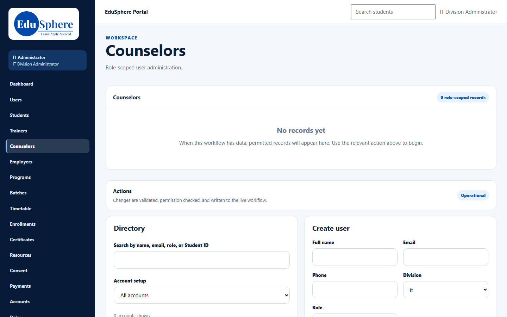
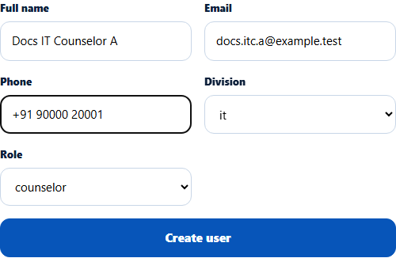
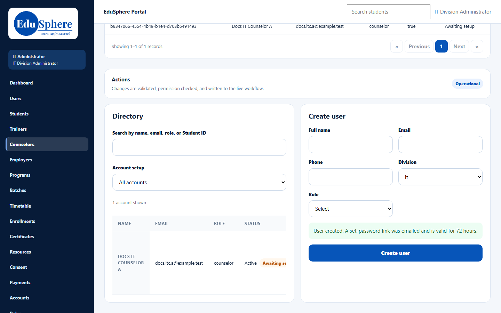
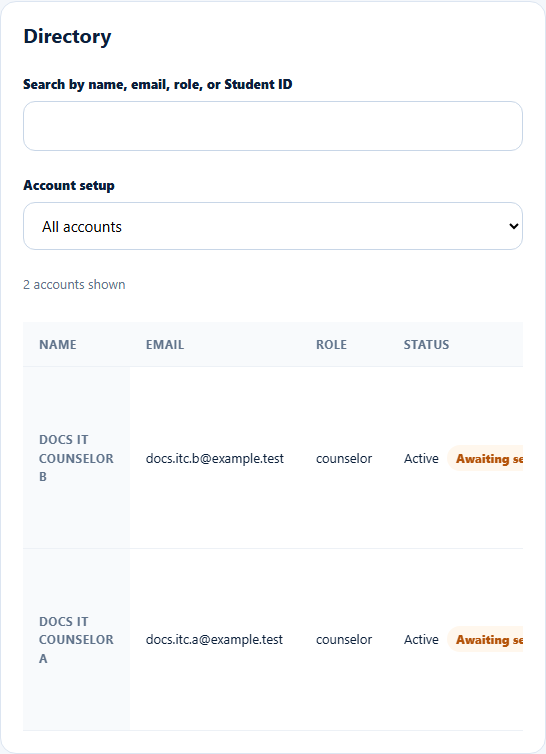
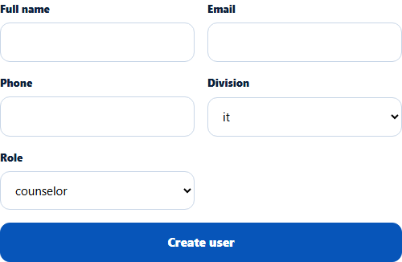
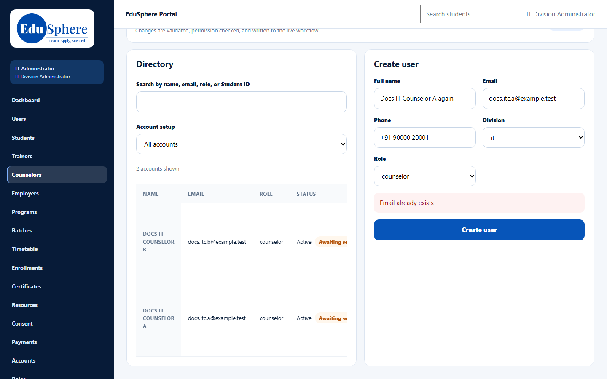

# Create an IT counselor account
> Doc ID: DOC-ITC-ADM-001 · Verified on 2026-11-18 against `main` @ `6b61546c` · Roles: IT Admin, Super Admin

## Purpose
Give a new IT counselor their own EduSphere account. The counselor receives an email with a link to set their password, and can then sign in to the IT portal.

## Who Can Use This Feature
- **IT Admin**: on **Counselors** or **Users** in the IT portal.
- **Super Admin**: on **Users** in the administration portal.

### What each role sees
| | IT Admin | Super Admin |
|---|---|---|
| Where | **Counselors** (or **Users**) | **Users** (`/admin/users`) |
| **Division** | Only **it** | **it**, **overseas** or **global**; starts on **it** |
| **Role** options | IT roles (it student, trainer, placement team, hr team, counselor, coordinator, placement officer, interviewer, it admin) | All roles in every division |

## Prerequisites
- You are signed in as an IT Admin (`/it/login`) or Super Admin (`/admin/login`).
- The counselor's email address is not used by any other EduSphere account.

## How to Access
- IT Admin: sidebar **Counselors**. The **Create user** form is next to the **Directory**.
- Super Admin: sidebar **Users**.

## Steps
### Step 1 — Open Counselors
In the sidebar, select **Counselors**. Before any IT counselor exists, the list says **No records yet**.

### Step 2 — Fill in the Create user form
In **Create user**, enter the counselor's **Full name**, **Email** and **Phone**. Choose **it** in **Division** and **counselor** in **Role**.

### Step 3 — Create the account
Select **Create user**. The message **User created. A set-password link was emailed and is valid for 72 hours.** appears under the form.

### Step 4 — Check the Directory
The new counselor appears in **Directory** as **Active** with **Awaiting setup** until they set their password. The table is wider than the card; scroll it sideways to see every column.

### Super Admin — Create user on /admin/users
On `/admin/users` the **Division** list starts on **it**, so an account created with role **counselor** becomes an IT counselor. Choose **overseas** only if you want an Overseas counselor.

## Fields
| Field | Description | Required | Example |
|---|---|---|---|
| Full name | The counselor's name as students and colleagues see it | Yes | Docs IT Counselor A |
| Email | Sign-in email; the set-password link goes here | Yes | docs.itc.a@example.test |
| Phone | Contact number | No | +91 90000 20001 |
| Division | **it** for IT counselors | Yes | it |
| Role | Choose **counselor** | Yes | counselor |

## Expected Result
- The account exists with **Awaiting setup**.
- A welcome email with a set-password link (valid for 72 hours) is sent to the counselor.
- Once the counselor sets a password, the setup state changes to **Password set**. See [Set your first password](../../user-manual/account-access/auth-002-first-password.md).

## Validation Messages
| Message | When |
|---|---|
| User created. A set-password link was emailed and is valid for 72 hours. | Success |
| Email already exists | Another account already uses this email |
| Cannot create users in another division | An admin tried to create a user outside their own division (from code; not captured) |
| Role is not valid for the selected division | The role does not exist in the chosen division (from code; not captured) |

## Common Errors
**Problem:** "Email already exists". **Cause:** The address belongs to another account, which may be inactive. **Resolution:** Search for it on **Users**. Reactivate that account or use a different email.

**Problem:** The new counselor lands in the Overseas portal or cannot sign in at `/it/login`. **Cause:** The account was created with **Division** **overseas**. **Resolution:** Create the account again with **it**.

**Problem:** The counselor did not get the email. **Resolution:** Re-send the link from **Users**. See [Manage IT counselor users](adm-002-manage-it-counselor-users.md).

## Tips
- The table above the cards shows an internal **reference** code and **true/false** in **Active**; you do not need either to create a counselor.
- Creating the account gives the counselor no leads or students. Leads arrive from the telecaller; students are assigned on **Students** (see Related Features).

## Related Features
- [Manage IT counselor users](adm-002-manage-it-counselor-users.md)
- [Assign or change a student's counselor](adm-003-student-counselor.md)
- [Telecaller hands a lead to an IT counselor](../handoffs/ho-001-telecaller-handover.md)
