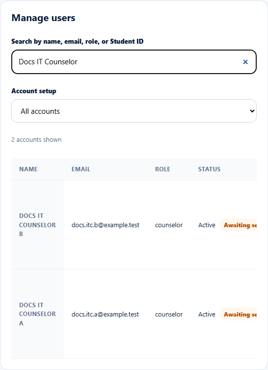
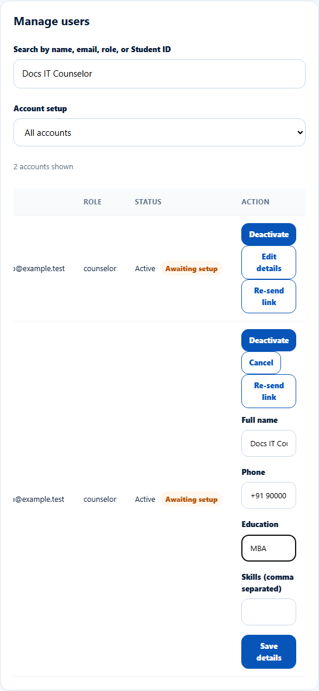
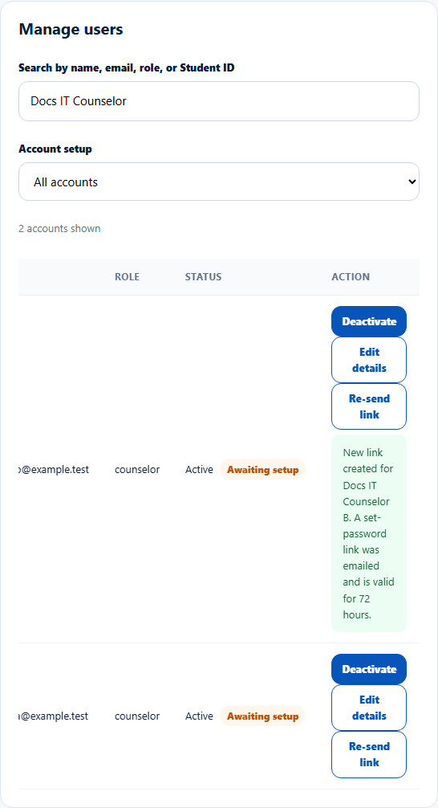

# Manage IT counselor users
> Doc ID: DOC-ITC-ADM-002 · Verified on 2026-11-18 against `main` @ `6b61546c` (edit details, re-send link). Deactivate / reactivate: added in session S10 · Roles: IT Admin, Super Admin

## Purpose
Keep IT counselor accounts up to date: correct their details, send a new set-password link when the first one was lost or expired, and switch an account off when the counselor leaves.

## Who Can Use This Feature
- **IT Admin**: on **Users** (or **Counselors**) in the IT portal.
- **Super Admin**: on **Users** in the administration portal.

## Prerequisites
- You are signed in as an IT Admin or Super Admin.
- The counselor account exists. See [Create an IT counselor account](adm-001-create-it-counselor.md).

## How to Access
Sidebar **Users**. Use the **Manage users** card below the table.

## Steps
### Step 1 — Find the counselor
In **Manage users**, type part of the name, email or role in **Search by name, email, role, or Student ID**. Use **Account setup** to show only **Awaiting setup** or **Link expired** accounts. The table scrolls sideways; the action buttons are on the right.

### Step 2 — Edit details
Select **Edit details** on the counselor's row. Change **Full name**, **Phone**, **Education** or **Skills (comma separated)** and select **Save details**. The message **Details updated.** appears. Select **Cancel** to close the form without saving.

### Step 3 — Re-send the set-password link
**Re-send link** appears only while the account is active and **Awaiting setup** or **Link expired**. Select it. The message **New link created for {name}. A set-password link was emailed and is valid for 72 hours.** appears on the row. The earlier link stops working.

### Step 4 — Deactivate or reactivate
VERIFICATION REQUIRED — captured in session S10.

## Fields
| Field | Description | Required | Example |
|---|---|---|---|
| Full name | Name shown to students and staff | Yes | Docs IT Counselor A |
| Phone | Contact number | No | +91 90000 20001 |
| Education | Free text | No | MBA |
| Skills (comma separated) | Free text list | No | Counselling, Python |

## Expected Result
- Edited details show at once in the list.
- A re-sent link replaces the old one and is valid for 72 hours.

## Validation Messages
| Message | When |
|---|---|
| Details updated. | Edit saved |
| New link created for {name}. A set-password link was emailed and is valid for 72 hours. | Link re-sent |

## Common Errors
**Problem:** There is no **Re-send link** button. **Cause:** The counselor has already set a password, or the account is inactive. **Resolution:** If they forgot their password, ask them to use **Forgot password** on the sign-in page. See [Forgot / reset your password](../../user-manual/account-access/auth-003-forgot-password.md).

**Problem:** You cannot see the counselor's name in the row. **Cause:** The table is wider than the card. **Resolution:** Scroll the table sideways, or widen the browser window.

## Tips
- The email cannot be changed here. To use a new email, create a new account.

## Related Features
- [Create an IT counselor account](adm-001-create-it-counselor.md)
- [Sign out, ended sessions, deactivated account](../../user-manual/account-access/auth-006-sign-out.md)
