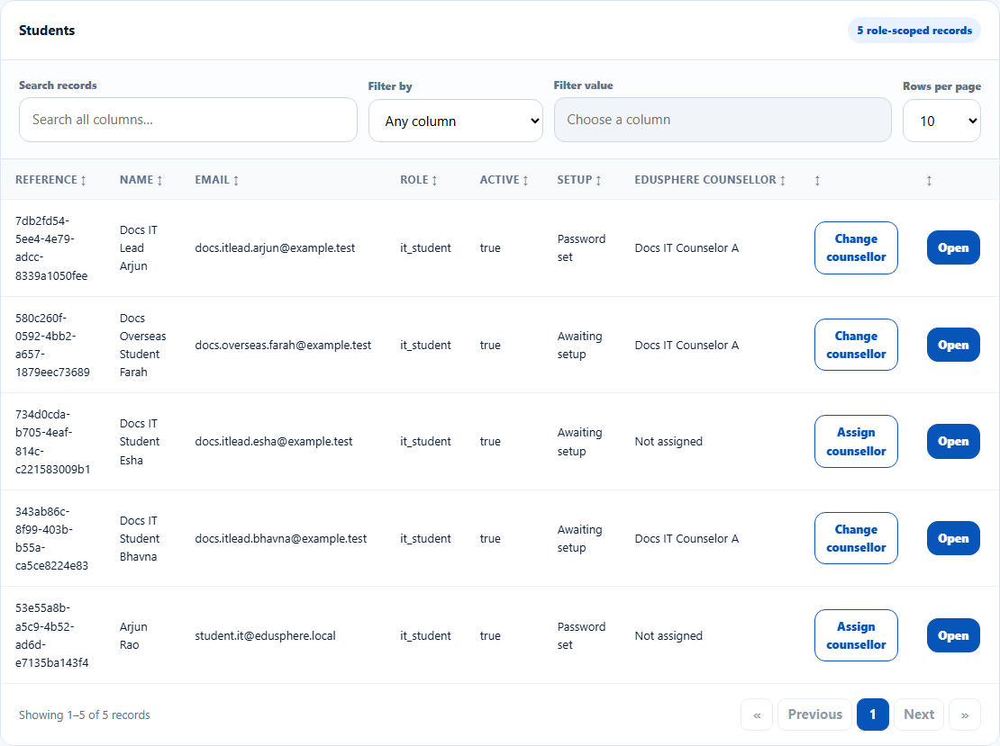
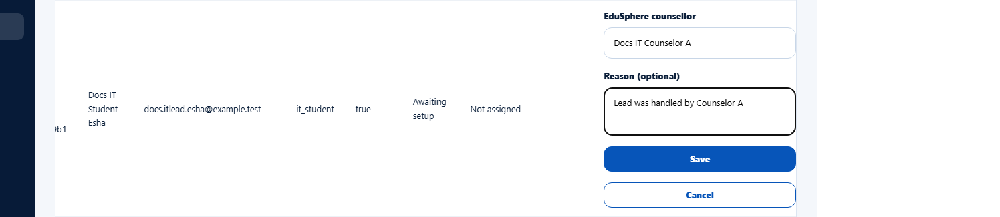
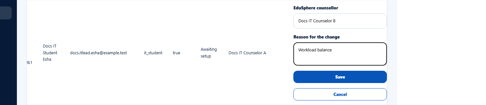
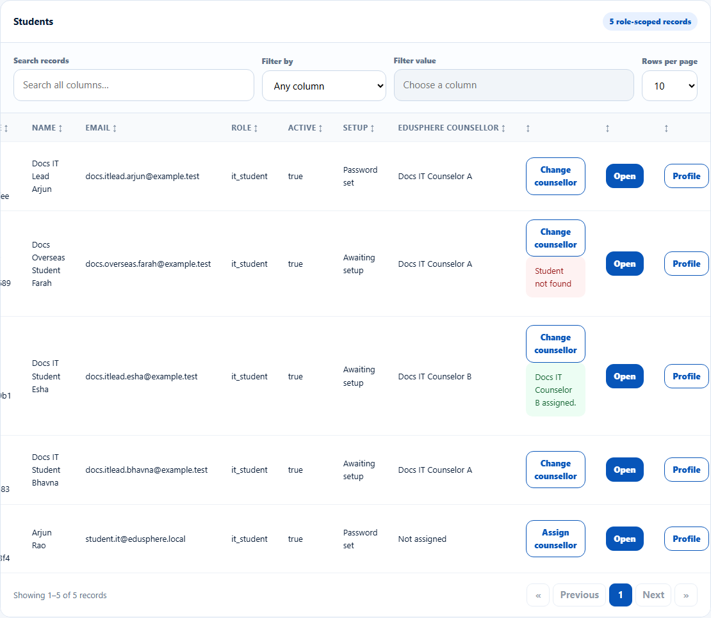
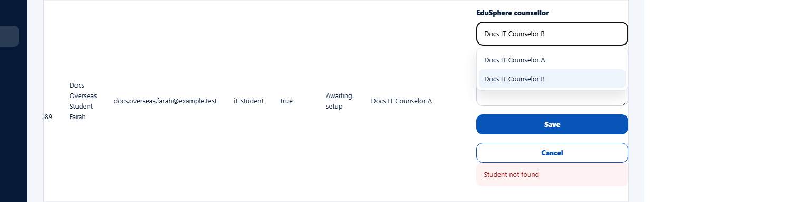

# Assign or change a student's counselor
> Doc ID: DOC-ITC-ADM-003 · Verified on 2026-11-18 against `main` @ `6b61546c` · Roles: IT Admin

## Purpose
Give an IT student a counselor, or move them to another counselor.

## Who Can Use This Feature
- **IT Admin** only. Super Admin cannot.

## Prerequisites
- The new counselor is an active IT counselor.

## How to Access
IT Admin sidebar **Students** → the **Students** table, column **EduSphere counsellor**.

## Steps
### Step 1 — Assign a counselor (no counselor yet)
On a row showing **Not assigned**, select **Assign counsellor**. Type a name in **EduSphere counsellor** and pick the counselor. **Reason (optional)** can be left empty. Select **Save**. The message **{counselor} assigned.** appears.

### Step 2 — Change the counselor
On a row with a counselor, select **Change counsellor**, pick the new counselor and fill **Reason for the change** (required: **Save** stays disabled until you do). Select **Save**. The message **{counselor} assigned.** appears.

## Expected Result
- The new counselor gets **Student assigned to you** with the reason, and the student appears in their **Students**.
- The previous counselor gets **Student reassigned** with the reason. They lose access: the student's pages show **404 This page could not be found.**

## Validation Messages
| Message | When |
|---|---|
| {counselor} assigned. | Saved |
| Student not found | The student joined IT from Overseas (finding P11, below) |
| Choose an active IT counselor | The chosen counselor is not an active IT counselor (from code; not captured) |

## Known limitation (finding P11)
For a student who joined IT from Overseas (for example **Docs Overseas Student Farah**), **Change counsellor** fails with **Student not found**. Their IT counselor cannot be changed here.

## Tips
- Choosing the counselor the student already has changes nothing.

## Related Features
- [My students](../../user-manual/students/stu-001-my-students.md)
- [Notifications](../../user-manual/notifications/notif-001-notifications.md)
