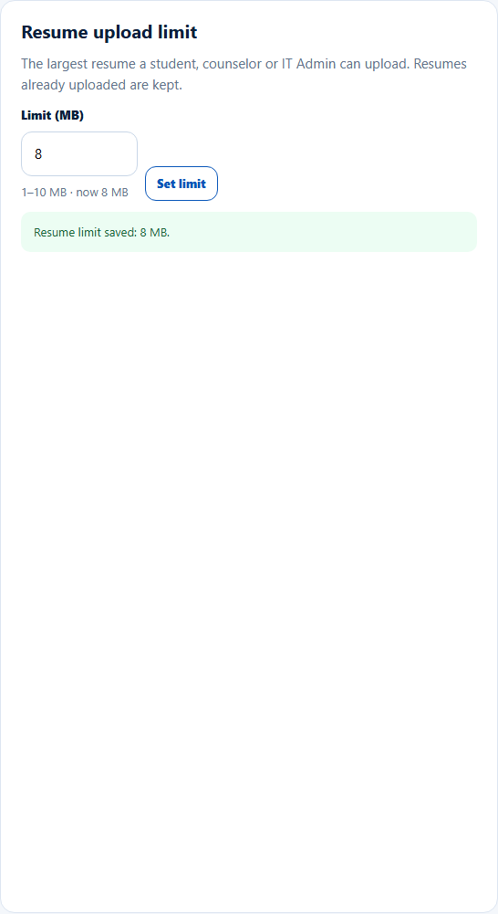

# Resume upload limit
> Doc ID: DOC-ITC-ADM-004 · Verified on 2026-11-18 against `main` @ `6b61546c` · Roles: IT Admin

## Purpose
Set the largest resume file a student, counselor or IT Admin can upload.

## Who Can Use This Feature
- **IT Admin**.

## Prerequisites
- None.

## How to Access
IT Admin sidebar **Students** → card **Resume upload limit** ("The largest resume a student, counselor or IT Admin can upload. Resumes already uploaded are kept.").

## Steps
### Step 1 — Enter the limit
Type a whole number in **Limit (MB)**. The hint shows the allowed range and the current value (**1–10 MB · now 5 MB**).

### Step 2 — Save
Select **Set limit**. The message **Resume limit saved: {n} MB.** appears.

## Fields
| Field | Required | Example |
|---|---|---|
| Limit (MB) | Yes | 5 (default), 1 to 10 |

## Expected Result
New uploads above the limit are refused. The resume upload hint follows it (for example "PDF, DOC or DOCX, up to 5 MB.").

## Validation Messages
| Message | When |
|---|---|
| Resume limit saved: {n} MB. | Saved |
| Enter a whole number from 1 to 10. | Outside 1–10 or not a whole number |

## Tips
- In the demo the limit was set to 8 MB and then back to 5 MB.

## Related Features
- [Student record](../../user-manual/students/stu-003-student-record.md)
