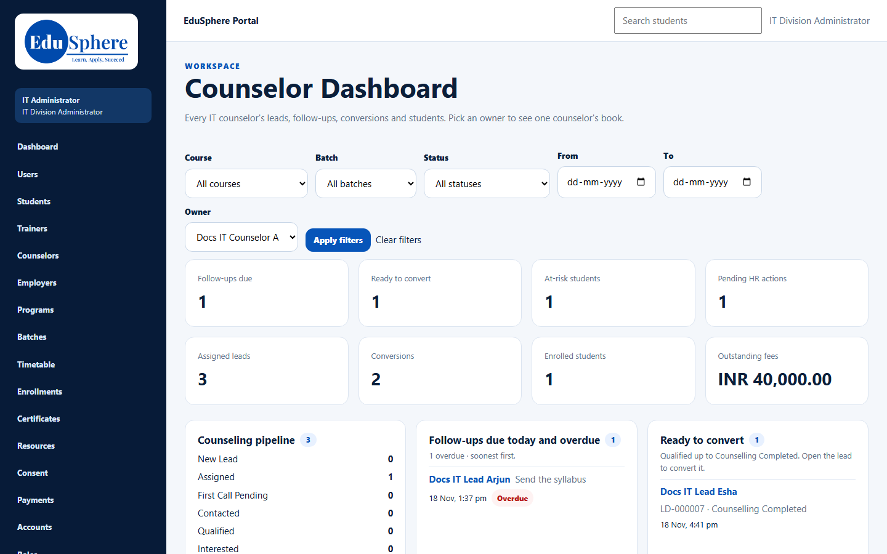

# IT Counselor Dashboard with the Owner filter
> Doc ID: DOC-ITC-ADM-005 · Verified on 2026-11-18 against `main` @ `6b61546c` (state prepared by data setup) · Roles: IT Admin

## Purpose
See every IT counselor's leads, follow-ups, conversions and students, or one counselor's book.

## Who Can Use This Feature
- **IT Admin**.

## Prerequisites
- None.

## How to Access
IT Admin sidebar **Counselor Dashboard** ("Every IT counselor's leads, follow-ups, conversions and students. Pick an owner to see one counselor's book.").

## Steps
### Step 1 — Pick an owner
Use the same filters as the counselor ([Filter the dashboard](../../user-manual/dashboard/dash-002-dashboard-filters.md)) plus **Owner** (**All counselors** or one counselor). Select **Apply filters**.

### Step 2 — Read the tiles and lists
They are the counselor's dashboard ([Counselor dashboard](../../user-manual/dashboard/dash-001-dashboard.md)) for the chosen owner. Names open the IT Admin's lead or student pages.

## Expected Result
With **Docs IT Counselor A** chosen, the figures match what Counselor A sees on their own dashboard.

## Related Features
- [Counselor dashboard](../../user-manual/dashboard/dash-001-dashboard.md)
