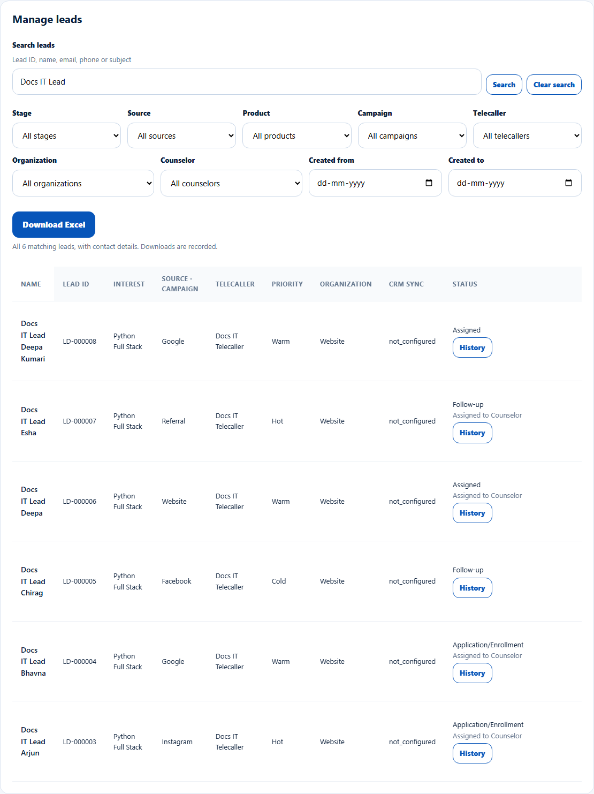
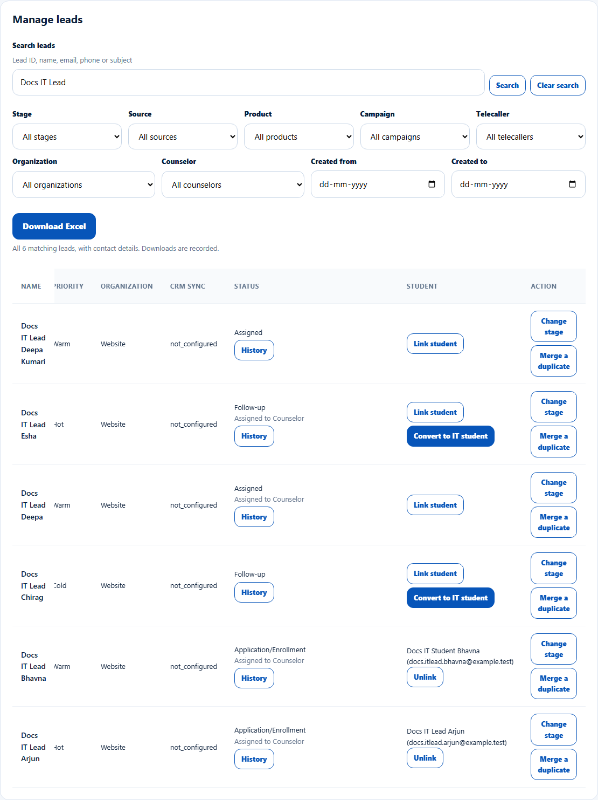
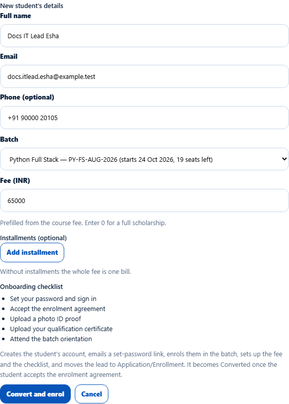

# Admin leads: convert, change stage, link
> Doc ID: DOC-ITC-ADM-006 · Verified on 2026-11-18 against `main` @ `6b61546c` · Roles: IT Admin

## Purpose
See every IT lead, whoever owns it, and act on it: convert, link a student, change the stage, view history or merge duplicates.

## Who Can Use This Feature
- **IT Admin**.

## Prerequisites
- You are signed in as IT Admin.

## How to Access
IT Admin sidebar **Leads** → card **Manage leads**.

## Steps
### Step 1 — Search and filter
Type in **Search leads** (Lead ID, name, email, phone or subject) and select **Search**. Filter by **Stage**, **Source**, **Product**, **Campaign**, **Telecaller**, **Organization**, **Counselor**, **Created from** and **Created to**. **Download Excel** downloads the matching leads with contact details; downloads are recorded.

### Step 2 — Scroll to the actions
The table is wider than the card. Scroll it sideways to see **Student** (**Link student** / **Unlink** and **Convert to IT student**) and **Action** (**Change stage**, **Merge a duplicate**). **Status** shows the stage and, for leads with a counselor, **Assigned to Counselor**, with **History**.

### Step 3 — Convert a lead
Select **Convert to IT student** on the row. The same form as the counselor's opens. See [Convert a lead to a new IT student](../../user-manual/conversion/conv-001-convert-new-student.md).

## Expected Result
You can act on any IT lead.

## Tips
- **Link student** asks for the student account's email.
- **CRM sync** shows `not_configured` when no external CRM is connected.
- For merging, see [Merge a duplicate lead](adm-007-merge-duplicate.md).

## Related Features
- [Merge a duplicate lead](adm-007-merge-duplicate.md)
- [Status labels](adm-013-status-labels.md)
