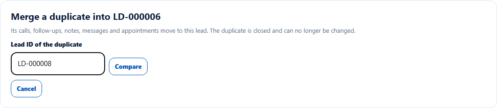
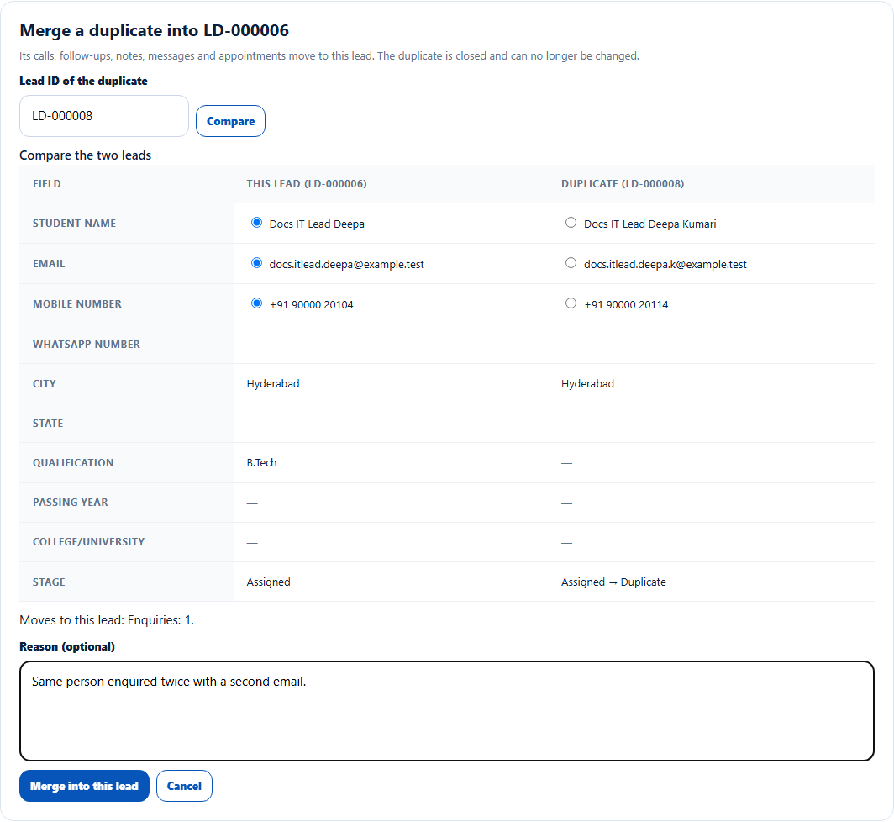
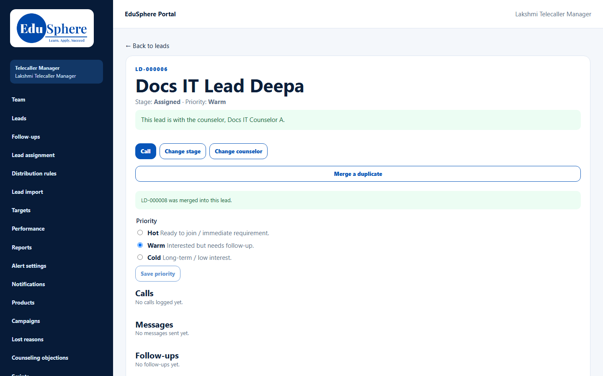
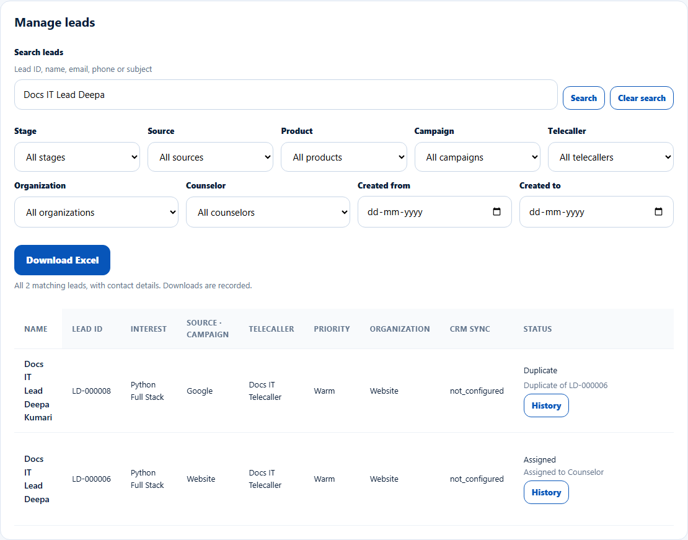

# Merge a duplicate lead
> Doc ID: DOC-ITC-ADM-007 · Verified on 2026-11-18 against `main` @ `6b61546c` · Roles: Telecaller Manager, IT Admin

## Purpose
When one person was entered twice, fold the duplicate lead into the real one so all calls, follow-ups, notes, messages and appointments sit on one lead.

## Who Can Use This Feature
- **Telecaller Manager**: on the lead page (`/telecaller/manager/leads/{id}`), shown below.
- **IT Admin**: **Leads** → **Merge a duplicate** in the row's **Action** column. The form opens inside that narrow column; widen the window or use the Telecaller Manager's page.

## Prerequisites
- You know the **Lead ID** of the duplicate (for example **LD-000008**).

## How to Access
Open the lead you want to **keep** → **Merge a duplicate**.

## Steps
### Step 1 — Enter the duplicate's Lead ID
Select **Merge a duplicate**. The section **Merge a duplicate into {Lead ID}** explains: "Its calls, follow-ups, notes, messages and appointments move to this lead. The duplicate is closed and can no longer be changed." Enter **Lead ID of the duplicate** and select **Compare**.

### Step 2 — Compare and choose values
A table compares **This lead** and **Duplicate** field by field. For fields that differ, pick which value to keep. The **Stage** row shows the duplicate will become **Duplicate**, and "Moves to this lead" lists what moves. Optionally add a **Reason (optional)**.

### Step 3 — Merge
Select **Merge into this lead**. The message **{duplicate Lead ID} was merged into this lead.** appears.

## Expected Result
- The duplicate's stage is **Duplicate** with "Duplicate of {Lead ID}" and it can no longer be changed.
- Its activity now sits on the lead you kept.

## Validation Messages
| Message | When |
|---|---|
| {Lead ID} was merged into this lead. | Success |

## Tips
- Merge into the lead the counselor is already working on.

## Related Features
- [Admin leads](adm-006-admin-leads.md)
